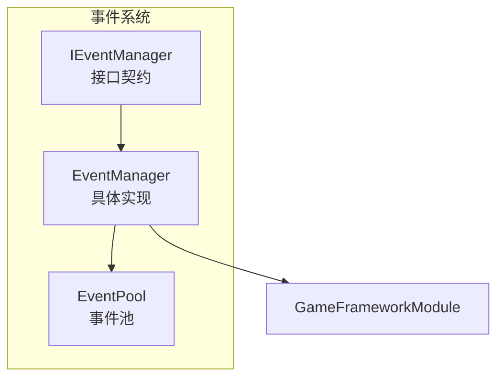
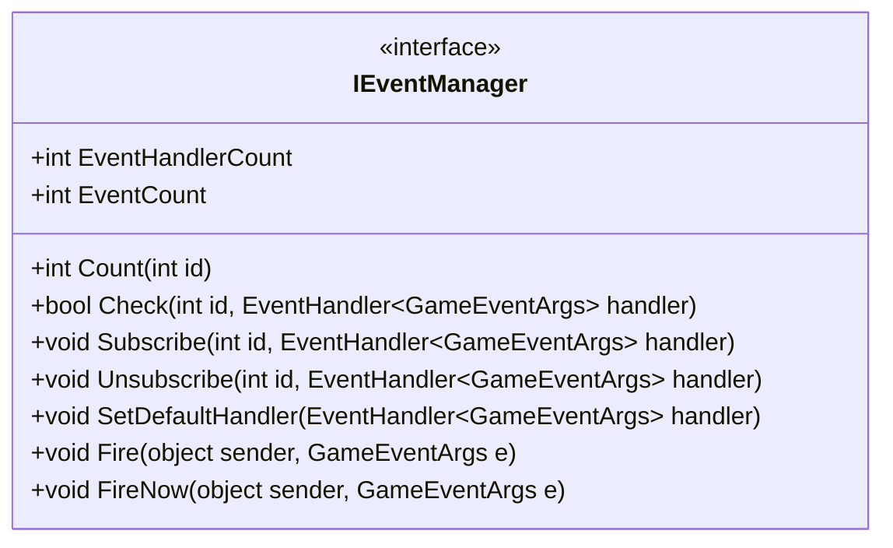
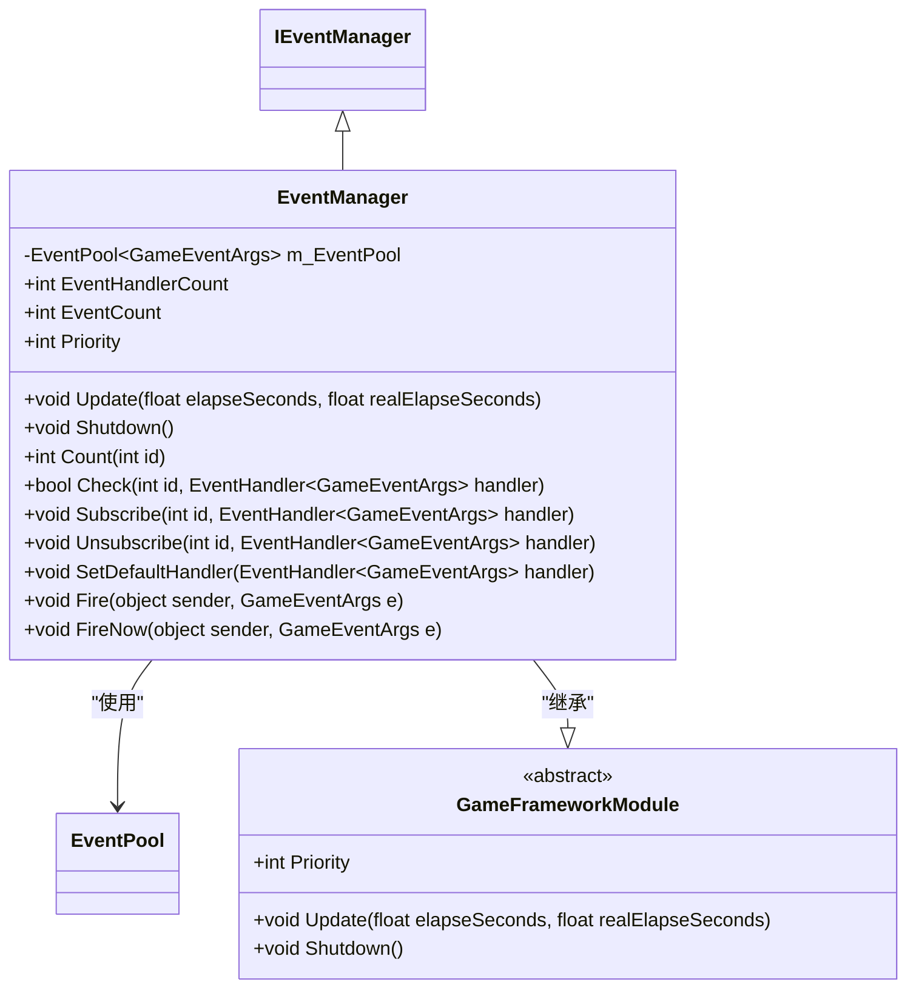
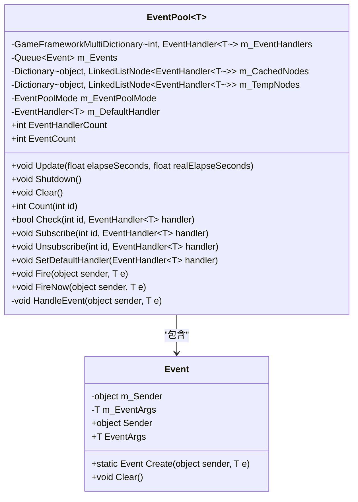
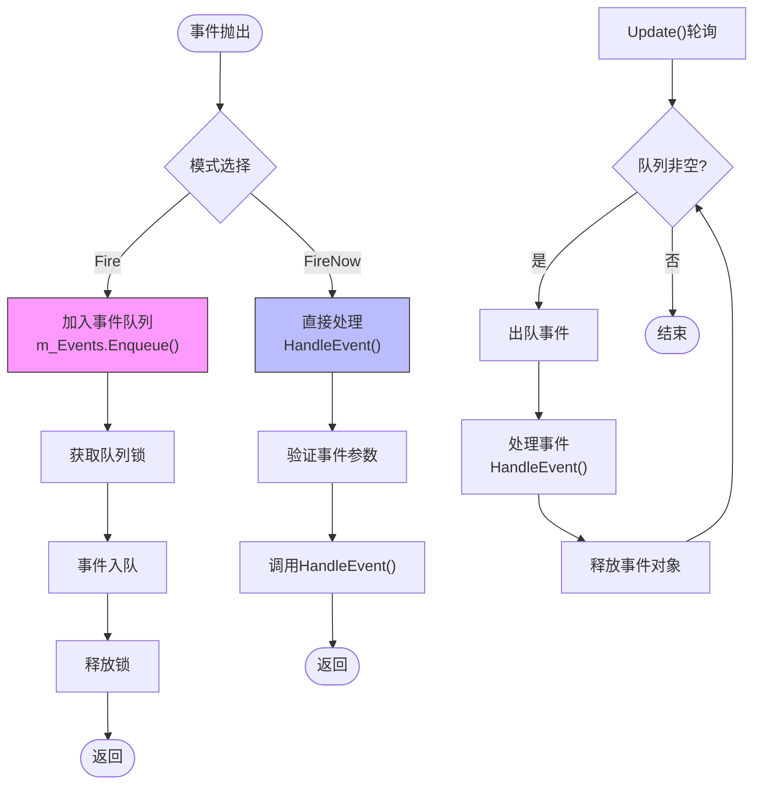
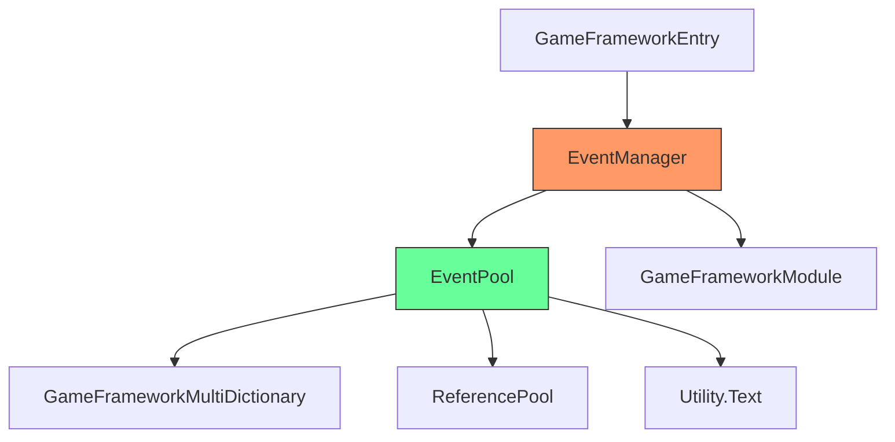

# 事件系统核心机制

<cite>
**Referenced Files in This Document**   
- [IEventManager.cs](file://GameFramework/Event/IEventManager.cs)
- [EventManager.cs](file://GameFramework/Event/EventManager.cs)
- [EventPool.cs](file://GameFramework/Base/EventPool/EventPool.cs)
- [EventPool.Event.cs](file://GameFramework/Base/EventPool/EventPool.Event.cs)
- [GameFrameworkModule.cs](file://GameFramework/Base/GameFrameworkModule.cs)
</cite>

## 目录
1. [简介](#简介)
2. [核心组件](#核心组件)
3. [架构概览](#架构概览)
4. [详细组件分析](#详细组件分析)
5. [依赖分析](#依赖分析)
6. [性能考量](#性能考量)
7. [故障排除指南](#故障排除指南)
8. [结论](#结论)

## 简介
本文档深入解析了游戏框架中的事件系统核心架构，重点阐述了事件管理的契约定义、具体实现以及其在框架生命周期中的作用。事件系统作为游戏框架的核心通信机制，提供了线程安全的事件订阅、发布和处理功能，支持异步和即时两种事件分发模式。

## 核心组件
事件系统由多个核心组件构成，包括定义事件管理契约的`IEventManager`接口、实现具体功能的`EventManager`类以及提供底层事件池功能的`EventPool<T>`泛型类。这些组件共同协作，实现了高效、安全的事件处理机制。

**Section sources**
- [IEventManager.cs](file://GameFramework/Event/IEventManager.cs#L14-L80)
- [EventManager.cs](file://GameFramework/Event/EventManager.cs#L14-L147)
- [EventPool.cs](file://GameFramework/Base/EventPool/EventPool.cs#L29-L37)

## 架构概览
事件系统采用分层架构设计，上层`EventManager`实现了`IEventManager`接口并继承自`GameFrameworkModule`，下层`EventPool<T>`提供了具体的事件管理功能。这种设计实现了接口与实现的分离，同时确保了事件系统能够融入框架的生命周期管理。

**Diagram sources **
- [IEventManager.cs](file://GameFramework/Event/IEventManager.cs#L14-L80)
- [EventManager.cs](file://GameFramework/Event/EventManager.cs#L14-L147)
- [EventPool.cs](file://GameFramework/Base/EventPool/EventPool.cs#L29-L37)

**Section sources**
- [EventManager.cs](file://GameFramework/Event/EventManager.cs#L14-L147)

## 详细组件分析

### IEventManager接口分析
`IEventManager`接口定义了事件管理的核心契约，包括事件的订阅、取消订阅、抛出等操作。该接口提供了统一的访问点，使得上层代码可以不依赖于具体实现。

**Diagram sources **
- [IEventManager.cs](file://GameFramework/Event/IEventManager.cs#L14-L80)

**Section sources**
- [IEventManager.cs](file://GameFramework/Event/IEventManager.cs#L14-L80)

### EventManager实现分析
`EventManager`是`IEventManager`接口的具体实现，它继承自`GameFrameworkModule`并集成`EventPool<GameEventArgs>`。该类通过委托调用`EventPool`的方法来实现接口契约。

**Diagram sources **
- [EventManager.cs](file://GameFramework/Event/EventManager.cs#L14-L147)
- [GameFrameworkModule.cs](file://GameFramework/Base/GameFrameworkModule.cs#L12-L37)

**Section sources**
- [EventManager.cs](file://GameFramework/Event/EventManager.cs#L14-L147)

### EventPool事件池分析
`EventPool<T>`是事件系统的核心数据结构，负责管理事件的存储、分发和处理。它使用多字典存储事件处理函数，队列存储待处理事件，并通过锁机制保证线程安全。

**Diagram sources **
- [EventPool.cs](file://GameFramework/Base/EventPool/EventPool.cs#L29-L37)
- [EventPool.Event.cs](file://GameFramework/Base/EventPool/EventPool.Event.cs#L9-L55)

**Section sources**
- [EventPool.cs](file://GameFramework/Base/EventPool/EventPool.cs#L29-L37)
- [EventPool.Event.cs](file://GameFramework/Base/EventPool/EventPool.Event.cs#L9-L55)

### 事件处理流程分析
事件系统支持两种事件分发模式：异步分发（Fire）和即时分发（FireNow）。异步模式通过事件队列实现线程安全，而即时模式则直接调用处理函数。

**Diagram sources **
- [EventPool.cs](file://GameFramework/Base/EventPool/EventPool.cs#L29-L37)
- [EventPool.Event.cs](file://GameFramework/Base/EventPool/EventPool.Event.cs#L9-L55)

**Section sources**
- [EventPool.cs](file://GameFramework/Base/EventPool/EventPool.cs#L29-L37)

## 依赖分析
事件系统与其他框架模块存在明确的依赖关系，它依赖于基础工具类如`GameFrameworkMultiDictionary`、`ReferencePool`等，同时作为独立模块被框架核心管理。

**Diagram sources **
- [EventManager.cs](file://GameFramework/Event/EventManager.cs#L14-L147)
- [EventPool.cs](file://GameFramework/Base/EventPool/EventPool.cs#L29-L37)
- [GameFrameworkModule.cs](file://GameFramework/Base/GameFrameworkModule.cs#L12-L37)

**Section sources**
- [EventManager.cs](file://GameFramework/Event/EventManager.cs#L14-L147)

## 性能考量
事件系统在设计时充分考虑了性能因素，通过对象池（ReferencePool）减少GC压力，使用高效的多字典结构存储事件处理函数，并通过合理的锁粒度保证线程安全。

- **对象复用**：事件对象通过`ReferencePool`进行复用，避免频繁的内存分配和垃圾回收
- **数据结构**：使用`GameFrameworkMultiDictionary`实现O(1)平均时间复杂度的事件处理函数查找
- **线程安全**：仅在事件入队时加锁，减少锁竞争
- **内存效率**：事件处理过程中使用缓存字典避免迭代器无效化问题

## 故障排除指南
当事件系统出现异常时，可参考以下常见问题及解决方案：

**Section sources**
- [EventPool.cs](file://GameFramework/Base/EventPool/EventPool.cs#L29-L37)
- [EventManager.cs](file://GameFramework/Event/EventManager.cs#L14-L147)

### 事件未被处理
- **检查订阅**：确认事件处理函数已正确订阅
- **检查ID**：确认事件ID与订阅时一致
- **检查模式**：若使用`FireNow`，确保在主线程调用

### 多次触发问题
- **检查重复订阅**：确保没有多次调用`Subscribe`
- **检查取消订阅**：在对象销毁时及时调用`Unsubscribe`

### 性能问题
- **减少事件频率**：避免在每帧抛出大量事件
- **优化处理函数**：确保事件处理函数执行效率
- **检查内存泄漏**：确保事件对象被正确释放

## 结论
事件系统通过清晰的分层架构和精心设计的实现，提供了高效、安全的事件管理功能。`IEventManager`接口定义了明确的契约，`EventManager`实现了框架集成，而`EventPool<T>`提供了强大的底层支持。系统通过异步和即时两种模式满足不同场景需求，同时保证了线程安全和性能效率。模块优先级设置为7确保了其在框架生命周期中的合理位置，而完整的清理流程保证了资源的正确释放。