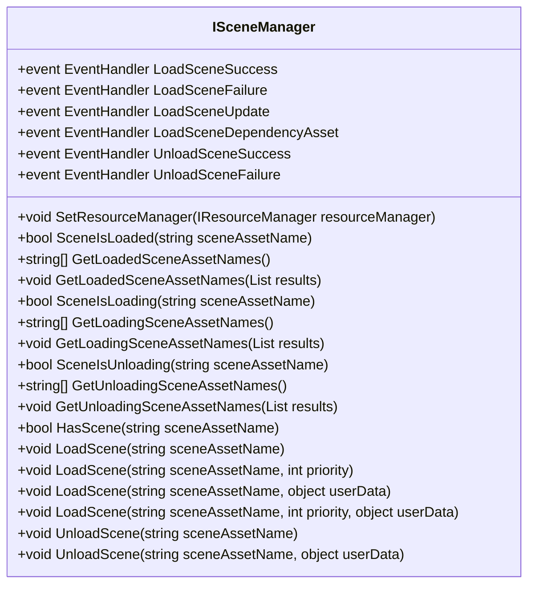
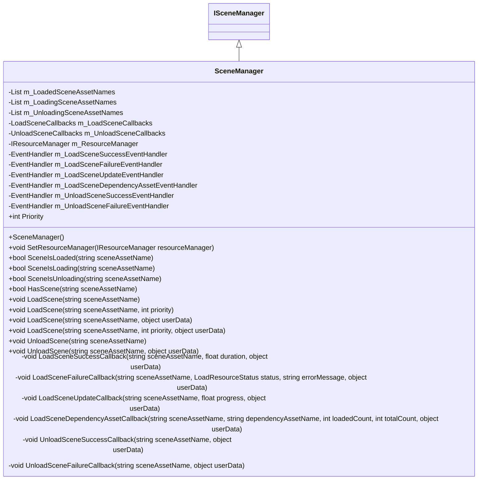
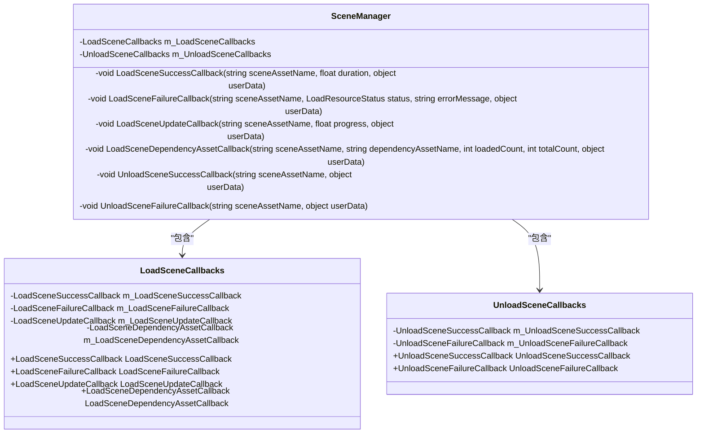
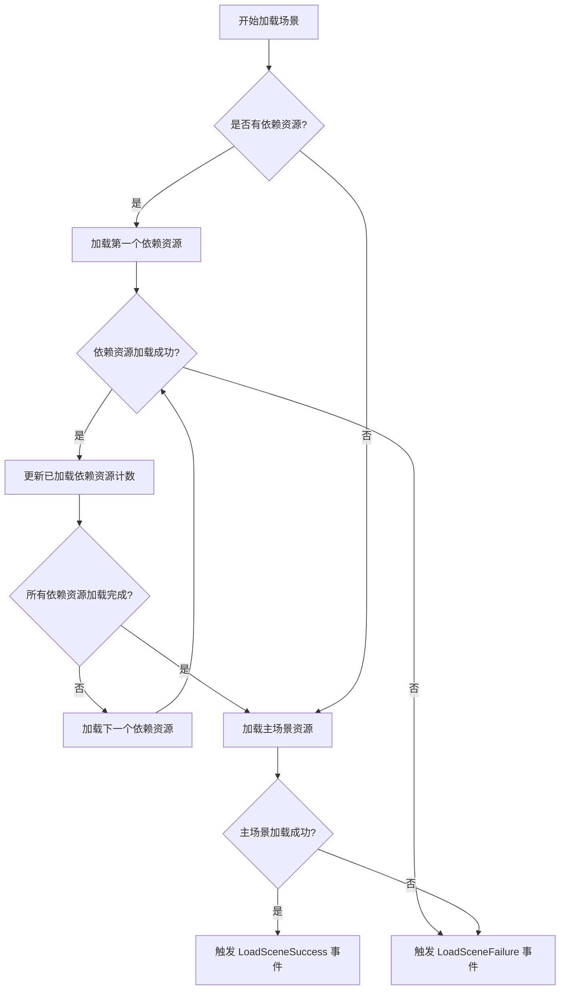
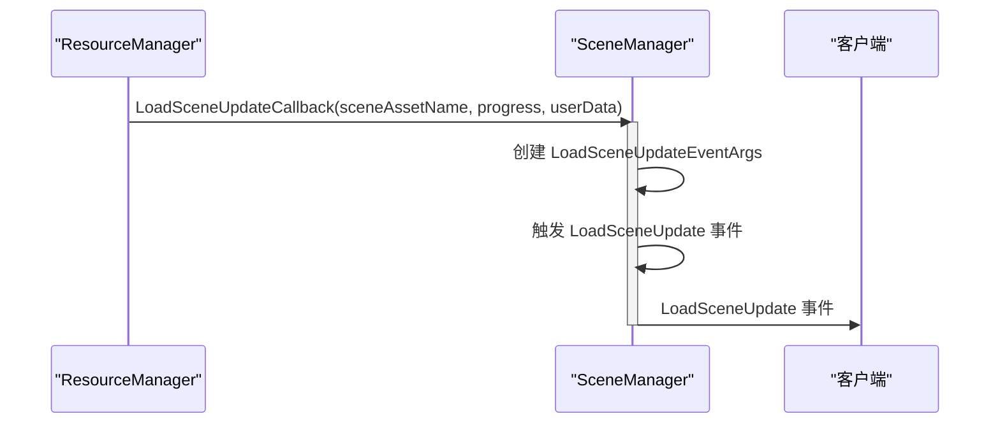
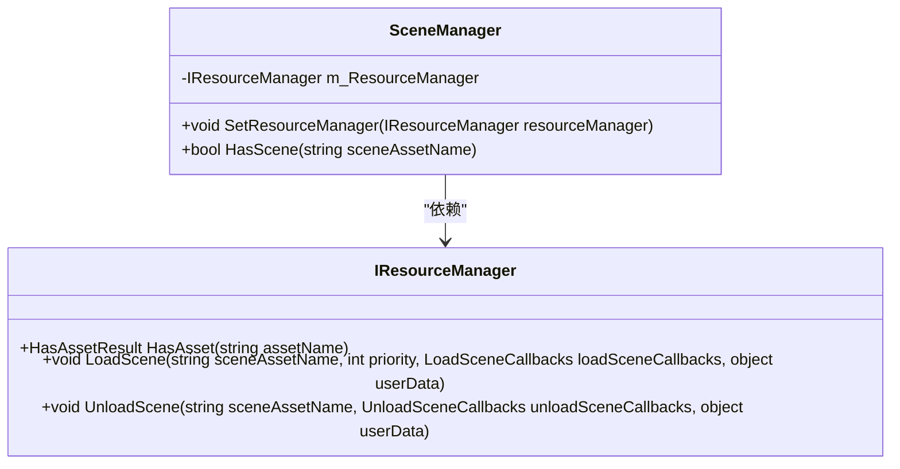
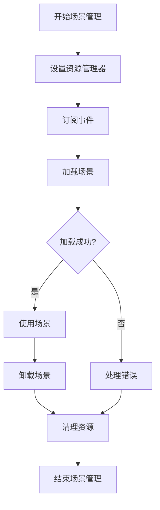

# 场景管理

<cite>
**本文档引用的文件**
- [ISceneManager.cs](file://GameFramework/Scene/ISceneManager.cs)
- [SceneManager.cs](file://GameFramework/Scene/SceneManager.cs)
- [LoadSceneUpdateEventArgs.cs](file://GameFramework/Scene/LoadSceneUpdateEventArgs.cs)
- [LoadSceneSuccessEventArgs.cs](file://GameFramework/Scene/LoadSceneSuccessEventArgs.cs)
- [LoadSceneFailureEventArgs.cs](file://GameFramework/Scene/LoadSceneFailureEventArgs.cs)
- [LoadSceneDependencyAssetEventArgs.cs](file://GameFramework/Scene/LoadSceneDependencyAssetEventArgs.cs)
- [UnloadSceneSuccessEventArgs.cs](file://GameFramework/Scene/UnloadSceneSuccessEventArgs.cs)
- [UnloadSceneFailureEventArgs.cs](file://GameFramework/Scene/UnloadSceneFailureEventArgs.cs)
- [LoadSceneCallbacks.cs](file://GameFramework/Resource/LoadSceneCallbacks.cs)
- [UnloadSceneCallbacks.cs](file://GameFramework/Resource/UnloadSceneCallbacks.cs)
</cite>

## 目录
1. [简介](#简介)
2. [核心接口](#核心接口)
3. [场景加载与卸载机制](#场景加载与卸载机制)
4. [事件系统与回调机制](#事件系统与回调机制)
5. [依赖资源处理](#依赖资源处理)
6. [加载进度反馈](#加载进度反馈)
7. [资源管理协同](#资源管理协同)
8. [最佳实践](#最佳实践)

## 简介
场景管理模块负责游戏运行时场景的异步加载、卸载、多场景叠加等核心功能。该模块通过与资源管理系统的深度集成，实现了高效的场景资源管理，支持加载优先级设置、进度反馈、依赖资源处理等高级功能。场景管理器采用事件驱动架构，通过事件订阅机制通知外部系统场景状态变化。

## 核心接口

### ISceneManager 接口
`ISceneManager` 接口定义了场景管理器的核心功能，包括场景状态查询、加载/卸载操作以及事件订阅。



**图示来源**
- [ISceneManager.cs](file://GameFramework/Scene/ISceneManager.cs#L16-L158)

**本节来源**
- [ISceneManager.cs](file://GameFramework/Scene/ISceneManager.cs#L16-L158)

### SceneManager 实现
`SceneManager` 类实现了 `ISceneManager` 接口，是场景管理功能的具体实现。它维护了三个内部列表来跟踪场景状态：已加载场景、正在加载场景和正在卸载场景。



**图示来源**
- [SceneManager.cs](file://GameFramework/Scene/SceneManager.cs#L16-L506)

**本节来源**
- [SceneManager.cs](file://GameFramework/Scene/SceneManager.cs#L16-L506)

## 场景加载与卸载机制

### 加载机制
场景加载通过 `LoadScene` 方法实现，支持多种重载形式，允许指定优先级和用户自定义数据。加载过程包含严格的前置条件检查：

1. 验证场景资源名称有效性
2. 确保资源管理器已设置
3. 检查场景是否正在加载、卸载或已加载

```mermaid
sequenceDiagram
participant Client as "客户端"
participant SceneManager as "SceneManager"
participant ResourceManager as "ResourceManager"
Client->>SceneManager : LoadScene(sceneAssetName, priority, userData)
activate SceneManager
SceneManager->>SceneManager : 验证参数和状态
alt 状态检查失败
SceneManager-->>Client : 抛出 GameFrameworkException
deactivate SceneManager
else 状态检查通过
SceneManager->>SceneManager : 添加到 m_LoadingSceneAssetNames
SceneManager->>ResourceManager : LoadScene(sceneAssetName, priority, callbacks, userData)
deactivate SceneManager
end
```

**图示来源**
- [SceneManager.cs](file://GameFramework/Scene/SceneManager.cs#L358-L387)
- [SceneManager.cs](file://GameFramework/Scene/SceneManager.cs#L434-L444)

**本节来源**
- [SceneManager.cs](file://GameFramework/Scene/SceneManager.cs#L358-L387)

### 卸载机制
场景卸载通过 `UnloadScene` 方法实现，同样支持多种重载形式。卸载过程也包含严格的前置条件检查：

1. 验证场景资源名称有效性
2. 确保资源管理器已设置
3. 检查场景是否正在加载、卸载或未加载

```mermaid
sequenceDiagram
participant Client as "客户端"
participant SceneManager as "SceneManager"
participant ResourceManager as "ResourceManager"
Client->>SceneManager : UnloadScene(sceneAssetName, userData)
activate SceneManager
SceneManager->>SceneManager : 验证参数和状态
alt 状态检查失败
SceneManager-->>Client : 抛出 GameFrameworkException
deactivate SceneManager
else 状态检查通过
SceneManager->>SceneManager : 添加到 m_UnloadingSceneAssetNames
SceneManager->>ResourceManager : UnloadScene(sceneAssetName, callbacks, userData)
deactivate SceneManager
end
```

**图示来源**
- [SceneManager.cs](file://GameFramework/Scene/SceneManager.cs#L403-L432)
- [SceneManager.cs](file://GameFramework/Scene/SceneManager.cs#L481-L491)

**本节来源**
- [SceneManager.cs](file://GameFramework/Scene/SceneManager.cs#L403-L432)

## 事件系统与回调机制

### 事件定义
场景管理器提供了丰富的事件系统，用于通知外部系统场景状态的变化。这些事件基于 .NET 的事件机制实现，支持多播订阅。

```mermaid
classDiagram
class LoadSceneSuccessEventArgs {
+string SceneAssetName
+float Duration
+object UserData
+static LoadSceneSuccessEventArgs Create(string sceneAssetName, float duration, object userData)
}
class LoadSceneFailureEventArgs {
+string SceneAssetName
+string ErrorMessage
+object UserData
+static LoadSceneFailureEventArgs Create(string sceneAssetName, string errorMessage, object userData)
}
class LoadSceneUpdateEventArgs {
+string SceneAssetName
+float Progress
+object UserData
+static LoadSceneUpdateEventArgs Create(string sceneAssetName, float progress, object userData)
}
class LoadSceneDependencyAssetEventArgs {
+string SceneAssetName
+string DependencyAssetName
+int LoadedCount
+int TotalCount
+object UserData
+static LoadSceneDependencyAssetEventArgs Create(string sceneAssetName, string dependencyAssetName, int loadedCount, int totalCount, object userData)
}
class UnloadSceneSuccessEventArgs {
+string SceneAssetName
+object UserData
+static UnloadSceneSuccessEventArgs Create(string sceneAssetName, object userData)
}
class UnloadSceneFailureEventArgs {
+string SceneAssetName
+object UserData
+static UnloadSceneFailureEventArgs Create(string sceneAssetName, object userData)
}
LoadSceneSuccessEventArgs --|> GameFrameworkEventArgs
LoadSceneFailureEventArgs --|> GameFrameworkEventArgs
LoadSceneUpdateEventArgs --|> GameFrameworkEventArgs
LoadSceneDependencyAssetEventArgs --|> GameFrameworkEventArgs
UnloadSceneSuccessEventArgs --|> GameFrameworkEventArgs
UnloadSceneFailureEventArgs --|> GameFrameworkEventArgs
```



**图示来源**
- [LoadSceneSuccessEventArgs.cs](file://GameFramework/Scene/LoadSceneSuccessEventArgs.cs#L12-L76)
- [LoadSceneFailureEventArgs.cs](file://GameFramework/Scene/LoadSceneFailureEventArgs.cs#L12-L76)
- [LoadSceneUpdateEventArgs.cs](file://GameFramework/Scene/LoadSceneUpdateEventArgs.cs#L12-L76)
- [LoadSceneDependencyAssetEventArgs.cs](file://GameFramework/Scene/LoadSceneDependencyAssetEventArgs.cs#L12-L102)
- [UnloadSceneSuccessEventArgs.cs](file://GameFramework/Scene/UnloadSceneSuccessEventArgs.cs#L12-L63)
- [UnloadSceneFailureEventArgs.cs](file://GameFramework/Scene/UnloadSceneFailureEventArgs.cs#L12-L63)

**本节来源**
- [LoadSceneSuccessEventArgs.cs](file://GameFramework/Scene/LoadSceneSuccessEventArgs.cs#L12-L76)
- [LoadSceneFailureEventArgs.cs](file://GameFramework/Scene/LoadSceneFailureEventArgs.cs#L12-L76)
- [LoadSceneUpdateEventArgs.cs](file://GameFramework/Scene/LoadSceneUpdateEventArgs.cs#L12-L76)

### 回调机制
场景管理器使用 `LoadSceneCallbacks` 和 `UnloadSceneCallbacks` 类来封装回调函数，这些回调函数在场景加载/卸载过程中被资源管理器调用。



**图示来源**
- [LoadSceneCallbacks.cs](file://GameFramework/Resource/LoadSceneCallbacks.cs#L12-L143)
- [UnloadSceneCallbacks.cs](file://GameFramework/Resource/UnloadSceneCallbacks.cs#L12-L63)
- [SceneManager.cs](file://GameFramework/Scene/SceneManager.cs#L434-L505)

**本节来源**
- [LoadSceneCallbacks.cs](file://GameFramework/Resource/LoadSceneCallbacks.cs#L12-L143)
- [UnloadSceneCallbacks.cs](file://GameFramework/Resource/UnloadSceneCallbacks.cs#L12-L63)

## 依赖资源处理
场景管理器在加载场景时会自动处理依赖资源。当场景资源有依赖的其他资源时，这些依赖资源会按照依赖关系被依次加载。



当加载依赖资源时，场景管理器会触发 `LoadSceneDependencyAsset` 事件，提供以下信息：
- `SceneAssetName`: 正在加载的场景资源名称
- `DependencyAssetName`: 当前正在加载的依赖资源名称
- `LoadedCount`: 已加载的依赖资源数量
- `TotalCount`: 总共需要加载的依赖资源数量
- `UserData`: 用户自定义数据

**本节来源**
- [SceneManager.cs](file://GameFramework/Scene/SceneManager.cs#L471-L479)
- [LoadSceneDependencyAssetEventArgs.cs](file://GameFramework/Scene/LoadSceneDependencyAssetEventArgs.cs#L12-L102)

## 加载进度反馈
场景管理器提供实时的加载进度反馈，通过 `LoadSceneUpdate` 事件通知外部系统当前的加载进度。



加载进度以 0.0 到 1.0 的浮点数表示，其中：
- 0.0 表示加载刚开始
- 1.0 表示加载完成
- 中间值表示当前的加载进度

进度计算考虑了依赖资源的加载情况，确保进度反馈的准确性。例如，如果有 10 个依赖资源和 1 个主场景资源，每个资源的权重相等，则每加载完一个资源，进度增加约 9.1%。

**本节来源**
- [SceneManager.cs](file://GameFramework/Scene/SceneManager.cs#L461-L469)
- [LoadSceneUpdateEventArgs.cs](file://GameFramework/Scene/LoadSceneUpdateEventArgs.cs#L12-L76)

## 资源管理协同
场景管理器与资源管理器紧密协作，通过 `SetResourceManager` 方法建立连接。



场景管理器依赖资源管理器完成实际的资源加载和卸载操作，自身主要负责：
1. 状态管理：维护场景的加载、卸载状态
2. 事件分发：将资源管理器的回调转换为事件
3. 状态查询：提供场景状态查询接口
4. 生命周期管理：在关闭时清理所有已加载的场景

`HasScene` 方法通过调用资源管理器的 `HasAsset` 方法来检查场景资源是否存在，确保场景加载前资源的可用性。

**图示来源**
- [SceneManager.cs](file://GameFramework/Scene/SceneManager.cs#L186-L194)
- [SceneManager.cs](file://GameFramework/Scene/SceneManager.cs#L318-L321)

**本节来源**
- [SceneManager.cs](file://GameFramework/Scene/SceneManager.cs#L186-L194)
- [SceneManager.cs](file://GameFramework/Scene/SceneManager.cs#L318-L321)

## 最佳实践

### 场景切换最佳实践
1. **状态检查**: 在加载或卸载场景前，先检查场景的当前状态
2. **错误处理**: 订阅 `LoadSceneFailure` 和 `UnloadSceneFailure` 事件，妥善处理加载失败的情况
3. **资源释放**: 在场景卸载后，及时释放相关资源，避免内存泄漏
4. **用户反馈**: 利用 `LoadSceneUpdate` 事件更新加载进度条，提供良好的用户体验

### 资源释放策略
1. **引用计数**: 使用引用池管理事件参数对象，避免频繁的 GC
2. **及时清理**: 在 `Shutdown` 方法中清理所有已加载的场景
3. **异常安全**: 在异常情况下确保场景状态的一致性



**本节来源**
- [SceneManager.cs](file://GameFramework/Scene/SceneManager.cs#L164-L180)
- [SceneManager.cs](file://GameFramework/Scene/SceneManager.cs#L434-L505)