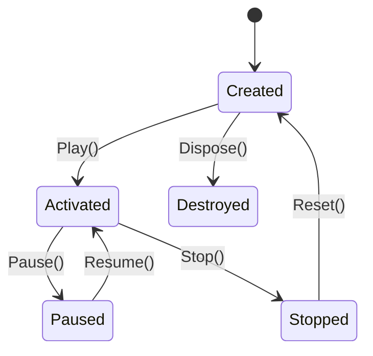
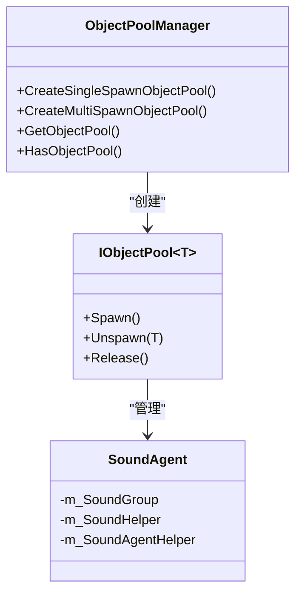
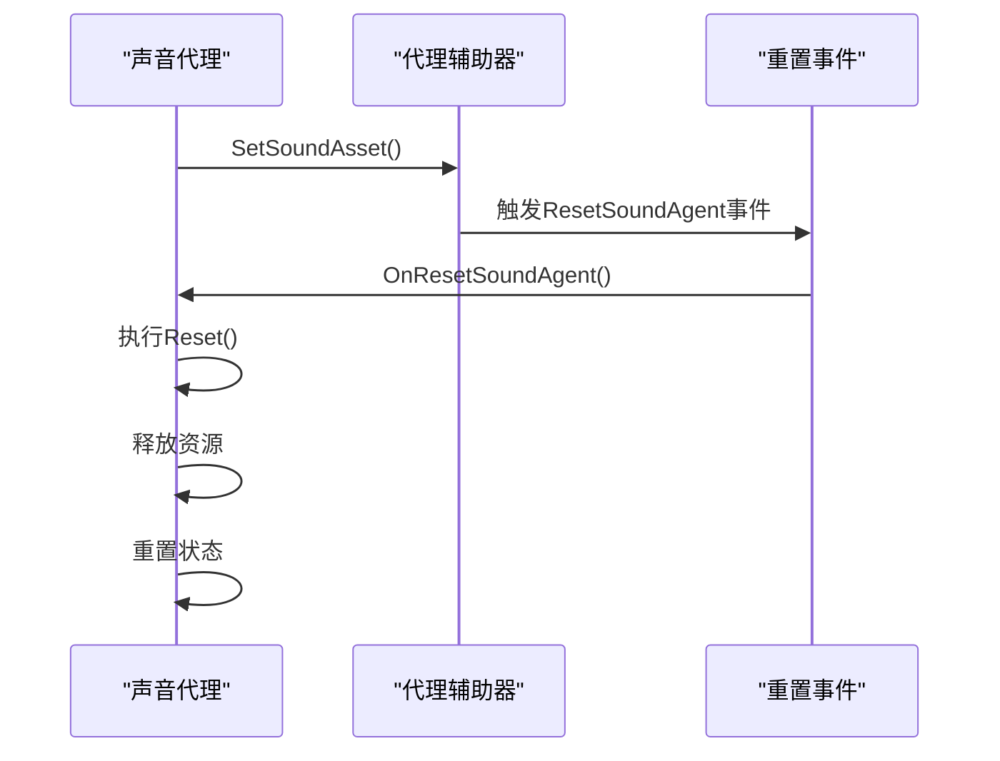

<cite>
**Referenced Files in This Document**   
- [ISoundAgent.cs](file://GameFramework/Sound/ISoundAgent.cs)
- [SoundManager.SoundAgent.cs](file://GameFramework/Sound/SoundManager.SoundAgent.cs)
- [SoundManager.cs](file://GameFramework/Sound/SoundManager.cs)
- [ObjectPoolManager.cs](file://GameFramework/ObjectPool/ObjectPoolManager.cs)
- [ReferencePool.cs](file://GameFramework/Base/ReferencePool/ReferencePool.cs)
- [ResetSoundAgentEventArgs.cs](file://GameFramework/Sound/ResetSoundAgentEventArgs.cs)
</cite>

# 声音代理生命周期

## 表格目录
1. [引言](#引言)
2. [声音代理生命周期管理](#声音代理生命周期管理)
3. [对象池模式应用](#对象池模式应用)
4. [ISoundAgent接口属性控制](#isoundagent接口属性控制)
5. [3D音效参数使用](#3d音效参数使用)
6. [代理重置机制](#代理重置机制)
7. [状态监控与异常处理](#状态监控与异常处理)

## 引言
声音代理（SoundAgent）是游戏框架中负责管理声音播放的核心组件。本文档深入剖析声音代理的完整生命周期管理机制，包括创建、复用、激活、暂停、恢复和销毁全过程。通过对象池模式的应用，系统能够预创建代理实例，有效避免运行时垃圾回收（GC）压力。文档详细说明ISoundAgent接口中各项属性的动态控制能力，以及3D音效相关参数的使用方法，为开发者提供全面的声音管理指导。

## 声音代理生命周期管理

声音代理的生命周期涵盖了从创建到销毁的完整过程，包括激活、暂停、恢复等状态转换。生命周期管理确保了声音资源的高效利用和流畅播放。

**Diagram sources**
- [SoundManager.SoundAgent.cs](file://GameFramework/Sound/SoundManager.SoundAgent.cs#L27-L57)
- [ISoundAgent.cs](file://GameFramework/Sound/ISoundAgent.cs#L12-L208)

**Section sources**
- [SoundManager.SoundAgent.cs](file://GameFramework/Sound/SoundManager.SoundAgent.cs#L27-L57)
- [ISoundAgent.cs](file://GameFramework/Sound/ISoundAgent.cs#L12-L208)

## 对象池模式应用

声音代理通过对象池模式进行管理，实现了对象的预创建和复用，有效避免了运行时GC压力。对象池由ObjectPoolManager统一管理，支持单次和多次获取。

**Diagram sources**
- [ObjectPoolManager.cs](file://GameFramework/ObjectPool/ObjectPoolManager.cs#L384-L387)
- [SoundManager.SoundAgent.cs](file://GameFramework/Sound/SoundManager.SoundAgent.cs#L27-L57)

**Section sources**
- [ObjectPoolManager.cs](file://GameFramework/ObjectPool/ObjectPoolManager.cs#L384-L387)
- [SoundManager.SoundAgent.cs](file://GameFramework/Sound/SoundManager.SoundAgent.cs#L27-L57)

## ISoundAgent接口属性控制

ISoundAgent接口提供了对声音代理的全面控制能力，包括时间、音量、空间混合等属性的动态调整。

### 核心属性控制表

| 属性名称 | 类型 | 描述 | 控制方法 |
|---------|------|------|---------|
| Time | float | 播放位置 | Get/Set |
| VolumeInSoundGroup | float | 声音组内音量 | Get/Set |
| MuteInSoundGroup | bool | 声音组内静音 | Get/Set |
| Loop | bool | 循环播放 | Get/Set |
| Priority | int | 播放优先级 | Get/Set |
| Pitch | float | 声音音调 | Get/Set |
| PanStereo | float | 立体声声相 | Get/Set |
| SpatialBlend | float | 空间混合量 | Get/Set |

**Section sources**
- [ISoundAgent.cs](file://GameFramework/Sound/ISoundAgent.cs#L12-L208)

## 3D音效参数使用

声音代理支持3D音效相关参数的配置，实现空间音频效果。

### 3D音效参数

| 参数名称 | 类型 | 描述 | 默认值 |
|---------|------|------|-------|
| MaxDistance | float | 声音最大距离 | DefaultMaxDistance |
| DopplerLevel | float | 多普勒等级 | DefaultDopplerLevel |
| SpatialBlend | float | 空间混合量 | DefaultSpatialBlend |

这些参数通过ISoundAgentHelper接口与底层音频系统交互，实现3D音效的精确控制。

**Section sources**
- [ISoundAgent.cs](file://GameFramework/Sound/ISoundAgent.cs#L12-L208)
- [SoundManager.SoundAgent.cs](file://GameFramework/Sound/SoundManager.SoundAgent.cs#L27-L57)

## 代理重置机制

声音代理的重置机制确保了资源的正确释放和状态的初始化，ResetSoundAgent事件在特定时机触发。

**Diagram sources**
- [SoundManager.SoundAgent.cs](file://GameFramework/Sound/SoundManager.SoundAgent.cs#L396-L420)
- [ResetSoundAgentEventArgs.cs](file://GameFramework/Sound/ResetSoundAgentEventArgs.cs#L12-L37)

**Section sources**
- [SoundManager.SoundAgent.cs](file://GameFramework/Sound/SoundManager.SoundAgent.cs#L396-L420)
- [ResetSoundAgentEventArgs.cs](file://GameFramework/Sound/ResetSoundAgentEventArgs.cs#L12-L37)

## 状态监控与异常处理

声音代理提供全面的状态监控和异常处理机制，确保系统的稳定运行。

### 状态监控最佳实践

1. **状态检查**：通过IsPlaying属性监控播放状态
2. **事件监听**：订阅PlaySoundSuccess、PlaySoundFailure等事件
3. **资源管理**：确保声音资源正确释放
4. **异常捕获**：处理优先级冲突、资源加载失败等情况

### 异常处理策略

- **低优先级忽略**：当新声音优先级低于现有声音时，可能被忽略
- **资源加载失败**：处理LoadAssetFailure等错误码
- **代理获取失败**：处理IgnoredDueToLowPriority等错误情况

**Section sources**
- [SoundManager.cs](file://GameFramework/Sound/SoundManager.cs#L12-L754)
- [ISoundAgent.cs](file://GameFramework/Sound/ISoundAgent.cs#L12-L208)