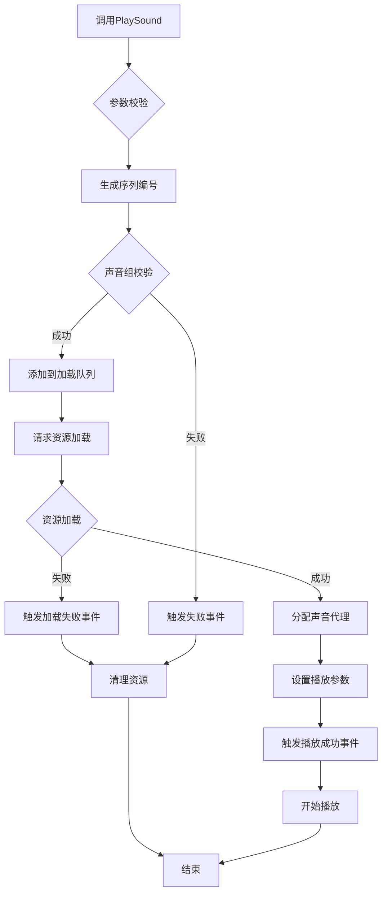
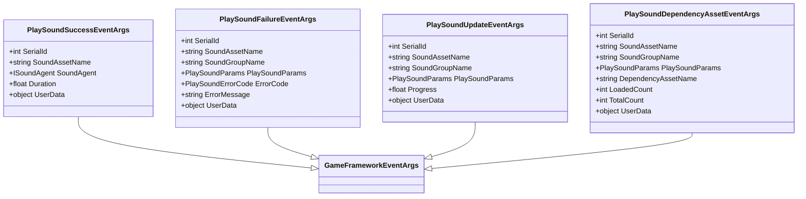
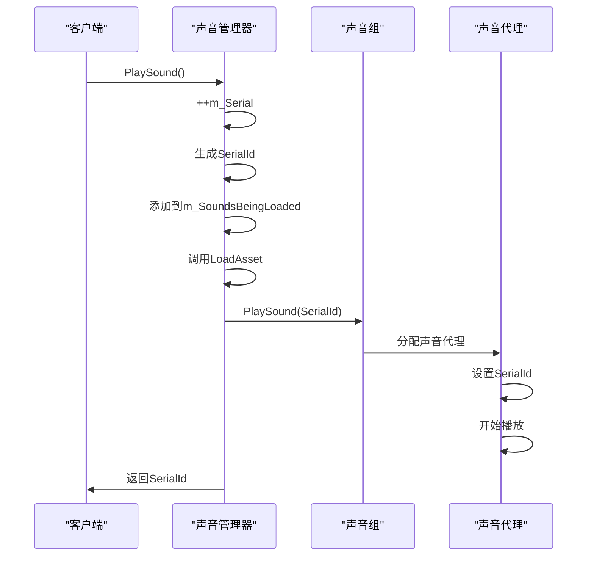

# 声音播放控制

<cite>
**本文档中引用的文件**  
- [SoundManager.cs](file://GameFramework/Sound/SoundManager.cs)
- [PlaySoundParams.cs](file://GameFramework/Sound/PlaySoundParams.cs)
- [ISoundAgent.cs](file://GameFramework/Sound/ISoundAgent.cs)
- [SoundManager.SoundGroup.cs](file://GameFramework/Sound/SoundManager.SoundGroup.cs)
- [SoundManager.PlaySoundInfo.cs](file://GameFramework/Sound/SoundManager.PlaySoundInfo.cs)
- [Constant.cs](file://GameFramework/Sound/Constant.cs)
</cite>

## 目录
1. [PlaySound方法重载说明](#playsound方法重载说明)
2. [PlaySoundParams播放参数解析](#playsoundparams播放参数解析)
3. [声音播放完整执行流程](#声音播放完整执行流程)
4. [事件通知机制与订阅](#事件通知机制与订阅)
5. [序列编号（SerialId）管理策略](#序列编号serialid管理策略)

## PlaySound方法重载说明

`PlaySound` 系列方法提供了多种重载形式，以满足不同场景下的声音播放需求。所有重载最终都会调用最完整的参数版本，即包含优先级、播放参数和用户数据的版本。

### 重载方法列表

| 方法签名 | 参数说明 | 适用场景 |
|---------|--------|--------|
| `PlaySound(string soundAssetName, string soundGroupName)` | 声音资源名、声音组名 | 最基础的播放调用，使用默认优先级 |
| `PlaySound(string soundAssetName, string soundGroupName, int priority)` | 声音资源名、声音组名、优先级 | 需要控制资源加载优先级的场景 |
| `PlaySound(string soundAssetName, string soundGroupName, PlaySoundParams playSoundParams)` | 声音资源名、声音组名、播放参数 | 需要自定义播放参数（如音量、音调等） |
| `PlaySound(string soundAssetName, string soundGroupName, object userData)` | 声音资源名、声音组名、用户数据 | 需要传递上下文数据的场景 |
| `PlaySound(string soundAssetName, string soundGroupName, int priority, PlaySoundParams playSoundParams)` | 声音资源名、声音组名、优先级、播放参数 | 同时需要控制优先级和播放参数 |
| `PlaySound(string soundAssetName, string soundGroupName, int priority, object userData)` | 声音资源名、声音组名、优先级、用户数据 | 需要优先级和上下文数据 |
| `PlaySound(string soundAssetName, string soundGroupName, PlaySoundParams playSoundParams, object userData)` | 声音资源名、声音组名、播放参数、用户数据 | 需要自定义播放参数和上下文数据 |
| `PlaySound(string soundAssetName, string soundGroupName, int priority, PlaySoundParams playSoundParams, object userData)` | 所有参数 | 最完整的调用方式，适用于复杂场景 |

所有重载方法最终都会调用最后一个完整版本，未指定的参数将使用默认值。

**Section sources**
- [SoundManager.cs](file://GameFramework/Sound/SoundManager.cs#L347-L490)

## PlaySoundParams播放参数解析

`PlaySoundParams` 结构体封装了声音播放时的各种参数，通过引用池管理以提高性能。

### 参数作用机制

| 参数 | 类型 | 默认值 | 作用说明 |
|------|------|--------|---------|
| Time | float | 0f | 设置声音的播放起始位置（秒） |
| MuteInSoundGroup | bool | false | 控制在声音组内是否静音 |
| Loop | bool | false | 是否循环播放 |
| Priority | int | 0 | 声音优先级，用于资源竞争时的替换策略 |
| VolumeInSoundGroup | float | 1f | 在声音组内的音量大小（0-1） |
| FadeInSeconds | float | 0f | 声音淡入时间（秒） |
| Pitch | float | 1f | 声音音调（1.0为正常） |
| PanStereo | float | 0f | 立体声声相（-1到1，左到右） |
| SpatialBlend | float | 0f | 2D/3D空间混合量（0为2D，1为3D） |
| MaxDistance | float | 100f | 声音最大距离（影响3D声音衰减） |
| DopplerLevel | float | 1f | 多普勒效应等级 |

参数通过 `PlaySoundParams.Create()` 静态方法创建，该方法从引用池获取实例，避免频繁的内存分配。

**Section sources**
- [PlaySoundParams.cs](file://GameFramework/Sound/PlaySoundParams.cs#L12-L247)
- [Constant.cs](file://GameFramework/Sound/Constant.cs#L10-L28)

## 声音播放完整执行流程

从调用 `PlaySound` 到最终音频输出，经历以下完整链路：



**Diagram sources**
- [SoundManager.cs](file://GameFramework/Sound/SoundManager.cs#L436-L490)
- [SoundManager.SoundGroup.cs](file://GameFramework/Sound/SoundManager.SoundGroup.cs#L151-L204)

### 详细执行步骤

1. **资源请求**：调用 `PlaySound` 方法，传入声音资源名和声音组名
2. **依赖加载**：通过 `m_ResourceManager.LoadAsset` 发起资源加载请求
3. **代理分配**：在声音组中寻找可用的声音代理（`SoundAgent`）
4. **参数设置**：将 `PlaySoundParams` 中的参数应用到声音代理
5. **播放触发**：调用声音代理的 `Play` 方法开始播放

**Section sources**
- [SoundManager.cs](file://GameFramework/Sound/SoundManager.cs#L436-L490)
- [SoundManager.SoundGroup.cs](file://GameFramework/Sound/SoundManager.SoundGroup.cs#L151-L204)

## 事件通知机制与订阅

系统提供了一套完整的事件通知机制，用于监听声音播放过程中的各种状态变化。

### 事件类型



**Diagram sources**
- [PlaySoundSuccessEventArgs.cs](file://GameFramework/Sound/PlaySoundSuccessEventArgs.cs#L12-L102)
- [PlaySoundFailureEventArgs.cs](file://GameFramework/Sound/PlaySoundFailureEventArgs.cs#L12-L128)
- [PlaySoundUpdateEventArgs.cs](file://GameFramework/Sound/PlaySoundUpdateEventArgs.cs#L12-L115)
- [PlaySoundDependencyAssetEventArgs.cs](file://GameFramework/Sound/PlaySoundDependencyAssetEventArgs.cs#L12-L141)

### 事件订阅代码示例

```csharp
// 订阅播放成功事件
soundManager.PlaySoundSuccess += OnPlaySoundSuccess;

// 订阅播放失败事件
soundManager.PlaySoundFailure += OnPlaySoundFailure;

// 订阅播放更新事件
soundManager.PlaySoundUpdate += OnPlaySoundUpdate;

// 订阅依赖资源加载事件
soundManager.PlaySoundDependencyAsset += OnPlaySoundDependencyAsset;

// 事件处理方法
private void OnPlaySoundSuccess(object sender, PlaySoundSuccessEventArgs e)
{
    Debug.Log($"声音播放成功: {e.SoundAssetName}, 序列号: {e.SerialId}");
}

private void OnPlaySoundFailure(object sender, PlaySoundFailureEventArgs e)
{
    Debug.LogError($"声音播放失败: {e.SoundAssetName}, 错误: {e.ErrorMessage}");
}

private void OnPlaySoundUpdate(object sender, PlaySoundUpdateEventArgs e)
{
    Debug.Log($"声音加载进度: {e.SoundAssetName}, 进度: {e.Progress:P}");
}

private void OnPlaySoundDependencyAsset(object sender, PlaySoundDependencyAssetEventArgs e)
{
    Debug.Log($"加载依赖资源: {e.DependencyAssetName}, 进度: {e.LoadedCount}/{e.TotalCount}");
}
```

**Section sources**
- [SoundManager.cs](file://GameFramework/Sound/SoundManager.cs#L613-L751)

## 序列编号（SerialId）管理策略

序列编号是声音实例的唯一标识，用于精确控制和跟踪声音播放状态。

### 生成与管理



**Diagram sources**
- [SoundManager.cs](file://GameFramework/Sound/SoundManager.cs#L436-L490)
- [SoundManager.SoundGroup.cs](file://GameFramework/Sound/SoundManager.SoundGroup.cs#L151-L204)

### 管理策略

- **递增生成**：每次调用 `PlaySound` 时，`m_Serial` 自增1，确保唯一性
- **状态跟踪**：通过 `m_SoundsBeingLoaded` 列表跟踪正在加载的声音
- **精确控制**：使用序列编号可以精确控制特定声音的暂停、恢复、停止等操作
- **资源清理**：在播放完成或失败时，从跟踪列表中移除对应的序列编号

序列编号是连接声音请求与实际播放实例的桥梁，使得系统能够对每个声音实例进行独立的管理和控制。

**Section sources**
- [SoundManager.cs](file://GameFramework/Sound/SoundManager.cs#L436-L490)
- [SoundManager.SoundGroup.cs](file://GameFramework/Sound/SoundManager.SoundGroup.cs#L151-L204)
- [ISoundAgent.cs](file://GameFramework/Sound/ISoundAgent.cs#L12-L208)