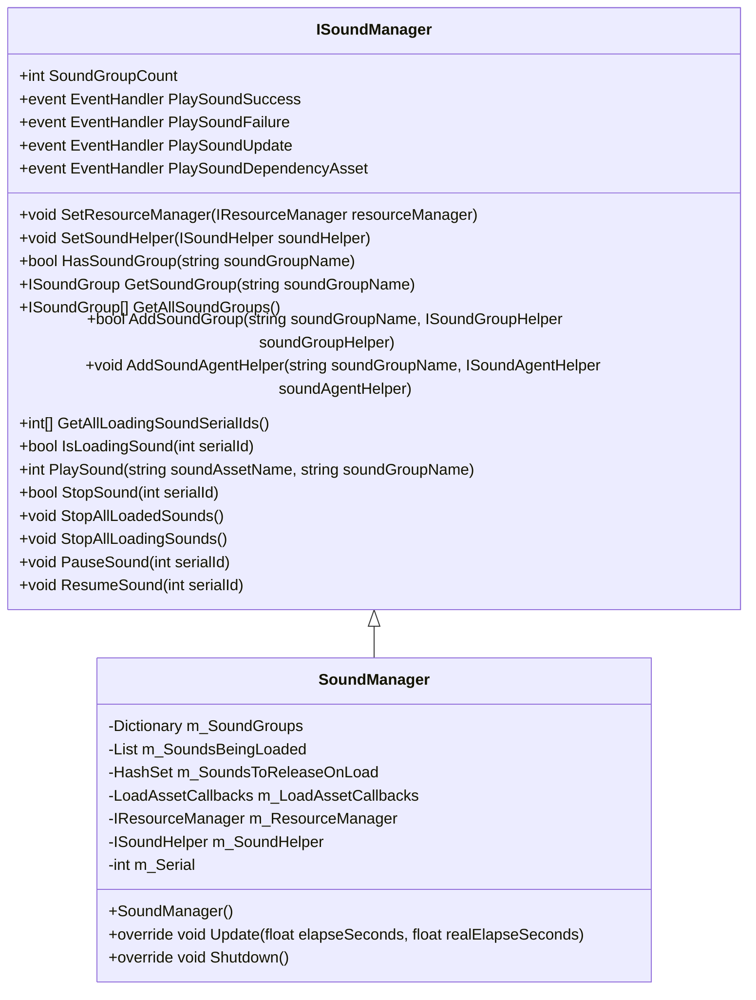
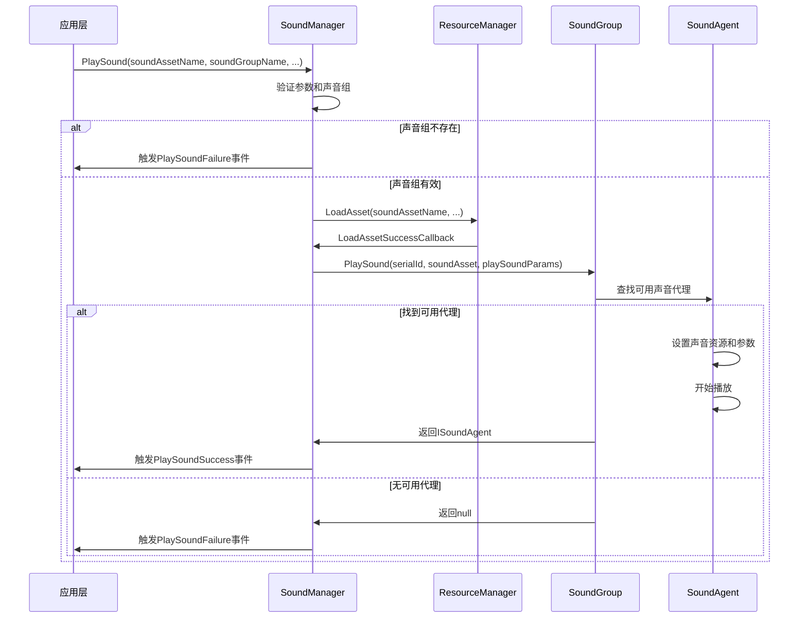
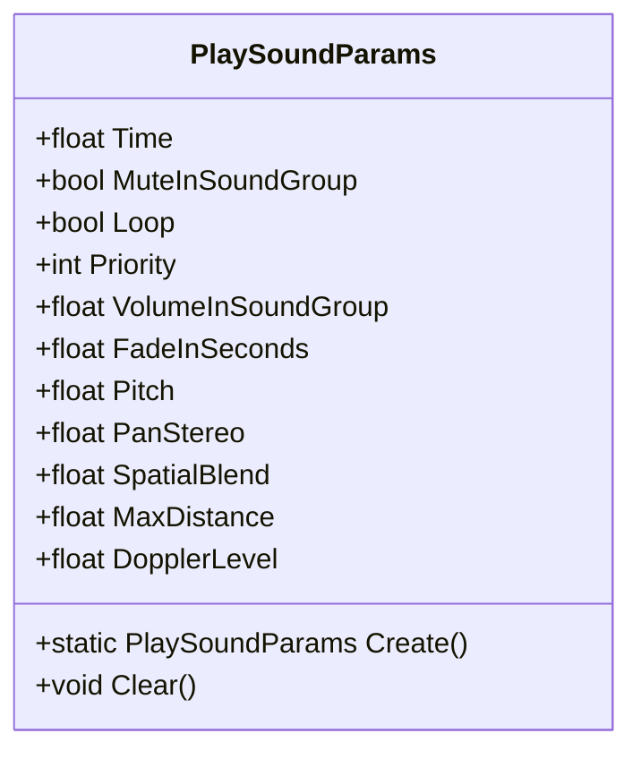
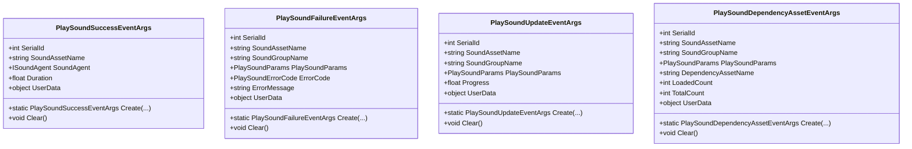

<cite>
**本文档中引用的文件**
- [ISoundManager.cs](file://GameFramework/Sound/ISoundManager.cs)
- [SoundManager.cs](file://GameFramework/Sound/SoundManager.cs)
- [ISoundAgent.cs](file://GameFramework/Sound/ISoundAgent.cs)
- [ISoundGroup.cs](file://GameFramework/Sound/ISoundGroup.cs)
- [PlaySoundParams.cs](file://GameFramework/Sound/PlaySoundParams.cs)
- [Constant.cs](file://GameFramework/Sound/Constant.cs)
- [PlaySoundSuccessEventArgs.cs](file://GameFramework/Sound/PlaySoundSuccessEventArgs.cs)
- [PlaySoundFailureEventArgs.cs](file://GameFramework/Sound/PlaySoundFailureEventArgs.cs)
</cite>

# 声音管理

## 目录
1. [简介](#简介)
2. [核心组件](#核心组件)
3. [声音播放流程](#声音播放流程)
4. [声音组管理](#声音组管理)
5. [3D音效与参数控制](#3d音效与参数控制)
6. [事件与回调处理](#事件与回调处理)
7. [资源与内存管理](#资源与内存管理)
8. [实践指南](#实践指南)

## 简介
声音管理系统提供了一套完整的音频控制解决方案，支持音效播放、背景音乐控制、声音组管理以及3D音效功能。系统通过模块化设计，实现了声音资源的高效加载、播放控制和内存管理，为游戏开发提供了稳定可靠的声音服务。

## 核心组件

声音管理系统由多个核心接口和实现类构成，各组件职责明确，协同工作。

### ISoundManager
`ISoundManager` 是声音管理器的主接口，定义了声音系统的核心功能。它负责管理声音组、播放声音、控制播放状态以及处理相关事件。

**主要职责：**
- 管理声音组的增删查改
- 提供声音播放、暂停、恢复、停止等控制方法
- 定义播放成功、失败、更新等事件
- 管理资源加载和声音代理

**Section sources**
- [ISoundManager.cs](file://GameFramework/Sound/ISoundManager.cs#L16-L261)

### SoundManager
`SoundManager` 是 `ISoundManager` 接口的具体实现，继承自 `GameFrameworkModule`。它作为声音系统的中枢，协调各个组件的工作。

**关键特性：**
- 维护声音组字典 `m_SoundGroups`
- 管理正在加载的声音序列 `m_SoundsBeingLoaded`
- 处理资源加载回调 `m_LoadAssetCallbacks`
- 维护声音序列号 `m_Serial`



**Diagram sources**
- [ISoundManager.cs](file://GameFramework/Sound/ISoundManager.cs#L16-L261)
- [SoundManager.cs](file://GameFramework/Sound/SoundManager.cs#L33-L46)

**Section sources**
- [SoundManager.cs](file://GameFramework/Sound/SoundManager.cs#L1-L755)

### ISoundAgent
`ISoundAgent` 是声音代理接口，代表一个具体的声音实例。它封装了声音播放的所有控制参数和状态。

**主要功能：**
- 控制播放、暂停、停止等状态
- 管理音量、音调、立体声等音频参数
- 支持3D音效相关属性（空间混合、最大距离、多普勒效应）
- 提供重置功能

**Section sources**
- [ISoundAgent.cs](file://GameFramework/Sound/ISoundAgent.cs#L12-L208)

### ISoundGroup
`ISoundGroup` 是声音组接口，用于对声音进行分类管理。每个声音组可以独立控制音量、静音状态等。

**核心属性：**
- `Name`: 声音组名称
- `SoundAgentCount`: 声音代理数量
- `AvoidBeingReplacedBySamePriority`: 同优先级声音替换策略
- `Mute`: 静音状态
- `Volume`: 音量控制

**Section sources**
- [ISoundGroup.cs](file://GameFramework/Sound/ISoundGroup.cs#L12-L75)

## 声音播放流程

声音播放是一个多阶段的异步过程，涉及资源加载、实例化和参数设置。

### 完整播放流程


**Diagram sources**
- [SoundManager.cs](file://GameFramework/Sound/SoundManager.cs#L436-L490)
- [SoundManager.cs](file://GameFramework/Sound/SoundManager.cs#L613-L681)
- [SoundManager.SoundGroup.cs](file://GameFramework/Sound/SoundManager.SoundGroup.cs#L151-L204)

### 资源加载阶段
当调用 `PlaySound` 方法时，系统首先通过 `ResourceManager` 加载声音资源。加载过程是异步的，使用 `LoadAssetCallbacks` 处理各种回调：

- `LoadAssetSuccessCallback`: 资源加载成功
- `LoadAssetFailureCallback`: 资源加载失败
- `LoadAssetUpdateCallback`: 加载进度更新
- `LoadAssetDependencyAssetCallback`: 依赖资源加载

### 实例化阶段
资源加载成功后，系统会调用声音组的 `PlaySound` 方法来实例化声音代理。选择代理的策略如下：

1. 优先选择未在播放的声音代理
2. 如果没有空闲代理，则根据优先级替换现有代理
3. 优先级较低的代理会被优先替换
4. 同优先级代理根据 `AvoidBeingReplacedBySamePriority` 策略决定是否替换

## 声音组管理

声音组是声音管理系统的核心组织单元，提供分类管理和独立控制功能。

### 声音组创建
通过 `AddSoundGroup` 方法创建声音组，可以指定以下参数：

- `soundGroupName`: 声音组名称
- `soundGroupAvoidBeingReplacedBySamePriority`: 同优先级替换策略
- `soundGroupMute`: 静音状态
- `soundGroupVolume`: 音量
- `soundGroupHelper`: 声音组辅助器

```csharp
// 示例：创建音乐和音效两个声音组
soundManager.AddSoundGroup("Music", true, false, 0.8f, musicHelper);
soundManager.AddSoundGroup("Effect", false, false, 1.0f, effectHelper);
```

### 音量独立控制
每个声音组都有独立的音量控制，通过 `Volume` 属性实现。实际播放音量是声音组音量与声音自身音量的乘积：

```
最终音量 = 声音组音量 × 声音自身音量
```

### 最大播放数限制
声音组通过预配置的声音代理数量来限制最大同时播放数。当所有代理都在使用时，新声音的播放将根据优先级策略决定是否替换现有声音。

**Section sources**
- [SoundManager.cs](file://GameFramework/Sound/SoundManager.cs#L225-L275)
- [SoundManager.SoundGroup.cs](file://GameFramework/Sound/SoundManager.SoundGroup.cs#L151-L204)

## 3D音效与参数控制

系统支持完整的3D音效功能，通过 `PlaySoundParams` 类进行参数配置。

### PlaySoundParams 参数详解
`PlaySoundParams` 类封装了所有声音播放参数，主要属性包括：

| 参数 | 类型 | 默认值 | 说明 |
|------|------|--------|------|
| Time | float | 0f | 播放起始时间 |
| MuteInSoundGroup | bool | false | 组内静音 |
| Loop | bool | false | 循环播放 |
| Priority | int | 0 | 播放优先级 |
| VolumeInSoundGroup | float | 1f | 组内音量 |
| FadeInSeconds | float | 0f | 淡入时间 |
| Pitch | float | 1f | 音调 |
| PanStereo | float | 0f | 立体声声相 |
| SpatialBlend | float | 0f | 空间混合量 |
| MaxDistance | float | 100f | 最大距离 |
| DopplerLevel | float | 1f | 多普勒等级 |



**Diagram sources**
- [PlaySoundParams.cs](file://GameFramework/Sound/PlaySoundParams.cs#L1-L250)
- [Constant.cs](file://GameFramework/Sound/Constant.cs#L1-L29)

### 3D音效参数
- **SpatialBlend**: 控制2D/3D混合，0为纯2D，1为纯3D
- **MaxDistance**: 声音在超过此距离后不再衰减
- **DopplerLevel**: 多普勒效应强度，影响移动声源的音调变化

## 事件与回调处理

系统提供丰富的事件机制，便于监控声音播放状态。

### 主要事件类型


**Diagram sources**
- [PlaySoundSuccessEventArgs.cs](file://GameFramework/Sound/PlaySoundSuccessEventArgs.cs#L1-L105)
- [PlaySoundFailureEventArgs.cs](file://GameFramework/Sound/PlaySoundFailureEventArgs.cs#L1-L131)

### 事件订阅示例
```csharp
// 订阅播放成功事件
soundManager.PlaySoundSuccess += (sender, e) =>
{
    Debug.Log($"声音播放成功: {e.SoundAssetName}");
};

// 订阅播放失败事件
soundManager.PlaySoundFailure += (sender, e) =>
{
    Debug.LogError($"声音播放失败: {e.ErrorMessage}");
};
```

## 资源与内存管理

系统采用高效的资源管理策略，确保内存使用最优。

### 对象池机制
- 使用 `ReferencePool` 管理 `PlaySoundParams` 等频繁创建的对象
- `PlaySoundParams.Create()` 方法从对象池获取实例
- 使用完毕后通过 `ReferencePool.Release()` 回收

### 声音代理复用
- 声音代理在停止播放后不会立即销毁
- 代理被重置后可重复用于播放新的声音资源
- 减少对象创建和销毁的开销

### 资源释放
- 当声音加载被取消时，自动释放相关资源
- 提供 `StopAllLoadingSounds` 方法批量停止加载中的声音
- 声音播放结束后，资源由 `ISoundHelper` 负责释放

## 实践指南

### 最佳实践
1. **合理规划声音组**: 将不同类型的声音（音乐、音效、语音）分组管理
2. **设置适当的优先级**: 确保重要声音不被轻易替换
3. **使用对象池**: 通过 `PlaySoundParams.Create()` 创建参数对象
4. **及时释放资源**: 订阅事件后记得在适当时机取消订阅

### 常见问题处理
- **声音无法播放**: 检查声音组是否存在，资源路径是否正确
- **内存占用过高**: 检查声音代理数量配置，避免过多预创建
- **播放延迟**: 优化资源加载优先级，考虑预加载重要声音

### 性能优化建议
- 对常用声音进行预加载
- 合理设置声音代理数量，平衡内存和性能
- 使用合适的音频格式和压缩率
- 在移动设备上适当降低音频质量以节省资源