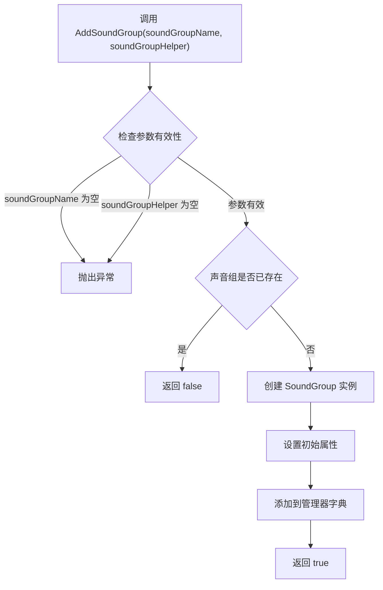
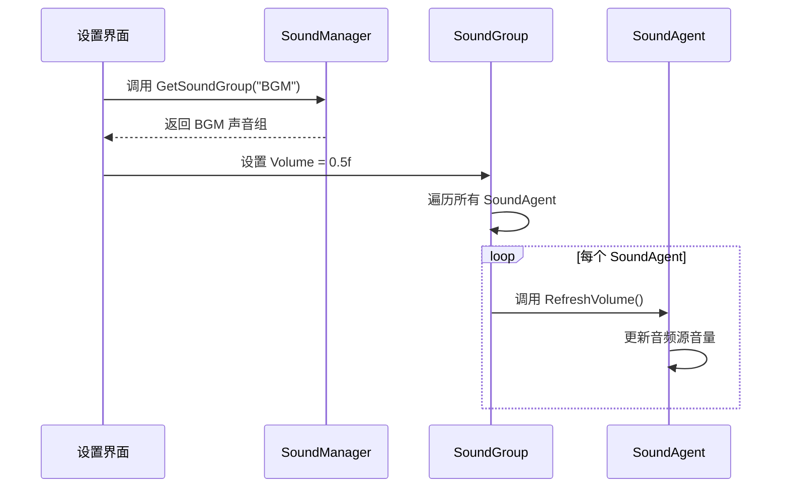
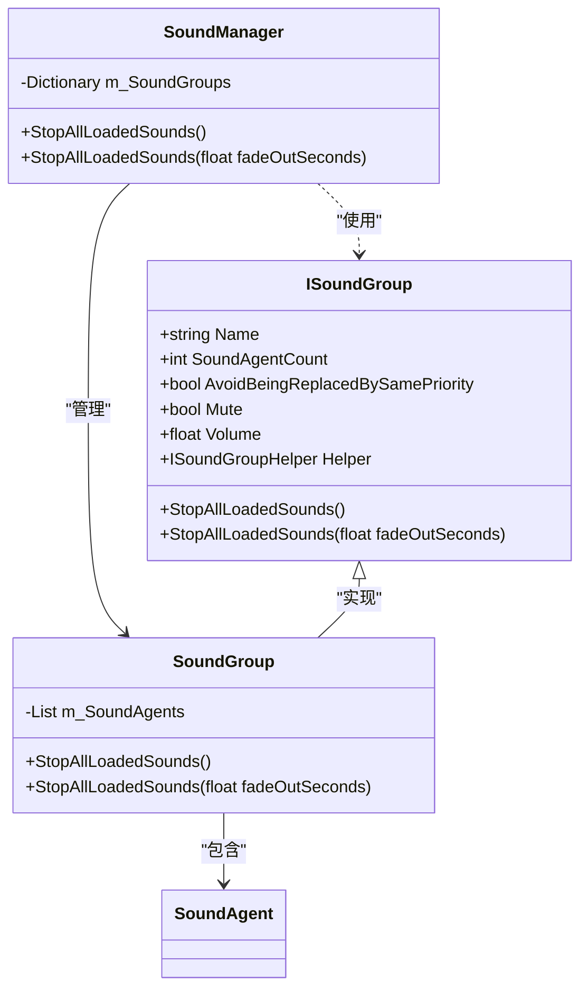

<cite>
**本文档中引用的文件**  
- [ISoundGroup.cs](file://GameFramework/Sound/ISoundGroup.cs)
- [ISoundGroupHelper.cs](file://GameFramework/Sound/ISoundGroupHelper.cs)
- [SoundManager.cs](file://GameFramework/Sound/SoundManager.cs)
- [SoundManager.SoundGroup.cs](file://GameFramework/Sound/SoundManager.SoundGroup.cs)
- [Constant.cs](file://GameFramework/Sound/Constant.cs)
</cite>

# 声音组管理

## 目录
1. [声音组设计概述](#声音组设计概述)
2. [创建与配置声音组](#创建与配置声音组)
3. [核心功能与优势](#核心功能与优势)
4. [扩展机制：ISoundGroupHelper](#扩展机制：isoundgrouphelper)
5. [典型应用场景](#典型应用场景)
6. [性能优化建议](#性能优化建议)

## 声音组设计概述

声音组（SoundGroup）是游戏音频系统中的核心管理单元，旨在对不同类型的声音资源进行逻辑分组和统一管理。通过将声音划分为背景音乐（BGM）、音效（SFX）、用户界面音效（UI SFX）等独立组别，系统能够实现精细化的音频控制，提升用户体验和开发效率。

声音组的设计遵循模块化原则，每个声音组都封装了其专属的属性和行为。这种设计模式不仅实现了音频资源的隔离，还为分组控制提供了基础。声音组通过 `ISoundGroup` 接口定义其公共契约，确保了系统的一致性和可扩展性。

**Section sources**
- [ISoundGroup.cs](file://GameFramework/Sound/ISoundGroup.cs#L12-L75)

## 创建与配置声音组

### 创建声音组

声音组的创建通过 `SoundManager.AddSoundGroup` 方法完成。该方法是系统初始化或运行时动态创建声音组的主要入口。

**Diagram sources**
- [SoundManager.cs](file://GameFramework/Sound/SoundManager.cs#L243-L284)

### 配置声音组属性

在创建声音组时，可以配置其核心属性，以满足不同音频类别的需求。

| 属性 | 类型 | 默认值 | 描述 |
| :--- | :--- | :--- | :--- |
| `soundGroupName` | string | - | 声音组的唯一标识名称，如 "BGM"、"SFX"。 |
| `soundGroupHelper` | ISoundGroupHelper | - | 声音组的辅助器，用于扩展自定义行为。 |
| `soundGroupAvoidBeingReplacedBySamePriority` | bool | false | 当新声音的优先级与正在播放的声音相同时，是否避免被替换。 |
| `soundGroupMute` | bool | false | 声音组的初始静音状态。 |
| `soundGroupVolume` | float | 1.0f | 声音组的初始音量，范围通常为 0.0f (静音) 到 1.0f (最大音量)。 |

这些属性在 `AddSoundGroup` 的重载方法中被设置，并存储在 `SoundGroup` 类的私有字段中。

**Section sources**
- [SoundManager.cs](file://GameFramework/Sound/SoundManager.cs#L257-L284)
- [SoundManager.SoundGroup.cs](file://GameFramework/Sound/SoundManager.SoundGroup.cs#L45-L55)

## 核心功能与优势

### 分组音量与静音控制

声音组最核心的优势在于能够对一组声音进行统一的音量和静音控制。当 `SoundGroup` 的 `Volume` 或 `Mute` 属性被修改时，它会立即遍历其管理的所有 `SoundAgent`（声音代理），并调用 `RefreshVolume()` 或 `RefreshMute()` 方法来同步更新每个正在播放的声音。

**Diagram sources**
- [SoundManager.SoundGroup.cs](file://GameFramework/Sound/SoundManager.SoundGroup.cs#L108-L118)
- [SoundManager.SoundGroup.cs](file://GameFramework/Sound/SoundManager.SoundGroup.cs#L120-L130)

### 批量操作：StopAllLoadedSounds

声音组提供了 `StopAllLoadedSounds` 方法，用于一次性停止该组内所有正在播放的声音。这对于场景切换、暂停游戏或进入特定状态（如静音模式）时非常有用。

**Diagram sources**
- [ISoundGroup.cs](file://GameFramework/Sound/ISoundGroup.cs#L68-L74)
- [SoundManager.SoundGroup.cs](file://GameFramework/Sound/SoundManager.SoundGroup.cs#L278-L298)
- [SoundManager.cs](file://GameFramework/Sound/SoundManager.cs#L531-L546)

### 资源隔离与优先级管理

声音组通过 `SoundAgent` 池实现了资源隔离。每个声音组维护一个独立的 `SoundAgent` 列表，这些代理负责实际的声音播放。当播放一个声音时，系统会从该声音所属组的代理池中寻找一个空闲或可被替换的代理。

在 `PlaySound` 方法中，系统会根据声音的优先级（Priority）和 `AvoidBeingReplacedBySamePriority` 策略来决定哪个代理被复用，从而确保高优先级的声音（如关键音效）能够打断低优先级的声音（如环境音效）。

**Section sources**
- [SoundManager.SoundGroup.cs](file://GameFramework/Sound/SoundManager.SoundGroup.cs#L175-L220)

## 扩展机制：ISoundGroupHelper

`ISoundGroupHelper` 接口为声音组提供了强大的扩展能力。在创建声音组时，必须传入一个实现了 `ISoundGroupHelper` 的具体类。虽然接口本身是空的，但它作为一个“钩子”（hook），允许开发者注入自定义逻辑。

例如，可以创建一个 `BGMGroupHelper` 来实现背景音乐的淡入淡出、循环播放或根据游戏状态自动切换曲目等高级功能。这个辅助器实例被存储在 `SoundGroup` 中，开发者可以在需要时通过 `Helper` 属性获取并调用其自定义方法。

**Section sources**
- [ISoundGroupHelper.cs](file://GameFramework/Sound/ISoundGroupHelper.cs#L12-L14)
- [SoundManager.SoundGroup.cs](file://GameFramework/Sound/SoundManager.SoundGroup.cs#L68-L70)

## 典型应用场景

### 设置界面中的音量调节

最常见的应用场景是在游戏的设置界面中，为玩家提供独立调节背景音乐和音效音量的功能。

1.  **获取声音组**：UI脚本通过 `SoundManager.GetSoundGroup("BGM")` 和 `SoundManager.GetSoundGroup("SFX")` 获取对应的声音组。
2.  **绑定滑块**：将UI滑块的值绑定到声音组的 `Volume` 属性。
3.  **实时反馈**：当玩家拖动滑块时，声音组的 `Volume` 属性被更新，所有该组内的声音代理会立即收到通知并调整其音量，实现即时的听觉反馈。

此模式清晰地分离了UI逻辑和音频逻辑，使得功能实现简单且健壮。

**Section sources**
- [SoundManager.cs](file://GameFramework/Sound/SoundManager.cs#L187-L201)
- [SoundManager.SoundGroup.cs](file://GameFramework/Sound/SoundManager.SoundGroup.cs#L85-L95)

## 性能优化建议

### 合理设置最大代理数

虽然 `SoundManager` 没有直接暴露设置最大代理数的API，但 `AddSoundAgentHelper` 方法允许为声音组动态添加 `SoundAgent`。`SoundAgent` 本质上是音频播放器的包装器，每个代理都占用一定的系统资源（如内存和音频通道）。

*   **过度配置**：为一个声音组创建过多的 `SoundAgent` 会导致不必要的内存占用和潜在的性能开销，即使它们大部分时间处于空闲状态。
*   **优化策略**：应根据声音组的实际需求来配置代理数量。例如，BGM组通常只需要1-2个代理（用于淡入淡出切换），而SFX组可能需要更多（如5-10个）以支持同时播放多个音效。避免为所有组都配置过大的池。

通过合理规划 `SoundAgent` 的数量，可以在保证功能的同时，有效控制资源消耗，提升游戏的整体性能。