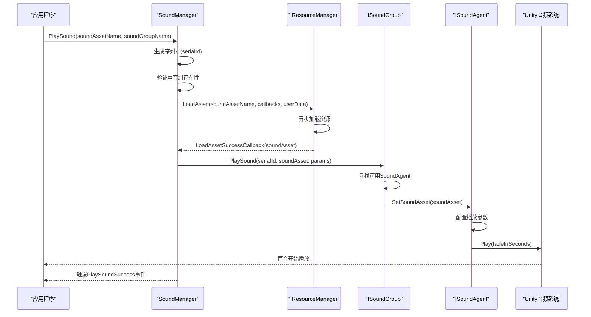
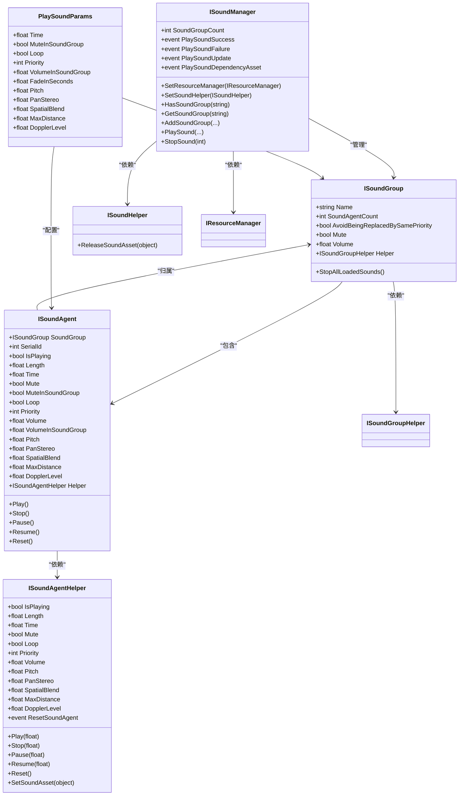

# 核心概念与架构

<cite>
**Referenced Files in This Document**  
- [ISoundManager.cs](file://GameFramework/Sound/ISoundManager.cs)
- [ISoundGroup.cs](file://GameFramework/Sound/ISoundGroup.cs)
- [ISoundAgent.cs](file://GameFramework/Sound/ISoundAgent.cs)
- [SoundManager.cs](file://GameFramework/Sound/SoundManager.cs)
- [PlaySoundSuccessEventArgs.cs](file://GameFramework/Sound/PlaySoundSuccessEventArgs.cs)
- [PlaySoundFailureEventArgs.cs](file://GameFramework/Sound/PlaySoundFailureEventArgs.cs)
- [PlaySoundUpdateEventArgs.cs](file://GameFramework/Sound/PlaySoundUpdateEventArgs.cs)
- [PlaySoundDependencyAssetEventArgs.cs](file://GameFramework/Sound/PlaySoundDependencyAssetEventArgs.cs)
- [PlaySoundParams.cs](file://GameFramework/Sound/PlaySoundParams.cs)
- [Constant.cs](file://GameFramework/Sound/Constant.cs)
- [ISoundHelper.cs](file://GameFramework/Sound/ISoundHelper.cs)
- [ISoundGroupHelper.cs](file://GameFramework/Sound/ISoundGroupHelper.cs)
- [ISoundAgentHelper.cs](file://GameFramework/Sound/ISoundAgentHelper.cs)
</cite>

## 目录
1. [引言](#引言)
2. [核心接口职责划分](#核心接口职责划分)
3. [声音管理器架构](#声音管理器架构)
4. [声音组隔离机制](#声音组隔离机制)
5. [声音代理封装原理](#声音代理封装原理)
6. [系统时序分析](#系统时序分析)
7. [模块初始化与依赖注入](#模块初始化与依赖注入)
8. [事件分发模型](#事件分发模型)
9. [类图与组件关系](#类图与组件关系)

## 引言

声音管理系统是游戏框架中的核心音频子系统，采用分层架构设计，通过三大核心接口 `ISoundManager`、`ISoundGroup` 和 `ISoundAgent` 实现职责分离与协作。该系统负责统一管理游戏中的所有声音资源，提供从资源加载、播放控制到生命周期管理的完整解决方案。系统设计遵循面向接口编程原则，通过依赖注入机制实现与Unity音频系统的解耦，确保了系统的可扩展性和可测试性。

**Section sources**
- [ISoundManager.cs](file://GameFramework/Sound/ISoundManager.cs#L12-L263)
- [ISoundGroup.cs](file://GameFramework/Sound/ISoundGroup.cs#L12-L77)
- [ISoundAgent.cs](file://GameFramework/Sound/ISoundAgent.cs#L12-L210)

## 核心接口职责划分

声音管理系统通过三个核心接口实现关注点分离：

### ISoundManager（主管理器）
作为系统的顶层协调者，`ISoundManager` 负责全局声音资源的调度与管理。其主要职责包括：
- 管理多个声音组（`ISoundGroup`）的生命周期
- 协调资源加载流程，与 `IResourceManager` 交互
- 维护声音播放序列号，确保每个声音实例的唯一性
- 分发播放成功、失败、更新等系统级事件

### ISoundGroup（声音组）
`ISoundGroup` 作为逻辑隔离单元，实现了声音的分类管理。每个声音组可以独立设置音量、静音状态和优先级策略，为不同类型的音频（如背景音乐、音效、语音）提供独立的控制通道。声音组还负责管理其内部的声音代理池。

### ISoundAgent（声音代理）
`ISoundAgent` 是音频播放实例的抽象封装，直接与Unity音频系统交互。每个代理实例对应一个正在播放或可播放的声音，封装了播放、暂停、停止等控制方法，以及音量、音调、空间化等音频参数的设置。

**Section sources**
- [ISoundManager.cs](file://GameFramework/Sound/ISoundManager.cs#L12-L263)
- [ISoundGroup.cs](file://GameFramework/Sound/ISoundGroup.cs#L12-L77)
- [ISoundAgent.cs](file://GameFramework/Sound/ISoundAgent.cs#L12-L210)

## 声音管理器架构

`SoundManager` 作为 `ISoundManager` 接口的具体实现，是整个声音系统的控制中枢。

### 资源加载协调
`SoundManager` 通过 `SetResourceManager` 方法注入资源管理器依赖，当调用 `PlaySound` 方法时，会委托 `IResourceManager` 异步加载声音资源。加载过程采用回调机制，通过 `LoadAssetCallbacks` 处理成功、失败、进度更新等事件。

### 声音代理分配
系统采用代理池（Agent Pool）模式管理声音播放实例。当播放新声音时，`SoundManager` 会通过其所属的 `ISoundGroup` 寻找可用的 `ISoundAgent`。选择策略基于优先级：优先选择未播放的声音代理；对于正在播放的代理，优先替换优先级较低的声音，或根据配置避免同优先级替换。

### 生命周期管理
`SoundManager` 维护两个关键集合：
- `m_SoundsBeingLoaded`：记录所有正在加载声音的序列号
- `m_SoundsToReleaseOnLoad`：记录需要在加载完成后立即释放的声音序列号

这种设计确保了在声音加载过程中可以响应停止请求，实现了加载过程的可中断性。

**Section sources**
- [SoundManager.cs](file://GameFramework/Sound/SoundManager.cs#L18-L754)
- [ISoundManager.cs](file://GameFramework/Sound/ISoundManager.cs#L12-L263)

## 声音组隔离机制

`ISoundGroup` 实现了声音的逻辑隔离，为不同类型的音频提供独立的控制策略。

### 音量与静音控制
每个声音组拥有独立的音量（`Volume`）和静音（`Mute`）属性。当播放声音时，最终音量由声音代理的 `VolumeInSoundGroup` 与声音组的 `Volume` 共同决定，实现了分层音量控制。这种设计允许全局调整背景音乐音量而不影响音效音量。

### 优先级替换策略
`AvoidBeingReplacedBySamePriority` 属性控制同优先级声音的替换行为。当设置为 `true` 时，高优先级声音组中的声音不会被同优先级的新声音替换，保护了重要音频的播放连续性。

### 资源复用
声音组内部维护一个 `SoundAgent` 列表，作为播放实例的资源池。这种设计避免了频繁创建和销毁音频组件的性能开销，通过复用代理实例提高了系统效率。

**Section sources**
- [ISoundGroup.cs](file://GameFramework/Sound/ISoundGroup.cs#L12-L77)
- [SoundManager.SoundGroup.cs](file://GameFramework/Sound/SoundManager.cs#L151-L204)

## 声音代理封装原理

`ISoundAgent` 作为音频播放的最小单元，实现了与Unity音频系统的集成。

### 参数封装
代理接口封装了Unity `AudioSource` 的大部分关键属性，包括：
- 基础控制：`IsPlaying`、`Time`、`Length`
- 音频效果：`Volume`、`Pitch`、`PanStereo`、`SpatialBlend`
- 3D音频：`MaxDistance`、`DopplerLevel`

### 播放控制
提供 `Play`、`Stop`、`Pause`、`Resume` 等控制方法，并支持淡入淡出效果（通过 `fadeInSeconds` 和 `fadeOutSeconds` 参数）。

### 与Unity系统集成
`ISoundAgent` 通过 `ISoundAgentHelper` 辅助器与Unity音频系统通信。`Helper` 属性返回具体的辅助器实现，该实现负责创建和管理 `AudioSource` 组件，处理底层音频播放逻辑。

**Section sources**
- [ISoundAgent.cs](file://GameFramework/Sound/ISoundAgent.cs#L12-L210)
- [ISoundAgentHelper.cs](file://GameFramework/Sound/ISoundAgentHelper.cs#L14-L162)

## 系统时序分析

**Diagram sources**
- [SoundManager.cs](file://GameFramework/Sound/SoundManager.cs#L18-L754)
- [ISoundManager.cs](file://GameFramework/Sound/ISoundManager.cs#L12-L263)
- [ISoundGroup.cs](file://GameFramework/Sound/ISoundGroup.cs#L12-L77)
- [ISoundAgent.cs](file://GameFramework/Sound/ISoundAgent.cs#L12-L210)

## 模块初始化与依赖注入

系统采用依赖注入模式实现组件解耦：

### 依赖注入机制
`SoundManager` 通过 `SetResourceManager` 和 `SetSoundHelper` 方法注入外部依赖：
- `IResourceManager`：负责声音资源的异步加载
- `ISoundHelper`：提供资源释放等辅助功能

### 初始化流程
1. 创建 `SoundManager` 实例
2. 注入 `IResourceManager` 和 `ISoundHelper`
3. 调用 `AddSoundGroup` 创建一个或多个声音组
4. 为声音组添加 `ISoundAgentHelper` 实现
5. 系统准备就绪，可开始播放声音

这种设计使得 `SoundManager` 不直接依赖具体实现，提高了系统的可测试性和可替换性。

**Section sources**
- [SoundManager.cs](file://GameFramework/Sound/SoundManager.cs#L18-L754)
- [ISoundHelper.cs](file://GameFramework/Sound/ISoundHelper.cs#L12-L19)

## 事件分发模型

系统采用事件驱动架构，通过事件通知机制与外部系统通信：

### 事件类型
- `PlaySoundSuccess`：声音加载并开始播放成功
- `PlaySoundFailure`：声音播放失败（资源加载失败、组不存在等）
- `PlaySoundUpdate`：声音加载进度更新
- `PlaySoundDependencyAsset`：加载依赖资源时触发

### 事件参数
每个事件都携带详细的上下文信息，如 `PlaySoundSuccessEventArgs` 包含：
- `SerialId`：声音序列号
- `SoundAssetName`：资源名称
- `SoundAgent`：播放代理
- `Duration`：加载耗时
- `UserData`：用户自定义数据

这种设计使得上层应用可以精确掌握声音播放状态，实现复杂的音频逻辑。

**Section sources**
- [PlaySoundSuccessEventArgs.cs](file://GameFramework/Sound/PlaySoundSuccessEventArgs.cs#L12-L102)
- [PlaySoundFailureEventArgs.cs](file://GameFramework/Sound/PlaySoundFailureEventArgs.cs#L12-L128)
- [PlaySoundUpdateEventArgs.cs](file://GameFramework/Sound/PlaySoundUpdateEventArgs.cs#L12-L115)
- [PlaySoundDependencyAssetEventArgs.cs](file://GameFramework/Sound/PlaySoundDependencyAssetEventArgs.cs#L12-L141)

## 类图与组件关系

**Diagram sources**
- [ISoundManager.cs](file://GameFramework/Sound/ISoundManager.cs#L12-L263)
- [ISoundGroup.cs](file://GameFramework/Sound/ISoundGroup.cs#L12-L77)
- [ISoundAgent.cs](file://GameFramework/Sound/ISoundAgent.cs#L12-L210)
- [ISoundHelper.cs](file://GameFramework/Sound/ISoundHelper.cs#L12-L19)
- [ISoundGroupHelper.cs](file://GameFramework/Sound/ISoundGroupHelper.cs#L12-L14)
- [ISoundAgentHelper.cs](file://GameFramework/Sound/ISoundAgentHelper.cs#L14-L162)
- [PlaySoundParams.cs](file://GameFramework/Sound/PlaySoundParams.cs#L12-L247)