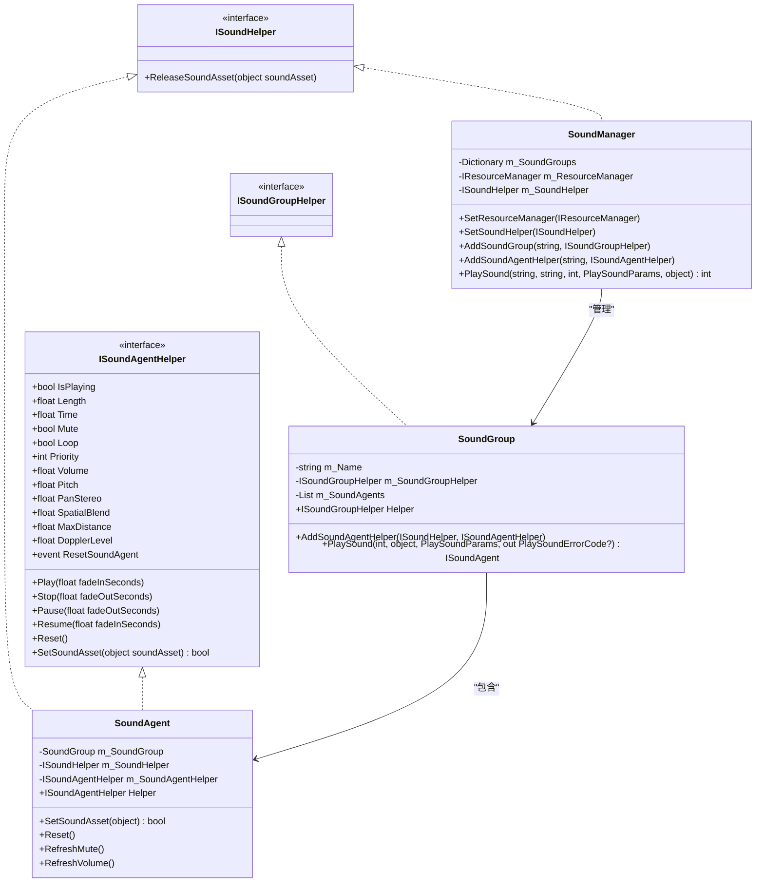
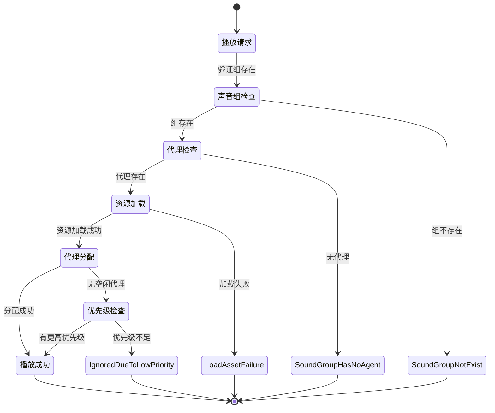

# 高级功能与扩展

<cite>
**本文档中引用的文件**  
- [ISoundHelper.cs](file://GameFramework/Sound/ISoundHelper.cs)
- [ISoundAgentHelper.cs](file://GameFramework/Sound/ISoundAgentHelper.cs)
- [ISoundGroupHelper.cs](file://GameFramework/Sound/ISoundGroupHelper.cs)
- [PlaySoundErrorCode.cs](file://GameFramework/Sound/PlaySoundErrorCode.cs)
- [SoundManager.cs](file://GameFramework/Sound/SoundManager.cs)
- [SoundManager.SoundGroup.cs](file://GameFramework/Sound/SoundManager.SoundGroup.cs)
- [SoundManager.SoundAgent.cs](file://GameFramework/Sound/SoundManager.SoundAgent.cs)
- [Constant.cs](file://GameFramework/Sound/Constant.cs)
</cite>

## 目录
1. [引言](#引言)
2. [声音系统可扩展性设计](#声音系统可扩展性设计)
3. [辅助接口详解](#辅助接口详解)
4. [播放错误码解析](#播放错误码解析)
5. [多平台适配与性能优化](#多平台适配与性能优化)
6. [高级音频功能指导](#高级音频功能指导)
7. [结论](#结论)

## 引言
本节介绍声音系统的高级功能与可扩展性设计，重点说明如何通过辅助接口实现自定义音频引擎集成、特殊播放逻辑或性能监控。同时，解析播放失败的各类错误码，帮助开发者快速定位问题。此外，探讨系统在多平台适配、内存优化和异步加载异常处理方面的设计考量，并提供自定义音频效果处理、动态混音策略和性能调优的进阶指导。

## 声音系统可扩展性设计

声音系统采用模块化设计，通过定义清晰的接口实现高度可扩展性。核心组件包括声音管理器（`SoundManager`）、声音组（`SoundGroup`）和声音代理（`SoundAgent`），它们分别负责全局管理、分组控制和具体播放逻辑。系统通过辅助接口（Helper）解耦核心逻辑与具体实现，使得开发者可以灵活替换底层音频引擎或添加自定义行为。

系统支持动态添加声音代理辅助器（`ISoundAgentHelper`），允许在运行时扩展播放能力。声音组辅助器（`ISoundGroupHelper`）为空接口，为未来扩展预留空间。声音辅助器（`ISoundHelper`）提供资源释放功能，确保与资源管理系统无缝集成。

**图示来源**
- [ISoundHelper.cs](file://GameFramework/Sound/ISoundHelper.cs#L12-L19)
- [ISoundAgentHelper.cs](file://GameFramework/Sound/ISoundAgentHelper.cs#L14-L162)
- [ISoundGroupHelper.cs](file://GameFramework/Sound/ISoundGroupHelper.cs#L12-L14)
- [SoundManager.cs](file://GameFramework/Sound/SoundManager.cs#L1-L754)
- [SoundManager.SoundGroup.cs](file://GameFramework/Sound/SoundManager.SoundGroup.cs#L1-L303)
- [SoundManager.SoundAgent.cs](file://GameFramework/Sound/SoundManager.SoundAgent.cs#L1-L421)

**本节来源**
- [SoundManager.cs](file://GameFramework/Sound/SoundManager.cs#L1-L754)
- [SoundManager.SoundGroup.cs](file://GameFramework/Sound/SoundManager.SoundGroup.cs#L1-L303)
- [SoundManager.SoundAgent.cs](file://GameFramework/Sound/SoundManager.SoundAgent.cs#L1-L421)

## 辅助接口详解

### ISoundHelper 接口
`ISoundHelper` 接口定义了释放声音资源的方法，是声音系统与资源管理器之间的桥梁。通过 `SetSoundHelper` 方法注入实现，系统可在声音播放完毕或停止时调用 `ReleaseSoundAsset` 释放底层资源，确保内存管理的正确性。

**本节来源**
- [ISoundHelper.cs](file://GameFramework/Sound/ISoundHelper.cs#L12-L19)

### ISoundAgentHelper 接口
`ISoundAgentHelper` 是声音代理的核心接口，封装了所有与音频播放相关的属性和操作。它提供对播放状态、音量、音调、立体声声相、空间混合量等参数的读写访问，并支持播放、暂停、停止、恢复等控制方法。通过此接口，系统可与任意音频引擎（如Unity AudioSource、FMOD、Wwise）集成。

**本节来源**
- [ISoundAgentHelper.cs](file://GameFramework/Sound/ISoundAgentHelper.cs#L14-L162)

### ISoundGroupHelper 接口
`ISoundGroupHelper` 是一个空接口，当前版本未定义任何方法。其设计目的是为未来扩展预留空间，例如添加组级回调、性能监控或自定义逻辑。开发者可实现此接口并将其传递给 `AddSoundGroup` 方法，为特定声音组提供扩展能力。

**本节来源**
- [ISoundGroupHelper.cs](file://GameFramework/Sound/ISoundGroupHelper.cs#L12-L14)

## 播放错误码解析

`PlaySoundErrorCode` 枚举定义了播放声音时可能遇到的各类错误，帮助开发者精确定位问题根源。

| 错误码 | 说明 | 产生条件 |
|--------|------|----------|
| Unknown | 未知错误 | 未预期的异常情况 |
| SoundGroupNotExist | 声音组不存在 | 播放时指定的声音组名称无效或未创建 |
| SoundGroupHasNoAgent | 声音组没有声音代理 | 声音组未添加任何声音代理辅助器 |
| LoadAssetFailure | 加载资源失败 | 资源管理器加载声音资源时出错 |
| IgnoredDueToLowPriority | 播放因优先级低被忽略 | 无空闲代理且所有代理优先级均不低于新声音 |
| SetSoundAssetFailure | 设置声音资源失败 | 声音代理辅助器设置资源失败 |

**图示来源**
- [PlaySoundErrorCode.cs](file://GameFramework/Sound/PlaySoundErrorCode.cs#L12-L43)
- [SoundManager.cs](file://GameFramework/Sound/SoundManager.cs#L436-L490)
- [SoundManager.SoundGroup.cs](file://GameFramework/Sound/SoundManager.SoundGroup.cs#L133-L161)

**本节来源**
- [PlaySoundErrorCode.cs](file://GameFramework/Sound/PlaySoundErrorCode.cs#L12-L43)
- [PlaySoundFailureEventArgs.cs](file://GameFramework/Sound/PlaySoundFailureEventArgs.cs#L67-L71)

## 多平台适配与性能优化

### 多平台适配
系统通过 `ISoundAgentHelper` 接口实现跨平台兼容性。开发者可为不同平台（如PC、移动端、主机）实现特定的辅助器，封装平台相关的音频API调用。声音管理器仅依赖接口，无需关心具体实现，确保核心逻辑的统一。

### 内存优化
系统采用对象池（`ReferencePool`）管理 `PlaySoundParams` 等频繁创建的对象，减少GC压力。声音资源的加载与释放通过 `ISoundHelper` 显式控制，避免内存泄漏。声音代理在重置时主动释放资源，确保及时回收。

### 异步加载异常处理
声音加载采用异步模式，通过 `LoadAssetCallbacks` 注册成功、失败、更新和依赖资源事件。在 `LoadAssetFailureCallback` 中，系统捕获加载错误并触发 `PlaySoundFailure` 事件，携带 `LoadAssetFailure` 错误码。对于正在加载中被取消的声音，系统将其加入 `m_SoundsToReleaseOnLoad` 集合，在加载完成后自动释放资源，防止内存泄漏。

**本节来源**
- [SoundManager.cs](file://GameFramework/Sound/SoundManager.cs#L629-L753)
- [Constant.cs](file://GameFramework/Sound/Constant.cs#L1-L27)
- [PlaySoundParams.cs](file://GameFramework/Sound/PlaySoundParams.cs#L1-L248)

## 高级音频功能指导

### 自定义音频引擎集成
要集成自定义音频引擎，需实现 `ISoundAgentHelper` 接口。在 `SetSoundAsset` 方法中接收声音资源对象，并将其传递给底层引擎。实现所有属性的get/set方法以控制播放参数，并在 `Play`、`Stop` 等方法中调用引擎的对应功能。最后，通过 `SoundManager.AddSoundAgentHelper` 将其实例添加到指定声音组。

### 特殊播放逻辑
通过 `ISoundGroupHelper` 可实现组级特殊逻辑。例如，实现一个监控辅助器，在声音组中添加代理时记录性能数据。或实现一个动态混音器，根据游戏状态调整各声音组的音量平衡。虽然当前接口为空，但可通过继承或组合模式扩展功能。

### 性能监控
利用 `ISoundAgentHelper.ResetSoundAgent` 事件，可监听声音代理的重置（通常发生在资源切换或释放时）。结合 `ISoundHelper`，可在资源释放时记录内存使用情况。通过分析 `PlaySoundUpdateEventArgs` 的进度数据，可监控加载性能并优化资源分布。

### 动态混音策略
系统支持声音组级和代理级音量控制。通过 `SoundGroup.Volume` 和 `SoundAgent.VolumeInSoundGroup` 的乘积计算最终音量，实现灵活的混音策略。例如，可动态调整背景音乐组的音量以响应游戏事件，或根据距离衰减单个声音的音量。

**本节来源**
- [ISoundAgentHelper.cs](file://GameFramework/Sound/ISoundAgentHelper.cs#L14-L162)
- [ISoundGroupHelper.cs](file://GameFramework/Sound/ISoundGroupHelper.cs#L12-L14)
- [SoundManager.SoundAgent.cs](file://GameFramework/Sound/SoundManager.SoundAgent.cs#L221-L264)
- [SoundManager.SoundGroup.cs](file://GameFramework/Sound/SoundManager.SoundGroup.cs#L133-L161)

## 结论
声音系统通过精心设计的接口和模块化架构，实现了高度的可扩展性和灵活性。三个辅助接口（`ISoundHelper`、`ISoundAgentHelper`、`ISoundGroupHelper`）分别负责资源管理、播放控制和组级扩展，为开发者提供了强大的定制能力。详细的错误码体系有助于快速诊断播放问题。系统在多平台适配、内存优化和异常处理方面表现出色，结合提供的高级指导，可满足复杂项目的音频需求。