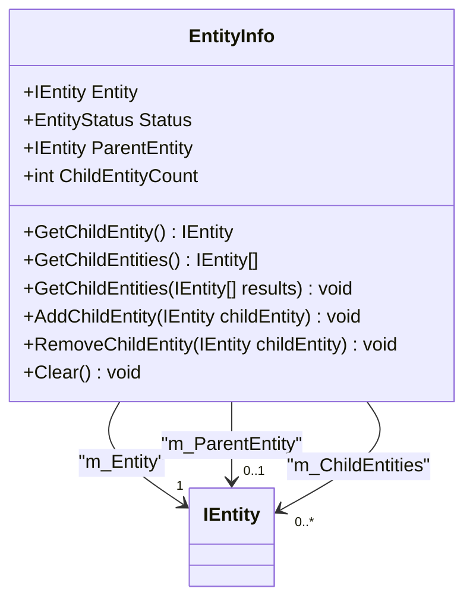
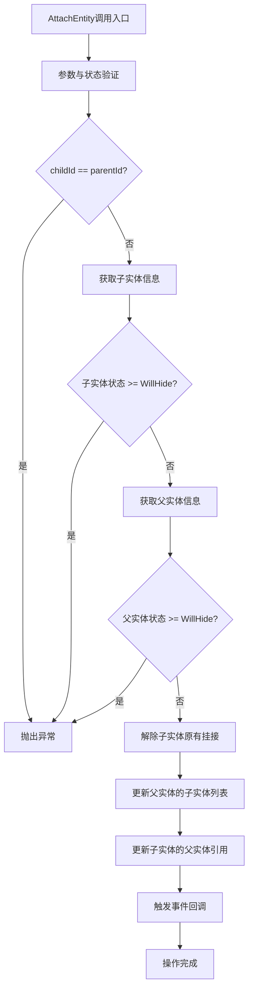
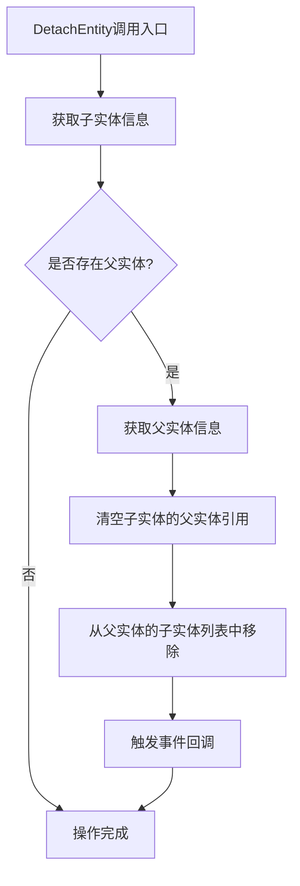
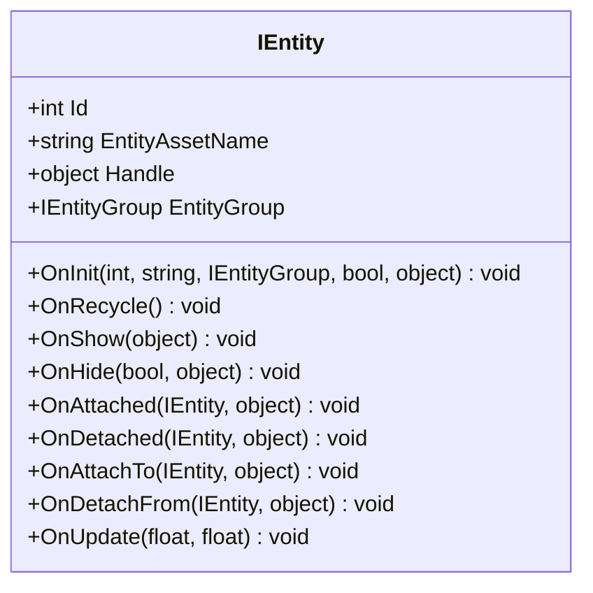

# 实体层级与挂接

<cite>
**Referenced Files in This Document**   
- [EntityManager.cs](file://GameFramework/Entity/EntityManager.cs)
- [EntityManager.EntityInfo.cs](file://GameFramework/Entity/EntityManager.EntityInfo.cs)
- [IEntity.cs](file://GameFramework/Entity/IEntity.cs)
</cite>

## 目录
1. [引言](#引言)
2. [实体层级结构核心机制](#实体层级结构核心机制)
3. [挂接与解除操作](#挂接与解除操作)
4. [双向引用与事件回调](#双向引用与事件回调)
5. [层级结构的应用场景](#层级结构的应用场景)
6. [开发规范与最佳实践](#开发规范与最佳实践)

## 引言

在游戏开发框架中，实体（Entity）是构成游戏世界的基本单元。为了实现复杂的场景组织和行为逻辑，实体之间需要建立层级关系。本文档系统讲解实体间的父子层级关系管理机制，重点阐述`AttachEntity`和`DetachEntity`系列方法的使用方式与内部实现。通过分析`EntityInfo`中的`ParentEntity`和`ChildEntities`字段，详细说明双向引用的维护机制，以及挂接/解除时的事件回调流程。同时，本文将探讨层级结构在场景组织、坐标变换继承和批量操作中的实际应用，并提供避免循环引用和内存泄漏的开发规范。

## 实体层级结构核心机制

实体层级结构是游戏对象组织的基础，它通过父子关系将多个实体连接成树状结构。每个实体可以拥有一个父实体和多个子实体，从而形成复杂的场景图。

### EntityInfo中的层级信息

实体的层级信息由`EntityInfo`类进行管理，该类作为`EntityManager`的内部私有类，封装了实体的核心状态和关系。



**Diagram sources**  
- [EntityManager.EntityInfo.cs](file://GameFramework/Entity/EntityManager.EntityInfo.cs#L16-L133)

**Section sources**  
- [EntityManager.EntityInfo.cs](file://GameFramework/Entity/EntityManager.EntityInfo.cs#L16-L133)

`EntityInfo`类的关键字段包括：
- `m_Entity`：指向实际的实体对象
- `m_Status`：表示实体的当前状态（如初始化、显示、隐藏等）
- `m_ParentEntity`：存储父实体的引用，类型为`IEntity`
- `m_ChildEntities`：存储子实体列表，类型为`List<IEntity>`

这种设计实现了实体间双向引用的维护。父实体通过`m_ChildEntities`列表管理其所有子实体，而子实体通过`m_ParentEntity`字段直接引用其父实体，确保了层级关系的完整性和一致性。

## 挂接与解除操作

实体的挂接（Attach）和解除（Detach）是构建和修改层级结构的核心操作。`EntityManager`提供了多个重载方法来支持不同的使用场景。

### AttachEntity方法族

`AttachEntity`方法用于将一个子实体挂接到指定的父实体上。该方法族提供了四种主要的重载形式：



**Diagram sources**  
- [EntityManager.cs](file://GameFramework/Entity/EntityManager.cs#L906-L942)

**Section sources**  
- [EntityManager.cs](file://GameFramework/Entity/EntityManager.cs#L895-L1025)

主要的`AttachEntity`方法包括：
- `AttachEntity(int childEntityId, int parentEntityId)`：通过实体ID进行挂接
- `AttachEntity(IEntity childEntity, IEntity parentEntity)`：通过实体引用进行挂接
- `AttachEntity(int childEntityId, IEntity parentEntity)`：混合ID和引用的挂接
- `AttachEntity(IEntity childEntity, int parentEntityId)`：混合引用和ID的挂接

所有重载方法最终都会调用`AttachEntity(int childEntityId, int parentEntityId, object userData)`作为核心实现。

### 操作流程与验证

挂接操作的完整流程如下：
1. **参数验证**：检查子实体ID是否等于父实体ID，防止自挂接
2. **实体查找**：通过`GetEntityInfo`方法获取子实体和父实体的`EntityInfo`
3. **状态检查**：确保子实体和父实体的状态均未达到`WillHide`或更高，保证实体处于可操作状态
4. **解除原有挂接**：调用`DetachEntity`方法解除子实体原有的父实体关系
5. **更新引用**：在父实体的`ChildEntities`列表中添加子实体，并更新子实体的`ParentEntity`引用
6. **事件回调**：触发相应的事件回调方法

### DetachEntity方法族

`DetachEntity`方法用于将子实体从其父实体上解除挂接。



**Diagram sources**  
- [EntityManager.cs](file://GameFramework/Entity/EntityManager.cs#L1041-L1066)

**Section sources**  
- [EntityManager.cs](file://GameFramework/Entity/EntityManager.cs#L1031-L1090)

`DetachEntity`方法同样提供了多种重载形式，但核心逻辑保持一致。操作流程包括：
1. 获取子实体的`EntityInfo`
2. 检查是否存在父实体，若不存在则直接返回
3. 获取父实体的`EntityInfo`
4. 清空子实体的`ParentEntity`引用
5. 从父实体的`ChildEntities`列表中移除该子实体
6. 触发相应的事件回调

## 双向引用与事件回调

实体层级管理的核心在于双向引用的维护和事件回调机制的协同工作。

### 双向引用维护

双向引用确保了层级关系的完整性和一致性。当调用`AttachEntity`方法时，系统会同时更新父实体和子实体的引用：

```csharp
// 更新父实体的子实体列表
parentEntityInfo.AddChildEntity(childEntity);

// 更新子实体的父实体引用
childEntityInfo.ParentEntity = parentEntity;
```

这种设计使得可以从任意方向遍历层级结构。例如，可以通过父实体的`GetChildEntities`方法获取所有子实体，也可以通过子实体的`GetParentEntity`方法获取其父实体。

### 事件回调机制

在挂接和解除操作中，系统会自动触发一系列事件回调，通知相关实体状态的变化。

#### 挂接时的回调

当执行`AttachEntity`操作时，会按以下顺序触发两个回调：

```csharp
// 父实体回调：通知父实体有新的子实体被附加
parentEntity.OnAttached(childEntity, userData);

// 子实体回调：通知子实体自己被附加到新的父实体
childEntity.OnAttachTo(parentEntity, userData);
```

**Section sources**  
- [EntityManager.cs](file://GameFramework/Entity/EntityManager.cs#L940-L941)

#### 解除时的回调

当执行`DetachEntity`操作时，会按以下顺序触发两个回调：

```csharp
// 父实体回调：通知父实体有子实体被解除
parentEntity.OnDetached(childEntity, userData);

// 子实体回调：通知子实体自己从父实体解除
childEntity.OnDetachFrom(parentEntity, userData);
```

**Section sources**  
- [EntityManager.cs](file://GameFramework/Entity/EntityManager.cs#L1064-L1065)

#### 回调接口定义

这些回调方法在`IEntity`接口中定义，确保所有实体类型都能正确响应层级变化：



**Diagram sources**  
- [IEntity.cs](file://GameFramework/Entity/IEntity.cs#L79-L100)

**Section sources**  
- [IEntity.cs](file://GameFramework/Entity/IEntity.cs#L79-L100)

## 层级结构的应用场景

实体层级结构在游戏开发中具有广泛的应用，主要体现在以下几个方面：

### 场景组织

层级结构是构建复杂场景的基础。通过将游戏对象组织成树状结构，可以实现逻辑上的分组和管理。例如，在角色控制系统中，可以将角色的各个部件（头、身体、四肢）作为子实体挂接到角色主体上，便于统一管理和操作。

### 坐标变换继承

在大多数游戏引擎中，子实体的坐标是相对于其父实体的。这意味着当父实体移动、旋转或缩放时，其所有子实体会自动继承这些变换。这种特性在实现角色动画、UI布局和场景装饰时非常有用。

### 批量操作

层级结构使得对一组相关实体进行批量操作变得简单高效。例如，当需要隐藏一个完整的UI界面时，只需调用界面根实体的`HideEntity`方法，其所有子实体（按钮、文本、图像等）会自动被隐藏。同样，销毁一个父实体时，其所有子实体也会被自动清理。

## 开发规范与最佳实践

为了确保实体层级系统的稳定性和性能，开发者应遵循以下规范和最佳实践：

### 避免循环引用

循环引用是层级系统中最常见的错误之一。系统通过在`AttachEntity`方法中检查`childEntityId == parentEntityId`来防止直接的自引用。开发者还应避免间接的循环引用，例如A→B→C→A的结构。

### 内存泄漏防范

由于实体间存在相互引用，不当的引用管理可能导致内存泄漏。建议在`OnHide`或`OnRecycle`方法中清理不必要的引用，并确保在实体销毁时正确调用`DetachEntity`方法。

### 事件回调处理

在实现`OnAttached`、`OnDetached`等回调方法时，应注意以下几点：
- 避免在回调中执行耗时操作，以免影响主线程性能
- 确保回调逻辑的幂等性，即多次调用不会产生副作用
- 在回调中谨慎处理`userData`参数，避免空引用异常

### 性能优化

对于包含大量子实体的父实体，频繁的`AddChildEntity`和`RemoveChildEntity`操作可能影响性能。建议：
- 批量操作时使用`List<IEntity>`参数的批量方法
- 避免在每帧中频繁修改层级结构
- 对于静态的层级结构，尽量在初始化时完成构建