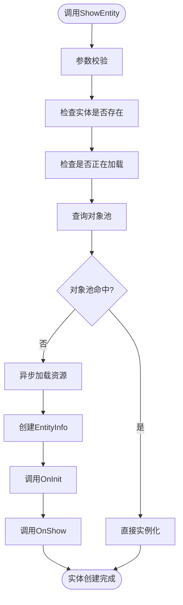
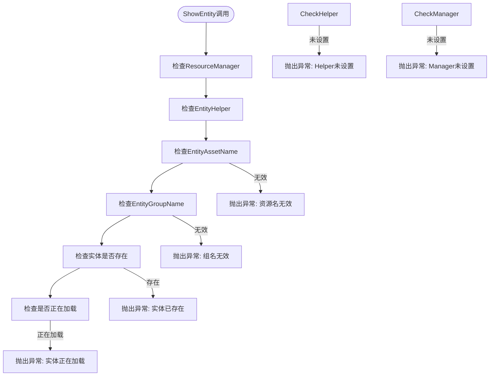
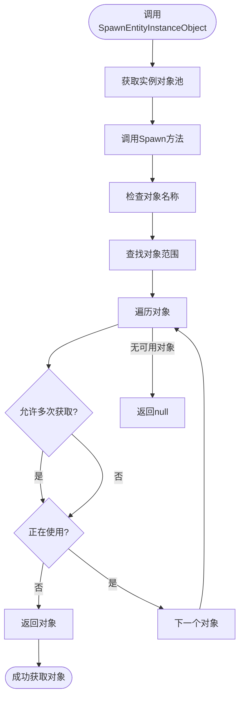
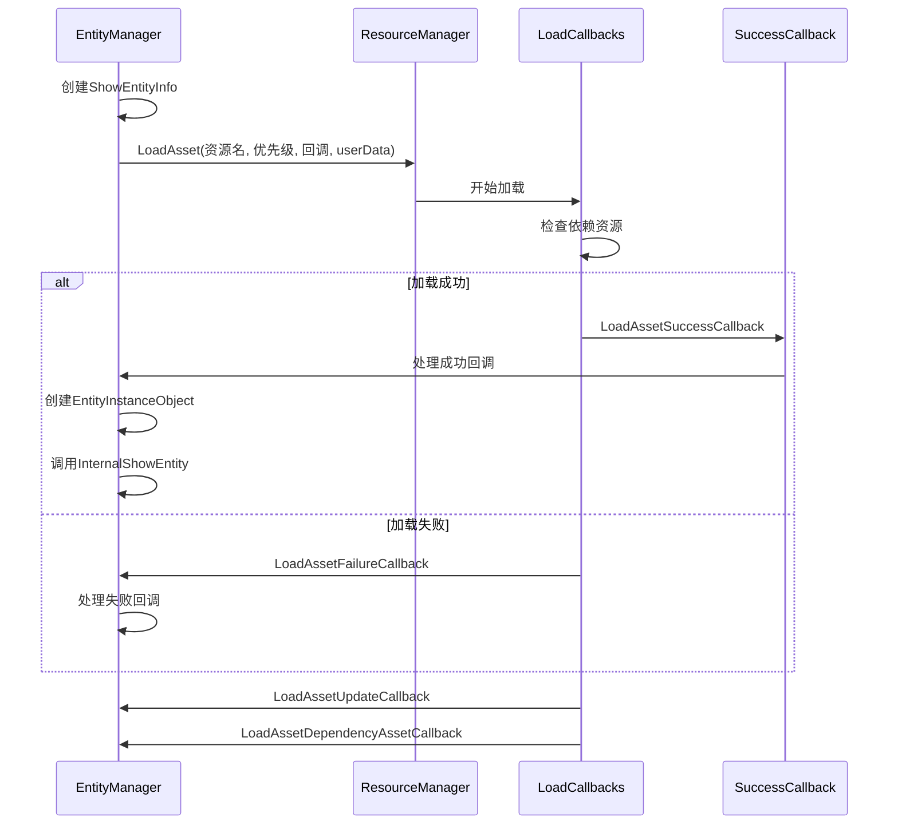
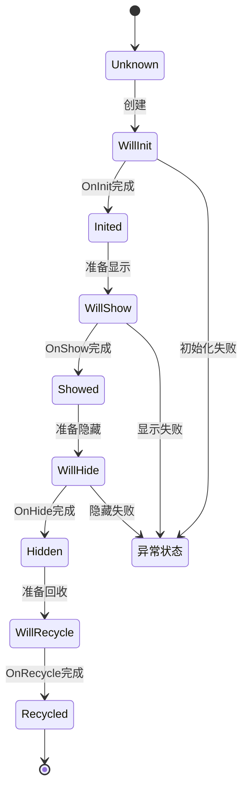
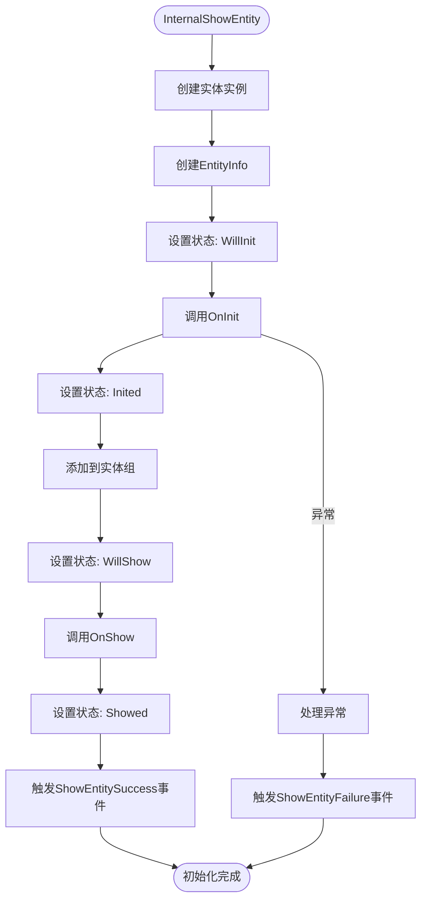
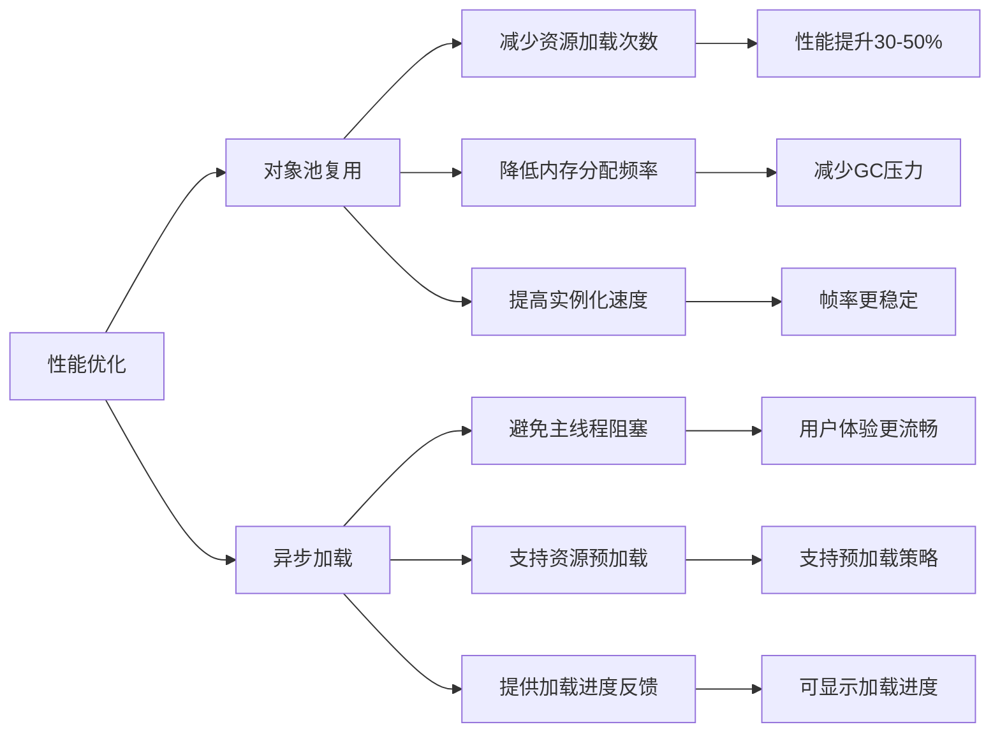

<cite>
**Referenced Files in This Document**   
- [EntityManager.cs](file://GameFramework/Entity/EntityManager.cs)
- [IEntity.cs](file://GameFramework/Entity/IEntity.cs)
- [IResourceManager.cs](file://GameFramework/Resource/IResourceManager.cs)
- [EntityManager.EntityInfo.cs](file://GameFramework/Entity/EntityManager.EntityInfo.cs)
- [EntityManager.ShowEntityInfo.cs](file://GameFramework/Entity/EntityManager.ShowEntityInfo.cs)
- [EntityManager.EntityInstanceObject.cs](file://GameFramework/Entity/EntityManager.EntityInstanceObject.cs)
- [EntityManager.EntityGroup.cs](file://GameFramework/Entity/EntityManager.EntityGroup.cs)
- [LoadAssetCallbacks.cs](file://GameFramework/Resource/LoadAssetCallbacks.cs)
- [ShowEntitySuccessEventArgs.cs](file://GameFramework/Entity/ShowEntitySuccessEventArgs.cs)
</cite>

# 实体创建与初始化

## Table of Contents
1. [实体创建流程概述](#实体创建流程概述)
2. [参数校验与唯一性检查](#参数校验与唯一性检查)
3. [对象池复用机制](#对象池复用机制)
4. [异步资源加载流程](#异步资源加载流程)
5. [EntityInfo状态管理](#entityinfo状态管理)
6. [实体初始化与回调](#实体初始化与回调)
7. [性能优化分析](#性能优化分析)

## 实体创建流程概述

实体创建流程始于调用`ShowEntity`方法，该方法提供多个重载版本以支持不同的参数组合。整个流程从参数校验开始，经过实体唯一性检查，最终通过`IResourceManager`异步加载资源或直接从对象池实例化。核心流程包含参数验证、对象池查询、异步资源加载、实体信息创建和状态管理等关键步骤。

**Diagram sources**
- [EntityManager.cs](file://GameFramework/Entity/EntityManager.cs#L570-L655)
- [IResourceManager.cs](file://GameFramework/Resource/IResourceManager.cs#L520-L581)

**Section sources**
- [EntityManager.cs](file://GameFramework/Entity/EntityManager.cs#L570-L655)

## 参数校验与唯一性检查

`ShowEntity`方法在执行实体创建前会进行严格的参数校验和唯一性检查。首先验证`m_ResourceManager`和`m_EntityHelper`是否已设置，确保系统依赖项完整。接着检查`entityAssetName`和`entityGroupName`是否为空，防止无效资源加载。

**Diagram sources**
- [EntityManager.cs](file://GameFramework/Entity/EntityManager.cs#L607-L625)

**Section sources**
- [EntityManager.cs](file://GameFramework/Entity/EntityManager.cs#L607-L625)

## 对象池复用机制

实体系统采用对象池机制优化性能，通过`EntityGroup.SpawnEntityInstanceObject`方法查询对象池。当实体资源已存在于对象池时，系统直接复用现有实例，避免重复加载资源的开销。

**Diagram sources**
- [EntityManager.EntityGroup.cs](file://GameFramework/Entity/EntityManager.EntityGroup.cs#L362-L365)
- [EntityManager.EntityInstanceObject.cs](file://GameFramework/Entity/EntityManager.EntityInstanceObject.cs#L41-L57)

**Section sources**
- [EntityManager.EntityGroup.cs](file://GameFramework/Entity/EntityManager.EntityGroup.cs#L362-L365)

## 异步资源加载流程

当对象池中无可用实例时，系统通过`IResourceManager.LoadAsset`发起异步资源加载。加载过程包含成功、失败、更新和依赖资源加载四个回调，确保资源加载的完整性和可靠性。

**Diagram sources**
- [EntityManager.cs](file://GameFramework/Entity/EntityManager.cs#L647-L655)
- [IResourceManager.cs](file://GameFramework/Resource/IResourceManager.cs#L520-L581)
- [LoadAssetCallbacks.cs](file://GameFramework/Resource/LoadAssetCallbacks.cs#L12-L143)

**Section sources**
- [EntityManager.cs](file://GameFramework/Entity/EntityManager.cs#L647-L655)

## EntityInfo状态管理

`EntityInfo`类负责管理实体的生命周期状态，通过`EntityStatus`枚举跟踪实体从创建到销毁的各个阶段。状态转换确保了实体操作的有序性和正确性。

**Diagram sources**
- [EntityManager.EntityInfo.cs](file://GameFramework/Entity/EntityManager.EntityInfo.cs#L16-L136)

**Section sources**
- [EntityManager.EntityInfo.cs](file://GameFramework/Entity/EntityManager.EntityInfo.cs#L16-L136)

## 实体初始化与回调

实体初始化过程通过`InternalShowEntity`方法实现，包含`OnInit`和`OnShow`两个关键回调。`OnInit`在实体创建时调用，用于初始化实体状态；`OnShow`在实体显示时调用，用于处理显示逻辑。

**Diagram sources**
- [EntityManager.cs](file://GameFramework/Entity/EntityManager.cs#L1161-L1200)
- [IEntity.cs](file://GameFramework/Entity/IEntity.cs#L54-L65)

**Section sources**
- [EntityManager.cs](file://GameFramework/Entity/EntityManager.cs#L1161-L1200)

## 性能优化分析

实体系统的性能优化主要体现在对象池复用和异步加载两个方面。当实体资源已存在于对象池时，系统直接实例化，避免了资源加载的I/O开销和内存分配成本。

**Diagram sources**
- [EntityManager.cs](file://GameFramework/Entity/EntityManager.cs#L638-L655)
- [EntityManager.EntityGroup.cs](file://GameFramework/Entity/EntityManager.EntityGroup.cs#L362-L365)

**Section sources**
- [EntityManager.cs](file://GameFramework/Entity/EntityManager.cs#L638-L655)