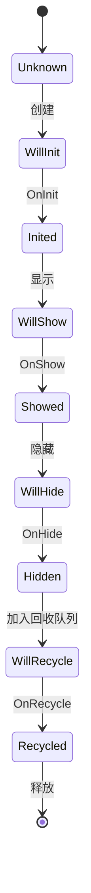
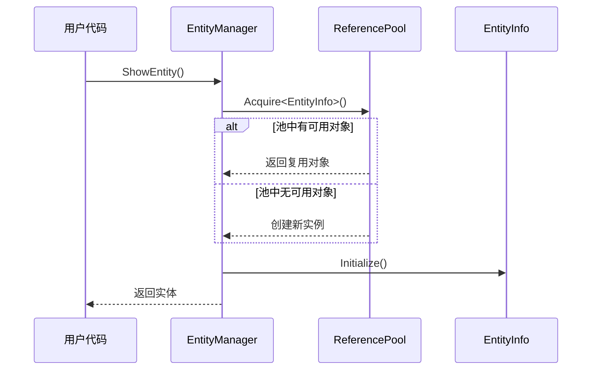
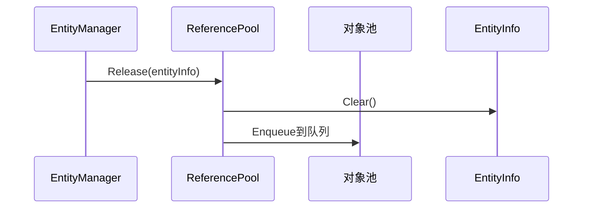
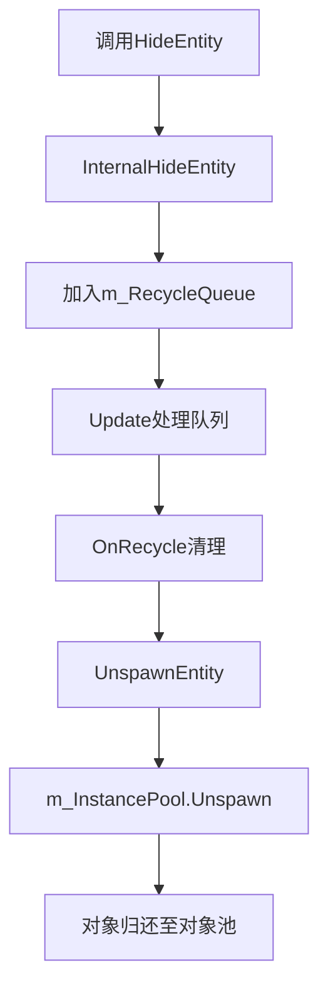
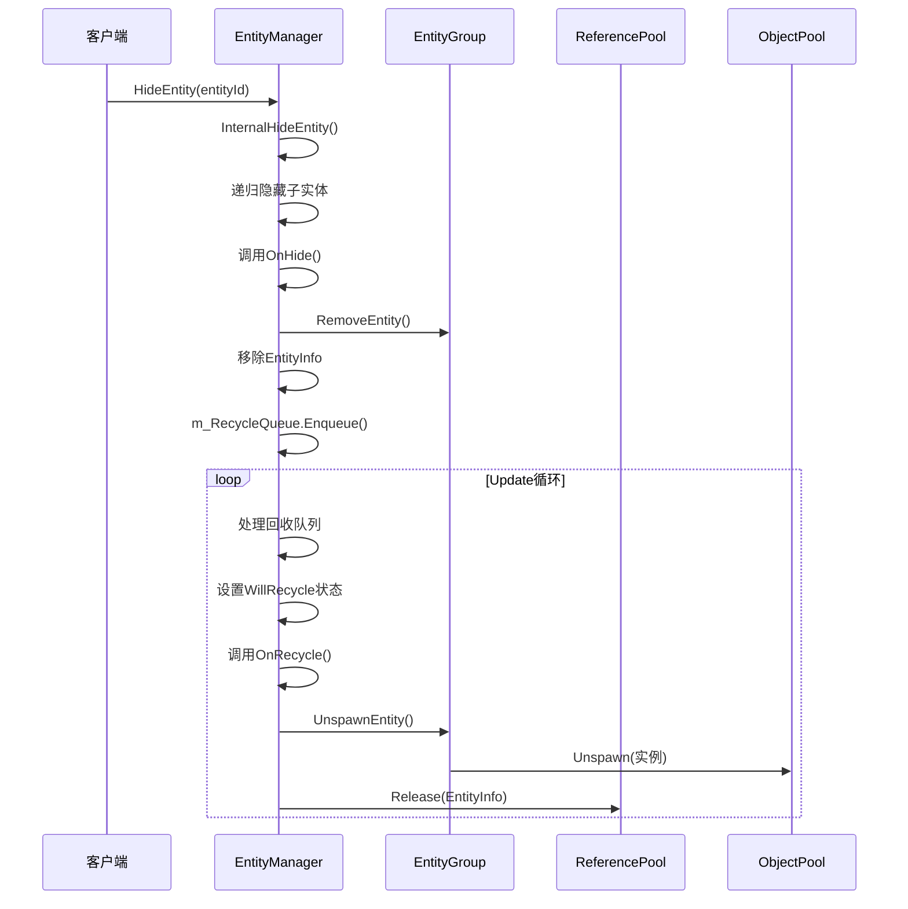
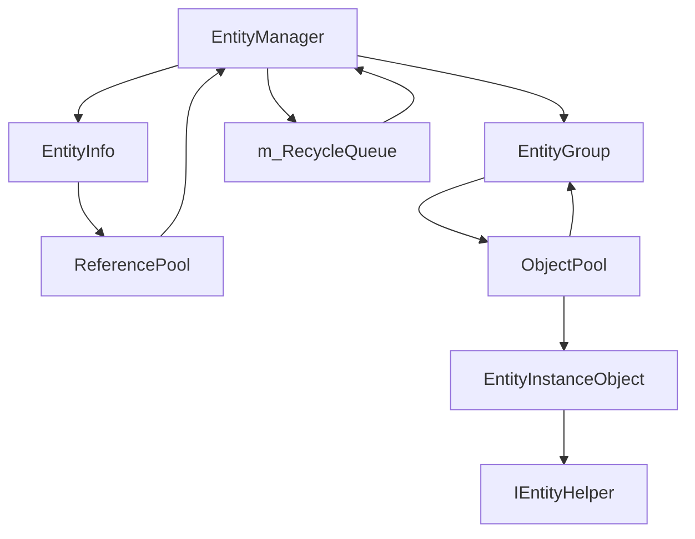

# 实体回收与对象池管理

<cite>
**本文档引用的文件**  
- [EntityManager.cs](file://GameFramework/Entity/EntityManager.cs)
- [EntityManager.EntityInfo.cs](file://GameFramework/Entity/EntityManager.EntityInfo.cs)
- [ReferencePool.cs](file://GameFramework/Base/ReferencePool/ReferencePool.cs)
- [ObjectPoolManager.cs](file://GameFramework/ObjectPool/ObjectPoolManager.cs)
- [EntityManager.EntityGroup.cs](file://GameFramework/Entity/EntityManager.EntityGroup.cs)
- [IEntity.cs](file://GameFramework/Entity/IEntity.cs)
</cite>

## 目录
1. [OnRecycle方法调用时机与设计意图](#onrecycle方法调用时机与设计意图)  
2. [实体回收状态流转机制](#实体回收状态流转机制)  
3. [EntityInfo对象复用机制](#entityinfo对象复用机制)  
4. [实体归还对象池流程](#实体归还对象池流程)  
5. [自定义回收策略扩展建议](#自定义回收策略扩展建议)  
6. [核心流程序列图](#核心流程序列图)  
7. [组件依赖关系图](#组件依赖关系图)

## OnRecycle方法调用时机与设计意图

`OnRecycle`方法是实体生命周期末期的重要清理入口，定义于`IEntity`接口中，作为实体被回收前的最后回调。该方法的调用时机严格发生在实体完成隐藏操作后、正式进入回收队列处理阶段。

其设计意图主要包括：
- **事件注销**：清理实体注册的所有事件监听，防止内存泄漏
- **组件销毁**：释放与实体绑定的临时组件或资源引用
- **状态重置**：将实体内部状态恢复至初始值，为后续复用做准备
- **资源解绑**：断开与外部系统的关联引用，确保对象可安全回收

该方法由实体系统自动调用，开发者应在实现类中重写此方法以完成必要的清理工作。

**Section sources**  
- [IEntity.cs](file://GameFramework/Entity/IEntity.cs#L59)
- [EntityManager.cs](file://GameFramework/Entity/EntityManager.cs#L161-L184)

## 实体回收状态流转机制

实体的回收过程通过`EntityStatus`枚举实现严格的状态控制，完整状态流转如下：



当调用`HideEntity`方法时，系统执行以下关键步骤：
1. 递归隐藏所有子实体
2. 调用`OnHide`进行隐藏前处理
3. 从实体组中移除该实体
4. 将`EntityInfo`对象加入`m_RecycleQueue`回收队列

在`EntityManager.Update`方法中，系统会持续处理回收队列中的实体：
- 将状态置为`WillRecycle`
- 调用`OnRecycle`执行清理逻辑
- 更新状态为`Recycled`
- 执行`UnspawnEntity`归还实例
- 通过`ReferencePool.Release`释放`EntityInfo`

**Diagram sources**  
- [EntityManager.EntityStatus.cs](file://GameFramework/Entity/EntityManager.EntityStatus.cs#L14-L25)
- [EntityManager.cs](file://GameFramework/Entity/EntityManager.cs#L161-L184)

**Section sources**  
- [EntityManager.cs](file://GameFramework/Entity/EntityManager.cs#L161-L184)
- [EntityManager.cs](file://GameFramework/Entity/EntityManager.cs#L1202-L1241)

## EntityInfo对象复用机制

`EntityInfo`对象通过`ReferencePool`（引用池）实现高效的内存复用，避免频繁的GC操作。

### 创建过程


### 释放过程


`ReferencePool`通过`ReferenceCollection`管理不同类型引用对象的队列，提供`Acquire`和`Release`接口实现对象的获取与归还。每次释放时会调用`Clear`方法重置内部状态，确保下次获取时为干净状态。

**Diagram sources**  
- [EntityManager.EntityInfo.cs](file://GameFramework/Entity/EntityManager.EntityInfo.cs#L71-L82)
- [ReferencePool.cs](file://GameFramework/Base/ReferencePool/ReferencePool.cs#L12-L200)

**Section sources**  
- [EntityManager.EntityInfo.cs](file://GameFramework/Entity/EntityManager.EntityInfo.cs#L71-L82)
- [ReferencePool.cs](file://GameFramework/Base/ReferencePool/ReferencePool.cs#L12-L200)

## 实体归还对象池流程

实体实例的归还通过`EntityGroup.UnspawnEntity`方法完成，其核心流程如下：



具体实现中：
1. `EntityGroup.UnspawnEntity`接收实体句柄作为参数
2. 转发调用至内部的`m_InstancePool.Unspawn`方法
3. 对象池将实例标记为未使用并加入空闲队列
4. 后续`Spawn`操作可从池中获取该实例

`EntityInstanceObject`作为包装类，继承自`ObjectBase`，在`Release`方法中调用`IEntityHelper.ReleaseEntity`完成最终资源释放。

**Diagram sources**  
- [EntityManager.EntityGroup.cs](file://GameFramework/Entity/EntityManager.EntityGroup.cs#L367-L370)
- [EntityManager.EntityInstanceObject.cs](file://GameFramework/Entity/EntityManager.EntityInstanceObject.cs#L53-L56)

**Section sources**  
- [EntityManager.EntityGroup.cs](file://GameFramework/Entity/EntityManager.EntityGroup.cs#L367-L370)
- [EntityManager.EntityInstanceObject.cs](file://GameFramework/Entity/EntityManager.EntityInstanceObject.cs#L53-L56)

## 自定义回收策略扩展建议

### 延迟回收
可通过扩展`EntityManager`实现延迟回收机制：
```csharp
// 示例：延迟1秒回收
public void DelayedHideEntity(int entityId, float delay)
{
    // 记录延迟信息
    m_DelayedRecycles.Add(new DelayedRecycle(entityId, Time.time + delay));
}
```
在`Update`中检查超时并执行真实隐藏。

### 条件过滤
实现选择性回收策略：
```csharp
public bool ShouldRecycleEntity(IEntity entity)
{
    // 根据标签、类型、状态等条件判断
    return !entity.HasTag("Permanent") && entity.Level < 10;
}
```

### 分级回收
建立多级回收策略：
- L1：立即回收临时实体
- L2：延迟回收常用实体
- L3：压缩回收稀有实体

### 回收监听
提供回收前回调接口：
```csharp
public event Action<EntityInfo> OnBeforeRecycle;
```
允许模块在回收前执行特定逻辑。

## 核心流程序列图



**Diagram sources**  
- [EntityManager.cs](file://GameFramework/Entity/EntityManager.cs#L161-L184)
- [EntityManager.cs](file://GameFramework/Entity/EntityManager.cs#L1202-L1241)

## 组件依赖关系图



该图展示了实体管理系统中各核心组件的依赖关系，体现了对象池与引用池协同工作的整体架构。

**Diagram sources**  
- [EntityManager.cs](file://GameFramework/Entity/EntityManager.cs#L23)
- [EntityManager.EntityInfo.cs](file://GameFramework/Entity/EntityManager.EntityInfo.cs#L16-L133)
- [EntityManager.EntityGroup.cs](file://GameFramework/Entity/EntityManager.EntityGroup.cs#L367-L370)