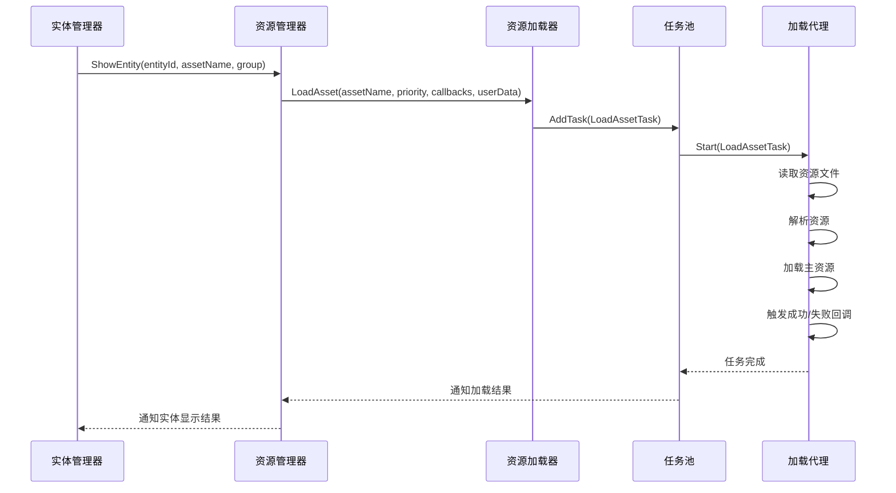
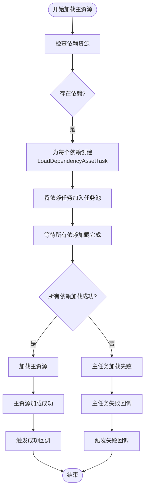
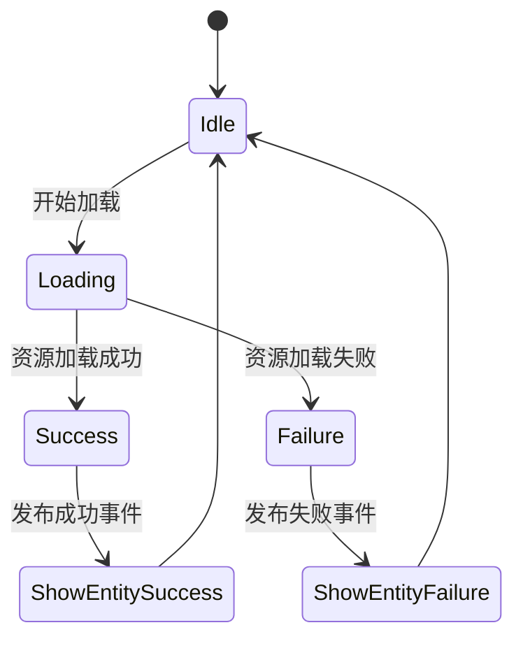
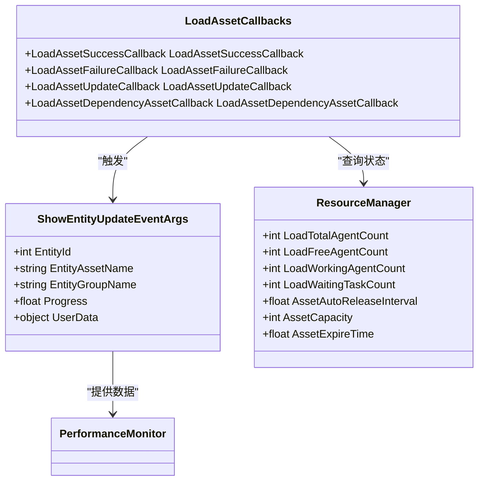

# 实体显示与资源加载

<cite>
**本文档中引用的文件**  
- [ResourceManager.cs](file://GameFramework/Resource/ResourceManager.cs)
- [LoadAssetCallbacks.cs](file://GameFramework/Resource/LoadAssetCallbacks.cs)
- [EntityManager.cs](file://GameFramework/Entity/EntityManager.cs)
- [ShowEntitySuccessEventArgs.cs](file://GameFramework/Entity/ShowEntitySuccessEventArgs.cs)
- [ShowEntityFailureEventArgs.cs](file://GameFramework/Entity/ShowEntityFailureEventArgs.cs)
- [ShowEntityDependencyAssetEventArgs.cs](file://GameFramework/Entity/ShowEntityDependencyAssetEventArgs.cs)
- [ShowEntityUpdateEventArgs.cs](file://GameFramework/Entity/ShowEntityUpdateEventArgs.cs)
</cite>

## 目录
1. [异步资源加载机制](#异步资源加载机制)
2. [加载优先级与依赖处理](#加载优先级与依赖处理)
3. [实体显示事件分析](#实体显示事件分析)
4. [依赖资源事件与上下文传递](#依赖资源事件与上下文传递)
5. [加载进度与性能监控](#加载进度与性能监控)

## 异步资源加载机制

实体显示过程中的资源加载通过 `ResourceManager` 的 `LoadAsset` 方法链实现，该方法链最终调用 `ResourceLoader.LoadAsset` 方法启动异步加载流程。加载过程由 `TaskPool<LoadResourceTaskBase>` 管理，通过 `LoadResourceAgent` 代理执行具体的资源读取操作。

加载流程始于 `EntityManager.ShowEntity` 方法，该方法检查实体是否已存在或正在加载，若未加载则通过 `ResourceManager.LoadAsset` 发起资源请求。`LoadAsset` 方法根据资源名称、类型、优先级和回调函数创建 `LoadAssetTask`，并将其加入任务池等待执行。



**Diagram sources**
- [EntityManager.cs](file://GameFramework/Entity/EntityManager.cs#L1310-L1324)
- [ResourceManager.cs](file://GameFramework/Resource/ResourceManager.cs#L1462-L1627)
- [ResourceManager.ResourceLoader.cs](file://GameFramework/Resource/ResourceManager.ResourceLoader.cs#L180-L240)

**Section sources**
- [EntityManager.cs](file://GameFramework/Entity/EntityManager.cs#L1310-L1324)
- [ResourceManager.cs](file://GameFramework/Resource/ResourceManager.cs#L1462-L1627)

## 加载优先级与依赖处理

资源加载支持优先级控制，通过 `LoadAsset` 方法的 `priority` 参数指定。高优先级任务会被优先调度执行。依赖资源的处理在 `LoadAssetTask` 创建时完成，系统会检查主资源的所有依赖项，并为每个依赖项创建 `LoadDependencyAssetTask`。

依赖资源的加载是递归进行的，每个依赖项都可能有自己的依赖。系统通过 `m_AssetDependencyCount` 和 `m_ResourceDependencyCount` 字典跟踪资源的引用计数，确保资源在不再被引用时可以被正确释放。依赖加载成功后，会通过 `OnLoadDependencyAsset` 回调通知主任务。



**Diagram sources**
- [ResourceManager.ResourceLoader.LoadAssetTask.cs](file://GameFramework/Resource/ResourceManager.ResourceLoader.LoadAssetTask.cs#L1-L89)
- [ResourceManager.ResourceLoader.LoadDependencyAssetTask.cs](file://GameFramework/Resource/ResourceManager.ResourceLoader.LoadDependencyAssetTask.cs#L1-L61)

**Section sources**
- [ResourceManager.ResourceLoader.cs](file://GameFramework/Resource/ResourceManager.ResourceLoader.cs#L180-L240)
- [ResourceManager.ResourceLoader.LoadDependencyAssetTask.cs](file://GameFramework/Resource/ResourceManager.ResourceLoader.LoadDependencyAssetTask.cs#L1-L61)

## 实体显示事件分析

实体显示过程通过事件机制通知外部系统加载结果。`ShowEntitySuccessEventArgs` 和 `ShowEntityFailureEventArgs` 分别表示加载成功和失败的事件。

`ShowEntitySuccessEventArgs` 在资源成功加载并实例化后触发，包含加载成功的实体对象、加载耗时和用户自定义数据。`ShowEntityFailureEventArgs` 在加载过程中发生错误时触发，包含错误的实体编号、资源名称、组名、错误信息和用户自定义数据。

事件的发布时机如下：
- **成功事件**：在 `LoadAssetSuccessCallback` 中，当资源成功加载且实体成功实例化后发布。
- **失败事件**：在 `LoadAssetFailureCallback` 中，当资源加载失败或实体实例化失败时发布。

错误分类包括：
- **资源不存在**：`LoadResourceStatus.NotExist`
- **资源未就绪**：`LoadResourceStatus.NotReady`
- **类型错误**：`LoadResourceStatus.TypeError`
- **依赖错误**：`LoadResourceStatus.DependencyError`
- **加载失败**：其他具体错误



**Diagram sources**
- [ShowEntitySuccessEventArgs.cs](file://GameFramework/Entity/ShowEntitySuccessEventArgs.cs#L12-L76)
- [ShowEntityFailureEventArgs.cs](file://GameFramework/Entity/ShowEntityFailureEventArgs.cs#L12-L102)
- [EntityManager.cs](file://GameFramework/Entity/EntityManager.cs#L1243-L1292)

**Section sources**
- [ShowEntitySuccessEventArgs.cs](file://GameFramework/Entity/ShowEntitySuccessEventArgs.cs#L12-L76)
- [ShowEntityFailureEventArgs.cs](file://GameFramework/Entity/ShowEntityFailureEventArgs.cs#L12-L102)

## 依赖资源事件与上下文传递

`ShowEntityDependencyAssetEventArgs` 事件在加载依赖资源时触发，用于通知外部系统依赖资源的加载进度。该事件包含实体编号、资源名称、组名、当前加载的依赖资源名称、已加载数量和总数。

此事件在处理复杂资源依赖时尤为重要，允许外部系统：
- 显示详细的加载进度条
- 监控特定依赖资源的加载情况
- 实现加载优化策略

`userData` 参数贯穿整个加载流程，从 `ShowEntity` 调用开始，通过 `LoadAsset` 传递到 `LoadAssetTask`，最终在所有回调和事件中可用。这使得调用者可以在回调中访问上下文信息，如UI组件引用、业务逻辑数据等。

```csharp
// 事件订阅代码范例
eventHandler.ShowEntityDependencyAsset += OnShowEntityDependencyAsset;

private void OnShowEntityDependencyAsset(object sender, ShowEntityDependencyAssetEventArgs e)
{
    // 更新UI进度条
    progressBar.value = (float)e.LoadedCount / e.TotalCount;
    // 记录日志
    Debug.Log($"加载依赖: {e.DependencyAssetName} ({e.LoadedCount}/{e.TotalCount})");
    // 检查特定依赖
    if (e.DependencyAssetName == "critical_asset")
    {
        // 执行特殊处理
    }
}

// userData传递示例
var userData = new { 
    UIReference = uiComponent,
    Callback = onComplete,
    Priority = LoadPriority.High 
};
entityManager.ShowEntity(entityId, assetName, groupName, userData);
```

**Diagram sources**
- [ShowEntityDependencyAssetEventArgs.cs](file://GameFramework/Entity/ShowEntityDependencyAssetEventArgs.cs#L12-L128)
- [EntityManager.cs](file://GameFramework/Entity/EntityManager.cs#L1310-L1324)

**Section sources**
- [ShowEntityDependencyAssetEventArgs.cs](file://GameFramework/Entity/ShowEntityDependencyAssetEventArgs.cs#L12-L128)
- [LoadAssetCallbacks.cs](file://GameFramework/Resource/LoadAssetCallbacks.cs#L12-L143)

## 加载进度与性能监控

加载进度通过 `ShowEntityUpdateEventArgs` 事件实现，该事件在资源加载过程中定期触发，提供加载进度百分比。进度更新由 `LoadResourceAgentHelperUpdateEventArgs` 触发，经过 `LoadAssetUpdateCallback` 传递到 `ShowEntityUpdateEventArgs`。

`ResourceManager` 的回调机制通过 `LoadAssetCallbacks` 类封装，该类聚合了成功、失败、更新和依赖加载四个回调函数。这种设计使得调用者可以灵活选择需要监听的事件类型。

性能监控应用包括：
- **加载耗时分析**：通过 `ShowEntitySuccessEventArgs.Duration` 统计资源加载时间
- **并发量监控**：通过 `LoadTotalAgentCount`、`LoadFreeAgentCount` 等属性监控加载代理使用情况
- **任务队列监控**：通过 `LoadWaitingTaskCount` 监控等待加载的任务数量
- **资源池监控**：通过 `AssetCapacity`、`AssetExpireTime` 等属性监控资源对象池状态



**Diagram sources**
- [LoadAssetCallbacks.cs](file://GameFramework/Resource/LoadAssetCallbacks.cs#L12-L143)
- [ShowEntityUpdateEventArgs.cs](file://GameFramework/Entity/ShowEntityUpdateEventArgs.cs#L12-L102)
- [ResourceManager.cs](file://GameFramework/Resource/ResourceManager.cs#L1-L2588)

**Section sources**
- [LoadAssetCallbacks.cs](file://GameFramework/Resource/LoadAssetCallbacks.cs#L12-L143)
- [ShowEntityUpdateEventArgs.cs](file://GameFramework/Entity/ShowEntityUpdateEventArgs.cs#L12-L102)
- [ResourceManager.cs](file://GameFramework/Resource/ResourceManager.cs#L1-L2588)