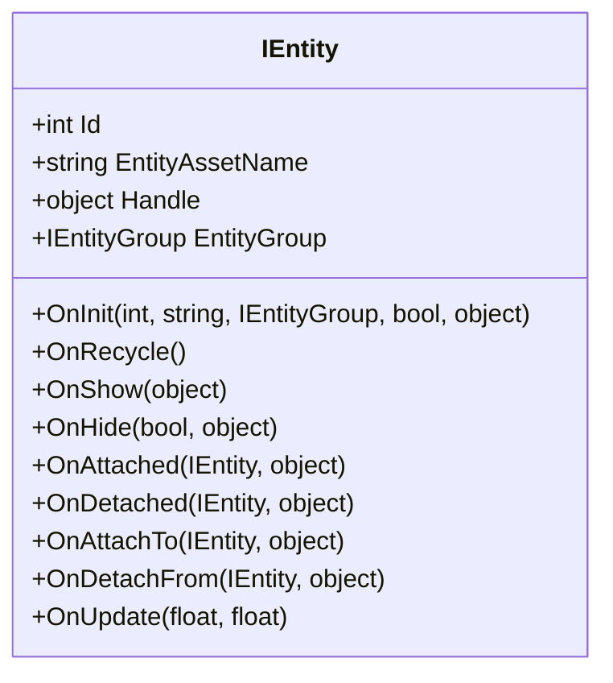
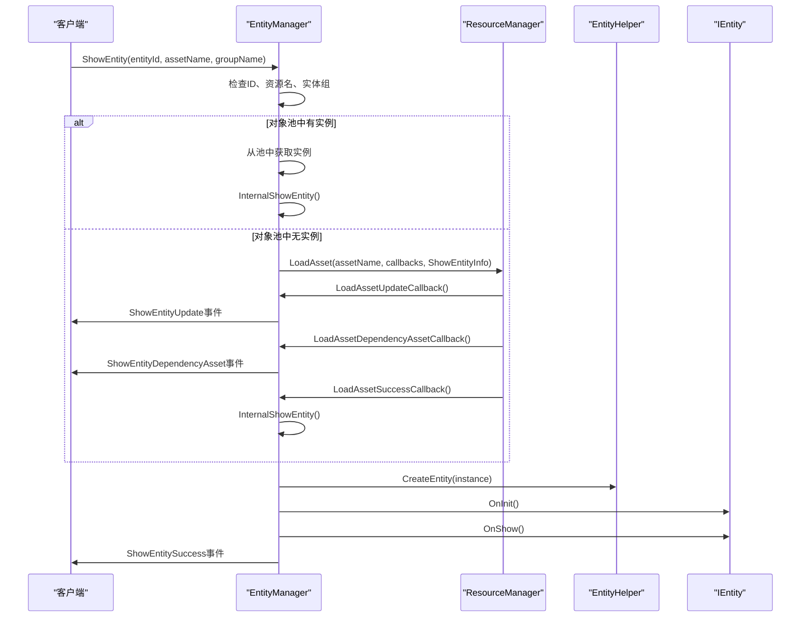
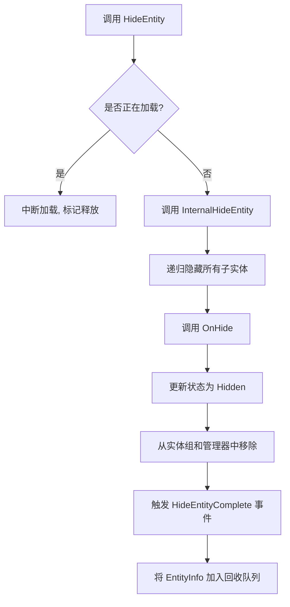
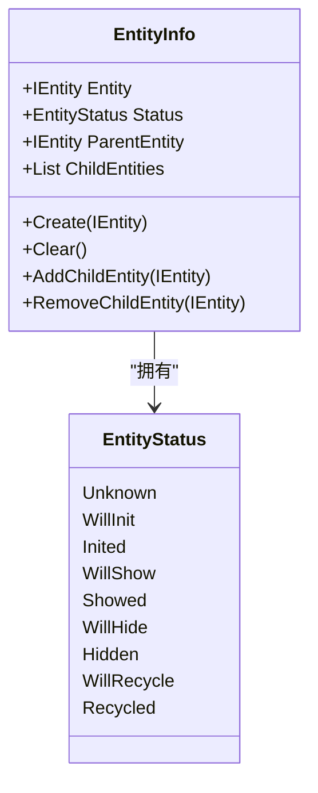

<cite>
**Referenced Files in This Document**  
- [IEntity.cs](file://GameFramework/Entity/IEntity.cs)
- [EntityManager.cs](file://GameFramework/Entity/EntityManager.cs)
- [EntityManager.EntityInfo.cs](file://GameFramework/Entity/EntityManager.EntityInfo.cs)
- [ShowEntitySuccessEventArgs.cs](file://GameFramework/Entity/ShowEntitySuccessEventArgs.cs)
- [ShowEntityFailureEventArgs.cs](file://GameFramework/Entity/ShowEntityFailureEventArgs.cs)
- [HideEntityCompleteEventArgs.cs](file://GameFramework/Entity/HideEntityCompleteEventArgs.cs)
- [ShowEntityUpdateEventArgs.cs](file://GameFramework/Entity/ShowEntityUpdateEventArgs.cs)
- [ShowEntityDependencyAssetEventArgs.cs](file://GameFramework/Entity/ShowEntityDependencyAssetEventArgs.cs)
- [EntityManager.ShowEntityInfo.cs](file://GameFramework/Entity/EntityManager.ShowEntityInfo.cs)
- [EntityManager.EntityStatus.cs](file://GameFramework/Entity/EntityManager.EntityStatus.cs)
</cite>

## 实体生命周期管理

本文档深入解析实体（Entity）在游戏框架中的完整生命周期，涵盖从创建、初始化、显示、隐藏到回收的各个阶段。详细说明 `IEntity` 接口的核心方法调用时机与实现规范，阐述 `ShowEntity` 和 `HideEntity` 的异步流程，包括资源加载、依赖处理及事件回调机制。结合 `EntityManager` 的内部状态管理（`EntityInfo`），全面解释实体从加载到销毁的全过程，并提供异常处理和资源释放的最佳实践。

### 核心接口与生命周期方法

`IEntity` 接口定义了实体在其生命周期中必须实现的核心方法，这些方法由 `EntityManager` 在特定时机自动调用。

**Diagram sources**
- [IEntity.cs](file://GameFramework/Entity/IEntity.cs#L12-L108)

**Section sources**
- [IEntity.cs](file://GameFramework/Entity/IEntity.cs#L12-L108)

#### OnInit
- **调用时机**: 实体被成功创建并初始化时调用。
- **实现规范**: 此方法是实体生命周期的起点，用于执行初始化逻辑，如设置初始状态、注册事件监听器、初始化组件等。参数 `isNewInstance` 指示该实体是否为全新实例（`true`）或从对象池中复用的实例（`false`），开发者应据此进行差异化处理。

#### OnShow
- **调用时机**: 实体被成功加载并准备显示时调用。
- **实现规范**: 此方法用于执行与“显示”相关的逻辑，如激活游戏对象、播放出现动画、开始接收用户输入等。`userData` 参数可用于传递显示时所需的上下文数据。

#### OnHide
- **调用时机**: 实体被隐藏时调用。
- **实现规范**: 用于执行与“隐藏”相关的清理逻辑，如停用游戏对象、停止动画、暂停逻辑更新等。`isShutdown` 参数指示此次隐藏是否由关闭实体管理器触发，可用于区分正常隐藏和系统关闭。

#### OnRecycle
- **调用时机**: 实体被回收至对象池前调用。
- **实现规范**: 这是实体在被销毁前的最后一次回调，用于重置所有状态，确保其可以安全地被后续实例复用。必须将所有可变成员变量重置为默认值，以避免状态污染。

### 显示与隐藏的异步流程

实体的显示（`ShowEntity`）和隐藏（`HideEntity`）操作是异步的，由 `EntityManager` 统一管理。

#### ShowEntity 异步流程
1.  **检查与准备**: `EntityManager` 首先检查实体ID和资源名称的有效性，确保实体未被加载或正在加载。
2.  **对象池查询**: 尝试从所属实体组的对象池中获取实体实例。
3.  **异步加载**: 若对象池中无可用实例，则通过 `IResourceManager` 异步加载实体资源。此过程会触发一系列事件：
    - **ShowEntityUpdate**: 报告加载进度。
    - **ShowEntityDependencyAsset**: 报告加载依赖资源的进度。
4.  **内部显示**: 资源加载成功后，调用 `InternalShowEntity` 方法。
5.  **生命周期回调**: 按顺序调用 `OnInit` -> `OnShow`。
6.  **事件通知**: 所有初始化和显示逻辑完成后，触发 `ShowEntitySuccess` 事件。

**Diagram sources**
- [EntityManager.cs](file://GameFramework/Entity/EntityManager.cs#L800-L1200)
- [ShowEntityUpdateEventArgs.cs](file://GameFramework/Entity/ShowEntityUpdateEventArgs.cs)
- [ShowEntityDependencyAssetEventArgs.cs](file://GameFramework/Entity/ShowEntityDependencyAssetEventArgs.cs)
- [ShowEntitySuccessEventArgs.cs](file://GameFramework/Entity/ShowEntitySuccessEventArgs.cs)

**Section sources**
- [EntityManager.cs](file://GameFramework/Entity/EntityManager.cs#L800-L1200)

#### HideEntity 异步流程
1.  **检查与中断**: 若实体正在加载中，将其从加载队列中移除，并标记为待释放，以中断加载过程。
2.  **递归隐藏**: 调用 `InternalHideEntity`，首先递归隐藏所有子实体。
3.  **生命周期回调**: 按顺序调用 `OnHide`。
4.  **状态更新与事件**: 更新实体状态为 `Hidden`，从实体组和管理器中移除，并触发 `HideEntityComplete` 事件。
5.  **回收入队**: 将 `EntityInfo` 加入回收队列，等待在下一帧被 `Update` 方法处理。

**Diagram sources**
- [EntityManager.cs](file://GameFramework/Entity/EntityManager.cs#L1200-L1300)
- [HideEntityCompleteEventArgs.cs](file://GameFramework/Entity/HideEntityCompleteEventArgs.cs)

**Section sources**
- [EntityManager.cs](file://GameFramework/Entity/EntityManager.cs#L1200-L1300)

### 内部状态管理与事件机制

`EntityManager` 使用 `EntityInfo` 类来跟踪每个实体的完整状态和元数据。

**Diagram sources**
- [EntityManager.EntityInfo.cs](file://GameFramework/Entity/EntityManager.EntityInfo.cs)
- [EntityManager.EntityStatus.cs](file://GameFramework/Entity/EntityManager.EntityStatus.cs)

**Section sources**
- [EntityManager.EntityInfo.cs](file://GameFramework/Entity/EntityManager.EntityInfo.cs)
- [EntityManager.EntityStatus.cs](file://GameFramework/Entity/EntityManager.EntityStatus.cs)

#### EntityInfo
- **作用**: 作为 `EntityManager` 内部管理实体的容器，持有对 `IEntity` 的引用、当前状态、父子关系等信息。
- **状态机**: `EntityStatus` 枚举定义了实体的九个状态，`EntityManager` 通过精确的状态转换来保证生命周期的正确性。

#### 事件机制
`EntityManager` 通过事件向外部系统通知关键操作的结果：
- **ShowEntitySuccess**: 显示成功，携带成功显示的实体、加载耗时和用户数据。
- **ShowEntityFailure**: 显示失败，携带失败的实体ID、资源名、错误信息和用户数据。
- **HideEntityComplete**: 隐藏完成，携带已隐藏的实体信息和用户数据。

### 最佳实践与异常处理

- **资源释放**: 确保在 `OnRecycle` 中重置所有状态，避免内存泄漏和状态污染。
- **异常处理**: `InternalShowEntity` 方法使用 `try-catch` 包裹，确保即使实体初始化失败，也能通过 `ShowEntityFailure` 事件通知上层，而不会导致整个系统崩溃。
- **对象池**: 充分利用对象池机制，减少频繁的 `new` 和 `delete` 操作，提升性能。
- **事件订阅**: 及时订阅和取消订阅事件，防止内存泄漏。