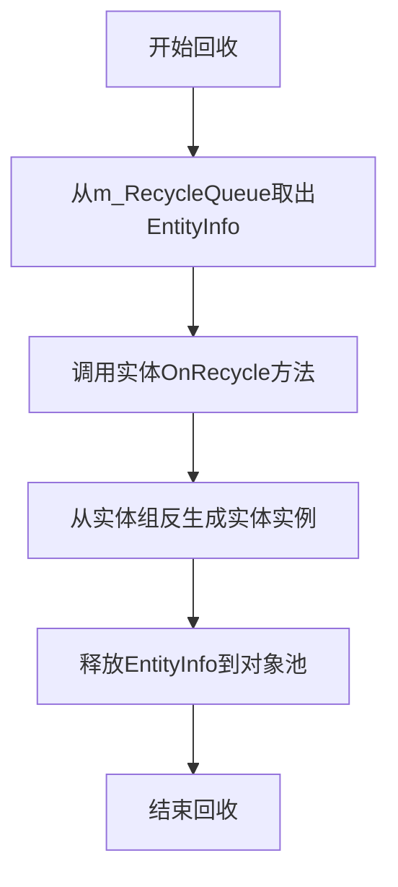

# 实体隐藏与卸载

<cite>
**Referenced Files in This Document**  
- [EntityManager.cs](file://GameFramework/Entity/EntityManager.cs)
- [HideEntityCompleteEventArgs.cs](file://GameFramework/Entity/HideEntityCompleteEventArgs.cs)
- [IEntity.cs](file://GameFramework/Entity/IEntity.cs)
- [IEntityGroup.cs](file://GameFramework/Entity/IEntityGroup.cs)
</cite>

## 目录
1. [调用方式](#调用方式)
2. [加载中实体的处理机制](#加载中实体的处理机制)
3. [InternalHideEntity执行流程](#internalhideentity执行流程)
4. [HideEntityComplete事件触发条件](#hideentitycomplete事件触发条件)
5. [isShutdown参数的特殊处理](#isshutdown参数的特殊处理)
6. [资源释放最佳实践](#资源释放最佳实践)

## 调用方式

`HideEntity`方法提供了两种调用方式，分别通过实体ID或`IEntity`实例来隐藏实体。

第一种方式通过实体编号进行调用，适用于已知实体ID的场景：
```csharp
[SPEC SYMBOL](file://GameFramework/Entity/EntityManager.cs#L661-L664)
```

第二种方式通过`IEntity`接口实例进行调用，适用于持有实体引用的场景：
```csharp
[SPEC SYMBOL](file://GameFramework/Entity/EntityManager.cs#L693-L696)
```

两种调用方式最终都会重载到带有`userData`参数的方法中，实现统一的隐藏逻辑处理。

**Section sources**
- [EntityManager.cs](file://GameFramework/Entity/EntityManager.cs#L661-L696)

## 加载中实体的处理机制

当尝试隐藏一个正在加载过程中的实体时，系统通过`m_EntitiesBeingLoaded`和`m_EntitiesToReleaseOnLoad`两个集合协同工作来处理。

`m_EntitiesBeingLoaded`是一个字典，用于记录所有正在加载的实体及其序列号：
```csharp
[SPEC SYMBOL](file://GameFramework/Entity/EntityManager.cs#L21-L21)
```

`m_EntitiesToReleaseOnLoad`是一个哈希集合，用于记录那些在加载完成后需要立即释放的实体序列号：
```csharp
[SPEC SYMBOL](file://GameFramework/Entity/EntityManager.cs#L22-L22)
```

当调用`HideEntity`方法时，如果检测到目标实体正处于加载状态（通过`IsLoadingEntity`方法判断），系统会将该实体的序列号添加到`m_EntitiesToReleaseOnLoad`集合中，并从`m_EntitiesBeingLoaded`中移除：
```csharp
[SPEC SYMBOL](file://GameFramework/Entity/EntityManager.cs#L671-L687)
```

在资源加载成功回调`LoadAssetSuccessCallback`中，系统会检查实体序列号是否存在于`m_EntitiesToReleaseOnLoad`中，若存在则直接释放资源而不进行实体创建：
```csharp
[SPEC SYMBOL](file://GameFramework/Entity/EntityManager.cs#L1185-L1195)
```

这种机制确保了在实体加载完成前被请求隐藏的实体能够被正确处理，避免了资源浪费和内存泄漏。

**Section sources**
- [EntityManager.cs](file://GameFramework/Entity/EntityManager.cs#L21-L22)
- [EntityManager.cs](file://GameFramework/Entity/EntityManager.cs#L671-L687)
- [EntityManager.cs](file://GameFramework/Entity/EntityManager.cs#L1185-L1195)

## InternalHideEntity执行流程

`InternalHideEntity`是实体隐藏的核心执行方法，其处理流程包含多个关键步骤。

首先，该方法会递归隐藏所有子实体，确保父子关系的完整性：
```csharp
[SPEC SYMBOL](file://GameFramework/Entity/EntityManager.cs#L1202-L1204)
```

接着，检查实体当前状态，若已是隐藏状态则直接返回，避免重复操作：
```csharp
[SPEC SYMBOL](file://GameFramework/Entity/EntityManager.cs#L1206-L1208)
```

然后执行核心的隐藏操作序列：
1. 调用`DetachEntity`解除与父实体的关系
2. 触发`OnHide`回调通知实体即将被隐藏
3. 从所属实体组中移除该实体
4. 从管理器的实体信息字典中移除记录

```csharp
[SPEC SYMBOL](file://GameFramework/Entity/EntityManager.cs#L1209-L1230)
```

最后，触发`HideEntityComplete`事件并将其加入回收队列：
```csharp
[SPEC SYMBOL](file://GameFramework/Entity/EntityManager.cs#L1232-L1241)
```

**Section sources**
- [EntityManager.cs](file://GameFramework/Entity/EntityManager.cs#L1202-L1241)

## HideEntityComplete事件触发条件

`HideEntityComplete`事件在实体成功完成隐藏流程后触发，其触发条件包括：

1. 实体必须成功通过所有前置检查（存在且非隐藏状态）
2. 所有子实体已被递归隐藏
3. 与父实体的关系已成功解除
4. 实体已从实体组和管理器中正确移除

事件的创建和触发过程如下：
```csharp
[SPEC SYMBOL](file://GameFramework/Entity/EntityManager.cs#L1234-L1240)
```

`HideEntityCompleteEventArgs`类定义了事件携带的数据结构，包括实体编号、资源名称、所属实体组和用户自定义数据：
```csharp
[SPEC SYMBOL](file://GameFramework/Entity/HideEntityCompleteEventArgs.cs#L12-L89)
```

事件使用对象池进行管理，通过`ReferencePool.Acquire`获取实例，使用完毕后通过`ReferencePool.Release`归还，有效减少了GC压力。

**Section sources**
- [EntityManager.cs](file://GameFramework/Entity/EntityManager.cs#L1234-L1240)
- [HideEntityCompleteEventArgs.cs](file://GameFramework/Entity/HideEntityCompleteEventArgs.cs#L12-L89)

## isShutdown参数的特殊处理

`isShutdown`参数在框架关闭时具有特殊处理逻辑，它通过`m_IsShutdown`字段进行全局管理。

当框架调用`Shutdown`方法时，会将`m_IsShutdown`设置为`true`：
```csharp
[SPEC SYMBOL](file://GameFramework/Entity/EntityManager.cs#L189-L197)
```

这个标志位随后会被传递给`OnHide`回调方法：
```csharp
[SPEC SYMBOL](file://GameFramework/Entity/EntityManager.cs#L1214)
```

实体实现可以根据`isShutdown`参数的值来区分正常隐藏和框架关闭两种场景，从而执行不同的清理逻辑。例如，在框架关闭时可能需要跳过某些渐变动画或网络请求取消操作，以加快关闭速度。

**Section sources**
- [EntityManager.cs](file://GameFramework/Entity/EntityManager.cs#L189-L197)
- [EntityManager.cs](file://GameFramework/Entity/EntityManager.cs#L1214)

## 资源释放最佳实践

实体的资源释放遵循严格的生命周期管理流程，确保不会发生内存泄漏。

当实体被隐藏后，其`EntityInfo`会被加入`m_RecycleQueue`队列：
```csharp
[SPEC SYMBOL](file://GameFramework/Entity/EntityManager.cs#L1241)
```

在`Update`方法中，系统会轮询处理回收队列中的所有实体：
```csharp
[SPEC SYMBOL](file://GameFramework/Entity/EntityManager.cs#L161-L184)
```

处理流程包括：
1. 调用`OnRecycle`方法通知实体进行回收准备
2. 从实体组的对象池中反生成（Unspawn）实体实例
3. 释放`EntityInfo`对象回对象池



**Diagram sources**
- [EntityManager.cs](file://GameFramework/Entity/EntityManager.cs#L161-L184)

最佳实践建议：
1. 在`OnHide`回调中及时清理事件监听和协程
2. 避免在`OnRecycle`中执行耗时操作
3. 确保所有引用的对象都得到适当释放
4. 利用`userData`参数传递必要的上下文信息

对象在`Update`循环中被真正归还至对象池，这个延迟处理机制确保了即使在事件回调中再次引用该实体，也能获得有效的对象引用。

**Section sources**
- [EntityManager.cs](file://GameFramework/Entity/EntityManager.cs#L161-L184)