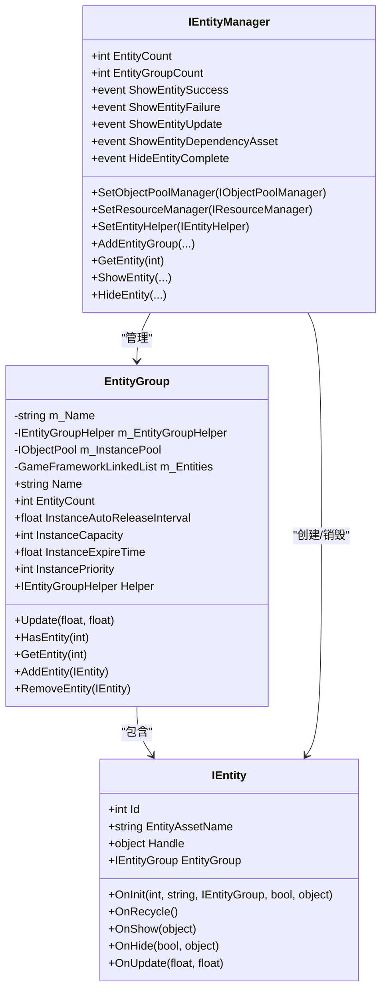
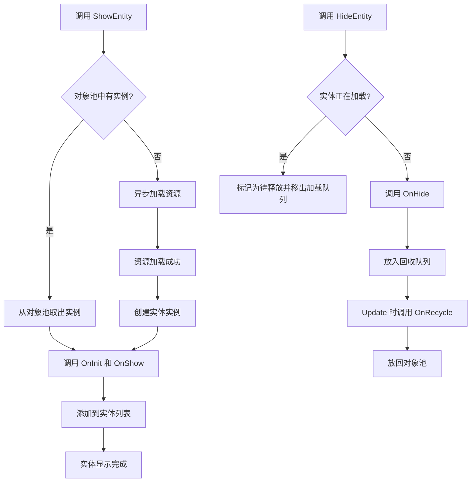
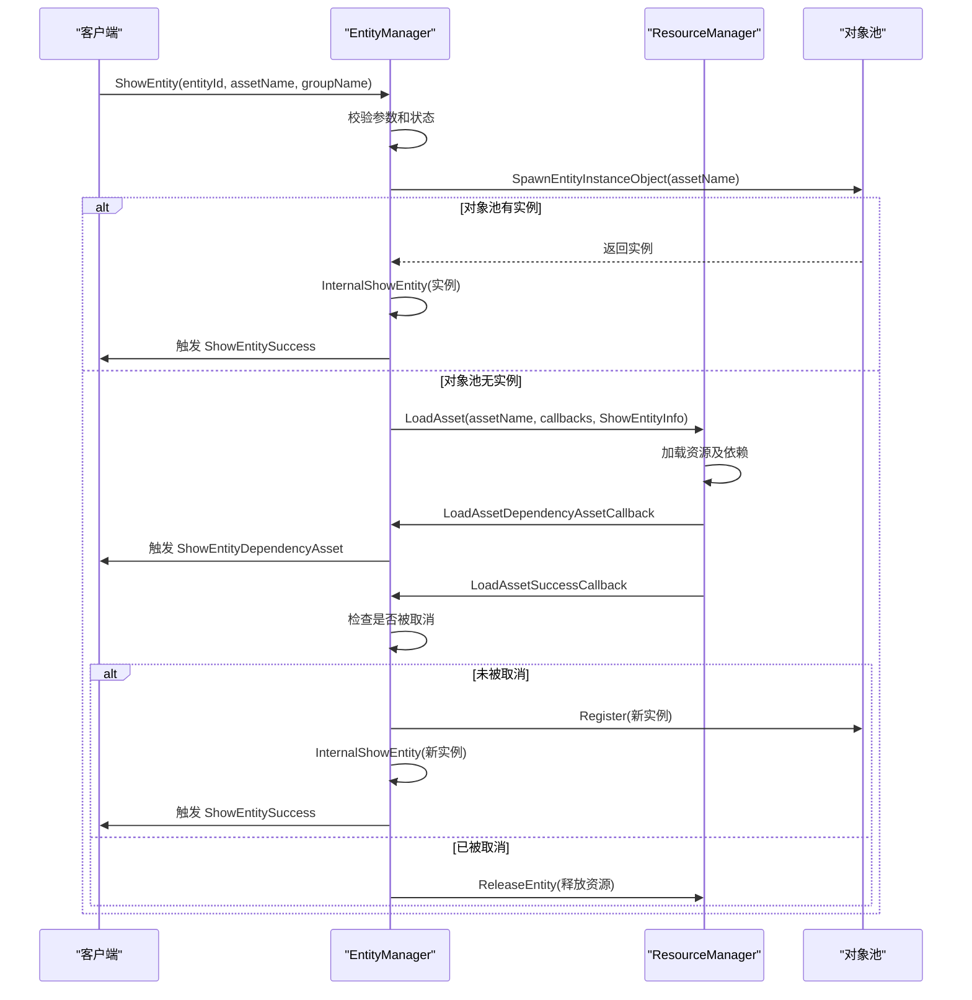

# 实体管理

<cite>
**本文档引用的文件**
- [IEntity.cs](file://GameFramework/Entity/IEntity.cs)
- [IEntityManager.cs](file://GameFramework/Entity/IEntityManager.cs)
- [EntityManager.cs](file://GameFramework/Entity/EntityManager.cs)
- [EntityManager.EntityGroup.cs](file://GameFramework/Entity/EntityManager.EntityGroup.cs)
- [ShowEntitySuccessEventArgs.cs](file://GameFramework/Entity/ShowEntitySuccessEventArgs.cs)
- [HideEntityCompleteEventArgs.cs](file://GameFramework/Entity/HideEntityCompleteEventArgs.cs)
- [ShowEntityDependencyAssetEventArgs.cs](file://GameFramework/Entity/ShowEntityDependencyAssetEventArgs.cs)
</cite>

## 目录
1. [引言](#引言)
2. [核心接口与类设计](#核心接口与类设计)
3. [实体生命周期管理](#实体生命周期管理)
4. [异步流程与事件机制](#异步流程与事件机制)
5. [实体组与对象池集成](#实体组与对象池集成)
6. [性能优化与最佳实践](#性能优化与最佳实践)

## 引言
实体管理系统（EntityManager）是游戏框架中的核心模块，负责管理游戏世界中所有实体的创建、显示、隐藏、挂接和销毁等全生命周期操作。本文档深入解析该系统的架构设计、关键接口与类的职责，以及在实际游戏开发中的最佳使用模式。

## 核心接口与类设计

### IEntity 接口
`IEntity` 接口定义了实体的基本行为和属性，是所有实体类型的契约。它提供了获取实体编号、资源名称、实例对象和所属实体组的方法。更重要的是，它定义了实体生命周期中的关键回调方法，如 `OnInit`（初始化）、`OnShow`（显示）、`OnHide`（隐藏）、`OnUpdate`（轮询）等，允许实体在不同状态时执行自定义逻辑。

**Section sources**
- [IEntity.cs](file://GameFramework/Entity/IEntity.cs#L12-L108)

### IEntityManager 接口
`IEntityManager` 接口是实体管理器的公共契约，暴露了所有管理功能。它不仅提供了对实体和实体组的增删查改操作，还定义了关键的事件，如 `ShowEntitySuccess`、`ShowEntityFailure` 和 `HideEntityComplete`，使得外部系统可以监听实体状态的变化。该接口还要求设置 `IObjectPoolManager` 和 `IResourceManager`，体现了其对对象池和资源管理系统的依赖。

**Section sources**
- [IEntityManager.cs](file://GameFramework/Entity/IEntityManager.cs#L17-L448)

### EntityGroup 类
`EntityGroup` 是 `IEntityGroup` 接口的内部实现，它将实体进行分组管理。每个实体组都拥有一个独立的对象池（`IObjectPool<EntityInstanceObject>`），用于缓存和复用实体的实例对象。这种设计允许对不同类型的实体（如玩家、敌人、道具）进行独立的性能调优，例如设置不同的对象池容量、过期时间和优先级。

**Diagram sources**
- [IEntity.cs](file://GameFramework/Entity/IEntity.cs#L12-L108)
- [IEntityManager.cs](file://GameFramework/Entity/IEntityManager.cs#L17-L448)
- [EntityManager.EntityGroup.cs](file://GameFramework/Entity/EntityManager.EntityGroup.cs#L17-L391)

## 实体生命周期管理

### 实体创建与显示 (ShowEntity)
实体的创建通过 `ShowEntity` 系列方法触发。流程如下：
1.  **参数校验**：检查资源管理器、实体辅助器、实体ID、资源名、组名等是否有效。
2.  **状态检查**：确保实体ID未被占用，且未在加载中。
3.  **获取实体组**：根据组名获取对应的 `EntityGroup`。
4.  **对象池尝试**：首先尝试从该组的对象池中取出一个实例（`SpawnEntityInstanceObject`）。如果成功，则直接使用该实例，跳过资源加载。
5.  **异步加载**：如果对象池为空，则调用 `IResourceManager.LoadAsset` 发起异步加载。加载的上下文信息（如 `ShowEntityInfo`）会被传递，以便在加载成功后完成实体的初始化。

### 实体隐藏与销毁 (HideEntity)
实体的隐藏通过 `HideEntity` 系列方法完成，其流程根据实体状态而异：
1.  **正在加载中**：如果实体仍在加载队列中（`IsLoadingEntity` 为 true），则将其标记为待释放（加入 `m_EntitiesToReleaseOnLoad`），并从加载队列中移除。当资源加载完成时，会检查此标记并直接释放资源，不进行后续的显示流程。
2.  **已加载**：如果实体已存在，则调用 `InternalHideEntity`。该方法会触发实体的 `OnHide` 回调，然后将实体信息放入回收队列（`m_RecycleQueue`）。在管理器的 `Update` 方法中，会处理回收队列，调用 `OnRecycle` 并将实体实例放回其所属组的对象池中，实现复用。

**Diagram sources**
- [EntityManager.cs](file://GameFramework/Entity/EntityManager.cs#L607-L655)
- [EntityManager.cs](file://GameFramework/Entity/EntityManager.cs#L671-L687)
- [EntityManager.cs](file://GameFramework/Entity/EntityManager.cs#L1233-L1261)

**Section sources**
- [EntityManager.cs](file://GameFramework/Entity/EntityManager.cs#L570-L655)
- [EntityManager.cs](file://GameFramework/Entity/EntityManager.cs#L661-L711)

## 异步流程与事件机制

### 异步加载流程
`ShowEntity` 的核心是异步资源加载。当需要从资源系统加载时，`EntityManager` 会注册一系列回调函数（`m_LoadAssetCallbacks`）：
-   **成功回调 (`LoadAssetSuccessCallback`)**：当资源加载成功，会检查该实体是否已被标记为“待释放”。如果是，则直接释放资源；否则，创建 `EntityInstanceObject`，注册到实体组的对象池，并最终调用 `InternalShowEntity` 完成显示。
-   **失败回调**：触发 `ShowEntityFailure` 事件。
-   **更新回调**：触发 `ShowEntityUpdate` 事件，可用于更新加载进度条。
-   **依赖资源回调**：当加载过程中需要加载依赖资源时，触发 `ShowEntityDependencyAsset` 事件。

### 回调事件
系统通过事件机制解耦，通知外部状态变化：
-   **ShowEntitySuccessEventArgs**：在实体成功显示后触发。包含 `Entity`（显示成功的实体）、`Duration`（加载耗时）和 `UserData`（用户数据）。
-   **HideEntityCompleteEventArgs**：在实体完全隐藏并准备回收后触发。包含 `EntityId`、`EntityAssetName`、`EntityGroup` 和 `UserData`。

**Diagram sources**
- [ShowEntitySuccessEventArgs.cs](file://GameFramework/Entity/ShowEntitySuccessEventArgs.cs#L12-L76)
- [HideEntityCompleteEventArgs.cs](file://GameFramework/Entity/HideEntityCompleteEventArgs.cs#L12-L90)
- [ShowEntityDependencyAssetEventArgs.cs](file://GameFramework/Entity/ShowEntityDependencyAssetEventArgs.cs#L12-L113)
- [EntityManager.cs](file://GameFramework/Entity/EntityManager.cs#L607-L655)

## 实体组与对象池集成

### 组织结构
`EntityGroup` 是实体的逻辑容器。所有实体都必须归属于一个实体组。这种分组方式便于管理，例如可以按功能（UI、角色、特效）或按场景区域进行分组。`IEntityManager` 维护一个 `m_EntityGroups` 字典，以组名作为键来管理所有组。

### 对象池集成
`EntityGroup` 与对象池的集成是其核心特性：
1.  **专用对象池**：每个 `EntityGroup` 在初始化时，会通过 `IObjectPoolManager` 创建一个专属的 `IObjectPool<EntityInstanceObject>`。`EntityInstanceObject` 封装了实体的原始资源和实例化后的对象。
2.  **实例复用**：当调用 `HideEntity` 时，实体的实例对象（`Handle`）不会被立即销毁，而是通过 `UnspawnEntity` 方法放回其所属组的对象池。
3.  **实例获取**：当调用 `ShowEntity` 且对象池中有可用实例时，`SpawnEntityInstanceObject` 会从池中取出一个实例，实现快速显示，避免了昂贵的资源加载和对象实例化开销。
4.  **配置独立**：每个组的对象池可以独立配置 `InstanceCapacity`（容量）、`