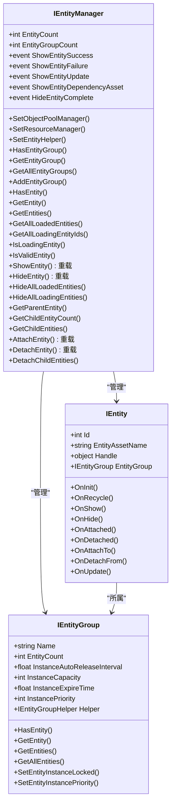
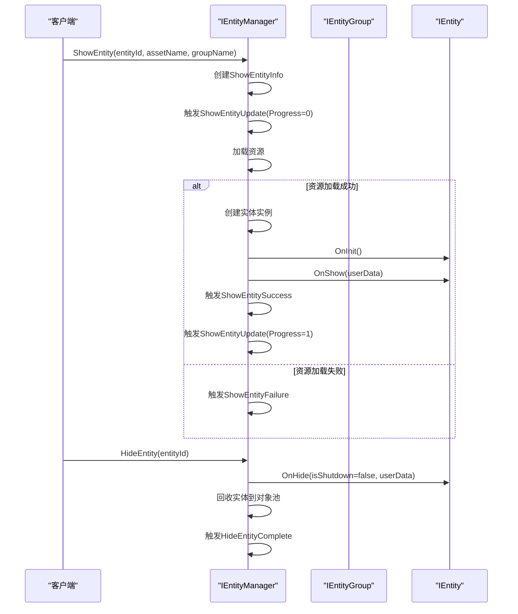

# 实体管理API参考

<cite>
**本文档引用的文件**  
- [IEntityManager.cs](file://GameFramework/Entity/IEntityManager.cs)
- [IEntity.cs](file://GameFramework/Entity/IEntity.cs)
- [IEntityGroup.cs](file://GameFramework/Entity/IEntityGroup.cs)
- [ShowEntitySuccessEventArgs.cs](file://GameFramework/Entity/ShowEntitySuccessEventArgs.cs)
- [HideEntityCompleteEventArgs.cs](file://GameFramework/Entity/HideEntityCompleteEventArgs.cs)
- [ShowEntityFailureEventArgs.cs](file://GameFramework/Entity/ShowEntityFailureEventArgs.cs)
- [ShowEntityUpdateEventArgs.cs](file://GameFramework/Entity/ShowEntityUpdateEventArgs.cs)
- [ShowEntityDependencyAssetEventArgs.cs](file://GameFramework/Entity/ShowEntityDependencyAssetEventArgs.cs)
</cite>

## 目录
1. [接口继承关系](#接口继承关系)
2. [IEntityManager接口](#ientitymanager接口)
3. [IEntity接口](#ientity接口)
4. [IEntityGroup接口](#ientitygroup接口)
5. [事件参数类](#事件参数类)
6. [典型调用序列](#典型调用序列)

## 接口继承关系

**Diagram sources**
- [IEntityManager.cs](file://GameFramework/Entity/IEntityManager.cs#L17-L448)
- [IEntity.cs](file://GameFramework/Entity/IEntity.cs#L12-L108)
- [IEntityGroup.cs](file://GameFramework/Entity/IEntityGroup.cs#L95-L143)

## IEntityManager接口

`IEntityManager`是实体管理系统的核心接口，负责实体的生命周期管理、分组管理以及事件通知。

### 属性

- **EntityCount**: 获取当前管理的实体总数。
- **EntityGroupCount**: 获取当前管理的实体组总数。

### 事件

- **ShowEntitySuccess**: 实体显示成功时触发，事件参数为`ShowEntitySuccessEventArgs`。
- **ShowEntityFailure**: 实体显示失败时触发，事件参数为`ShowEntityFailureEventArgs`。
- **ShowEntityUpdate**: 实体显示过程中进度更新时触发，事件参数为`ShowEntityUpdateEventArgs`。
- **ShowEntityDependencyAsset**: 显示实体时加载依赖资源时触发，事件参数为`ShowEntityDependencyAssetEventArgs`。
- **HideEntityComplete**: 实体隐藏完成时触发，事件参数为`HideEntityCompleteEventArgs`。

### 方法

#### 实体组管理

- **SetObjectPoolManager**: 设置对象池管理器，用于实体实例的创建和回收。
- **SetResourceManager**: 设置资源管理器，用于加载实体资源。
- **SetEntityHelper**: 设置实体辅助器，用于创建和初始化实体实例。
- **HasEntityGroup**: 判断指定名称的实体组是否存在。
- **GetEntityGroup**: 获取指定名称的实体组。
- **GetAllEntityGroups**: 获取所有实体组。
- **AddEntityGroup**: 增加新的实体组，可配置对象池参数和辅助器。

#### 实体查询

- **HasEntity**: 重载方法，通过实体ID或资源名称判断实体是否存在。
- **GetEntity**: 重载方法，通过实体ID或资源名称获取单个实体。
- **GetEntities**: 重载方法，通过资源名称获取多个同名实体。
- **GetAllLoadedEntities**: 获取所有已加载的实体，性能特征为O(n)时间复杂度，返回数组或填充到List中。
- **GetAllLoadingEntityIds**: 获取所有正在加载的实体ID。

#### 实体操作

- **ShowEntity**: 重载系列方法，用于显示实体。参数差异如下：
  - `ShowEntity(int, string, string)`: 基础版本，指定实体ID、资源名称和组名。
  - `ShowEntity(int, string, string, int)`: 增加加载优先级参数。
  - `ShowEntity(int, string, string, object)`: 增加用户自定义数据参数。
  - `ShowEntity(int, string, string, int, object)`: 同时包含优先级和用户数据。
- **HideEntity**: 重载系列方法，用于隐藏实体，支持通过ID或实体引用，以及可选的用户数据。
- **HideAllLoadedEntities**: 隐藏所有已加载的实体。
- **HideAllLoadingEntities**: 隐藏所有正在加载的实体。

#### 实体关系管理

- **GetParentEntity**: 获取子实体的父实体。
- **GetChildEntityCount**: 获取父实体的子实体数量。
- **GetChildEntities**: 获取父实体的所有子实体。
- **AttachEntity**: 重载系列方法，将子实体附加到父实体，支持多种参数组合。
- **DetachEntity**: 重载系列方法，解除子实体与父实体的关系。
- **DetachChildEntities**: 解除父实体的所有子实体。

**Section sources**
- [IEntityManager.cs](file://GameFramework/Entity/IEntityManager.cs#L17-L448)

## IEntity接口

`IEntity`是所有实体的基接口，定义了实体的基本属性和生命周期方法。

### 属性

- **Id**: 获取实体的唯一编号。
- **EntityAssetName**: 获取实体的资源名称。
- **Handle**: 获取实体的实际实例对象。
- **EntityGroup**: 获取实体所属的实体组。

### 生命周期方法

- **OnInit**: 实体初始化时调用，提供实体ID、资源名称、所属组、是否为新实例和用户数据。
- **OnRecycle**: 实体被回收时调用，用于清理资源。
- **OnShow**: 实体显示时调用，接收用户自定义数据。
- **OnHide**: 实体隐藏时调用，包含是否因管理器关闭而隐藏的标志和用户数据。
- **OnUpdate**: 实体轮询时调用，接收逻辑和真实流逝时间。

### 关系管理方法

- **OnAttached**: 当本实体被附加为其他实体的子实体时调用。
- **OnDetached**: 当本实体被解除子实体关系时调用。
- **OnAttachTo**: 当本实体附加到其他实体作为子实体时调用。
- **OnDetachFrom**: 当本实体从其他实体解除关系时调用。

**Section sources**
- [IEntity.cs](file://GameFramework/Entity/IEntity.cs#L12-L108)

## IEntityGroup接口

`IEntityGroup`表示实体组，用于对实体进行分类管理，每个组拥有独立的对象池配置。

### 属性

- **Name**: 获取实体组的名称。
- **EntityCount**: 获取组内实体数量。
- **InstanceAutoReleaseInterval**: 获取或设置对象池自动释放可释放对象的间隔秒数。
- **InstanceCapacity**: 获取或设置对象池容量。
- **InstanceExpireTime**: 获取或设置对象池对象过期秒数。
- **InstancePriority**: 获取或设置对象池优先级。
- **Helper**: 获取实体组辅助器。

### 方法

- **HasEntity**: 重载方法，通过ID或资源名称判断组内是否存在实体。
- **GetEntity**: 重载方法，通过ID或资源名称从组内获取实体。
- **GetEntities**: 重载方法，通过资源名称获取组内多个同名实体。
- **GetAllEntities**: 获取组内所有实体。
- **SetEntityInstanceLocked**: 设置实体实例是否被加锁，影响对象池行为。
- **SetEntityInstancePriority**: 设置实体实例的优先级。

**Section sources**
- [IEntityGroup.cs](file://GameFramework/Entity/IEntityGroup.cs#L95-L143)

## 事件参数类

### ShowEntitySuccessEventArgs

显示实体成功事件的参数类。

- **Entity**: 获取显示成功的实体。
- **Duration**: 获取加载持续时间（秒）。
- **UserData**: 获取用户自定义数据。
- **Create**: 静态工厂方法，创建事件实例。
- **Clear**: 清理方法，重置所有字段。

**Section sources**
- [ShowEntitySuccessEventArgs.cs](file://GameFramework/Entity/ShowEntitySuccessEventArgs.cs#L12-L76)

### HideEntityCompleteEventArgs

隐藏实体完成事件的参数类。

- **EntityId**: 获取被隐藏实体的编号。
- **EntityAssetName**: 获取被隐藏实体的资源名称。
- **EntityGroup**: 获取被隐藏实体所属的实体组。
- **UserData**: 获取用户自定义数据。
- **Create**: 静态工厂方法，创建事件实例。
- **Clear**: 清理方法，重置所有字段。

**Section sources**
- [HideEntityCompleteEventArgs.cs](file://GameFramework/Entity/HideEntityCompleteEventArgs.cs#L12-L89)

### ShowEntityFailureEventArgs

显示实体失败事件的参数类。

- **EntityId**: 获取尝试显示的实体编号。
- **EntityAssetName**: 获取尝试显示的实体资源名称。
- **EntityGroupName**: 获取实体组名称。
- **ErrorMessage**: 获取错误信息。
- **UserData**: 获取用户自定义数据。
- **Create**: 静态工厂方法，创建事件实例。
- **Clear**: 清理方法，重置所有字段。

**Section sources**
- [ShowEntityFailureEventArgs.cs](file://GameFramework/Entity/ShowEntityFailureEventArgs.cs#L12-L102)

### ShowEntityUpdateEventArgs

显示实体更新事件的参数类。

- **EntityId**: 获取正在显示的实体编号。
- **EntityAssetName**: 获取正在显示的实体资源名称。
- **EntityGroupName**: 获取实体组名称。
- **Progress**: 获取显示进度（0.0-1.0）。
- **UserData**: 获取用户自定义数据。
- **Create**: 静态工厂方法，创建事件实例。
- **Clear**: 清理方法，重置所有字段。

**Section sources**
- [ShowEntityUpdateEventArgs.cs](file://GameFramework/Entity/ShowEntityUpdateEventArgs.cs#L12-L102)

### ShowEntityDependencyAssetEventArgs

显示实体时加载依赖资源事件的参数类。

- **EntityId**: 获取主实体编号。
- **EntityAssetName**: 获取主实体资源名称。
- **EntityGroupName**: 获取实体组名称。
- **DependencyAssetName**: 获取被加载的依赖资源名称。
- **LoadedCount**: 获取当前已加载的依赖资源数量。
- **TotalCount**: 获取总共需要加载的依赖资源数量。
- **UserData**: 获取用户自定义数据。
- **Create**: 静态工厂方法，创建事件实例。
- **Clear**: 清理方法，重置所有字段。

**Section sources**
- [ShowEntityDependencyAssetEventArgs.cs](file://GameFramework/Entity/ShowEntityDependencyAssetEventArgs.cs#L12-L128)

## 典型调用序列

**Diagram sources**
- [IEntityManager.cs](file://GameFramework/Entity/IEntityManager.cs#L202-L230)
- [IEntity.cs](file://GameFramework/Entity/IEntity.cs#L63-L77)
- [ShowEntitySuccessEventArgs.cs](file://GameFramework/Entity/ShowEntitySuccessEventArgs.cs#L58-L65)
- [HideEntityCompleteEventArgs.cs](file://GameFramework/Entity/HideEntityCompleteEventArgs.cs#L69-L77)