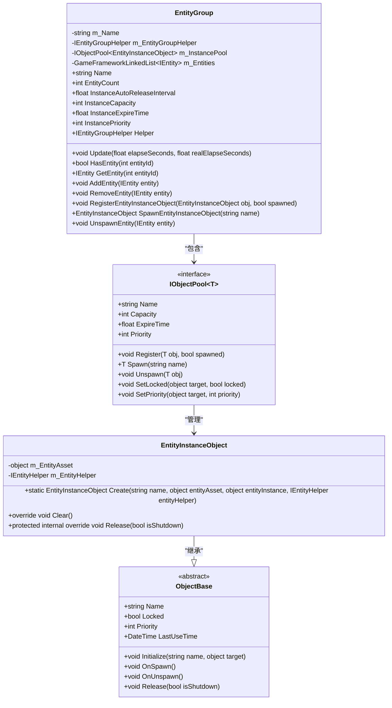
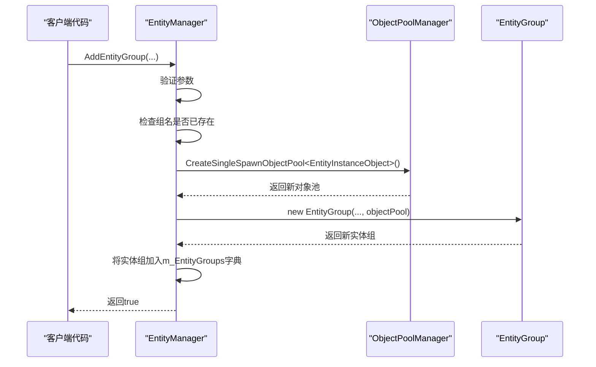

<cite>
**Referenced Files in This Document**   
- [EntityManager.EntityGroup.cs](file://GameFramework/Entity/EntityManager.EntityGroup.cs)
- [IEntityGroup.cs](file://GameFramework/Entity/IEntityGroup.cs)
- [IEntityGroupHelper.cs](file://GameFramework/Entity/IEntityGroupHelper.cs)
- [EntityManager.EntityInstanceObject.cs](file://GameFramework/Entity/EntityManager.EntityInstanceObject.cs)
- [EntityManager.cs](file://GameFramework/Entity/EntityManager.cs)
- [ObjectPoolManager.cs](file://GameFramework/ObjectPool/ObjectPoolManager.cs)
- [IObjectPool.cs](file://GameFramework/ObjectPool/IObjectPool.cs)
- [EntityManager.EntityInfo.cs](file://GameFramework/Entity/EntityManager.EntityInfo.cs)
- [EntityManager.ShowEntityInfo.cs](file://GameFramework/Entity/EntityManager.ShowEntityInfo.cs)
- [EntityManager.EntityStatus.cs](file://GameFramework/Entity/EntityManager.EntityStatus.cs)
</cite>

# 实体组管理

## 目录
1. [引言](#引言)
2. [实体组设计目的与使用场景](#实体组设计目的与使用场景)
3. [核心作用：实体容器与对象池集成点](#核心作用实体容器与对象池集成点)
4. [EntityGroup类实现机制](#entitygroup类实现机制)
5. [对象池配置详解](#对象池配置详解)
6. [实体列表管理与轮询更新逻辑](#实体列表管理与轮询更新逻辑)
7. [扩展实体组行为：IEntityGroupHelper](#扩展实体组行为ientitygrouphelper)
8. [动态创建与参数配置：AddEntityGroup API](#动态创建与参数配置addentitygroup-api)
9. [性能调优建议](#性能调优建议)
10. [总结](#总结)

## 引言

实体组（EntityGroup）是游戏框架中用于组织和管理实体（Entity）的核心组件。它不仅作为一个逻辑容器，将具有相似功能或生命周期的实体进行分组管理，更关键的是，它与对象池（ObjectPool）系统深度集成，实现了实体实例的高效复用，从而显著提升了游戏性能。本文档旨在全面阐述实体组的设计理念、内部实现机制以及最佳实践，为开发者提供一个清晰、深入的理解。

## 实体组设计目的与使用场景

实体组的设计旨在解决游戏开发中实体管理的复杂性问题。在大型游戏中，实体数量庞大，类型多样，其创建、销毁和更新操作频繁，若不加以有效管理，极易导致内存碎片化和性能瓶颈。实体组通过将实体进行逻辑分组，实现了以下设计目的：

1.  **逻辑隔离与组织**：将功能相关的实体（如所有敌人、所有特效、所有UI元素）归入不同的实体组，便于进行批量操作和状态管理。
2.  **生命周期管理**：为每个实体组独立配置对象池参数，可以针对不同类型的实体（如瞬时的子弹与持久的NPC）制定差异化的内存管理策略。
3.  **性能优化**：通过与对象池的集成，避免了频繁的内存分配与垃圾回收，极大地提升了实体的创建和销毁效率。

其典型使用场景包括：
- **按功能划分**：创建`EnemyGroup`、`EffectGroup`、`PlayerGroup`等，分别管理不同类型的实体。
- **按场景划分**：在关卡切换时，可以方便地隐藏或销毁整个实体组，实现资源的快速释放。
- **按性能需求划分**：对高频创建销毁的实体（如子弹）使用高容量、短过期时间的对象池；对低频使用的实体（如BOSS）则使用低容量、长过期时间的对象池。

**Section sources**
- [EntityManager.EntityGroup.cs](file://GameFramework/Entity/EntityManager.EntityGroup.cs#L140-L146)
- [IEntityGroup.cs](file://GameFramework/Entity/IEntityGroup.cs#L14-L143)

## 核心作用：实体容器与对象池集成点

实体组的核心作用体现在其双重身份上：它既是**实体的容器**，也是**对象池的集成点**。

作为**实体容器**，`EntityGroup`类内部维护了一个`GameFrameworkLinkedList<IEntity>`类型的链表（`m_Entities`），用于存储当前组内所有已激活的实体引用。通过`AddEntity`和`RemoveEntity`方法，实体可以在其生命周期内被添加到或从该链表中移除。这使得实体组能够对组内所有实体进行统一的遍历和操作。

作为**对象池集成点**，`EntityGroup`内部持有一个专门用于管理实体实例的`IObjectPool<EntityInstanceObject>`（`m_InstancePool`）。`EntityInstanceObject`是框架定义的、用于包装实体资源和实例的特殊对象，它继承自`ObjectBase`，因此可以被纳入对象池系统进行管理。当需要创建一个新实体时，实体组会首先尝试从其内部的对象池中“获取”（Spawn）一个已存在的`EntityInstanceObject`；当一个实体被隐藏（Hide）时，其对应的`EntityInstanceObject`会被“回收”（Unspawn）回对象池，等待下次复用。这种设计将实体的逻辑生命周期（显示/隐藏）与其实例的物理生命周期（创建/销毁）解耦，是实现高效内存管理的关键。



**Diagram sources**
- [EntityManager.EntityGroup.cs](file://GameFramework/Entity/EntityManager.EntityGroup.cs#L140-L146)
- [IObjectPool.cs](file://GameFramework/ObjectPool/IObjectPool.cs#L14-L218)

**Section sources**
- [EntityManager.EntityGroup.cs](file://GameFramework/Entity/EntityManager.EntityGroup.cs#L140-L146)
- [EntityManager.EntityInstanceObject.cs](file://GameFramework/Entity/EntityManager.EntityInstanceObject.cs#L14-L60)

## EntityGroup类实现机制

`EntityGroup`类是`IEntityGroup`接口的具体实现，其内部结构和方法设计精巧，确保了高效和安全的实体管理。

### 初始化与构造

`EntityGroup`的构造函数接收多个关键参数，包括组名、对象池的自动释放间隔、容量、过期时间、优先级以及一个`IEntityGroupHelper`辅助器。在初始化时，它会通过`IObjectPoolManager`创建一个名为`"Entity Instance Pool ({name})"`的单次获取对象池（Single Spawn Object Pool），并将其赋值给`m_InstancePool`。这种命名方式便于在调试时快速识别对象池的归属。

### 接口方法实现

`EntityGroup`实现了`IEntityGroup`接口的所有方法。例如，`GetEntity(int entityId)`方法会遍历`m_Entities`链表，查找ID匹配的实体；`HasEntity(string entityAssetName)`则会检查组内是否存在指定资源名称的实体。这些查询操作均在O(n)时间内完成，其中n为组内实体数量。

## 对象池配置详解

`EntityGroup`通过其内部的`IObjectPool<EntityInstanceObject>`暴露了四个核心配置项，这些配置直接决定了对象池的行为和性能：

1.  **容量（Capacity）**：通过`InstanceCapacity`属性设置。它定义了对象池中最多可以容纳的`EntityInstanceObject`实例数量。当池中实例数达到容量上限时，新创建的实例在被回收后会立即被释放，而不是留在池中。这对于控制内存峰值至关重要。
2.  **过期时间（Expire Time）**：通过`InstanceExpireTime`属性设置。它定义了池中未被使用的实例在多长时间后被视为“过期”。过期的实例会在对象池的自动释放周期中被清理，以回收内存。
3.  **自动释放间隔（Auto Release Interval）**：通过`InstanceAutoReleaseInterval`属性设置。它定义了对象池检查并释放过期实例的频率（以秒为单位）。一个较短的间隔可以更快地回收内存，但会增加CPU开销；一个较长的间隔则相反。
4.  **优先级（Priority）**：通过`InstancePriority`属性设置。当系统内存紧张需要释放对象池中的对象时，会优先释放优先级较低的对象池中的实例。

这些配置项的默认值通常由`ObjectPoolManager`的全局常量（如`DefaultCapacity`、`DefaultExpireTime`）决定，但`EntityGroup`允许在创建时进行覆盖，以满足不同实体组的特定需求。

**Section sources**
- [IEntityGroup.cs](file://GameFramework/Entity/IEntityGroup.cs#L14-L143)
- [ObjectPoolManager.cs](file://GameFramework/ObjectPool/ObjectPoolManager.cs#L28-L33)

## 实体列表管理与轮询更新逻辑

`EntityGroup`通过一个双向链表`m_Entities`来管理其内部的实体。使用链表而非数组的主要优势在于，添加和移除实体的操作时间复杂度为O(1)，非常适合频繁变动的实体集合。

### 轮询更新逻辑

`EntityGroup`的`Update`方法是其轮询更新逻辑的核心。该方法在每帧被调用，负责遍历组内所有实体并调用它们的`OnUpdate`方法。为了安全地在遍历过程中移除实体（例如，一个实体在更新时自我销毁），代码采用了缓存下一个节点的技巧：

```csharp
LinkedListNode<IEntity> current = m_Entities.First;
while (current != null)
{
    m_CachedNode = current.Next; // 缓存下一个节点
    current.Value.OnUpdate(elapseSeconds, realElapseSeconds);
    current = m_CachedNode; // 移动到下一个节点
    m_CachedNode = null; // 清空缓存
}
```

这种方式确保了即使`current.Value.OnUpdate`内部调用了`RemoveEntity`导致链表结构改变，循环依然能安全地继续执行，避免了因迭代器失效而导致的异常。

**Section sources**
- [EntityManager.EntityGroup.cs](file://GameFramework/Entity/EntityManager.EntityGroup.cs#L140-L146)

## 扩展实体组行为：IEntityGroupHelper

`IEntityGroupHelper`接口为实体组提供了强大的扩展能力。虽然该接口本身为空，但它作为一个占位符，允许开发者通过继承来实现自定义的辅助逻辑。`EntityGroup`在构造时会接收一个`IEntityGroupHelper`的实现，并将其存储在`m_EntityGroupHelper`字段中。

通过这个辅助器，开发者可以注入与特定实体组相关的初始化、销毁或更新逻辑。例如，可以创建一个`EnemyGroupHelper`，在敌人实体被创建时自动为其分配AI行为树，或在敌人组被销毁时播放特定的音效。这种设计遵循了“组合优于继承”的原则，使得实体组的核心逻辑保持简洁，而将可变的、特定的逻辑交由外部辅助器处理。

**Section sources**
- [IEntityGroupHelper.cs](file://GameFramework/Entity/IEntityGroupHelper.cs#L12-L14)
- [EntityManager.EntityGroup.cs](file://GameFramework/Entity/EntityManager.EntityGroup.cs#L140-L146)

## 动态创建与参数配置：AddEntityGroup API

实体组的动态创建是通过`EntityManager`的`AddEntityGroup`方法实现的。此API是配置实体组参数的入口点。

### API签名与参数

```csharp
public bool AddEntityGroup(string entityGroupName, float instanceAutoReleaseInterval, int instanceCapacity, float instanceExpireTime, int instancePriority, IEntityGroupHelper entityGroupHelper)
```

该方法接收实体组的名称和上述提到的所有对象池配置参数，以及一个`IEntityGroupHelper`。它首先进行一系列有效性检查（如名称非空、辅助器非空、对象池管理器已设置等），然后检查同名实体组是否已存在。如果所有检查通过，它将使用传入的参数创建一个新的`EntityGroup`实例，并将其添加到`EntityManager`的`m_EntityGroups`字典中。

### 创建流程与依赖

值得注意的是，`AddEntityGroup`方法依赖于`IObjectPoolManager`。在`EntityGroup`的构造函数中，它会调用`objectPoolManager.CreateSingleSpawnObjectPool<EntityInstanceObject>(...)`来创建其内部的对象池。这意味着在调用`AddEntityGroup`之前，必须先通过`EntityManager.SetObjectPoolManager()`方法设置好对象池管理器，否则会抛出异常。



**Diagram sources**
- [EntityManager.cs](file://GameFramework/Entity/EntityManager.cs#L321-L346)
- [ObjectPoolManager.cs](file://GameFramework/ObjectPool/ObjectPoolManager.cs#L384-L387)

**Section sources**
- [EntityManager.cs](file://GameFramework/Entity/EntityManager.cs#L321-L346)

## 性能调优建议

为了最大化实体组的性能，开发者应根据实际需求进行精细的参数调优：

1.  **合理设置容量**：为高频实体（如子弹）设置一个合理的容量上限，既能保证快速获取，又不会过度占用内存。对于低频实体，可以设置较小的容量。
2.  **调整过期时间**：对于瞬时实体