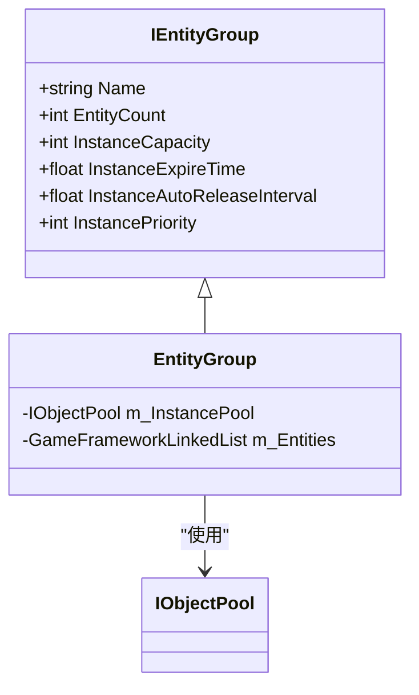
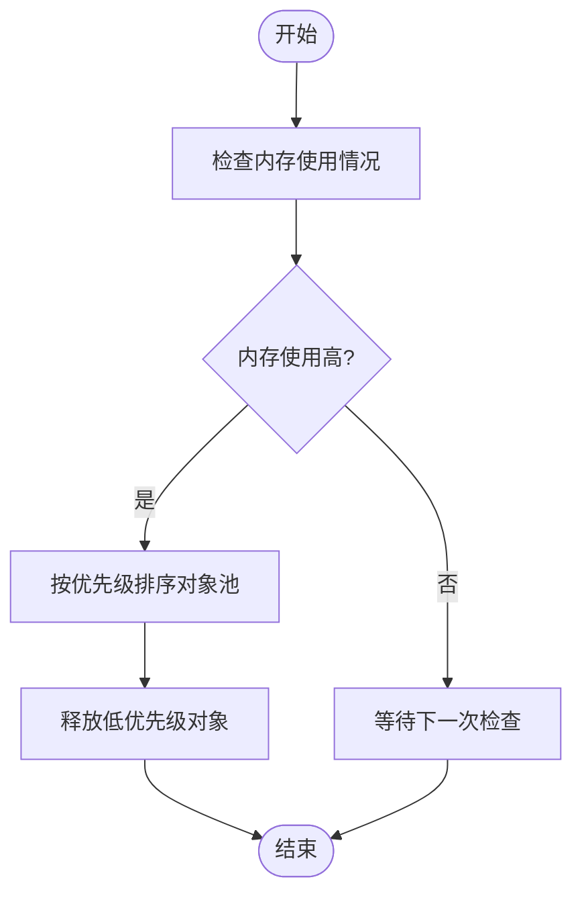
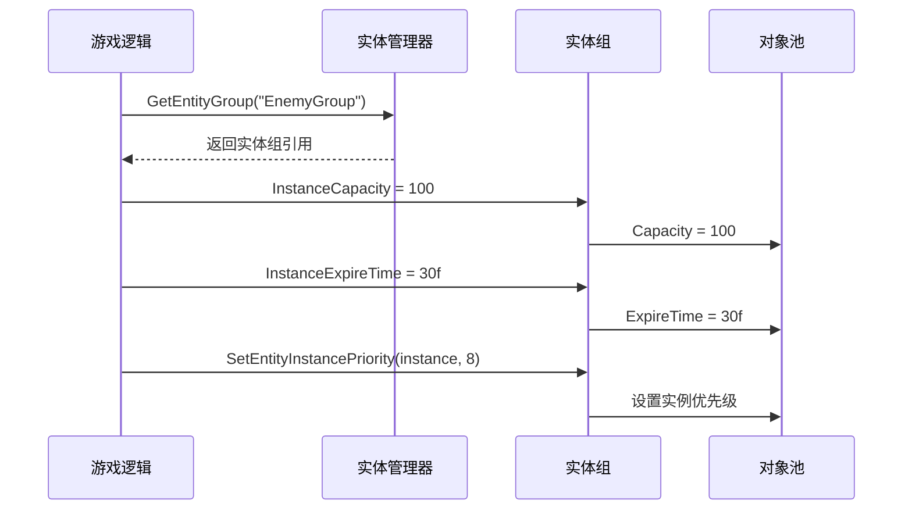
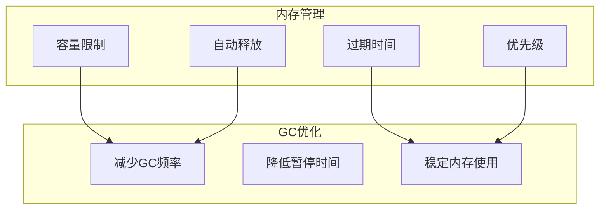

# 实体组配置

<cite>
**本文档中引用的文件**   
- [IEntityGroup.cs](file://GameFramework/Entity/IEntityGroup.cs)
- [EntityManager.EntityGroup.cs](file://GameFramework/Entity/EntityManager.EntityGroup.cs)
- [ObjectPoolBase.cs](file://GameFramework/ObjectPool/ObjectPoolBase.cs)
- [IObjectPool.cs](file://GameFramework/ObjectPool/IObjectPool.cs)
- [IEntityManager.cs](file://GameFramework/Entity/IEntityManager.cs)
</cite>

## 目录
1. [引言](#引言)
2. [实体组配置参数详解](#实体组配置参数详解)
3. [运行时动态调整](#运行时动态调整)
4. [内存管理与GC优化](#内存管理与gc优化)
5. [不同场景下的配置建议](#不同场景下的配置建议)
6. [总结](#总结)

## 引言
实体组是游戏框架中用于管理实体对象的核心组件，通过对象池机制实现高效的内存管理和性能优化。本文档详细阐述实体组的四个关键配置参数：实例对象池容量（InstanceCapacity）、对象过期时间（InstanceExpireTime）、自动释放间隔（InstanceAutoReleaseInterval）和优先级（InstancePriority）的设置方法及其对系统性能的影响。

**Section sources**
- [IEntityGroup.cs](file://GameFramework/Entity/IEntityGroup.cs#L14-L143)

## 实体组配置参数详解

### 实例对象池容量（InstanceCapacity）
实例对象池容量定义了实体组中可容纳的最大对象数量。该参数通过`InstanceCapacity`属性进行设置，直接影响内存使用和对象复用效率。

当容量设置过低时，可能导致频繁的对象创建和销毁，增加GC压力；而设置过高则会占用过多内存资源。合理的容量设置应基于实际使用场景中同时存在的实体数量。



**Diagram sources**
- [IEntityGroup.cs](file://GameFramework/Entity/IEntityGroup.cs#L44-L48)
- [EntityManager.EntityGroup.cs](file://GameFramework/Entity/EntityManager.EntityGroup.cs#L92-L96)

### 对象过期时间（InstanceExpireTime）
对象过期时间指定了对象在未被使用的情况下可保留在池中的最长时间（以秒为单位）。通过`InstanceExpireTime`属性进行配置，用于控制对象的生命周期。

过期机制有助于清理长时间未使用的对象，防止内存泄漏。较短的过期时间可以更快释放内存，但可能导致频繁的创建/销毁循环；较长的过期时间则有利于提高对象复用率，但会增加内存占用。

**Section sources**
- [IEntityGroup.cs](file://GameFramework/Entity/IEntityGroup.cs#L53-L57)
- [EntityManager.EntityGroup.cs](file://GameFramework/Entity/EntityManager.EntityGroup.cs#L110-L114)

### 自动释放间隔（InstanceAutoReleaseInterval）
自动释放间隔决定了对象池检查并释放可释放对象的频率（以秒为单位）。通过`InstanceAutoReleaseInterval`属性设置，是平衡性能和内存使用的重要参数。

较短的释放间隔可以更及时地回收内存，但会增加CPU开销；较长的间隔则减少检查频率，降低CPU使用率，但可能导致内存释放不及时。该参数与对象过期时间协同工作，共同管理对象池的内存使用。

**Section sources**
- [IEntityGroup.cs](file://GameFramework/Entity/IEntityGroup.cs#L35-L39)
- [EntityManager.EntityGroup.cs](file://GameFramework/Entity/EntityManager.EntityGroup.cs#L80-L84)

### 优先级（InstancePriority）
优先级参数用于标识对象池的重要程度，通过`InstancePriority`属性进行设置。在内存紧张时，系统会优先保留高优先级对象池中的对象。

优先级机制支持多级内存管理策略，允许开发者根据实体类型的重要性分配不同的优先级。例如，玩家角色相关的实体组可以设置较高优先级，而环境装饰物相关的实体组可以设置较低优先级。



**Diagram sources**
- [IEntityGroup.cs](file://GameFramework/Entity/IEntityGroup.cs#L62-L66)
- [ObjectPoolBase.cs](file://GameFramework/ObjectPool/ObjectPoolBase.cs#L140-L144)

## 运行时动态调整
通过`IEntityGroup`接口，可以在运行时动态调整实体组的配置参数。以下为动态调整的代码示例：

```csharp
// 获取实体组
IEntityGroup entityGroup = entityManager.GetEntityGroup("PlayerGroup");

// 动态调整配置参数
entityGroup.InstanceCapacity = 50;
entityGroup.InstanceExpireTime = 60f;
entityGroup.InstanceAutoReleaseInterval = 5f;
entityGroup.InstancePriority = 10;

// 调整实体实例的优先级
entityGroup.SetEntityInstancePriority(entityInstance, 5);
```

这种动态调整能力使得系统能够根据当前运行状态和性能需求实时优化资源配置。例如，在进入战斗场景时增加玩家实体组的容量，在退出战斗后恢复默认设置。



**Diagram sources**
- [IEntityManager.cs](file://GameFramework/Entity/IEntityManager.cs#L85-L90)
- [IEntityGroup.cs](file://GameFramework/Entity/IEntityGroup.cs#L142-L142)

## 内存管理与GC优化
实体组的配置参数在内存管理和GC优化中发挥着关键作用：

### 内存使用模式
- **容量控制**：限制最大内存占用，防止内存爆炸
- **过期机制**：避免长时间持有无用对象，减少内存泄漏风险
- **自动释放**：周期性清理，保持内存使用稳定
- **优先级管理**：在内存紧张时做出智能决策

### GC性能影响
合理的配置可以显著降低GC频率和暂停时间：
- 减少对象创建/销毁次数，降低GC标记阶段的工作量
- 通过对象复用减少新生代对象数量
- 避免大量对象同时进入老年代，减少Full GC的发生



**Diagram sources**
- [IObjectPool.cs](file://GameFramework/ObjectPool/IObjectPool.cs#L21-L216)
- [ObjectPoolBase.cs](file://GameFramework/ObjectPool/ObjectPoolBase.cs#L14-L150)

## 不同场景下的配置建议

### 高频创建/销毁场景
适用于子弹、特效等短生命周期实体：
- **容量**：中等（20-50），根据峰值需求设置
- **过期时间**：短（10-30秒），快速回收内存
- **自动释放间隔**：短（2-5秒），及时清理
- **优先级**：低（0-5），便于在内存紧张时释放

### 持久存在场景
适用于玩家角色、NPC等长期存在的实体：
- **容量**：较高（50-100），预留足够空间
- **过期时间**：长（60-120秒），减少重建开销
- **自动释放间隔**：中等（10-20秒），平衡性能
- **优先级**：高（8-10），确保稳定性

### 大量静态场景
适用于地图元素、环境装饰等：
- **容量**：高（100+），一次性加载
- **过期时间**：极长（300+秒），几乎永不释放
- **自动释放间隔**：长（30+秒），减少检查开销
- **优先级**：中等（5-7），根据重要性调整

## 总结
实体组的四个核心配置参数——容量、过期时间、自动释放间隔和优先级——共同构成了一个灵活高效的内存管理机制。通过合理配置这些参数，开发者可以在内存使用和性能表现之间找到最佳平衡点。

关键要点：
- 参数配置应基于具体使用场景和性能需求
- 运行时动态调整提供了更大的灵活性
- 各参数之间存在相互影响，需要综合考虑
- 合理的配置能显著提升GC性能和整体系统稳定性

**Section sources**
- [IEntityGroup.cs](file://GameFramework/Entity/IEntityGroup.cs#L14-L143)
- [EntityManager.EntityGroup.cs](file://GameFramework/Entity/EntityManager.EntityGroup.cs#L25-L45)