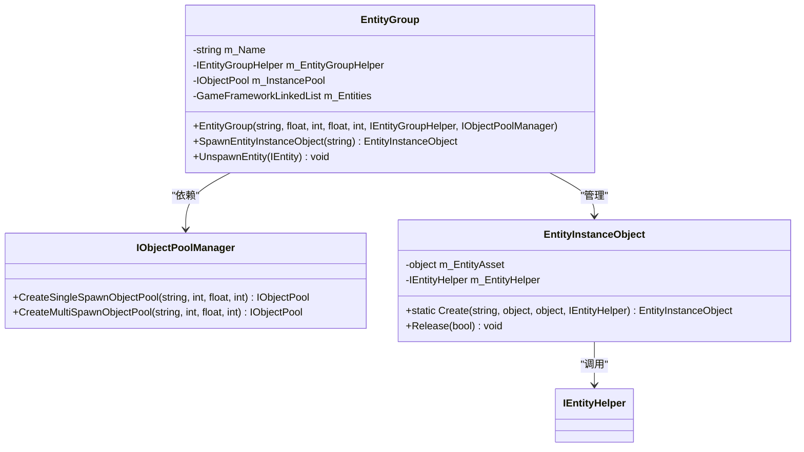
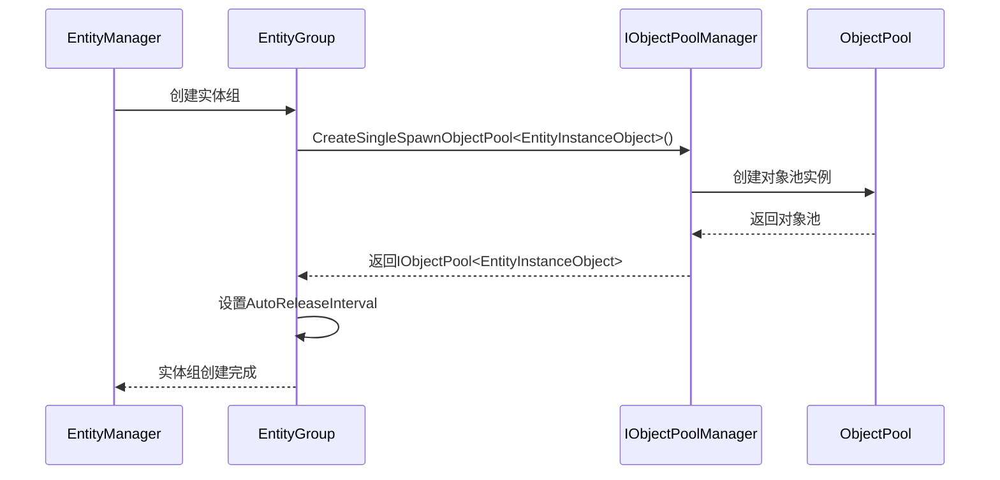
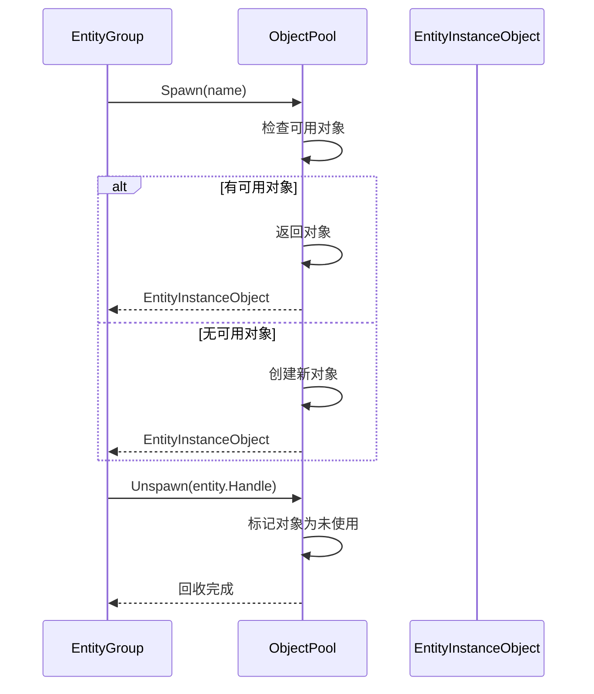
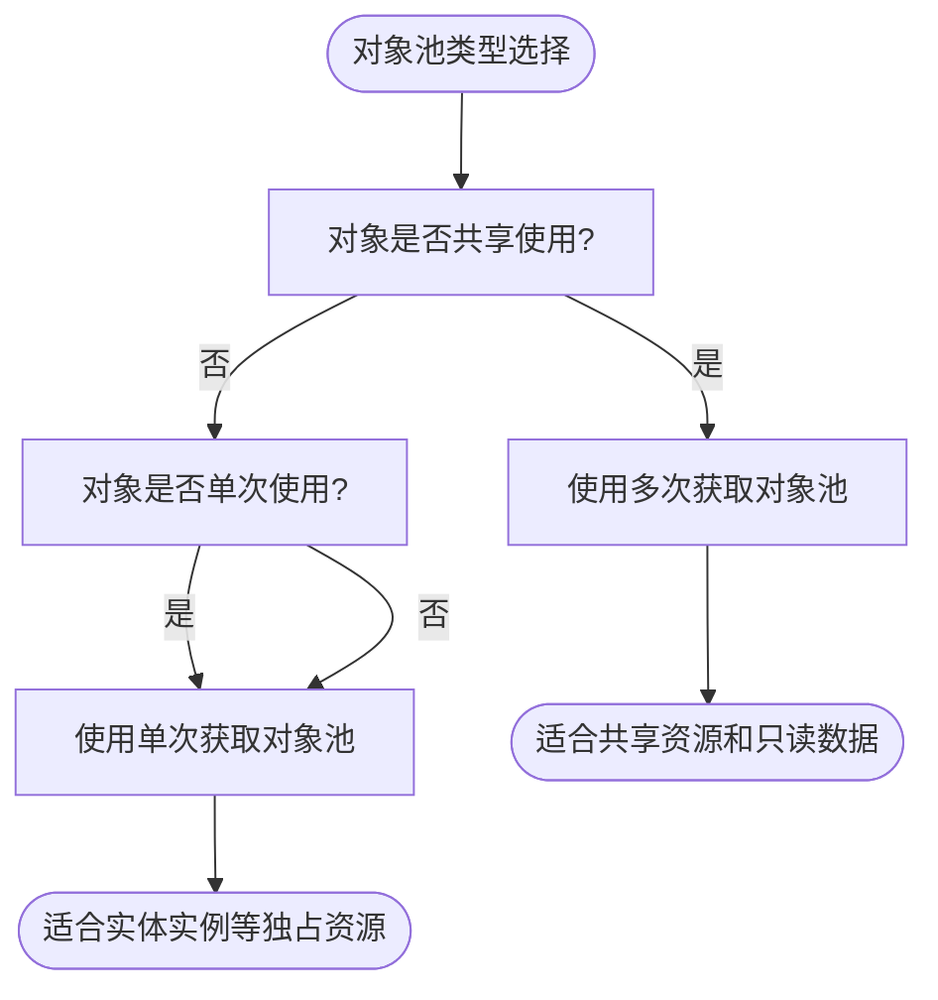
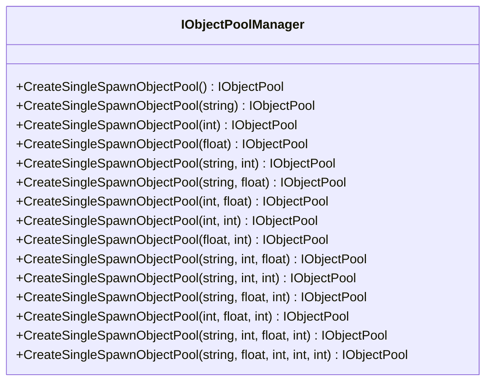
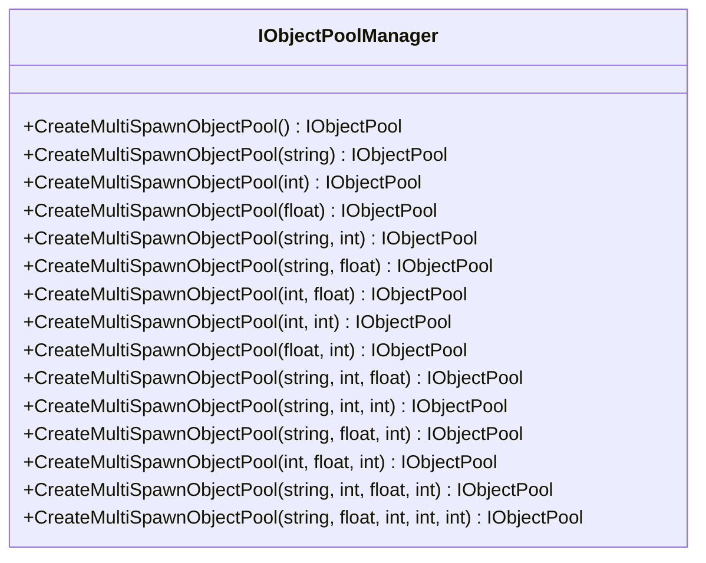
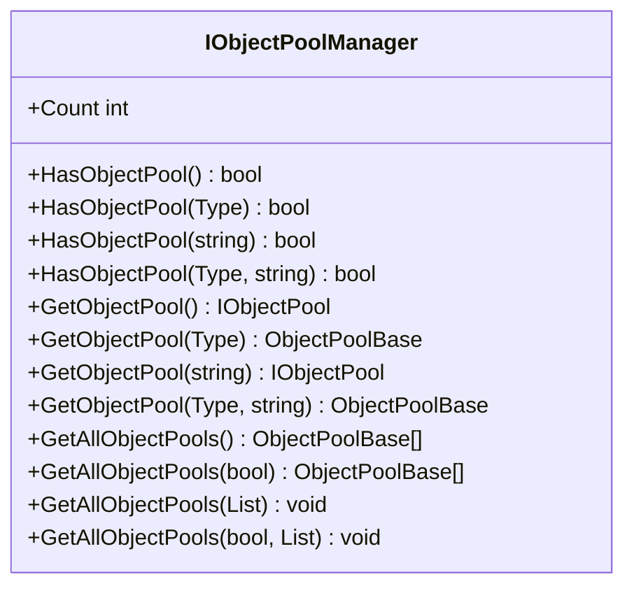
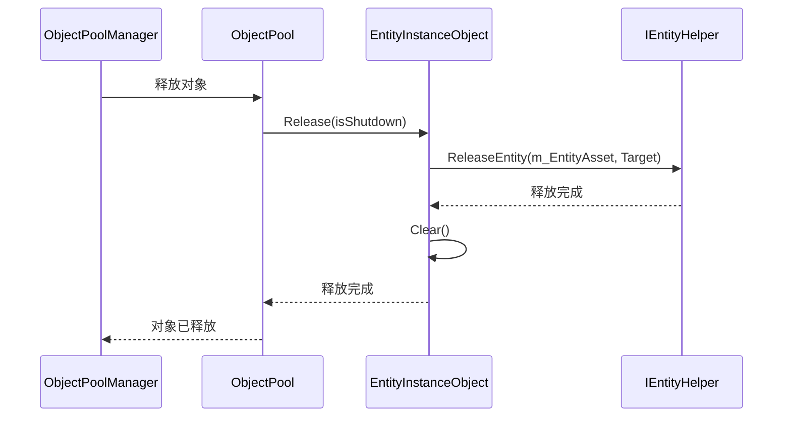

# 对象池集成机制

<cite>
**Referenced Files in This Document**   
- [EntityManager.EntityGroup.cs](file://GameFramework/Entity/EntityManager.EntityGroup.cs)
- [IObjectPoolManager.cs](file://GameFramework/ObjectPool/IObjectPoolManager.cs)
- [EntityManager.EntityInstanceObject.cs](file://GameFramework/Entity/EntityManager.EntityInstanceObject.cs)
- [EntityManager.cs](file://GameFramework/Entity/EntityManager.cs)
- [ObjectPoolManager.cs](file://GameFramework/ObjectPool/ObjectPoolManager.cs)
</cite>

## 目录
1. [实体组与对象池的集成机制](#实体组与对象池的集成机制)
2. [单次与多次获取对象池的区别](#单次与多次获取对象池的区别)
3. [对象池创建流程](#对象池创建流程)
4. [对象池状态监控与调试](#对象池状态监控与调试)

## 实体组与对象池的集成机制

`EntityGroup` 类通过 `IObjectPoolManager` 接口创建和管理 `EntityInstanceObject` 对象池，实现了实体实例的高效复用。在 `EntityGroup` 的构造函数中，通过 `IObjectPoolManager.CreateSingleSpawnObjectPool` 方法创建了一个专门用于管理实体实例的对象池。



**Diagram sources**
- [EntityManager.EntityGroup.cs](file://GameFramework/Entity/EntityManager.EntityGroup.cs#L17-L391)
- [IObjectPoolManager.cs](file://GameFramework/ObjectPool/IObjectPoolManager.cs#L15-L749)
- [EntityManager.EntityInstanceObject.cs](file://GameFramework/Entity/EntityManager.EntityInstanceObject.cs#L16-L57)

**Section sources**
- [EntityManager.EntityGroup.cs](file://GameFramework/Entity/EntityManager.EntityGroup.cs#L17-L391)

### 对象池初始化流程

`EntityGroup` 在初始化时通过以下步骤创建对象池：

1. 接收 `IObjectPoolManager` 作为构造参数
2. 调用 `CreateSingleSpawnObjectPool` 方法创建 `EntityInstanceObject` 类型的对象池
3. 设置对象池的自动释放间隔、容量、过期时间和优先级等参数



**Diagram sources**
- [EntityManager.EntityGroup.cs](file://GameFramework/Entity/EntityManager.EntityGroup.cs#L35-L53)
- [IObjectPoolManager.cs](file://GameFramework/ObjectPool/IObjectPoolManager.cs#L144-L359)

**Section sources**
- [EntityManager.EntityGroup.cs](file://GameFramework/Entity/EntityManager.EntityGroup.cs#L35-L53)

### 对象获取与回收机制

`EntityGroup` 提供了 `SpawnEntityInstanceObject` 和 `UnspawnEntity` 方法来管理对象池中的对象：

- `SpawnEntityInstanceObject`：从对象池中获取一个 `EntityInstanceObject` 实例
- `UnspawnEntity`：将实体实例回收到对象池中



**Diagram sources**
- [EntityManager.EntityGroup.cs](file://GameFramework/Entity/EntityManager.EntityGroup.cs#L362-L370)
- [IObjectPool.cs](file://GameFramework/ObjectPool/IObjectPool.cs#L138-L144)

**Section sources**
- [EntityManager.EntityGroup.cs](file://GameFramework/Entity/EntityManager.EntityGroup.cs#L362-L370)

## 单次与多次获取对象池的区别

### 单次获取对象池 (Single Spawn Object Pool)

单次获取对象池适用于对象在同一时间只能被一个实体使用的场景。当对象被获取后，它会被标记为"正在使用"，直到被显式回收才能再次被获取。

**适用场景：**
- 实体实例对象
- UI 界面实例
- 音效实例
- 网络连接实例

**特点：**
- 每个对象在同一时间只能被一个实体获取
- 获取操作会增加对象的获取计数
- 回收操作会减少获取计数
- 获取计数为0时对象可被自动释放

### 多次获取对象池 (Multi Spawn Object Pool)

多次获取对象池适用于对象可以被多个实体同时使用的场景。同一个对象实例可以被多次获取，而不会被标记为"正在使用"。

**适用场景：**
- 共享资源对象
- 配置数据对象
- 静态数据对象
- 只读数据对象

**特点：**
- 同一个对象实例可以被多个实体同时获取
- 不跟踪对象的获取状态
- 更适合共享和只读对象
- 减少对象创建和销毁的开销



**Diagram sources**
- [IObjectPoolManager.cs](file://GameFramework/ObjectPool/IObjectPoolManager.cs#L144-L359)
- [IObjectPoolManager.cs](file://GameFramework/ObjectPool/IObjectPoolManager.cs#L422-L637)

**Section sources**
- [IObjectPoolManager.cs](file://GameFramework/ObjectPool/IObjectPoolManager.cs#L144-L637)

## 对象池创建流程

### CreateSingleSpawnObjectPool API

`CreateSingleSpawnObjectPool` 方法用于创建允许单次获取的对象池，提供了多个重载版本以满足不同的配置需求：



**Diagram sources**
- [IObjectPoolManager.cs](file://GameFramework/ObjectPool/IObjectPoolManager.cs#L144-L359)

**Section sources**
- [IObjectPoolManager.cs](file://GameFramework/ObjectPool/IObjectPoolManager.cs#L144-L359)

### CreateMultiSpawnObjectPool API

`CreateMultiSpawnObjectPool` 方法用于创建允许多次获取的对象池，其API结构与单次获取对象池类似：



**Diagram sources**
- [IObjectPoolManager.cs](file://GameFramework/ObjectPool/IObjectPoolManager.cs#L422-L637)

**Section sources**
- [IObjectPoolManager.cs](file://GameFramework/ObjectPool/IObjectPoolManager.cs#L422-L637)

### 对象池创建参数说明

| 参数 | 类型 | 说明 |
|------|------|------|
| name | string | 对象池名称，用于标识和查找对象池 |
| capacity | int | 对象池容量，限制池中对象的最大数量 |
| expireTime | float | 对象过期时间（秒），超过此时间未使用的对象可被释放 |
| priority | int | 对象池优先级，用于排序和资源管理 |
| autoReleaseInterval | float | 自动释放间隔（秒），定期检查并释放可释放对象 |

## 对象池状态监控与调试

### 对象池信息获取

`IObjectPoolManager` 提供了多种方法来获取对象池的状态信息：



**Diagram sources**
- [IObjectPoolManager.cs](file://GameFramework/ObjectPool/IObjectPoolManager.cs#L117-L137)

**Section sources**
- [IObjectPoolManager.cs](file://GameFramework/ObjectPool/IObjectPoolManager.cs#L117-L137)

### 对象池监控方法

| 方法 | 说明 | 使用场景 |
|------|------|---------|
| Count | 获取对象池管理器中对象池的总数 | 监控对象池整体数量 |
| HasObjectPool | 检查是否存在指定类型或名称的对象池 | 验证对象池是否已创建 |
| GetObjectPool | 获取指定类型或名称的对象池 | 获取特定对象池进行详细检查 |
| GetAllObjectPools | 获取所有对象池 | 全面监控所有对象池状态 |
| Release | 释放对象池中的可释放对象 | 手动触发对象池清理 |
| ReleaseAllUnused | 释放对象池中所有未使用的对象 | 强制清理所有空闲对象 |

### 调试与诊断

通过 `ObjectPoolManager` 的内部实现，可以深入了解对象池的运行状态：

```mermaid
classDiagram
class ObjectPoolManager {
-Dictionary<TypeNamePair, ObjectPoolBase> m_ObjectPools
-List<ObjectPoolBase> m_CachedAllObjectPools
-IObjectPoolManager.ObjectPoolComparer m_ObjectPoolComparer
}
class ObjectPoolBase {
-string m_Name
-int m_Capacity
-float m_ExpireTime
-int m_Priority
-float m_AutoReleaseInterval
-DateTime m_LastAutoReleaseTime
}
class Object<T> {
-T m_Object
-int m_SpawnCount
-bool m_Locked
-int m_Priority
-DateTime m_LastUseTime
}
ObjectPoolManager --> ObjectPoolBase : "包含"
ObjectPoolBase --> Object : "管理"
```

**Diagram sources**
- [ObjectPoolManager.cs](file://GameFramework/ObjectPool/ObjectPoolManager.cs#L28-L33)
- [ObjectPoolManager.Object.cs](file://GameFramework/ObjectPool/ObjectPoolManager.Object.cs#L11-L194)

**Section sources**
- [ObjectPoolManager.cs](file://GameFramework/ObjectPool/ObjectPoolManager.cs#L28-L33)
- [ObjectPoolManager.Object.cs](file://GameFramework/ObjectPool/ObjectPoolManager.Object.cs#L11-L194)

### 对象释放机制

`EntityInstanceObject` 在释放时会调用 `IEntityHelper.ReleaseEntity` 方法来释放底层资源：



**Diagram sources**
- [EntityManager.EntityInstanceObject.cs](file://GameFramework/Entity/EntityManager.EntityInstanceObject.cs#L53-L56)
- [ObjectPoolManager.Object.cs](file://GameFramework/ObjectPool/ObjectPoolManager.Object.cs#L178-L188)

**Section sources**
- [EntityManager.EntityInstanceObject.cs](file://GameFramework/Entity/EntityManager.EntityInstanceObject.cs#L53-L56)