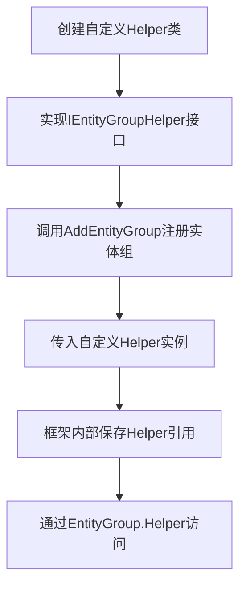

# 扩展与辅助器

<cite>
**本文档中引用的文件**  
- [IEntityGroupHelper.cs](file://GameFramework/Entity/IEntityGroupHelper.cs)
- [IEntityGroup.cs](file://GameFramework/Entity/IEntityGroup.cs)
- [EntityManager.EntityGroup.cs](file://GameFramework/Entity/EntityManager.EntityGroup.cs)
- [EntityManager.cs](file://GameFramework/Entity/EntityManager.cs)
</cite>

## 目录
1. [简介](#简介)
2. [IEntityGroupHelper接口设计目的](#ientitygrouphelper接口设计目的)
3. [扩展机制与自定义Helper实现](#扩展机制与自定义helper实现)
4. [注册与使用自定义Helper](#注册与使用自定义helper)
5. [交互方式与调用时机](#交互方式与调用时机)
6. [实现示例](#实现示例)

## 简介
`IEntityGroupHelper` 是 GameFramework 框架中用于增强实体组（Entity Group）行为的扩展接口。通过实现该接口，开发者可以在不修改核心逻辑的前提下，为实体组添加自定义功能，如加载策略定制、日志记录、性能监控等。本文档详细说明该接口的设计目的、扩展机制、使用方法及其实现示例。

## IEntityGroupHelper接口设计目的
`IEntityGroupHelper` 接口作为实体组的辅助器，其主要设计目的是提供一个可扩展的钩子机制，允许外部代码介入实体组的生命周期和行为管理。该接口本身为空接口，意味着其具体功能完全由实现类定义，从而支持高度灵活的定制化需求。

通过将辅助逻辑从核心实体管理器中解耦，框架实现了关注点分离，提升了模块的可维护性和可测试性。开发者可通过实现此接口，在实体组创建、更新、资源加载等关键节点插入自定义逻辑。

**Section sources**
- [IEntityGroupHelper.cs](file://GameFramework/Entity/IEntityGroupHelper.cs#L12-L14)

## 扩展机制与自定义Helper实现
框架通过依赖注入的方式将 `IEntityGroupHelper` 实例传递给实体组。在创建实体组时，`EntityManager` 会将用户提供的 `IEntityGroupHelper` 实现注入到 `EntityGroup` 内部，后续可通过 `Helper` 属性访问该实例。

由于 `IEntityGroupHelper` 当前为空接口，具体的扩展行为需由实现类自行定义方法，并在适当时机被调用。例如，可在自定义 Helper 中定义 `OnEntityLoadStart`、`OnEntityLoadSuccess` 等方法，用于监控实体加载过程。

这种设计允许开发者根据项目需求自由扩展功能，而无需修改框架源码，符合开闭原则。

**Section sources**
- [IEntityGroup.cs](file://GameFramework/Entity/IEntityGroup.cs#L71-L74)
- [EntityManager.EntityGroup.cs](file://GameFramework/Entity/EntityManager.EntityGroup.cs#L140-L146)

## 注册与使用自定义Helper
要使用自定义的 `IEntityGroupHelper`，首先需要通过 `EntityManager.AddEntityGroup` 方法在创建实体组时传入 Helper 实例。该方法接受 `IEntityGroupHelper` 类型的参数，并将其与指定名称的实体组关联。

一旦注册成功，该 Helper 实例便成为该实体组的一部分，可通过 `IEntityGroup.Helper` 属性随时访问。开发者可在业务逻辑中获取目标实体组后，调用其 Helper 上的自定义方法以执行扩展功能。



**Diagram sources**
- [EntityManager.cs](file://GameFramework/Entity/EntityManager.cs#L321)
- [IEntityManager.cs](file://GameFramework/Entity/IEntityManager.cs#L114)

**Section sources**
- [EntityManager.cs](file://GameFramework/Entity/EntityManager.cs#L224-L309)

## 交互方式与调用时机
`IEntityGroupHelper` 与实体组的交互主要发生在实体组的生命周期管理过程中。虽然接口本身不定义具体方法，但典型的调用时机包括：

- **实体组初始化时**：在 `EntityGroup` 构造函数中接收 Helper 实例。
- **实体加载前后**：可在自定义 Helper 中定义回调方法，在资源加载开始、完成或失败时被触发。
- **实体更新周期**：在 `EntityGroup.Update` 方法中可调用 Helper 进行状态监控或性能采样。
- **实体回收过程**：在隐藏或销毁实体时，可通过 Helper 执行清理或日志记录。

这些时机为开发者提供了丰富的切入点，可用于实现跨切面的功能增强。

**Section sources**
- [EntityManager.EntityGroup.cs](file://GameFramework/Entity/EntityManager.EntityGroup.cs#L35-L53)
- [EntityManager.cs](file://GameFramework/Entity/EntityManager.cs#L268-L309)

## 实现示例
以下是一个自定义 `IEntityGroupHelper` 的实现示例，用于记录实体加载的性能数据：

```csharp
public class PerformanceLogHelper : IEntityGroupHelper
{
    private Dictionary<string, float> m_LoadStartTime = new Dictionary<string, float>();

    public void OnLoadStart(string assetName)
    {
        m_LoadStartTime[assetName] = Time.time;
    }

    public void OnLoadSuccess(string assetName)
    {
        if (m_LoadStartTime.TryGetValue(assetName, out float startTime))
        {
            float duration = Time.time - startTime;
            Debug.Log($"[Performance] Entity '{assetName}' loaded in {duration:F2}s");
            m_LoadStartTime.Remove(assetName);
        }
    }

    public void OnLoadFailure(string assetName, string errorMessage)
    {
        Debug.LogError($"[Performance] Failed to load entity '{assetName}': {errorMessage}");
        m_LoadStartTime.Remove(assetName);
    }
}
```

在注册实体组时使用该 Helper：

```csharp
var helper = new PerformanceLogHelper();
entityManager.AddEntityGroup("PlayerGroup", 60, 10, 300, 1, helper);
```

随后在资源加载流程中调用 Helper 方法即可实现性能监控。

**Section sources**
- [IEntityGroupHelper.cs](file://GameFramework/Entity/IEntityGroupHelper.cs#L12-L14)
- [EntityManager.cs](file://GameFramework/Entity/EntityManager.cs#L321)