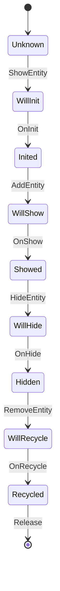
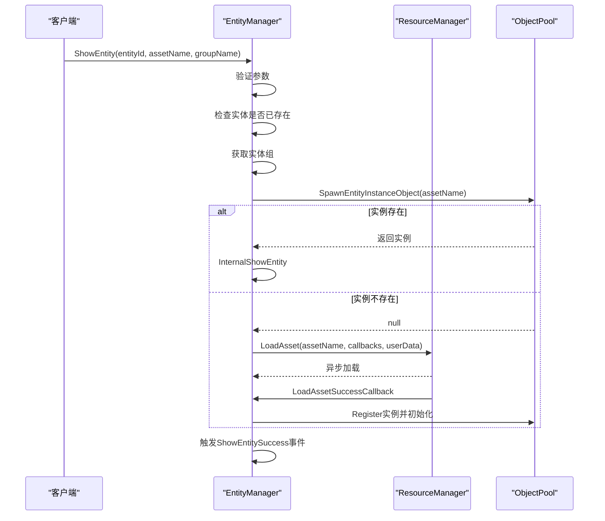
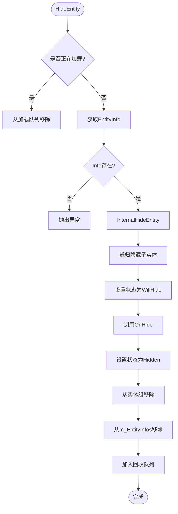
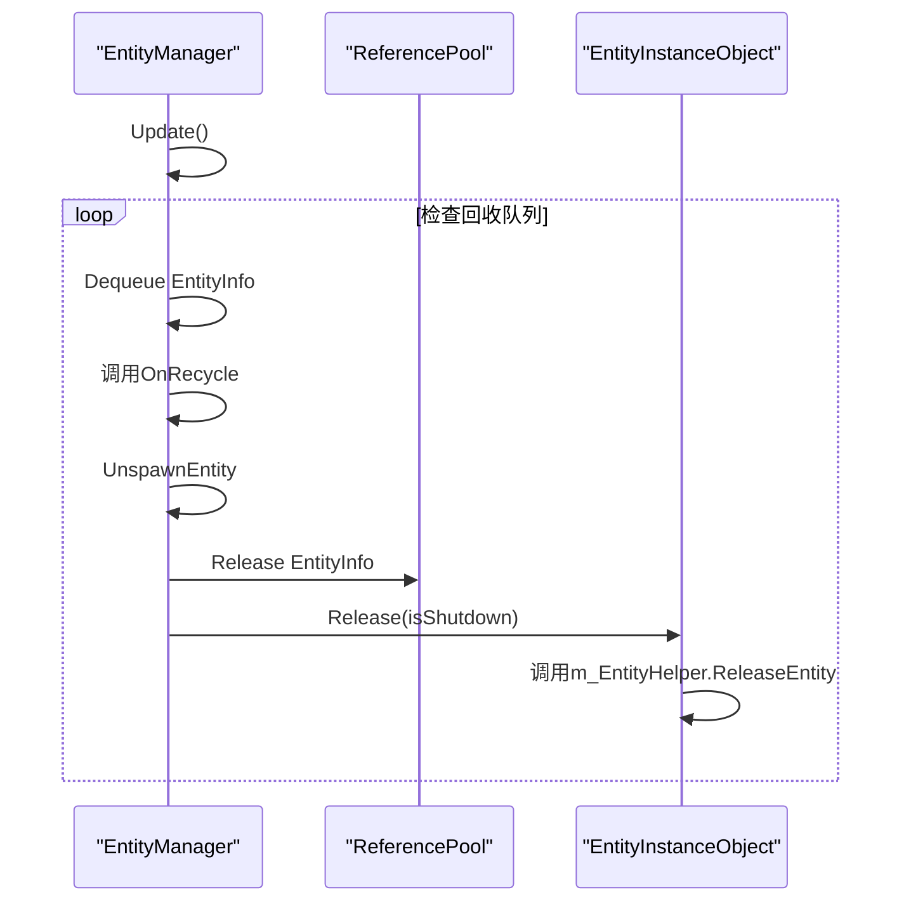
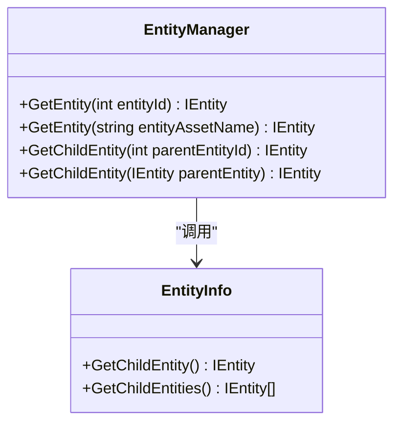
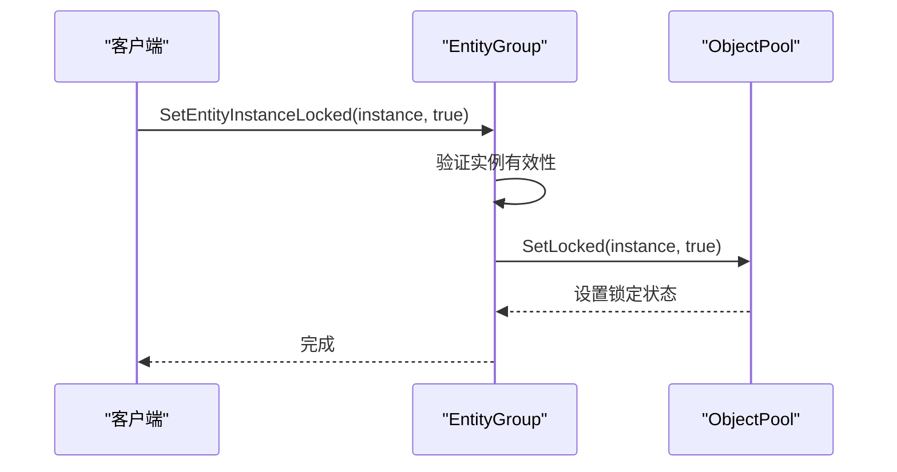
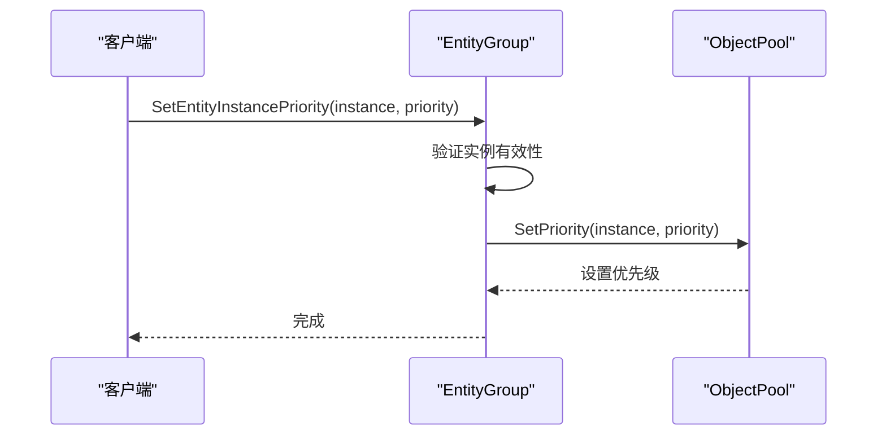
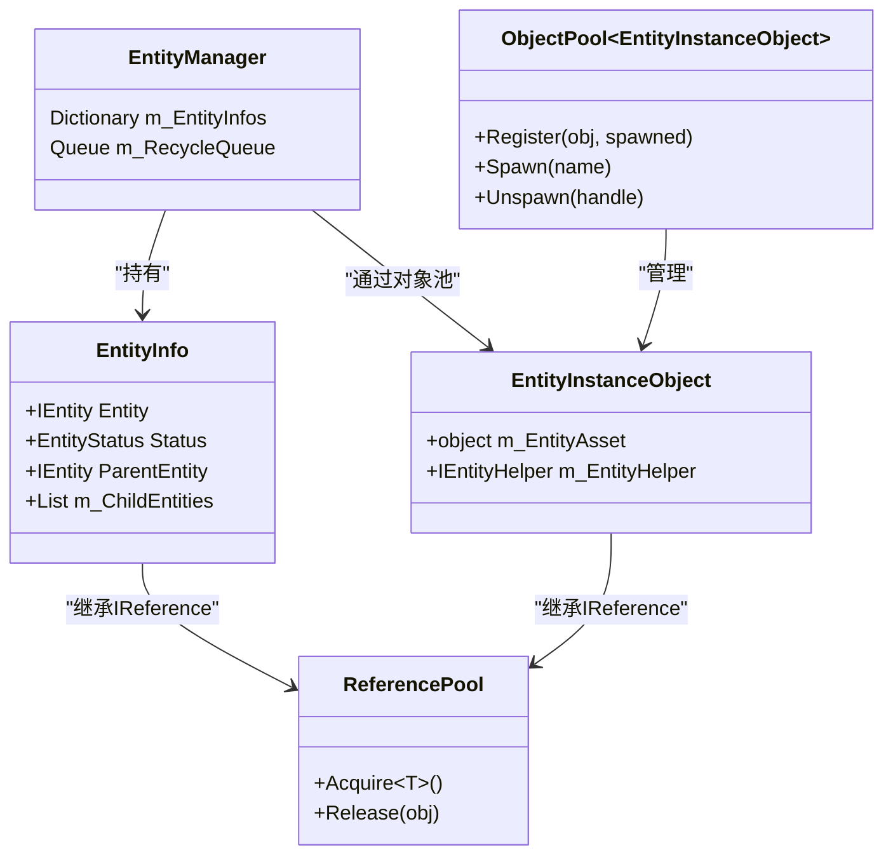

# 生命周期管理

<cite>
**Referenced Files in This Document**   
- [EntityManager.cs](file://GameFramework/Entity/EntityManager.cs)
- [IEntity.cs](file://GameFramework/Entity/IEntity.cs)
- [IEntityGroup.cs](file://GameFramework/Entity/IEntityGroup.cs)
- [EntityManager.EntityInfo.cs](file://GameFramework/Entity/EntityManager.EntityInfo.cs)
- [EntityManager.EntityInstanceObject.cs](file://GameFramework/Entity/EntityManager.EntityInstanceObject.cs)
</cite>

## Table of Contents
1. [生命周期管理](#生命周期管理)
2. [实体全生命周期流程](#实体全生命周期流程)
3. [核心查询方法](#核心查询方法)
4. [资源调度控制](#资源调度控制)
5. [内存泄漏防范](#内存泄漏防范)

## 实体全生命周期流程

实体的全生命周期管理由 `EntityManager` 统一负责，涵盖从创建、显示、隐藏到销毁的完整流程。整个生命周期通过 `EntityInfo` 类进行状态追踪，确保每个实体的状态转换清晰可控。



**Diagram sources**
- [EntityManager.EntityInfo.cs](file://GameFramework/Entity/EntityManager.EntityInfo.cs#L16-L133)
- [IEntity.cs](file://GameFramework/Entity/IEntity.cs#L54-L72)

### 实体添加 (ShowEntity)

实体的添加通过 `ShowEntity` 方法触发，该方法会检查实体组是否存在、资源管理器是否已设置，并确保实体ID不重复。若实体实例已存在于对象池中，则直接复用；否则，通过资源管理器异步加载资源。



**Diagram sources**
- [EntityManager.cs](file://GameFramework/Entity/EntityManager.cs#L607-L655)
- [EntityManager.EntityGroup.cs](file://GameFramework/Entity/EntityManager.EntityGroup.cs#L362-L365)

**Section sources**
- [EntityManager.cs](file://GameFramework/Entity/EntityManager.cs#L570-L655)

### 实体获取与释放

实体的获取主要通过 `GetEntity` 系列方法实现，支持通过实体ID或资源名称进行查找。当实体被隐藏时，会进入回收队列，在下一帧由 `Update` 方法统一处理回收。



**Diagram sources**
- [EntityManager.cs](file://GameFramework/Entity/EntityManager.cs#L661-L711)
- [EntityManager.cs](file://GameFramework/Entity/EntityManager.cs#L1150-L1159)

**Section sources**
- [EntityManager.cs](file://GameFramework/Entity/EntityManager.cs#L661-L711)

### 实体销毁

实体的销毁是通过对象池机制实现的延迟销毁。当实体被隐藏后，其信息会被加入回收队列，在 `Update` 方法中统一处理。最终通过 `EntityInstanceObject.Release` 方法调用实体辅助器进行资源释放。



**Diagram sources**
- [EntityManager.cs](file://GameFramework/Entity/EntityManager.cs#L105-L120)
- [EntityManager.EntityInstanceObject.cs](file://GameFramework/Entity/EntityManager.EntityInstanceObject.cs#L55-L57)

**Section sources**
- [EntityManager.cs](file://GameFramework/Entity/EntityManager.cs#L105-L120)

## 核心查询方法

### HasEntity 方法

`HasEntity` 方法用于检查实体是否存在，提供两种重载：通过实体ID和通过资源名称。

```mermaid
flowchart TD
A[HasEntity(entityId)] --> B{m_EntityInfos.ContainsKey(entityId)}
B --> |true| C[返回true]
B --> |false| D[返回false]
E[HasEntity(entityAssetName)] --> F[遍历m_EntityInfos]
F --> G{entity.EntityAssetName == entityAssetName}
G --> |true| H[返回true]
G --> |false| I[继续遍历]
I --> J{遍历完成?}
J --> |否| F
J --> |是| K[返回false]
```

**Diagram sources**
- [EntityManager.cs](file://GameFramework/Entity/EntityManager.cs#L353-L379)

**Section sources**
- [EntityManager.cs](file://GameFramework/Entity/EntityManager.cs#L353-L379)

### GetEntity 方法

`GetEntity` 方法用于获取实体实例，支持通过ID、资源名称或父实体获取子实体。



**Diagram sources**
- [EntityManager.cs](file://GameFramework/Entity/EntityManager.cs#L402-L418)
- [EntityManager.cs](file://GameFramework/Entity/EntityManager.cs#L802-L826)

**Section sources**
- [EntityManager.cs](file://GameFramework/Entity/EntityManager.cs#L402-L418)

### GetAllEntities 方法

`GetAllEntities` 方法用于获取实体组中的所有实体，提供数组和列表两种返回形式，避免频繁的内存分配。

```mermaid
flowchart TD
A[GetAllEntities()] --> B[创建结果数组]
B --> C[遍历m_Entities]
C --> D[添加到结果数组]
D --> E{遍历完成?}
E --> |否| C
E --> |是| F[返回数组]
G[GetAllEntities(results)] --> H[清空results]
H --> I[遍历m_Entities]
I --> J[添加到results]
J --> K{遍历完成?}
K --> |否| I
K --> |是| L[完成]
```

**Diagram sources**
- [EntityManager.EntityGroup.cs](file://GameFramework/Entity/EntityManager.EntityGroup.cs#L120-L143)

**Section sources**
- [EntityManager.EntityGroup.cs](file://GameFramework/Entity/EntityManager.EntityGroup.cs#L120-L143)

## 资源调度控制

### 实例加锁 (SetEntityInstanceLocked)

通过 `SetEntityInstanceLocked` 方法可以控制实体实例在对象池中的锁定状态，防止被自动释放。



**Diagram sources**
- [EntityManager.EntityGroup.cs](file://GameFramework/Entity/EntityManager.EntityGroup.cs#L372-L380)

**Section sources**
- [EntityManager.EntityGroup.cs](file://GameFramework/Entity/EntityManager.EntityGroup.cs#L372-L380)

### 优先级设置 (SetEntityInstancePriority)

通过 `SetEntityInstancePriority` 方法可以设置实体实例在对象池中的优先级，影响资源释放顺序。



**Diagram sources**
- [EntityManager.EntityGroup.cs](file://GameFramework/Entity/EntityManager.EntityGroup.cs#L382-L390)

**Section sources**
- [EntityManager.EntityGroup.cs](file://GameFramework/Entity/EntityManager.EntityGroup.cs#L382-L390)

## 内存泄漏防范

### 对象池与引用池协同

系统采用双层池化机制防止内存泄漏：
- **对象池 (ObjectPool)**：管理实体实例的复用
- **引用池 (ReferencePool)**：管理 `EntityInfo` 和 `EntityInstanceObject` 的复用



**Diagram sources**
- [EntityManager.EntityInfo.cs](file://GameFramework/Entity/EntityManager.EntityInfo.cs#L16-L133)
- [EntityManager.EntityInstanceObject.cs](file://GameFramework/Entity/EntityManager.EntityInstanceObject.cs#L16-L57)

**Section sources**
- [EntityManager.EntityInfo.cs](file://GameFramework/Entity/EntityManager.EntityInfo.cs#L16-L133)

### 最佳实践

1. **及时隐藏实体**：使用完实体后应及时调用 `HideEntity`，避免内存占用
2. **正确处理父子关系**：附加子实体时会自动解除原有父关系，避免循环引用
3. **合理使用加锁**：仅在必要时锁定实例，避免对象池无法释放资源
4. **优先级管理**：根据业务重要性设置实例优先级，确保关键资源不被过早释放
5. **事件清理**：监听 `HideEntityComplete` 事件进行资源清理工作

通过以上机制，系统实现了高效、安全的实体生命周期管理，有效防止了内存泄漏问题。