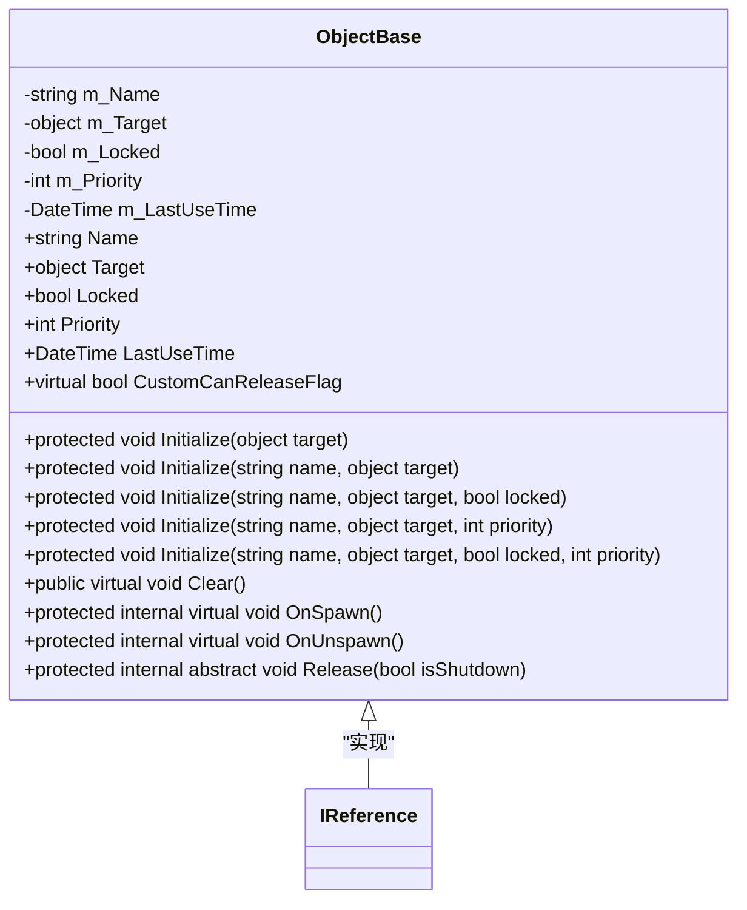
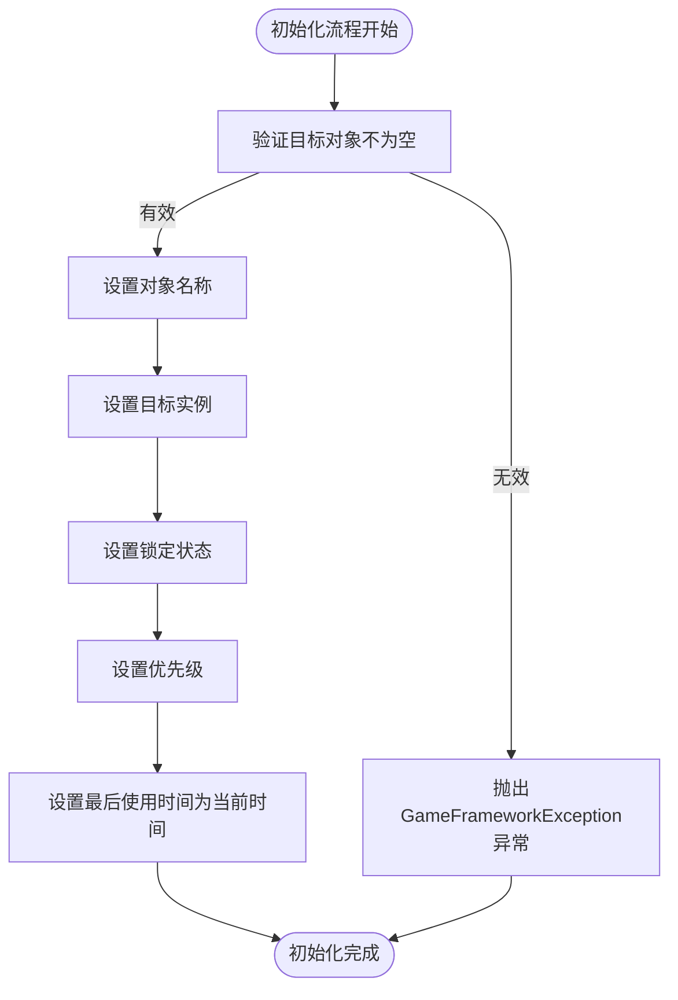
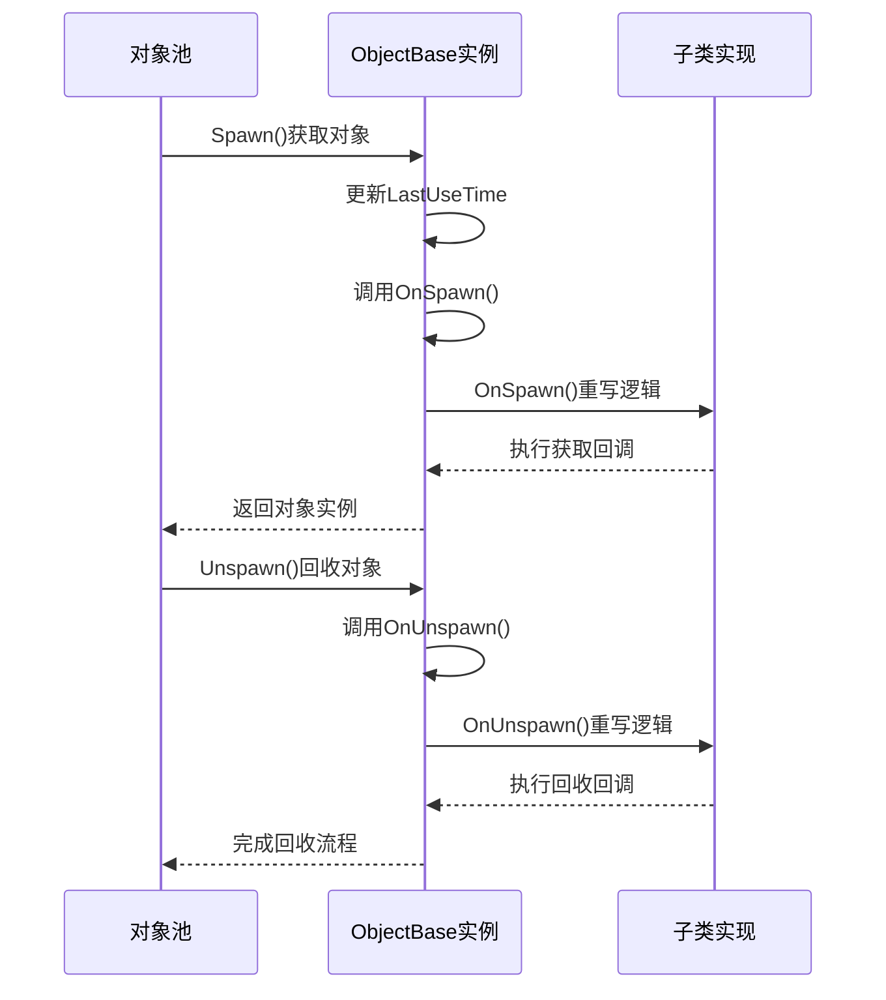
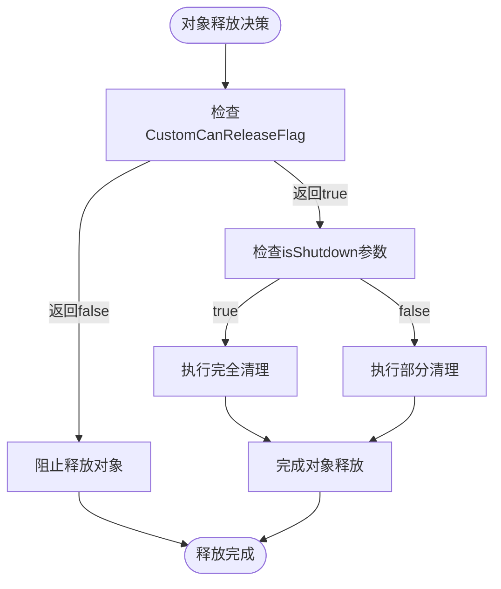
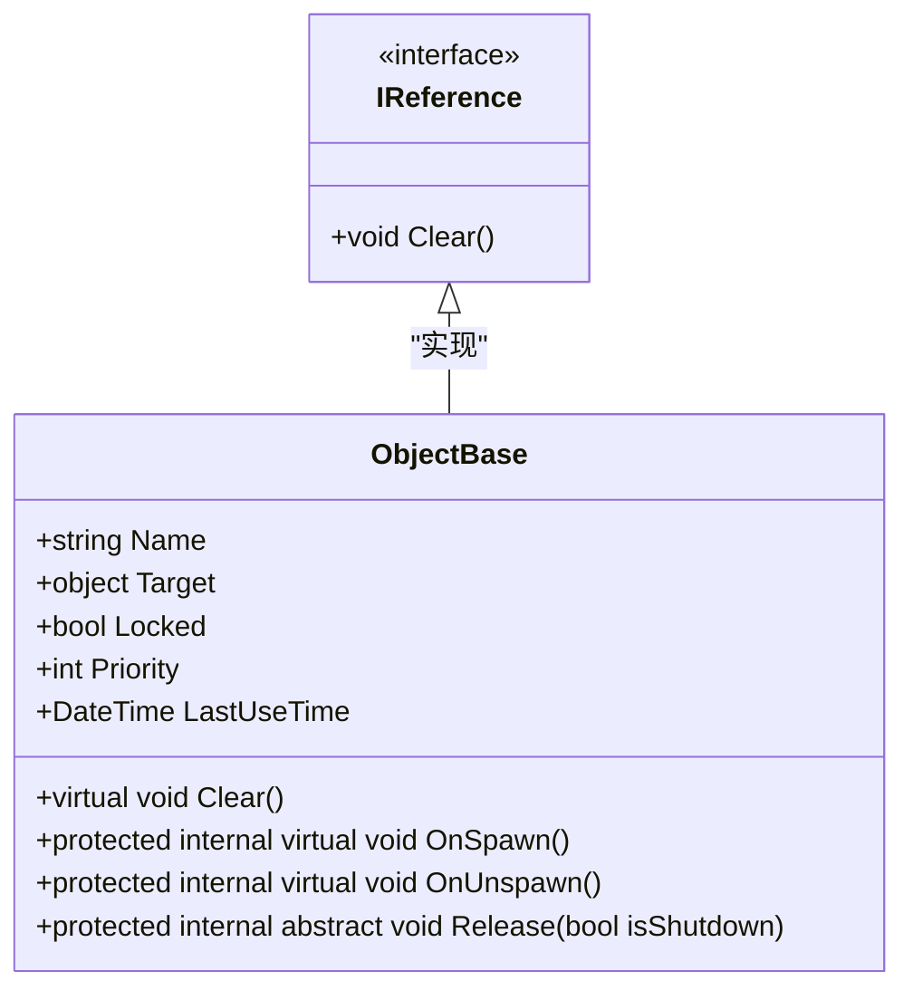
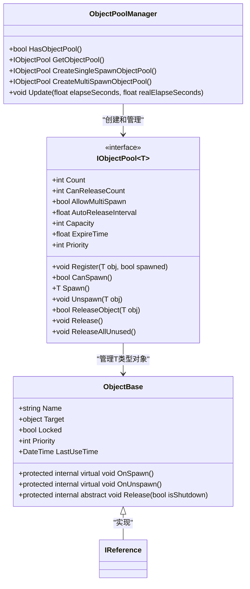

# 对象基类

<cite>
**Referenced Files in This Document**   
- [ObjectBase.cs](file://GameFramework/ObjectPool/ObjectBase.cs)
- [IReference.cs](file://GameFramework/Base/ReferencePool/IReference.cs)
- [ObjectPoolBase.cs](file://GameFramework/ObjectPool/ObjectPoolBase.cs)
- [ObjectPoolManager.cs](file://GameFramework/ObjectPool/ObjectPoolManager.cs)
- [IObjectPool.cs](file://GameFramework/ObjectPool/IObjectPool.cs)
</cite>

## 目录
1. [简介](#简介)
2. [核心属性设计](#核心属性设计)
3. [初始化与清理机制](#初始化与清理机制)
4. [对象生命周期回调](#对象生命周期回调)
5. [资源释放策略](#资源释放策略)
6. [引用接口集成](#引用接口集成)
7. [对象池管理集成](#对象池管理集成)
8. [使用示例与最佳实践](#使用示例与最佳实践)

## 简介

`ObjectBase` 是游戏框架中对象池系统的核心抽象基类，为所有可被池化的对象提供统一的基类实现。该类通过封装对象的通用属性和生命周期管理逻辑，实现了轻量级对象的高效复用机制。作为被池化对象的统一基类，`ObjectBase` 不仅定义了对象的基本元数据，还规范了对象从创建、使用到回收的完整生命周期流程。

该基类的设计目标是为游戏实体、UI组件、声音对象等需要频繁创建和销毁的资源提供高效的内存管理方案。通过对象池化技术，可以有效减少垃圾回收压力，提升运行时性能，避免内存碎片化问题。`ObjectBase` 与 `IReference` 接口的集成进一步强化了引用计数机制，确保了对象状态的正确管理和资源的及时释放。

**Section sources**
- [ObjectBase.cs](file://GameFramework/ObjectPool/ObjectBase.cs#L14-L205)
- [IReference.cs](file://GameFramework/Base/ReferencePool/IReference.cs#L0-L20)

## 核心属性设计

`ObjectBase` 抽象类封装了被池化对象的核心属性，这些属性构成了对象池管理的基础元数据。每个被池化的对象实例都具备以下关键属性：

- **名称（Name）**：通过 `Name` 属性提供对象的标识名称，便于在调试和监控时识别特定对象。名称在初始化时可选设置，若未指定则为空字符串。
- **目标实例（Target）**：通过 `Target` 属性存储被池化的实际对象引用，这是对象池复用的核心数据载体。
- **锁定状态（Locked）**：通过 `Locked` 属性标记对象是否被锁定，锁定的对象不会被自动释放，确保关键对象的稳定持有。
- **优先级（Priority）**：通过 `Priority` 属性定义对象的优先级，影响对象池的释放策略，高优先级对象更晚被释放。
- **最后使用时间（LastUseTime）**：通过 `LastUseTime` 属性记录对象最后一次被使用的时间戳，用于实现基于时间的过期释放机制。

这些属性共同构成了对象池管理的决策依据，使得对象池能够根据对象的使用频率、重要性和时效性进行智能管理。

**Diagram sources**
- [ObjectBase.cs](file://GameFramework/ObjectPool/ObjectBase.cs#L14-L205)

**Section sources**
- [ObjectBase.cs](file://GameFramework/ObjectPool/ObjectBase.cs#L14-L205)

## 初始化与清理机制

`ObjectBase` 提供了一套完整的初始化与清理机制，确保对象在池化过程中的状态正确性。初始化流程通过多个重载的 `Initialize` 方法实现，支持灵活的配置选项。

初始化方法支持四种参数组合：仅目标对象、名称与目标对象、名称、目标对象与锁定状态、以及完整的名称、目标对象、锁定状态和优先级。所有重载方法最终都会调用最完整的 `Initialize(string name, object target, bool locked, int priority)` 方法进行统一处理。该方法首先验证目标对象的有效性，然后设置所有属性，并将最后使用时间更新为当前UTC时间。

清理机制通过 `Clear` 方法实现，该方法将所有属性重置为默认值，包括将名称和目标引用置空，锁定状态设为false，优先级归零，以及将最后使用时间重置为默认DateTime值。此方法被声明为 `virtual`，允许子类在清理时执行额外的自定义逻辑。

**Diagram sources**
- [ObjectBase.cs](file://GameFramework/ObjectPool/ObjectBase.cs#L160-L172)
- [ObjectBase.cs](file://GameFramework/ObjectPool/ObjectBase.cs#L177-L184)

**Section sources**
- [ObjectBase.cs](file://GameFramework/ObjectPool/ObjectBase.cs#L116-L172)
- [ObjectBase.cs](file://GameFramework/ObjectPool/ObjectBase.cs#L177-L184)

## 对象生命周期回调

`ObjectBase` 定义了对象生命周期的关键回调方法，这些方法在对象被获取和回收时自动触发，为子类提供了扩展生命周期行为的能力。

`OnSpawn` 方法在对象从池中被获取时调用，这是一个 `protected internal virtual` 方法，允许子类重写以执行获取时的初始化逻辑，如重置对象状态、恢复默认属性或重新注册事件监听器。此回调为对象的"激活"阶段提供了钩子。

`OnUnspawn` 方法在对象被回收到池中时调用，同样为 `protected internal virtual` 方法。子类可以重写此方法执行回收前的清理工作，如暂停动画、取消事件订阅或保存临时状态。此回调确保了对象在归还池中前处于干净状态。

这两个回调方法的设计遵循了模板方法模式，基类提供默认的空实现，子类可以根据需要选择性重写，实现了灵活的生命周期管理。

**Diagram sources**
- [ObjectBase.cs](file://GameFramework/ObjectPool/ObjectBase.cs#L189-L191)
- [ObjectBase.cs](file://GameFramework/ObjectPool/ObjectBase.cs#L196-L198)

**Section sources**
- [ObjectBase.cs](file://GameFramework/ObjectPool/ObjectBase.cs#L189-L198)

## 资源释放策略

`ObjectBase` 抽象类的核心设计之一是强制子类实现资源清理逻辑的 `Release` 抽象方法。该方法被声明为 `protected internal abstract`，确保只有对象池系统内部和子类可以访问，并且必须由所有子类提供具体实现。

`Release` 方法接收一个 `isShutdown` 布尔参数，指示当前释放操作是否发生在对象池关闭时。这一设计允许子类根据上下文执行不同的清理策略：在正常释放时可能只清理部分资源以备后续复用，而在池关闭时则执行彻底的资源销毁。

此外，`ObjectBase` 还提供了 `CustomCanReleaseFlag` 虚拟属性，子类可以重写此属性以提供自定义的释放检查逻辑。默认实现始终返回 `true`，表示对象可以被释放，但子类可以根据对象的当前状态（如正在进行关键操作）返回 `false` 来阻止释放。

这种双重释放机制（抽象方法强制实现 + 虚拟属性条件控制）确保了资源管理的灵活性和安全性，既强制了必要的清理工作，又允许基于运行时状态的智能决策。

**Diagram sources**
- [ObjectBase.cs](file://GameFramework/ObjectPool/ObjectBase.cs#L204-L204)
- [ObjectBase.cs](file://GameFramework/ObjectPool/ObjectBase.cs#L177-L184)

**Section sources**
- [ObjectBase.cs](file://GameFramework/ObjectPool/ObjectBase.cs#L204-L204)
- [ObjectBase.cs](file://GameFramework/ObjectPool/ObjectBase.cs#L177-L184)

## 引用接口集成

`ObjectBase` 抽象类实现了 `IReference` 接口，这一设计将对象池系统与引用池系统进行了有机整合，形成了轻量级对象复用的统一模式。`IReference` 接口仅定义了一个 `Clear` 方法，要求实现类提供清理引用的逻辑。

通过实现 `IReference` 接口，`ObjectBase` 不仅能够作为对象池的基类，还能无缝集成到引用池系统中。这种设计模式允许开发者将 `ObjectBase` 的子类同时用于两种不同的池化场景：当需要管理复杂对象（如游戏实体）时使用对象池，当需要管理简单数据结构时使用引用池。

`Clear` 方法在 `ObjectBase` 中被实现为重置所有核心属性，这既满足了 `IReference` 接口的要求，又为对象池的复用做好了准备。这种双重角色的设计提高了代码的复用性和系统的整体一致性，开发者可以基于同一套基类构建不同类型的可复用对象。

**Diagram sources**
- [IReference.cs](file://GameFramework/Base/ReferencePool/IReference.cs#L0-L20)
- [ObjectBase.cs](file://GameFramework/ObjectPool/ObjectBase.cs#L14-L205)

**Section sources**
- [IReference.cs](file://GameFramework/Base/ReferencePool/IReference.cs#L0-L20)
- [ObjectBase.cs](file://GameFramework/ObjectPool/ObjectBase.cs#L14-L205)

## 对象池管理集成

`ObjectBase` 与 `ObjectPoolManager` 和 `IObjectPool<T>` 接口紧密集成，构成了完整的对象池管理系统。`ObjectPoolManager` 作为对象池的中央管理器，负责创建和管理所有类型的对象池实例。

`ObjectPoolManager` 提供了 `CreateSingleSpawnObjectPool` 和 `CreateMultiSpawnObjectPool` 系列方法，用于创建不同配置的对象池。这些方法支持多种参数组合，包括容量、过期时间、优先级等，满足不同场景的需求。单次获取对象池（SingleSpawn）确保每个对象在同一时间只能被一个使用者获取，而多次获取对象池（MultiSpawn）允许多个使用者同时持有同一对象。

`IObjectPool<T>` 接口定义了对象池的标准操作，包括 `Spawn`（获取对象）、`Unspawn`（回收对象）和 `ReleaseObject`（释放对象）等核心方法。这些方法与 `ObjectBase` 的生命周期回调紧密配合，形成了完整的对象管理闭环。

**Diagram sources**
- [ObjectPoolManager.cs](file://GameFramework/ObjectPool/ObjectPoolManager.cs#L0-L799)
- [IObjectPool.cs](file://GameFramework/ObjectPool/IObjectPool.cs#L0-L218)
- [ObjectBase.cs](file://GameFramework/ObjectPool/ObjectBase.cs#L14-L205)

**Section sources**
- [ObjectPoolManager.cs](file://GameFramework/ObjectPool/ObjectPoolManager.cs#L384-L755)
- [IObjectPool.cs](file://GameFramework/ObjectPool/IObjectPool.cs#L138-L186)

## 使用示例与最佳实践

基于 `ObjectBase` 抽象类，开发者可以构建各种可被高效管理的游戏实体、UI组件或声音对象。创建子类时，必须实现 `Release` 抽象方法，确保资源的正确清理。建议在 `OnSpawn` 回调中重置对象状态，在 `OnUnspawn` 回调中执行轻量级清理。

最佳实践包括：为频繁创建销毁的对象使用对象池；合理设置对象优先级以控制释放顺序；利用锁定机制保护关键对象；通过 `CustomCanReleaseFlag` 实现智能释放决策。此外，应避免在对象池中存储对已销毁对象的引用，防止内存泄漏。

通过遵循这些实践，开发者可以充分利用 `ObjectBase` 提供的强大功能，构建高性能、低内存占用的游戏系统，实现资源的高效复用和管理。

**Section sources**
- [ObjectBase.cs](file://GameFramework/ObjectPool/ObjectBase.cs#L14-L205)