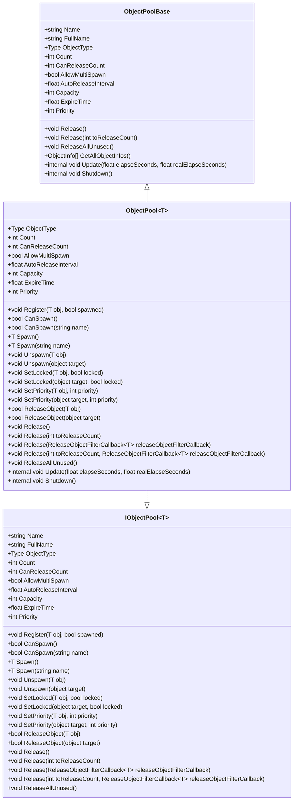

# 对象池基类

<cite>
**本文档中引用的文件**  
- [ObjectPoolBase.cs](file://GameFramework/ObjectPool/ObjectPoolBase.cs)
- [ObjectPoolManager.ObjectPool.cs](file://GameFramework/ObjectPool/ObjectPoolManager.ObjectPool.cs)
- [IObjectPool.cs](file://GameFramework/ObjectPool/IObjectPool.cs)
</cite>

## 目录
1. [简介](#简介)
2. [核心属性解析](#核心属性解析)
3. [可配置参数说明](#可配置参数说明)
4. [运行时更新与关闭流程](#运行时更新与关闭流程)
5. [继承关系与差异化行为](#继承关系与差异化行为)
6. [类图](#类图)

## 简介
`ObjectPoolBase` 是 GameFramework 框架中所有对象池实现的抽象基类，定义了对象池的基本结构和行为规范。该基类为开发者提供了统一的对象池接口，支持单例与多例对象池的差异化实现，是对象池系统的核心组成部分。

**Section sources**
- [ObjectPoolBase.cs](file://GameFramework/ObjectPool/ObjectPoolBase.cs#L14-L150)

## 核心属性解析
`ObjectPoolBase` 定义了多个核心属性，用于描述对象池的基本信息和状态。

### Name 与 FullName
`Name` 属性返回对象池的名称，而 `FullName` 则返回对象池的完整名称，由对象类型和名称组合而成。完整名称通过 `TypeNamePair` 类型生成，确保了对象池标识的唯一性。

### ObjectType
`ObjectType` 是一个抽象属性，返回对象池中对象的类型。该属性由具体实现类提供，用于标识对象池所管理的对象类型。

### Count 与 CanReleaseCount
`Count` 属性返回对象池中当前对象的总数，而 `CanReleaseCount` 则返回可被释放的对象数量。这两个属性为对象池的状态监控提供了基础数据。

**Section sources**
- [ObjectPoolBase.cs](file://GameFramework/ObjectPool/ObjectPoolBase.cs#L68-L79)

## 可配置参数说明
`ObjectPoolBase` 提供了一系列可配置参数，用于控制对象池的行为。

### AllowMultiSpawn
`AllowMultiSpawn` 参数决定是否允许对象被多次获取。当设置为 `true` 时，同一对象可被多次获取；设置为 `false` 时，对象只能被获取一次。

### AutoReleaseInterval
`AutoReleaseInterval` 参数设置对象池自动释放可释放对象的间隔秒数。该参数控制着对象池的自动清理频率。

### Capacity
`Capacity` 参数定义对象池的最大容量。当对象数量超过容量时，对象池会自动释放多余对象以维持容量限制。

### ExpireTime
`ExpireTime` 参数设置对象池中对象的过期秒数。超过此时间未被使用的对象将被视为可释放对象。

### Priority
`Priority` 参数定义对象池的优先级，用于在多个对象池之间进行排序和管理。

**Section sources**
- [ObjectPoolBase.cs](file://GameFramework/ObjectPool/ObjectPoolBase.cs#L84-L123)

## 运行时更新与关闭流程
`ObjectPoolBase` 通过 `Update` 和 `Shutdown` 方法管理对象池的运行时行为。

### Update 方法
`Update` 方法在每次游戏循环中被调用，负责处理对象池的自动释放逻辑。当经过的时间超过 `AutoReleaseInterval` 时，对象池会触发 `Release` 操作，清理可释放对象。

### Shutdown 方法
`Shutdown` 方法用于关闭对象池，释放所有资源。该方法会遍历对象池中的所有对象，执行释放操作，并清空内部数据结构。

**Section sources**
- [ObjectPoolBase.cs](file://GameFramework/ObjectPool/ObjectPoolBase.cs#L147-L149)
- [ObjectPoolManager.ObjectPool.cs](file://GameFramework/ObjectPool/ObjectPoolManager.ObjectPool.cs#L535-L558)

## 继承关系与差异化行为
`ObjectPoolBase` 通过继承机制支持单例与多例对象池的差异化行为。

### ObjectPool 实现
`ObjectPool<T>` 类继承自 `ObjectPoolBase`，实现了具体的对象池功能。该类通过泛型参数 `T` 约束对象类型必须继承自 `ObjectBase`，确保了类型安全。

### 单例与多例支持
通过 `AllowMultiSpawn` 参数，`ObjectPool<T>` 可以支持单例（`false`）和多例（`true`）两种模式。单例模式下，对象只能被获取一次；多例模式下，对象可被多次获取。

**Section sources**
- [ObjectPoolManager.ObjectPool.cs](file://GameFramework/ObjectPool/ObjectPoolManager.ObjectPool.cs#L18-L634)

## 类图

**Diagram sources**
- [ObjectPoolBase.cs](file://GameFramework/ObjectPool/ObjectPoolBase.cs#L14-L150)
- [ObjectPoolManager.ObjectPool.cs](file://GameFramework/ObjectPool/ObjectPoolManager.ObjectPool.cs#L18-L634)
- [IObjectPool.cs](file://GameFramework/ObjectPool/IObjectPool.cs#L1-L218)