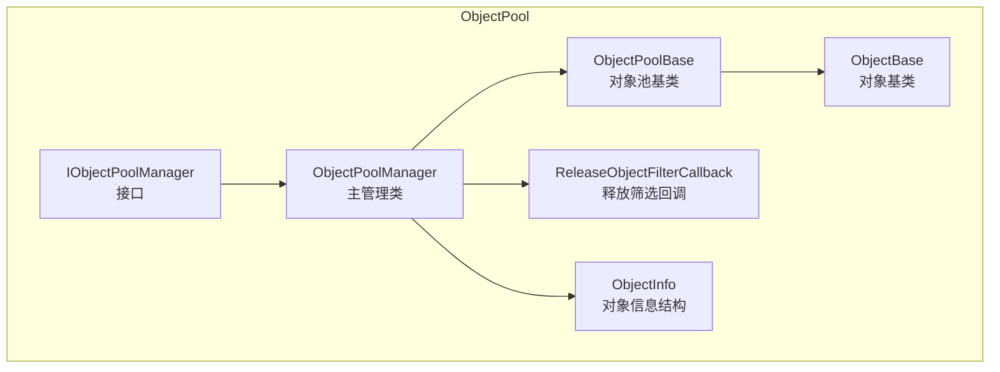
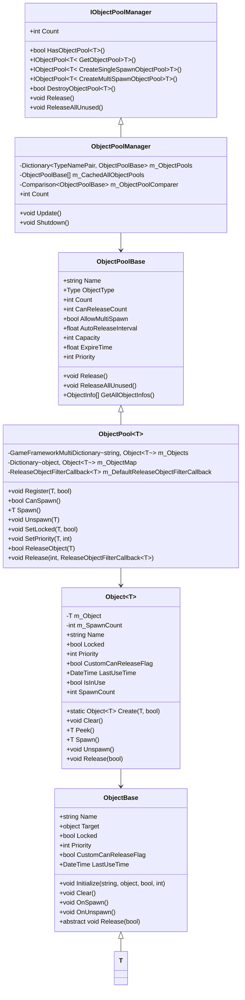
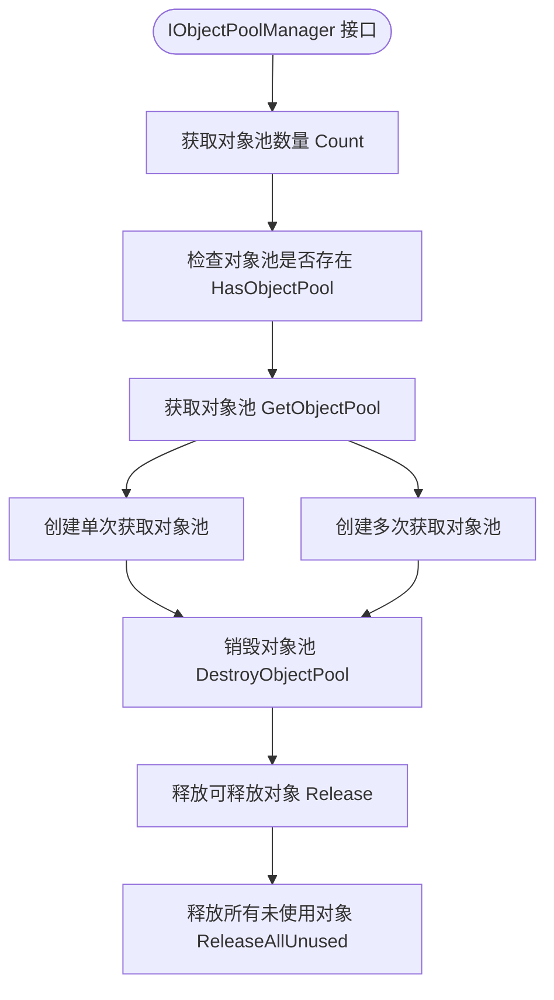
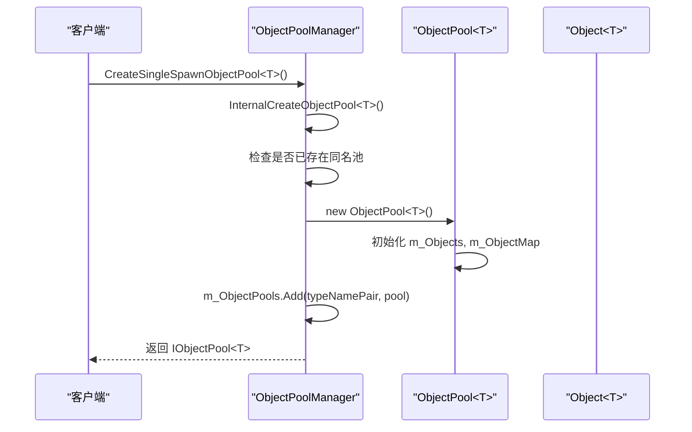
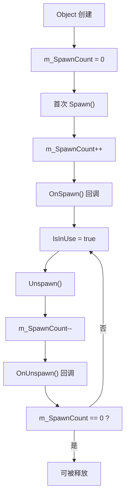
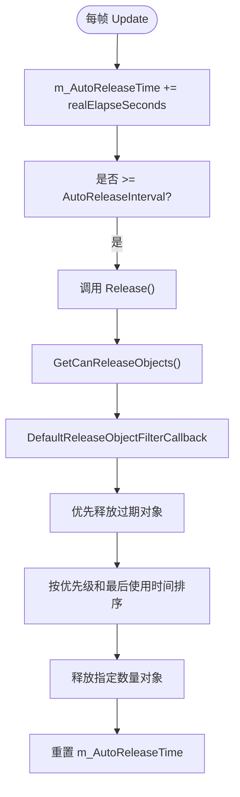
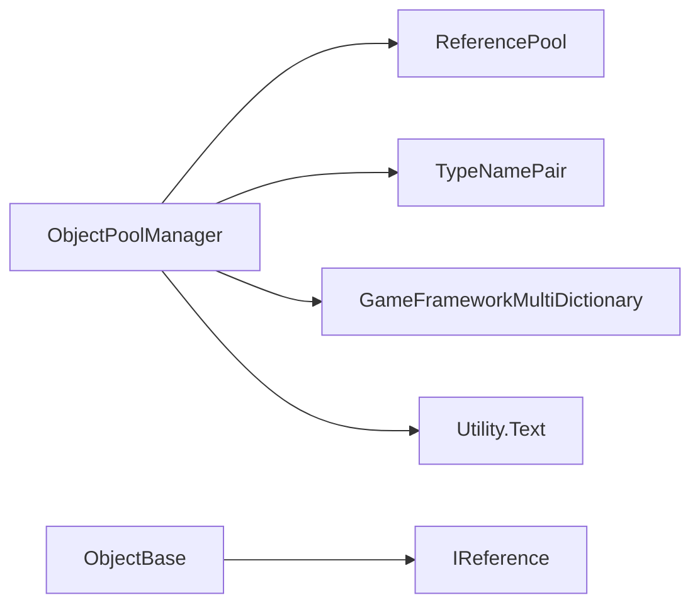

# 对象池管理器

<cite>
**本文档中引用的文件**
- [IObjectPoolManager.cs](file://GameFramework/ObjectPool/IObjectPoolManager.cs)
- [ObjectPoolManager.cs](file://GameFramework/ObjectPool/ObjectPoolManager.cs)
- [ObjectPoolManager.Object.cs](file://GameFramework/ObjectPool/ObjectPoolManager.Object.cs)
- [ObjectPoolManager.ObjectPool.cs](file://GameFramework/ObjectPool/ObjectPoolManager.ObjectPool.cs)
- [ObjectBase.cs](file://GameFramework/ObjectPool/ObjectBase.cs)
- [ReleaseObjectFilterCallback.cs](file://GameFramework/ObjectPool/ReleaseObjectFilterCallback.cs)
- [ObjectInfo.cs](file://GameFramework/ObjectPool/ObjectInfo.cs)
</cite>

## 目录
1. [简介](#简介)
2. [项目结构](#项目结构)
3. [核心组件](#核心组件)
4. [架构概述](#架构概述)
5. [详细组件分析](#详细组件分析)
6. [依赖分析](#依赖分析)
7. [性能考虑](#性能考虑)
8. [故障排除指南](#故障排除指南)
9. [结论](#结论)

## 简介
对象池管理器是游戏框架中用于管理对象池的核心模块，负责统一创建、查询、销毁和释放对象池。它通过 `IObjectPoolManager` 接口定义了完整的对象池管理能力，并由 `ObjectPoolManager` 类实现。该系统支持单次获取和多次获取两种对象池策略，适用于 Entity、UI、Sound 等需要频繁创建与销毁对象的模块。通过容量限制、过期时间、优先级排序和自动释放机制，有效控制内存使用并提升运行效率。

## 项目结构
对象池系统位于 `GameFramework/ObjectPool` 目录下，采用模块化设计，包含接口定义、基类实现和内部管理逻辑。

**图表来源**
- [IObjectPoolManager.cs](file://GameFramework/ObjectPool/IObjectPoolManager.cs)
- [ObjectPoolManager.cs](file://GameFramework/ObjectPool/ObjectPoolManager.cs)
- [ObjectBase.cs](file://GameFramework/ObjectPool/ObjectBase.cs)
- [ReleaseObjectFilterCallback.cs](file://GameFramework/ObjectPool/ReleaseObjectFilterCallback.cs)
- [ObjectInfo.cs](file://GameFramework/ObjectPool/ObjectInfo.cs)

**章节来源**
- [IObjectPoolManager.cs](file://GameFramework/ObjectPool/IObjectPoolManager.cs)
- [ObjectPoolManager.cs](file://GameFramework/ObjectPool/ObjectPoolManager.cs)

## 核心组件
`IObjectPoolManager` 接口定义了对象池管理的全部功能，包括对象池的创建、查询、销毁和释放。`ObjectPoolManager` 类实现了该接口，使用字典 `m_ObjectPools` 存储所有对象池实例，通过 `TypeNamePair` 作为键进行唯一标识。内部类 `Object<T>` 和 `ObjectPool<T>` 分别封装了对象的引用状态和池化行为。管理器在每帧调用 `Update` 方法，触发自动释放逻辑，并在关闭时调用 `Shutdown` 清理所有资源。

**章节来源**
- [IObjectPoolManager.cs](file://GameFramework/ObjectPool/IObjectPoolManager.cs#L15-L749)
- [ObjectPoolManager.cs](file://GameFramework/ObjectPool/ObjectPoolManager.cs#L28-L33)
- [ObjectPoolManager.Object.cs](file://GameFramework/ObjectPool/ObjectPoolManager.Object.cs#L11-L194)

## 架构概述
对象池管理器采用分层架构，上层为接口层，中层为管理器实现，底层为具体对象池和对象封装。

**图表来源**
- [IObjectPoolManager.cs](file://GameFramework/ObjectPool/IObjectPoolManager.cs#L15-L749)
- [ObjectPoolManager.cs](file://GameFramework/ObjectPool/ObjectPoolManager.cs)
- [ObjectPoolManager.ObjectPool.cs](file://GameFramework/ObjectPool/ObjectPoolManager.ObjectPool.cs)
- [ObjectPoolManager.Object.cs](file://GameFramework/ObjectPool/ObjectPoolManager.Object.cs)
- [ObjectBase.cs](file://GameFramework/ObjectPool/ObjectBase.cs)

## 详细组件分析

### IObjectPoolManager 接口分析
`IObjectPoolManager` 是对象池系统的顶层接口，定义了所有管理操作。

#### 接口功能

**图表来源**
- [IObjectPoolManager.cs](file://GameFramework/ObjectPool/IObjectPoolManager.cs#L15-L749)

**章节来源**
- [IObjectPoolManager.cs](file://GameFramework/ObjectPool/IObjectPoolManager.cs#L15-L749)

### ObjectPoolManager 类分析
`ObjectPoolManager` 是 `IObjectPoolManager` 的具体实现，负责管理所有对象池的生命周期。

#### 创建对象池流程

**图表来源**
- [ObjectPoolManager.cs](file://GameFramework/ObjectPool/ObjectPoolManager.cs#L1248-L1259)
- [ObjectPoolManager.ObjectPool.cs](file://GameFramework/ObjectPool/ObjectPoolManager.ObjectPool.cs)

**章节来源**
- [ObjectPoolManager.cs](file://GameFramework/ObjectPool/ObjectPoolManager.cs#L1248-L1259)

### Object<T> 内部对象分析
`Object<T>` 是对象池中对实际对象的包装，用于跟踪使用状态。

#### 状态管理流程

**图表来源**
- [ObjectPoolManager.Object.cs](file://GameFramework/ObjectPool/ObjectPoolManager.Object.cs#L11-L194)

**章节来源**
- [ObjectPoolManager.Object.cs](file://GameFramework/ObjectPool/ObjectPoolManager.Object.cs#L11-L194)

### 高级功能实现原理
对象池管理器提供了自动释放、优先级排序和条件筛选等高级功能。

#### 自动释放机制

**图表来源**
- [ObjectPoolManager.ObjectPool.cs](file://GameFramework/ObjectPool/ObjectPoolManager.ObjectPool.cs)
- [ReleaseObjectFilterCallback.cs](file://GameFramework/ObjectPool/ReleaseObjectFilterCallback.cs)

**章节来源**
- [ObjectPoolManager.ObjectPool.cs](file://GameFramework/ObjectPool/ObjectPoolManager.ObjectPool.cs)

## 依赖分析
对象池管理器依赖于框架的引用池（ReferencePool）进行内部对象的复用，并通过 `TypeNamePair` 作为键来唯一标识对象池。

**图表来源**
- [ObjectPoolManager.cs](file://GameFramework/ObjectPool/ObjectPoolManager.cs)
- [ObjectPoolManager.Object.cs](file://GameFramework/ObjectPool/ObjectPoolManager.Object.cs)
- [ObjectBase.cs](file://GameFramework/ObjectPool/ObjectBase.cs)

**章节来源**
- [ObjectPoolManager.cs](file://GameFramework/ObjectPool/ObjectPoolManager.cs)
- [ObjectBase.cs](file://GameFramework/ObjectPool/ObjectBase.cs)

## 性能考虑
对象池管理器通过以下方式优化性能：
- 使用字典 `m_ObjectPools` 实现 O(1) 的对象池查找。
- 内部对象 `Object<T>` 实现 `IReference`，利用引用池避免频繁 GC。
- `GetAllObjectPools` 提供排序选项，避免不必要的排序开销。
- 自动释放间隔 `AutoReleaseInterval` 可配置，平衡性能与内存。

## 故障排除指南
常见问题及解决方案：
- **对象池创建失败**：检查类型是否继承自 `ObjectBase`，名称是否重复。
- **对象无法释放**：检查对象的 `Locked` 状态或 `CustomCanReleaseFlag` 是否为 `false`。
- **内存泄漏**：确保所有获取的对象都正确调用 `Unspawn`。
- **性能下降**：调整 `AutoReleaseInterval` 和 `Capacity` 参数，避免频繁释放。

**章节来源**
- [ObjectPoolManager.cs](file://GameFramework/ObjectPool/ObjectPoolManager.cs)
- [ObjectPoolManager.ObjectPool.cs](file://GameFramework/ObjectPool/ObjectPoolManager.ObjectPool.cs)
- [ObjectBase.cs](file://GameFramework/ObjectPool/ObjectBase.cs)

## 结论
对象池管理器通过 `IObjectPoolManager` 接口和 `ObjectPoolManager` 实现，提供了一套完整、高效且灵活的对象池管理方案。其支持单次和多次获取策略，结合自动释放、优先级排序和条件筛选，能够有效管理 Entity、UI、Sound 等模块的对象生命周期，显著提升游戏性能和内存使用效率。