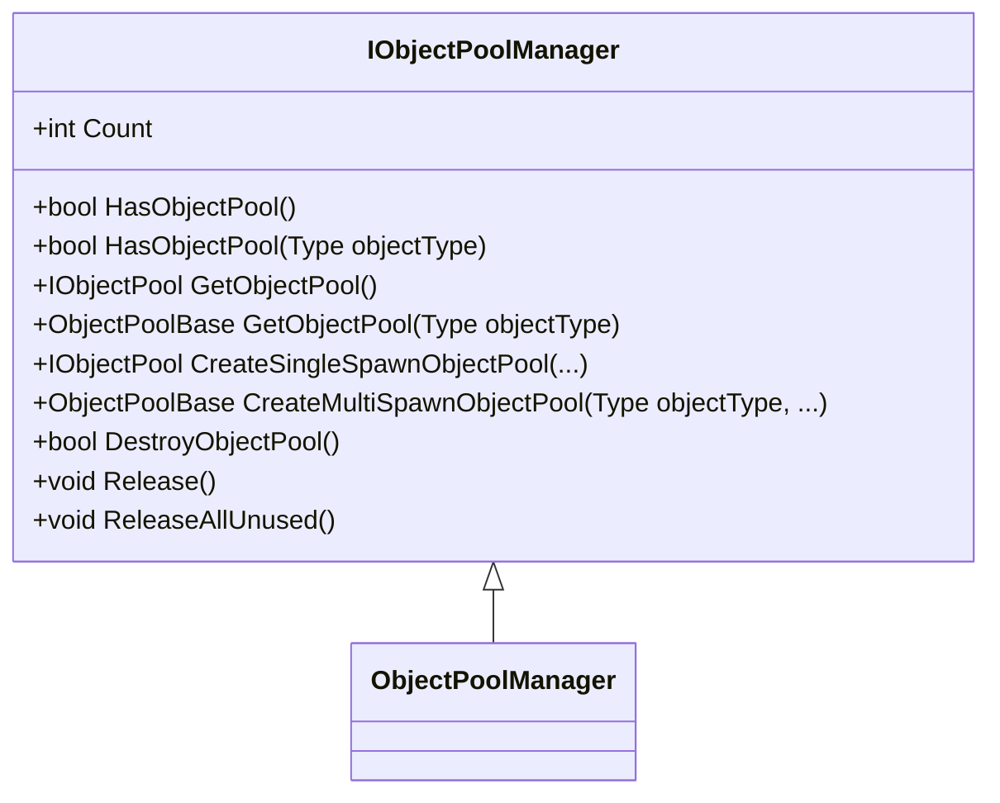
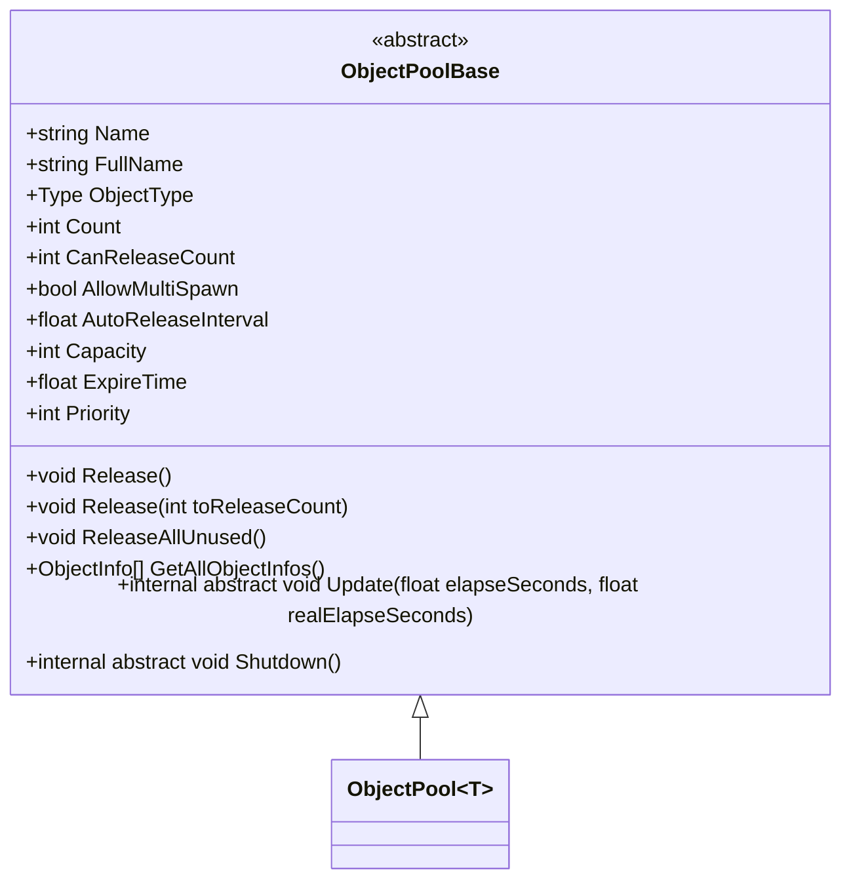
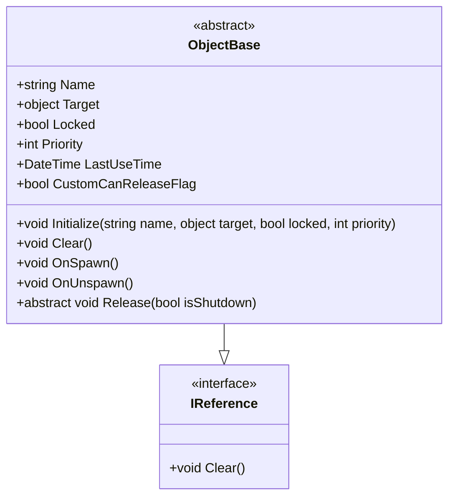
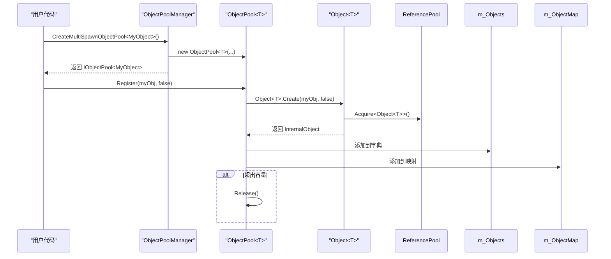
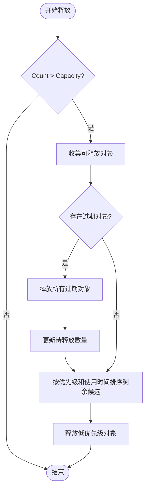
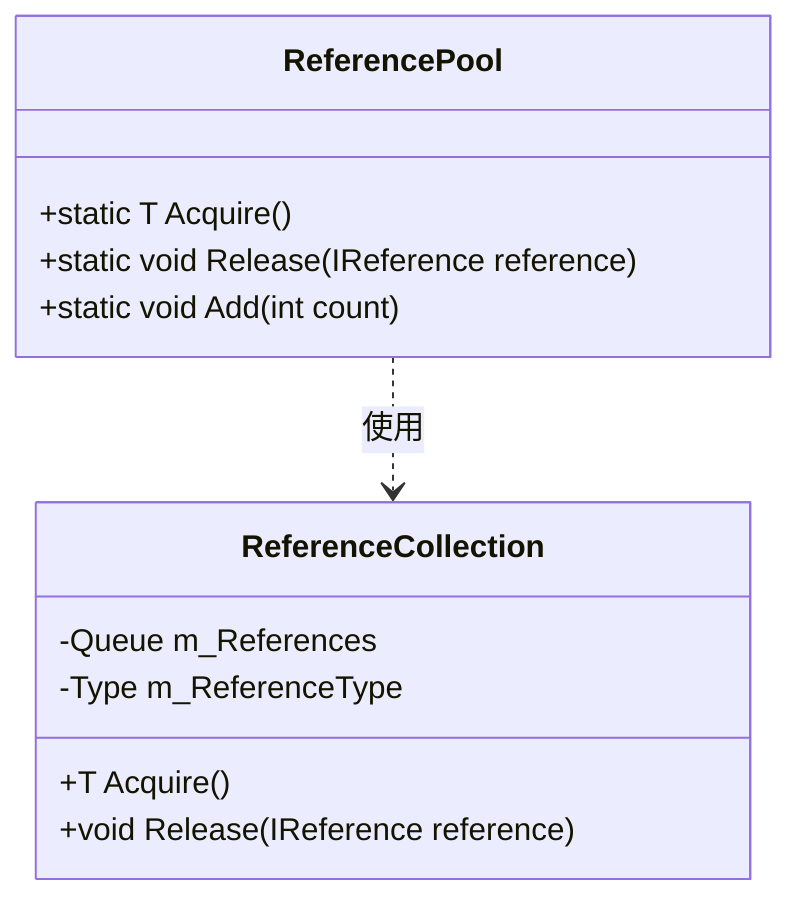

<cite>
**本文档中引用的文件**  
- [IObjectPoolManager.cs](file://GameFramework/ObjectPool/IObjectPoolManager.cs)
- [ObjectPoolBase.cs](file://GameFramework/ObjectPool/ObjectPoolBase.cs)
- [ObjectBase.cs](file://GameFramework/ObjectPool/ObjectBase.cs)
- [ObjectPoolManager.cs](file://GameFramework/ObjectPool/ObjectPoolManager.cs)
- [IObjectPool.cs](file://GameFramework/ObjectPool/IObjectPool.cs)
- [ObjectInfo.cs](file://GameFramework/ObjectPool/ObjectInfo.cs)
- [ReferencePool.cs](file://GameFramework/Base/ReferencePool/ReferencePool.cs)
- [IReference.cs](file://GameFramework/Base/ReferencePool/IReference.cs)
- [ObjectPoolManager.ObjectPool.cs](file://GameFramework/ObjectPool/ObjectPoolManager.ObjectPool.cs)
- [ObjectPoolManager.Object.cs](file://GameFramework/ObjectPool/ObjectPoolManager.Object.cs)
</cite>

# 对象池系统

## 目录
1. [引言](#引言)
2. [核心组件设计](#核心组件设计)
3. [对象池工作流程](#对象池工作流程)
4. [引用池机制](#引用池机制)
5. [自定义对象池实现](#自定义对象池实现)
6. [性能监控与优化](#性能监控与优化)
7. [常见误用场景规避](#常见误用场景规避)
8. [模块应用示例](#模块应用示例)
9. [结论](#结论)

## 引言

对象池系统是游戏开发中用于优化内存分配和减少垃圾回收（GC）压力的关键技术。通过预先创建并维护一组可复用的对象，系统能够在需要时快速获取对象，并在使用完毕后将其归还至池中，而非直接销毁。这种机制显著降低了频繁创建和销毁对象所带来的性能开销，尤其适用于高频次创建/销毁的场景，如实体、UI元素、音效等。

本系统基于 `IObjectPoolManager` 统一管理多个对象池，每个对象池由 `ObjectPoolBase` 抽象基类定义，管理的对象需继承自 `ObjectBase`。此外，系统还集成了轻量级的 `ReferencePool`（引用池），用于高效复用小型引用类型对象。

**Section sources**
- [IObjectPoolManager.cs](file://GameFramework/ObjectPool/IObjectPoolManager.cs#L15-L749)
- [ObjectPoolBase.cs](file://GameFramework/ObjectPool/ObjectPoolBase.cs#L14-L150)
- [ObjectBase.cs](file://GameFramework/ObjectPool/ObjectBase.cs#L14-L205)

## 核心组件设计

### IObjectPoolManager（对象池管理器）

`IObjectPoolManager` 是对象池系统的顶层管理接口，负责统一创建、查询、销毁和释放所有对象池。它提供了丰富的 API，支持通过对象类型、名称或自定义条件来操作对象池。

主要功能包括：
- **创建对象池**：支持创建允许单次或多次获取的对象池，并可配置容量、过期时间、优先级等参数。
- **查询对象池**：提供多种方式检查和获取对象池实例。
- **销毁对象池**：安全地销毁指定的对象池。
- **批量释放**：触发所有对象池的自动释放逻辑。



**Diagram sources**
- [IObjectPoolManager.cs](file://GameFramework/ObjectPool/IObjectPoolManager.cs#L15-L749)

### ObjectPoolBase（对象池基类）

`ObjectPoolBase` 是所有具体对象池的抽象基类，定义了对象池的核心属性和行为。它是一个泛型抽象类，通过继承实现具体类型的对象池。

关键属性与方法：
- **Name**: 对象池名称，用于区分同类型的不同池。
- **ObjectType**: 管理的对象类型。
- **Count**: 当前池中对象的总数。
- **CanReleaseCount**: 可被释放的对象数量。
- **AllowMultiSpawn**: 是否允许多次获取同一对象。
- **AutoReleaseInterval**: 自动释放检查的间隔时间。
- **Capacity**: 池的最大容量。
- **ExpireTime**: 对象过期时间（未使用时长）。
- **Priority**: 池的优先级，影响释放顺序。
- **Release()**: 释放可释放对象的核心方法。
- **GetAllObjectInfos()**: 获取池中所有对象的统计信息。



**Diagram sources**
- [ObjectPoolBase.cs](file://GameFramework/ObjectPool/ObjectPoolBase.cs#L14-L150)

### ObjectBase（对象基类）

`ObjectBase` 是所有可被池化对象的基类，继承自 `IReference` 接口。它封装了对象的元数据和生命周期事件。

核心特性：
- **Target**: 指向实际被管理的对象实例。
- **Name**: 对象的标识名称。
- **Locked**: 锁定状态，锁定的对象不会被自动释放。
- **Priority**: 对象优先级，影响释放顺序。
- **LastUseTime**: 上次使用时间，用于判断过期。
- **OnSpawn()**: 对象被获取时触发的事件。
- **OnUnspawn()**: 对象被回收时触发的事件。
- **Release(bool isShutdown)**: 释放对象资源的抽象方法，由子类实现。



**Diagram sources**
- [ObjectBase.cs](file://GameFramework/ObjectPool/ObjectBase.cs#L14-L205)
- [IReference.cs](file://GameFramework/Base/ReferencePool/IReference.cs#L12-L18)

## 对象池工作流程

### 对象的创建与注册

当需要将一个对象加入池中时，首先创建该对象的实例并继承 `ObjectBase`，然后通过 `IObjectPoolManager` 创建或获取对应的对象池，并调用 `Register` 方法注册对象。



**Diagram sources**
- [ObjectPoolManager.cs](file://GameFramework/ObjectPool/ObjectPoolManager.cs#L28-L33)
- [ObjectPoolManager.ObjectPool.cs](file://GameFramework/ObjectPool/ObjectPoolManager.ObjectPool.cs#L30-L100)
- [ObjectPoolManager.Object.cs](file://GameFramework/ObjectPool/ObjectPoolManager.Object.cs#L50-L65)

### 对象的获取（Spawn）

获取对象是通过调用对象池的 `Spawn` 方法完成的。系统会查找符合条件（名称匹配且未被占用）的对象，将其标记为“已使用”，并触发 `OnSpawn` 事件。

```mermaid
sequenceDiagram
participant User as "用户代码"
participant Pool as "ObjectPool<T>"
participant Internal as "Object<T>"
User->>Pool : Spawn("objName")
Pool->>m_Objects : TryGetValue("objName")
loop 遍历匹配对象
Pool->>Internal : 检查 !IsInUse 或 AllowMultiSpawn
alt 可用
Internal->>Internal : Spawn()
Internal->>ObjectBase : OnSpawn()
Internal-->>Pool : 返回 T
Pool-->>User : 返回对象实例
break
end
end
```

**Diagram sources**
- [ObjectPoolManager.ObjectPool.cs](file://GameFramework/ObjectPool/ObjectPoolManager.ObjectPool.cs#L240-L270)
- [ObjectPoolManager.Object.cs](file://GameFramework/ObjectPool/ObjectPoolManager.Object.cs#L120-L140)

### 对象的回收（Unspawn）

使用完毕后，必须调用 `Unspawn` 方法将对象归还。这会减少使用计数，更新最后使用时间，并触发 `OnUnspawn` 事件。如果此时池已超容，会立即触发释放。

```mermaid
sequenceDiagram
participant User as "用户代码"
participant Pool as "ObjectPool<T>"
participant Internal as "Object<T>"
User->>Pool : Unspawn(obj)
Pool->>m_ObjectMap : 查找 obj.Target
alt 找到 internalObject
Internal->>Internal : Unspawn()
Internal->>ObjectBase : OnUnspawn()
Internal->>ObjectBase : 更新 LastUseTime
Internal-->>Pool : SpawnCount--
alt Count > Capacity 且 SpawnCount == 0
Pool->>Pool : Release()
end
else
throw "未找到对象"
end
```

**Diagram sources**
- [ObjectPoolManager.ObjectPool.cs](file://GameFramework/ObjectPool/ObjectPoolManager.ObjectPool.cs#L275-L300)
- [ObjectPoolManager.Object.cs](file://GameFramework/ObjectPool/ObjectPoolManager.Object.cs#L145-L160)

### 对象的释放与回收策略

对象的释放由 `Release` 方法驱动，通常由系统自动触发（基于 `AutoReleaseInterval`）或手动调用。释放策略遵循以下优先级：
1. **过期对象优先**：使用时间超过 `ExpireTime` 的对象。
2. **低优先级优先**：在未过期对象中，优先级低的对象。
3. **最近最少使用**：同优先级下，最近最少使用的对象。



**Diagram sources**
- [ObjectPoolManager.ObjectPool.cs](file://GameFramework/ObjectPool/ObjectPoolManager.ObjectPool.cs#L450-L550)

### 池的自动伸缩机制

对象池通过 `Update` 方法在每帧被调用，累加真实流逝时间。当累计时间超过 `AutoReleaseInterval` 时，自动调用 `Release()` 方法，执行上述释放策略，从而实现动态内存管理。

**Section sources**
- [ObjectPoolManager.ObjectPool.cs](file://GameFramework/ObjectPool/ObjectPoolManager.ObjectPool.cs#L555-L565)

## 引用池机制

`ReferencePool` 是一个轻量级的、静态的引用对象复用系统，专为小型、频繁创建的引用类型（如事件参数、临时数据结构）设计。它通过 `IReference` 接口管理对象，避免了 `ObjectBase` 的额外开销。

### 工作原理

- **Acquire<T>()**: 从对应类型的队列中取出一个对象，若队列为空则创建新实例。
- **Release(IReference)**: 调用对象的 `Clear()` 方法后，将其放回队列。



**Diagram sources**
- [ReferencePool.cs](file://GameFramework/Base/ReferencePool/ReferencePool.cs#L98-L126)
- [ReferencePool.ReferenceCollection.cs](file://GameFramework/Base/ReferencePool/ReferencePool.ReferenceCollection.cs#L112-L126)

### 与对象池的协同

在 `ObjectPoolManager` 的内部实现中，`Object<T>` 类本身也实现了 `IReference`，其实例由 `ReferencePool` 管理。这形成了一个高效的双重复用机制：`Object<T>` 的元数据对象被引用池复用，而其管理的 `Target` 对象则由对象池管理。

**Section sources**
- [ObjectPoolManager.Object.cs](file://GameFramework/ObjectPool/ObjectPoolManager.Object.cs#L50-L65)
- [ReferencePool.cs](file://GameFramework/Base/ReferencePool/ReferencePool.cs#L98-L102)

## 自定义对象池实现

要创建自定义对象池，需遵循以下步骤：

1. **定义对象类**：继承 `ObjectBase` 并实现 `Release` 方法。
2. **创建对象池**：通过 `IObjectPoolManager` 创建池。
3. **注册和使用对象**：将对象注册