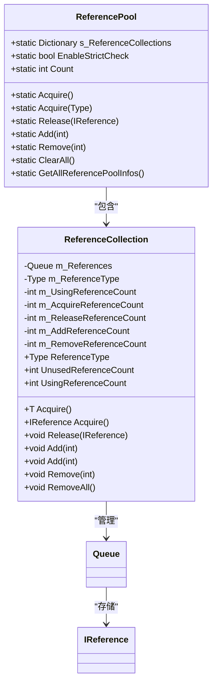
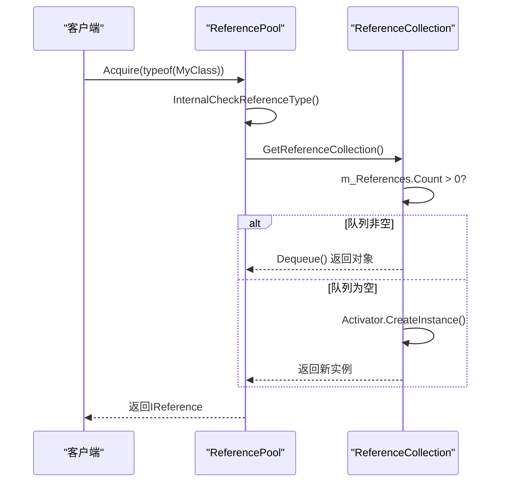

<cite>
**本文档中引用的文件**   
- [IReference.cs](file://GameFramework/Base/ReferencePool/IReference.cs)
- [ReferencePool.cs](file://GameFramework/Base/ReferencePool/ReferencePool.cs)
- [ReferencePool.ReferenceCollection.cs](file://GameFramework/Base/ReferencePool/ReferencePool.ReferenceCollection.cs)
- [ReferencePoolInfo.cs](file://GameFramework/Base/ReferencePool/ReferencePoolInfo.cs)
- [ObjectBase.cs](file://GameFramework/ObjectPool/ObjectBase.cs)
- [ObjectPoolBase.cs](file://GameFramework/ObjectPool/ObjectPoolBase.cs)
- [ObjectPoolManager.cs](file://GameFramework/ObjectPool/ObjectPoolManager.cs)
- [ObjectPoolManager.Object.cs](file://GameFramework/ObjectPool/ObjectPoolManager.Object.cs)
- [ObjectPoolManager.ObjectPool.cs](file://GameFramework/ObjectPool/ObjectPoolManager.ObjectPool.cs)
- [IObjectPoolManager.cs](file://GameFramework/ObjectPool/IObjectPoolManager.cs)
- [IObjectPool.cs](file://GameFramework/ObjectPool/IObjectPool.cs)
</cite>

## 目录
1. [引言](#引言)
2. [引用池与对象池协同机制](#引用池与对象池协同机制)
3. [IReference接口核心作用](#ireference接口核心作用)
4. [ReferencePool静态类与ReferenceCollection内部类](#referencepool静态类与referencecollection内部类)
5. [监控指标分析](#监控指标分析)
6. [动态对象创建机制](#动态对象创建机制)
7. [自定义数据结构接入引用池](#自定义数据结构接入引用池)
8. [结论](#结论)

## 引言
本文档深入阐述Unity游戏框架中ReferencePool引用池与ObjectPool对象池系统的协同工作机制。通过分析IReference接口在轻量级对象复用中的关键作用，揭示引用池如何通过ReferenceCollection内部类实现类型安全的对象队列管理。文档将详细解释Acquire获取、Release释放、Add预加载和Remove清理等核心操作的实现原理，剖析UsingReferenceCount、UnusedReferenceCount等监控指标的意义，并结合Activator.CreateInstance实现机制说明动态对象创建过程。最后，通过实际案例展示如何将自定义数据结构实现IReference接口并接入引用池，从而实现零GC分配的高性能内存复用模式。

## 引用池与对象池协同机制
在Unity游戏框架中，ReferencePool引用池与ObjectPool对象池系统通过共享的IReference接口和引用回收机制实现深度协同。ObjectPool对象池在内部管理对象时，其核心的Object<T>类实现了IReference接口，这意味着当对象从对象池中被释放时，这些内部管理对象本身也可以被回收到引用池中，形成一个高效的内存复用闭环。

```mermaid
graph TD
subgraph "对象池 (ObjectPool)"
OP[ObjectPool<T>]
OB[Object<T>]
OB --> |实现| IReference
end
subgraph "引用池 (ReferencePool)"
RP[ReferencePool]
RC[ReferenceCollection]
RC --> |管理| Queue[Queue<IReference>]
end
OP --> |释放| OB
OB --> |调用| Release[Release(IReference)]
Release --> RP
RP --> |入队| Queue
Queue --> |出队| Acquire[Acquire<T>()]
Acquire --> OB
OB --> |复用| OP
```

**Diagram sources**
- [ObjectPoolManager.Object.cs](file://GameFramework/ObjectPool/ObjectPoolManager.Object.cs#L11-L194)
- [ReferencePool.cs](file://GameFramework/Base/ReferencePool/ReferencePool.cs#L98-L102)
- [ReferencePool.ReferenceCollection.cs](file://GameFramework/Base/ReferencePool/ReferencePool.ReferenceCollection.cs#L112-L126)

**Section sources**
- [ObjectPoolManager.Object.cs](file://GameFramework/ObjectPool/ObjectPoolManager.Object.cs#L11-L194)
- [ReferencePool.cs](file://GameFramework/Base/ReferencePool/ReferencePool.cs#L98-L102)

## IReference接口核心作用
IReference接口是整个引用池系统的基础，它定义了所有可被池化对象必须实现的契约。该接口仅包含一个`Clear()`方法，其核心作用是为对象提供一个标准化的“重置”入口，确保对象在被归还给池时能够清理其内部状态，为下一次复用做好准备。

```csharp
public interface IReference
{
    void Clear();
}
```

这个轻量级的设计是实现高性能内存复用的关键。任何实现了IReference接口的类，无论是简单的数据结构还是复杂的管理器，都可以无缝接入引用池系统。在对象池的实现中，`Object<T>`类作为对象池内部的包装器，也实现了IReference接口，这使得对象池自身在管理其内部对象时，也能利用引用池来避免频繁的内存分配。

**Section sources**
- [IReference.cs](file://GameFramework/Base/ReferencePool/IReference.cs#L12-L18)

## ReferencePool静态类与ReferenceCollection内部类
ReferencePool是一个静态类，它通过一个静态字典`s_ReferenceCollections`来管理所有不同类型的引用集合。每个类型对应一个`ReferenceCollection`实例，这种设计实现了类型安全的隔离。



**Diagram sources**
- [ReferencePool.cs](file://GameFramework/Base/ReferencePool/ReferencePool.cs#L12-L225)
- [ReferencePool.ReferenceCollection.cs](file://GameFramework/Base/ReferencePool/ReferencePool.ReferenceCollection.cs#L12-L200)

**Section sources**
- [ReferencePool.cs](file://GameFramework/Base/ReferencePool/ReferencePool.cs#L12-L225)
- [ReferencePool.ReferenceCollection.cs](file://GameFramework/Base/ReferencePool/ReferencePool.ReferenceCollection.cs#L12-L200)

### Acquire获取操作
获取操作是引用池的核心功能。当调用`Acquire<T>()`时，系统首先通过`GetReferenceCollection()`方法获取对应类型的`ReferenceCollection`。如果队列中有可用对象，则从队列前端出队并返回；否则，通过`new T()`创建一个新实例。此过程通过泛型约束`where T : class, IReference, new()`确保类型安全。

### Release释放操作
释放操作将使用完毕的对象归还给池。在归还前，会调用对象的`Clear()`方法重置其状态。然后，对象被安全地（通过`lock`）加入到对应类型的队列中。如果启用了严格检查（`EnableStrictCheck`），系统还会验证该对象是否已被重复释放。

### Add预加载与Remove清理
`Add<T>(int count)`方法允许在系统启动或资源预加载阶段，预先创建并放入指定数量的对象到池中，以避免运行时的性能抖动。`Remove(int count)`方法则用于清理池中过多的空闲对象，以控制内存占用。

## 监控指标分析
`ReferenceCollection`类提供了一系列监控指标，用于跟踪池的运行状态，这些指标对于性能调优和问题诊断至关重要。

| 指标名称 | 属性名 | 意义 |
| :--- | :--- | :--- |
| 未使用引用数量 | `UnusedReferenceCount` | 当前在队列中等待被获取的对象数量，反映池的空闲程度 |
| 正在使用引用数量 | `UsingReferenceCount` | 当前已被获取但尚未归还的对象数量，反映池的负载 |
| 获取引用数量 | `AcquireReferenceCount` | 自池创建以来，成功获取对象的总次数，反映池的活跃度 |
| 归还引用数量 | `ReleaseReferenceCount` | 自池创建以来，成功归还对象的总次数，应与获取数量大致相等 |
| 增加引用数量 | `AddReferenceCount` | 通过`Add`方法或首次获取时动态创建的对象总数 |
| 移除引用数量 | `RemoveReferenceCount` | 通过`Remove`或`RemoveAll`方法从池中移除的对象总数 |

这些指标可以通过`ReferencePool.GetAllReferencePoolInfos()`方法批量获取，形成`ReferencePoolInfo`结构体数组，为开发者提供全面的池状态视图。

**Section sources**
- [ReferencePool.ReferenceCollection.cs](file://GameFramework/Base/ReferencePool/ReferencePool.ReferenceCollection.cs#L35-L110)
- [ReferencePoolInfo.cs](file://GameFramework/Base/ReferencePool/ReferencePoolInfo.cs#L15-L123)

## 动态对象创建机制
当使用`Acquire(Type referenceType)`方法时，引用池无法使用泛型`new()`约束，而是依赖`Activator.CreateInstance(m_ReferenceType)`来动态创建对象实例。`Activator.CreateInstance`是.NET反射机制的一部分，它可以在运行时根据Type信息创建对象。



**Diagram sources**
- [ReferencePool.cs](file://GameFramework/Base/ReferencePool/ReferencePool.cs#L98-L102)
- [ReferencePool.ReferenceCollection.cs](file://GameFramework/Base/ReferencePool/ReferencePool.ReferenceCollection.cs#L112-L126)

**Section sources**
- [ReferencePool.ReferenceCollection.cs](file://GameFramework/Base/ReferencePool/ReferencePool.ReferenceCollection.cs#L112-L126)

此机制虽然提供了灵活性，但相比泛型`new()`，性能开销更大。因此，在性能敏感的场景下，推荐优先使用泛型`Acquire<T>()`方法。

## 自定义数据结构接入引用池
要将自定义数据结构接入引用池，只需让该结构实现`IReference`接口，并正确实现`Clear()`方法即可。

```csharp
public class MyData : IReference
{
    public int Id;
    public string Name;
    public List<string> Tags;

    public void Clear()
    {
        Id = 0;
        Name = null;
        if (Tags != null)
        {
            Tags.Clear();
        }
    }
}
```

使用时，可以直接通过泛型方法获取和释放：

```csharp
// 从池中获取
MyData data = ReferencePool.Acquire<MyData>();
data.Id = 1;
data.Name = "Test";

// 使用完毕后归还
ReferencePool.Release(data);
```

通过这种方式，可以有效避免频繁创建和销毁`MyData`实例带来的GC压力，实现零分配的高性能内存复用。

**Section sources**
- [IReference.cs](file://GameFramework/Base/ReferencePool/IReference.cs#L12-L18)
- [ReferencePool.cs](file://GameFramework/Base/ReferencePool/ReferencePool.cs#L98-L102)

## 结论
ReferencePool引用池与ObjectPool对象池系统通过IReference接口紧密协作，构建了一个高效、可扩展的内存管理框架。ReferencePool通过ReferenceCollection内部类实现了类型安全、线程安全的对象队列管理，其提供的丰富监控指标有助于系统性能的持续优化。理解Activator.CreateInstance的动态创建机制，有助于在灵活性和性能之间做出权衡。通过将自定义数据结构实现IReference接口，开发者可以轻松地将任何轻量级对象纳入池化管理，显著降低GC压力，提升应用性能。