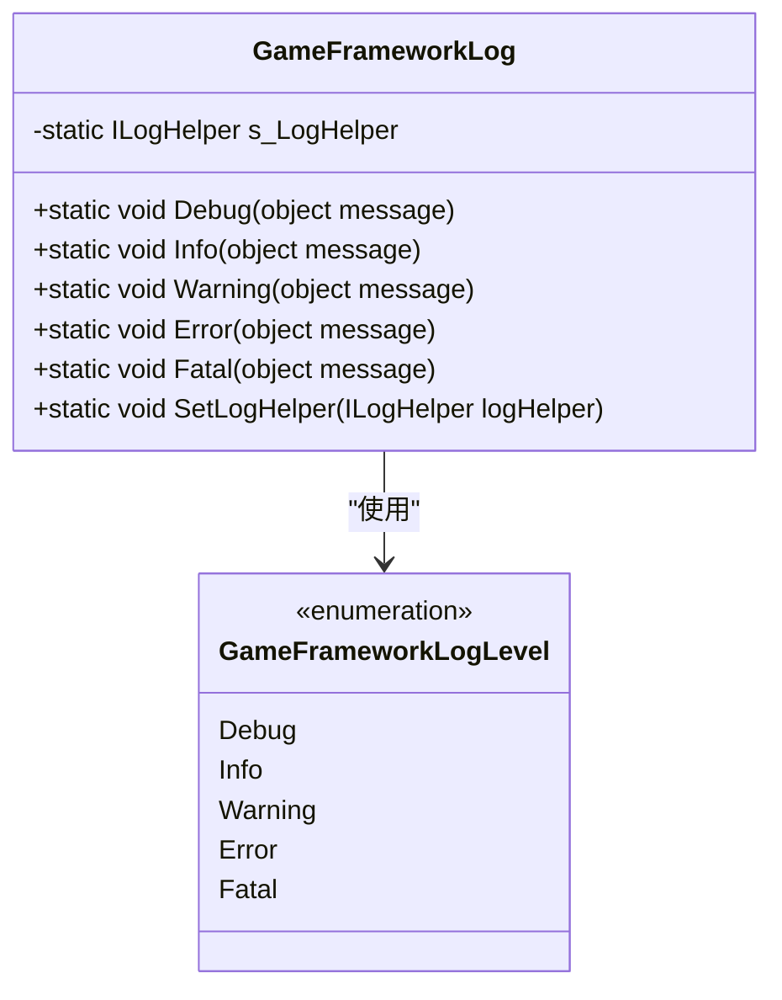
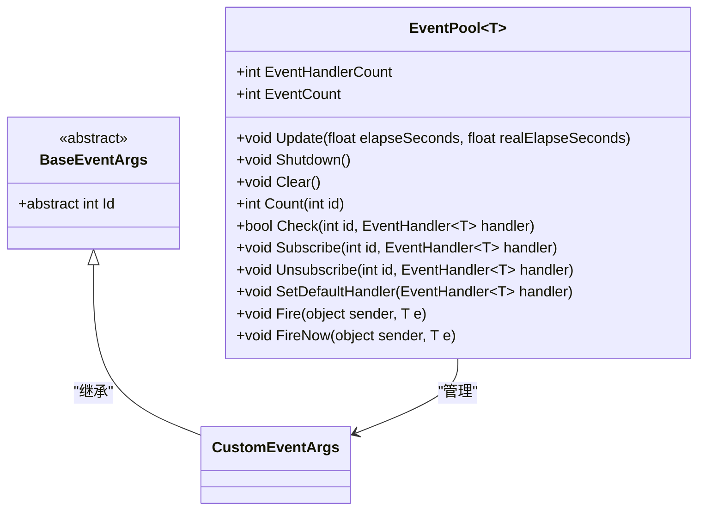

# 快速入门

<cite>
**Referenced Files in This Document**   
- [README.md](file://README.md)
- [GameFrameworkEntry.cs](file://GameFramework/Base/GameFrameworkEntry.cs)
- [GameFrameworkLog.cs](file://GameFramework/Base/Log/GameFrameworkLog.cs)
- [EventPool.cs](file://GameFramework/Base/EventPool/EventPool.cs)
- [BaseEventArgs.cs](file://GameFramework/Base/EventPool/BaseEventArgs.cs)
- [GameFrameworkLogLevel.cs](file://GameFramework/Base/Log/GameFrameworkLogLevel.cs)
</cite>

## 目录
1. [简介](#简介)
2. [环境准备与依赖导入](#环境准备与依赖导入)
3. [框架初始化与启动流程](#框架初始化与启动流程)
4. [核心模块获取与使用](#核心模块获取与使用)
5. [Hello World 示例](#hello-world-示例)
6. [常见初始化问题排查](#常见初始化问题排查)

## 简介

GameFramework 是一个基于 Unity 引擎的游戏框架，它对游戏开发中常用的模块进行了封装，旨在规范开发流程、加速开发速度并保证产品质量。本指南将帮助新手开发者快速集成和初始化 GameFramework，理解其核心启动机制，并通过一个简单的“Hello World”示例来展示如何使用框架的基本功能。

根据 `README.md` 文件的介绍，GameFramework 包含了 19 个内置模块，如全局配置、数据结点、事件系统、资源管理、网络通信等。这些模块为开发者提供了强大的基础功能支持。

**Section sources**
- [README.md](file://README.md)

## 环境准备与依赖导入

在开始集成 GameFramework 之前，请确保您的开发环境满足以下要求：
- Unity 引擎（具体版本请参考官方文档）
- 项目已创建并可以正常运行

要将 GameFramework 集成到您的 Unity 项目中，您需要将整个 `GameFramework` 文件夹复制到您项目的 `Assets` 目录下。这通常包括 `Base`、`Config`、`Resource` 等子目录以及 `README.md` 和 `LICENSE.md` 文件。

完成复制后，Unity 会自动导入所有脚本和资源。此时，您就可以在项目中使用 GameFramework 提供的各种功能了。

## 框架初始化与启动流程

GameFramework 的入口点是 `GameFrameworkEntry` 类。这是一个静态类，负责管理所有游戏框架模块的生命周期。

### GameFrameworkEntry 的作用

`GameFrameworkEntry` 类是整个框架的中枢。它通过一个链表 `s_GameFrameworkModules` 来管理所有已注册的模块。其主要职责包括：
- **模块初始化**：通过 `GetModule<T>()` 方法按需创建和获取模块实例。
- **模块轮询**：在每帧调用 `Update()` 方法，驱动所有模块的逻辑更新。
- **模块清理**：在游戏结束时调用 `Shutdown()` 方法，有序地关闭和清理所有模块。

### 模块自动注册机制

框架的模块注册是**延迟且自动**的。当您首次通过 `GameFrameworkEntry.GetModule<T>()` 获取一个模块时，该模块才会被创建并自动注册到 `GameFrameworkEntry` 的管理链表中。

模块的创建过程如下：
1.  调用 `GetModule<T>()`，传入模块的接口类型（如 `ILogModule`）。
2.  方法会检查该模块是否已存在。
3.  如果不存在，则通过反射创建模块的实例。
4.  新创建的模块会根据其 `Priority`（优先级）被插入到链表的正确位置。优先级高的模块会先被轮询。

```mermaid
flowchart TD
Start([调用 GetModule<T>()]) --> CheckExist{"模块已存在?"}
CheckExist --> |是| ReturnModule["返回已存在的模块实例"]
CheckExist --> |否| CreateInstance["通过反射创建模块实例"]
CreateInstance --> GetPriority["获取模块的 Priority"]
GetPriority --> FindPosition["在链表中找到插入位置"]
FindPosition --> Insert["将模块按优先级插入链表"]
Insert --> ReturnModule
ReturnModule --> End([返回模块实例])
```

**Diagram sources**
- [GameFrameworkEntry.cs](file://GameFramework/Base/GameFrameworkEntry.cs#L50-L130)

**Section sources**
- [GameFrameworkEntry.cs](file://GameFramework/Base/GameFrameworkEntry.cs#L1-L134)

## 核心模块获取与使用

GameFramework 将其功能划分为多个独立的模块。您可以通过 `GameFrameworkEntry.GetModule<T>()` 方法来获取这些模块的实例。

### 日志模块 (Log)

日志模块是开发者最常用的工具之一。在 GameFramework 中，您可以通过 `GameFrameworkLog` 静态类来输出不同级别的日志信息。

`GameFrameworkLogLevel` 枚举定义了五种日志级别：
- `Debug`：调试信息
- `Info`：一般信息
- `Warning`：警告信息
- `Error`：错误信息
- `Fatal`：严重错误信息



**Diagram sources**
- [GameFrameworkLog.cs](file://GameFramework/Base/Log/GameFrameworkLog.cs#L1-L800)
- [GameFrameworkLogLevel.cs](file://GameFramework/Base/Log/GameFrameworkLogLevel.cs#L1-L40)

### 事件系统 (Event)

事件系统是实现游戏逻辑解耦的关键。GameFramework 使用 `EventPool<T>` 来管理事件。

- **BaseEventArgs**：所有事件参数类都必须继承自 `BaseEventArgs`，并重写 `Id` 属性来标识事件类型。
- **EventPool<T>**：一个泛型事件池，用于订阅、取消订阅和抛出特定类型的事件。



**Diagram sources**
- [BaseEventArgs.cs](file://GameFramework/Base/EventPool/BaseEventArgs.cs#L1-L24)
- [EventPool.cs](file://GameFramework/Base/EventPool/EventPool.cs#L1-L286)

**Section sources**
- [GameFrameworkLog.cs](file://GameFramework/Base/Log/GameFrameworkLog.cs)
- [EventPool.cs](file://GameFramework/Base/EventPool/EventPool.cs)

## Hello World 示例

以下是一个完整的示例，展示如何在 Unity 项目中初始化 GameFramework 并使用日志和事件系统。

```csharp
using UnityEngine;
using GameFramework;
using GameFramework.Event;

// 1. 定义一个自定义事件
public class HelloWorldEventArgs : BaseEventArgs
{
    public static readonly int EventId = typeof(HelloWorldEventArgs).GetHashCode();
    public override int Id => EventId;
    public string Message { get; private set; }

    public static HelloWorldEventArgs Create(string message)
    {
        var e = ReferencePool.Acquire<HelloWorldEventArgs>();
        e.Message = message;
        return e;
    }

    public override void Clear()
    {
        Message = null;
    }
}

// 2. 创建一个 MonoBehaviour 来启动框架
public class GameLauncher : MonoBehaviour
{
    private void Start()
    {
        // 3. 初始化框架（获取核心模块即会触发初始化）
        var logModule = GameFrameworkEntry.GetModule<ILogModule>();
        var eventModule = GameFrameworkEntry.GetModule<IEventModule>();

        // 4. 订阅自定义事件
        eventModule.Subscribe(HelloWorldEventArgs.EventId, OnHelloWorld);

        // 5. 抛出一个 "Hello World" 事件
        eventModule.Fire(this, HelloWorldEventArgs.Create("Hello World from GameFramework!"));
    }

    // 6. 事件处理函数
    private void OnHelloWorld(object sender, GameEventArgs e)
    {
        var args = e as HelloWorldEventArgs;
        if (args != null)
        {
            // 7. 使用日志模块输出信息
            GameFrameworkLog.Info(args.Message);
            // 控制台将输出: "Hello World from GameFramework!"
        }
    }

    private void Update()
    {
        // 8. 框架的 Update 循环
        GameFrameworkEntry.Update(Time.deltaTime, Time.unscaledDeltaTime);
    }

    private void OnDestroy()
    {
        // 9. 清理框架
        GameFrameworkEntry.Shutdown();
    }
}
```

**Section sources**
- [GameFrameworkEntry.cs](file://GameFramework/Base/GameFrameworkEntry.cs)
- [GameFrameworkLog.cs](file://GameFramework/Base/Log/GameFrameworkLog.cs)
- [EventPool.cs](file://GameFramework/Base/EventPool/EventPool.cs)

## 常见初始化问题排查

在集成和初始化 GameFramework 时，可能会遇到一些问题。以下是一些常见的排查建议：

1.  **模块获取失败**：确保您传入 `GetModule<T>()` 的类型是接口（interface），并且命名空间以 `GameFramework.` 开头。例如，获取日志模块应使用 `ILogModule`，而不是 `LogModule`。
2.  **日志不输出**：`GameFrameworkLog` 需要一个 `ILogHelper` 实现才能输出日志。在您的启动脚本中，确保已经为其他模块（如调试器模块）设置了日志辅助器，或者手动调用 `GameFrameworkLog.SetLogHelper()` 来设置一个自定义的日志输出器。
3.  **事件未被处理**：检查事件的 `Id` 是否正确，确保订阅和抛出的事件 ID 完全一致。同时，确认事件处理函数的签名是否正确。
4.  **优先级问题**：如果某些模块的逻辑需要在其他模块之前执行，请检查其 `Priority` 属性的值。优先级数值越大，越早被轮询。