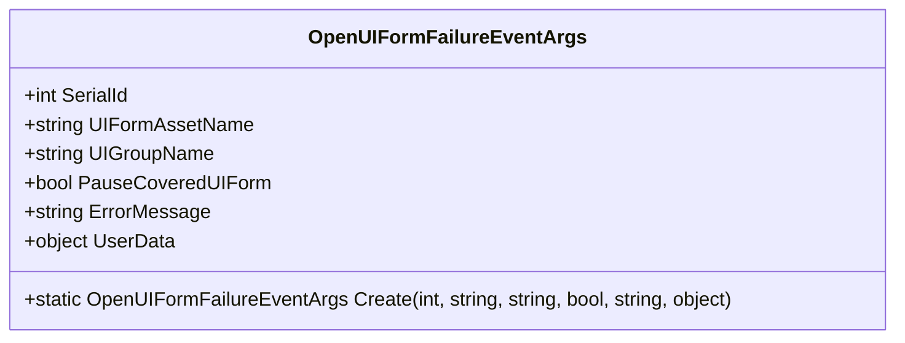
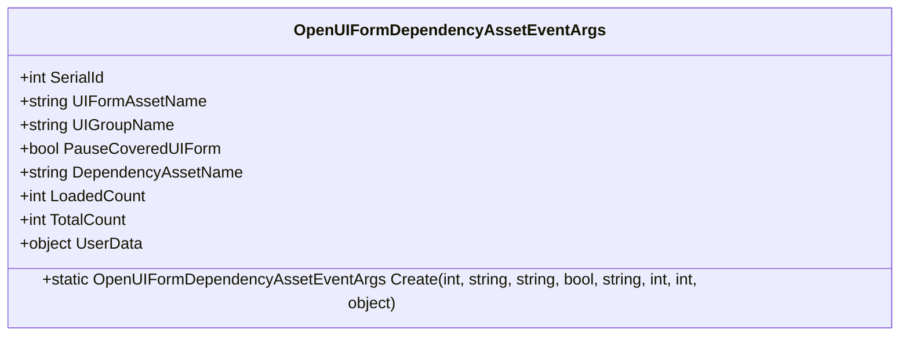
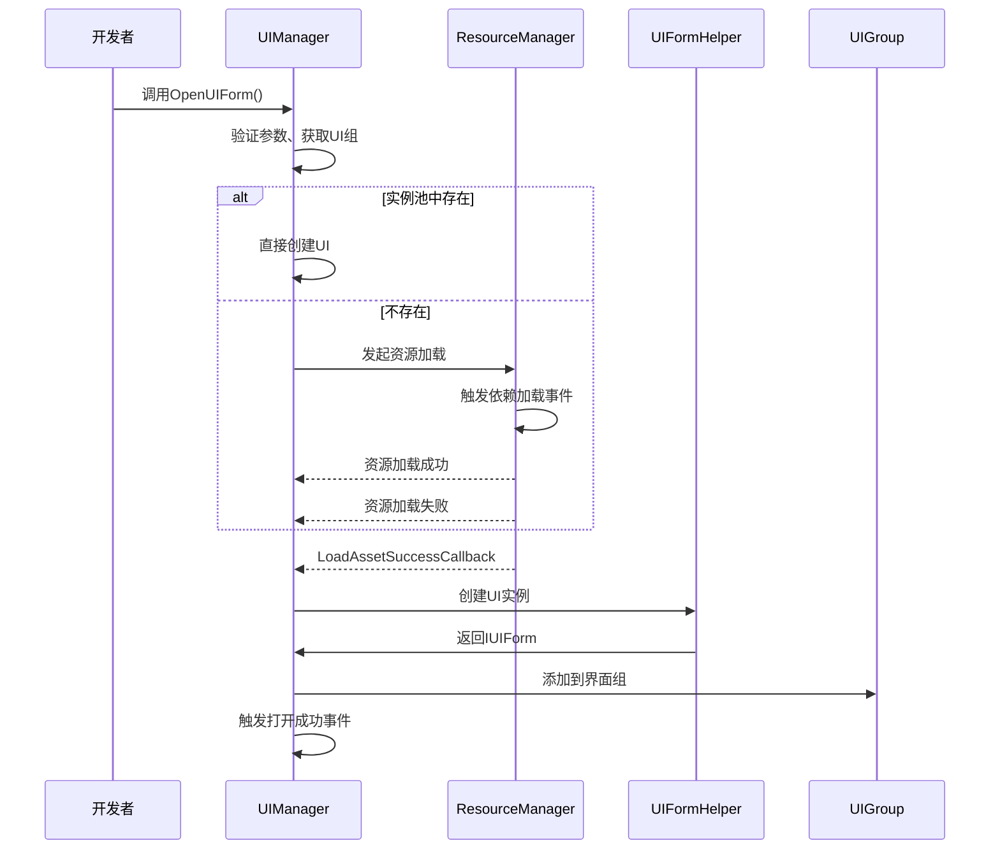
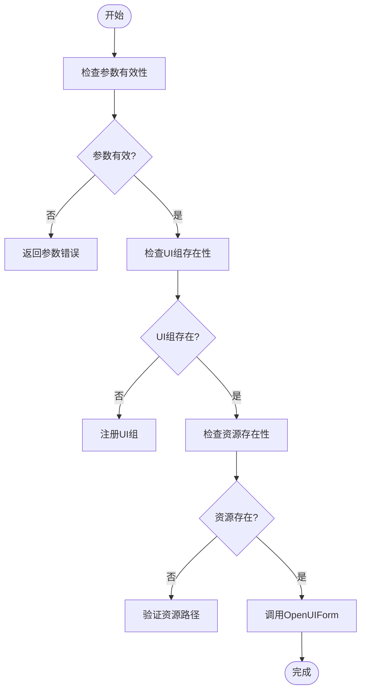
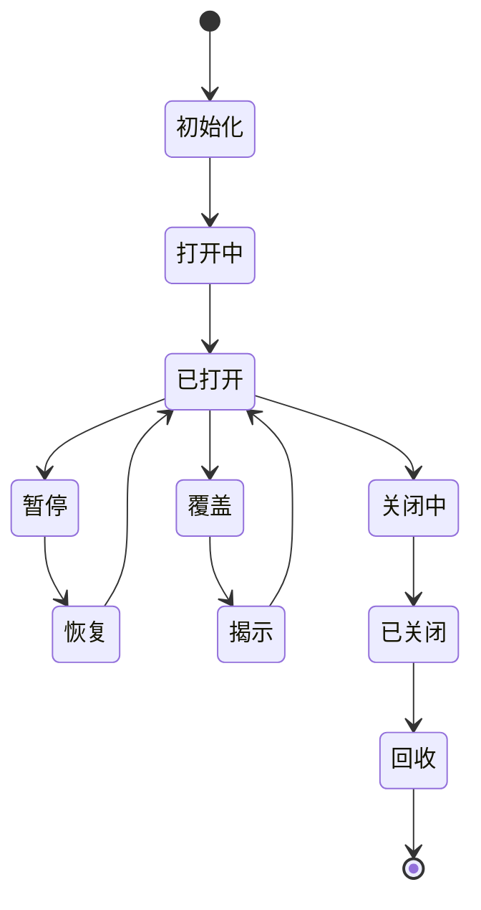
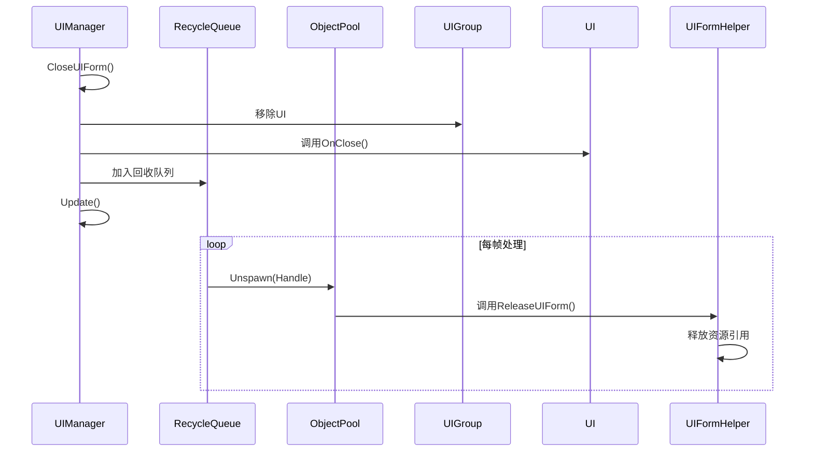

# UI界面加载与显示异常

<cite>
**本文档引用文件**  
- [OpenUIFormFailureEventArgs.cs](file://GameFramework/UI/OpenUIFormFailureEventArgs.cs)
- [OpenUIFormDependencyAssetEventArgs.cs](file://GameFramework/UI/OpenUIFormDependencyAssetEventArgs.cs)
- [UIManager.cs](file://GameFramework/UI/UIManager.cs)
- [IUIFormHelper.cs](file://GameFramework/UI/IUIFormHelper.cs)
</cite>

## 目录
1. [问题概述](#问题概述)
2. [核心事件分析](#核心事件分析)
3. [加载链路故障排查](#加载链路故障排查)
4. [资源路径与依赖配置检查](#资源路径与依赖配置检查)
5. [UI对象生命周期管理](#ui对象生命周期管理)
6. [内存泄漏预防与资源释放](#内存泄漏预防与资源释放)
7. [常见问题解决方案](#常见问题解决方案)

## 问题概述

UI系统在运行过程中可能出现表单打开失败、依赖资源加载阻塞、层级错乱、内存泄漏等问题。这些问题通常与资源加载流程、依赖管理、对象生命周期控制密切相关。本手册结合`OpenUIFormFailureEventArgs`和`OpenUIFormDependencyAssetEventArgs`事件，深入分析UI加载链路中的关键故障点，提供系统性排查方案。

**Section sources**
- [OpenUIFormFailureEventArgs.cs](file://GameFramework/UI/OpenUIFormFailureEventArgs.cs#L12-L115)
- [OpenUIFormDependencyAssetEventArgs.cs](file://GameFramework/UI/OpenUIFormDependencyAssetEventArgs.cs#L12-L141)

## 核心事件分析

### 打开界面失败事件（OpenUIFormFailureEventArgs）

该事件在UI表单打开失败时触发，包含关键诊断信息：

- **界面序列编号（SerialId）**：唯一标识本次打开操作
- **界面资源名称（UIFormAssetName）**：请求加载的UI资源路径
- **界面组名称（UIGroupName）**：目标UI组名称
- **暂停被覆盖界面标志（PauseCoveredUIForm）**：是否暂停下层界面
- **错误信息（ErrorMessage）**：具体的失败原因描述
- **用户自定义数据（UserData）**：开发者传入的上下文数据

此事件是定位UI加载失败的第一手依据，通过监听该事件可捕获所有打开失败的异常情况。

**Diagram sources**
- [OpenUIFormFailureEventArgs.cs](file://GameFramework/UI/OpenUIFormFailureEventArgs.cs#L12-L115)

### 加载依赖资源事件（OpenUIFormDependencyAssetEventArgs）

该事件在加载UI依赖资源过程中触发，用于监控加载进度：

- **依赖资源名称（DependencyAssetName）**：当前正在加载的依赖资源
- **已加载数量（LoadedCount）**：当前已成功加载的依赖数
- **总数（TotalCount）**：总依赖资源数量
- 其他字段与失败事件相同

通过监听此事件，可实时掌握UI加载的依赖加载进度，识别阻塞点。

**Diagram sources**
- [OpenUIFormDependencyAssetEventArgs.cs](file://GameFramework/UI/OpenUIFormDependencyAssetEventArgs.cs#L12-L141)

## 加载链路故障排查

### UI加载完整流程

**Diagram sources**
- [UIManager.cs](file://GameFramework/UI/UIManager.cs#L722-L763)
- [UIManager.cs](file://GameFramework/UI/UIManager.cs#L975-L997)
- [UIManager.cs](file://GameFramework/UI/UIManager.cs#L999-L1024)

### 故障点分析

1. **参数验证失败**：资源名或UI组名为空
2. **UI组不存在**：指定的UI组未通过`AddUIGroup`注册
3. **资源管理器未设置**：`SetResourceManager`未调用
4. **UI辅助器未设置**：`SetUIFormHelper`未调用
5. **资源加载失败**：资源不存在、路径错误、依赖缺失
6. **实例化失败**：`InstantiateUIForm`返回null
7. **创建失败**：`CreateUIForm`返回null

## 资源路径与依赖配置检查

### 检查清单

- **资源路径正确性**：确保`uiFormAssetName`路径与资源系统一致
- **UI组存在性**：通过`HasUIGroup`确认目标组已注册
- **依赖资源完整性**：检查UI预制体引用的所有资源是否已正确打包
- **实例化参数**：确认`IUIFormHelper.InstantiateUIForm`能正确实例化资源

### 验证方法

**Diagram sources**
- [UIManager.cs](file://GameFramework/UI/UIManager.cs#L722-L763)
- [IUIFormHelper.cs](file://GameFramework/UI/IUIFormHelper.cs#L12-L36)

## UI对象生命周期管理

### 生命周期关键方法

| 方法 | 触发时机 | 注意事项 |
|------|--------|--------|
| OnInit | UI初始化时 | 初始化数据和组件 |
| OnOpen | UI打开时 | 播放打开动画，注册事件 |
| OnClose | UI关闭时 | 注销事件，清理引用 |
| OnPause | UI被暂停时 | 暂停逻辑更新 |
| OnResume | UI恢复时 | 恢复逻辑更新 |
| OnCover | UI被覆盖时 | 视觉降级处理 |
| OnReveal | UI重新显示时 | 恢复正常显示 |
| OnDepthChanged | 层级变化时 | 更新渲染顺序 |

### 状态流转

**Diagram sources**
- [UIManager.cs](file://GameFramework/UI/UIManager.cs#L939-L973)
- [UIManager.cs](file://GameFramework/UI/UIManager.UIGroup.cs#L300-L350)

## 内存泄漏预防与资源释放

### 对象池机制

UI系统使用对象池管理UI实例，通过`m_InstancePool`实现复用：

- **注册**：`m_InstancePool.Register()` 将实例加入池
- **获取**：`m_InstancePool.Spawn()` 从池中获取实例
- **释放**：`m_InstancePool.Unspawn()` 将实例归还池

### 资源释放流程

**Diagram sources**
- [UIManager.cs](file://GameFramework/UI/UIManager.cs#L811-L836)
- [UIManager.cs](file://GameFramework/UI/UIManager.cs#L22-L22)
- [UIManager.UIFormInstanceObject.cs](file://GameFramework/UI/UIManager.UIFormInstanceObject.cs#L12-L60)

### 验证方法

1. **检查回收队列**：`m_RecycleQueue`是否及时清空
2. **监控对象池**：`m_InstancePool`的统计信息
3. **重写Release方法**：确保`UIFormInstanceObject.Release`正确释放资源
4. **避免强引用**：UI中不要持有外部对象的强引用

## 常见问题解决方案

### 问题1：UI表单打开失败

**排查步骤**：
1. 检查`OpenUIFormFailureEventArgs.ErrorMessage`
2. 验证资源路径是否正确
3. 确认UI组已注册
4. 检查资源依赖是否完整

### 问题2：依赖资源加载阻塞

**解决方案**：
1. 监听`OpenUIFormDependencyAssetEventArgs`
2. 记录`DependencyAssetName`和`LoadedCount/TotalCount`
3. 定位具体阻塞的依赖资源
4. 检查该资源是否存在、是否可访问

### 问题3：UI层级错乱

**原因**：
- `Depth`设置不正确
- `Refresh()`未正确调用
- `OnDepthChanged`未正确处理

**修复**：
1. 检查UI组深度设置
2. 确保`Refresh()`在层级变化后调用
3. 验证`UIGroupHelper.SetDepth`正确更新UI层级

### 问题4：内存泄漏

**检查点**：
1. `m_RecycleQueue`是否持续增长
2. `m_InstancePool`中对象是否未释放
3. `ReleaseUIForm`是否正确实现
4. UI中是否存在事件未注销

**Section sources**
- [UIManager.cs](file://GameFramework/UI/UIManager.cs#L722-L763)
- [UIManager.cs](file://GameFramework/UI/UIManager.cs#L975-L1056)
- [IUIFormHelper.cs](file://GameFramework/UI/IUIFormHelper.cs#L12-L36)