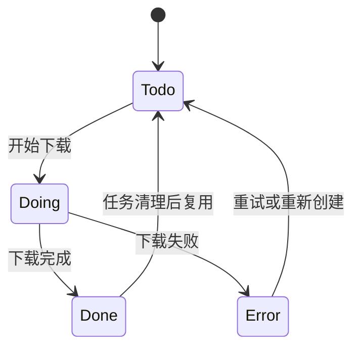
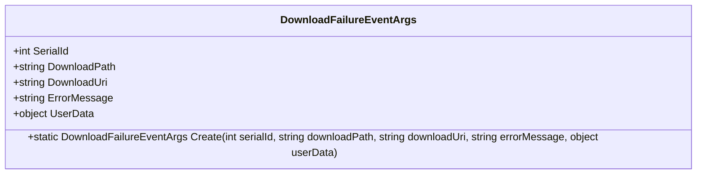
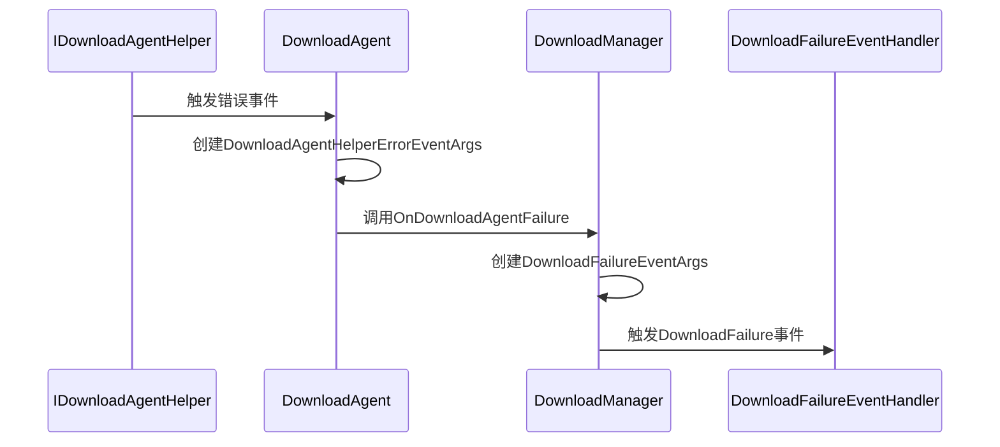
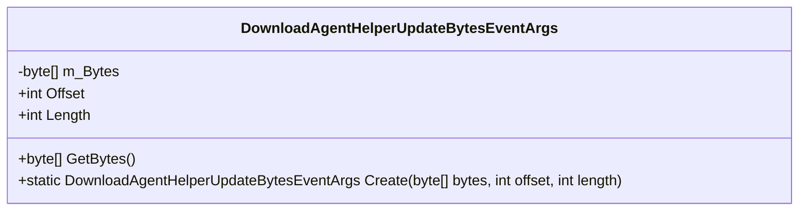
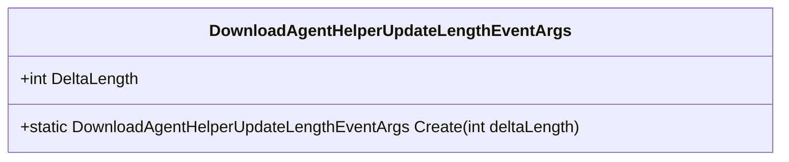
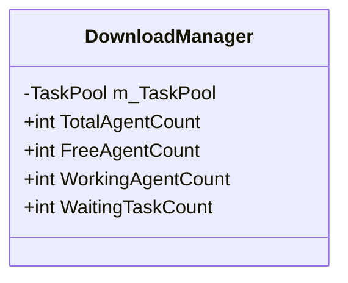

# 下载系统失败与进度异常

<cite>
**Referenced Files in This Document**   
- [DownloadManager.cs](file://GameFramework/Download/DownloadManager.cs)
- [DownloadManager.DownloadTask.cs](file://GameFramework/Download/DownloadManager.DownloadTask.cs)
- [DownloadFailureEventArgs.cs](file://GameFramework/Download/DownloadFailureEventArgs.cs)
- [DownloadManager.DownloadTaskStatus.cs](file://GameFramework/Download/DownloadManager.DownloadTaskStatus.cs)
- [Constant.cs](file://GameFramework/Download/Constant.cs)
- [DownloadAgentHelperErrorEventArgs.cs](file://GameFramework/Download/DownloadAgentHelperErrorEventArgs.cs)
- [DownloadAgentHelperUpdateBytesEventArgs.cs](file://GameFramework/Download/DownloadAgentHelperUpdateBytesEventArgs.cs)
- [DownloadAgentHelperUpdateLengthEventArgs.cs](file://GameFramework/Download/DownloadAgentHelperUpdateLengthEventArgs.cs)
</cite>

## 目录
1. [引言](#引言)
2. [下载任务状态流转](#下载任务状态流转)
3. [下载失败事件分析](#下载失败事件分析)
4. [进度更新中断问题](#进度更新中断问题)
5. [断点续传机制](#断点续传机制)
6. [外部因素影响](#外部因素影响)
7. [重试策略与并发控制](#重试策略与并发控制)
8. [最佳实践](#最佳实践)

## 引言

本文档旨在深入分析GameFramework中下载模块的故障排除机制，重点解决下载任务失败、进度更新中断和断点续传失效等问题。通过解析DownloadManager的任务调度机制和DownloadTask的状态流转，为开发者提供全面的故障诊断和优化指南。

## 下载任务状态流转

下载任务的状态管理是确保下载流程正确执行的核心。`DownloadTask`类通过`DownloadTaskStatus`枚举定义了任务的完整生命周期。



**Diagram sources**
- [DownloadManager.DownloadTaskStatus.cs](file://GameFramework/Download/DownloadManager.DownloadTaskStatus.cs#L14-L35)
- [DownloadManager.DownloadTask.cs](file://GameFramework/Download/DownloadManager.DownloadTask.cs#L27-L34)

**Section sources**
- [DownloadManager.DownloadTaskStatus.cs](file://GameFramework/Download/DownloadManager.DownloadTaskStatus.cs#L14-L35)
- [DownloadManager.DownloadTask.cs](file://GameFramework/Download/DownloadManager.DownloadTask.cs#L27-L34)

状态说明：
- **Todo**：任务已创建但尚未开始下载
- **Doing**：任务正在下载过程中
- **Done**：任务成功完成下载
- **Error**：任务因错误而终止

当下载代理（DownloadAgent）调用`Start`方法时，任务状态从`Todo`变为`Doing`。下载成功时变为`Done`，失败时变为`Error`。

## 下载失败事件分析

`DownloadFailureEventArgs`类封装了下载失败时的详细信息，是诊断问题的关键。



**Diagram sources**
- [DownloadFailureEventArgs.cs](file://GameFramework/Download/DownloadFailureEventArgs.cs#L12-L102)

**Section sources**
- [DownloadFailureEventArgs.cs](file://GameFramework/Download/DownloadFailureEventArgs.cs#L12-L102)

### 错误码与错误信息

`DownloadFailureEventArgs`中的`ErrorMessage`字段包含了具体的错误原因，主要来源包括：

1. **超时错误**：当下载任务的等待时间超过`Timeout`设置（默认30秒）时触发
2. **文件系统异常**：在`OnDownloadAgentHelperUpdateBytes`方法中，文件写入操作可能抛出异常
3. **网络连接问题**：底层网络库返回的连接错误
4. **代理辅助器错误**：`IDownloadAgentHelper`实现中报告的错误

错误处理流程：
1. 下载代理捕获异常或收到错误事件
2. 创建`DownloadAgentHelperErrorEventArgs`实例
3. 通过事件回调通知`DownloadManager`
4. `DownloadManager`创建`DownloadFailureEventArgs`并触发`DownloadFailure`事件



**Diagram sources**
- [DownloadAgentHelperErrorEventArgs.cs](file://GameFramework/Download/DownloadAgentHelperErrorEventArgs.cs#L12-L63)
- [DownloadManager.cs](file://GameFramework/Download/DownloadManager.cs#L480-L488)

**Section sources**
- [DownloadAgentHelperErrorEventArgs.cs](file://GameFramework/Download/DownloadAgentHelperErrorEventArgs.cs#L12-L63)
- [DownloadManager.cs](file://GameFramework/Download/DownloadManager.cs#L480-L488)

## 进度更新中断问题

进度更新中断通常表现为下载进度停滞或不准确，主要涉及`DownloadAgentHelperUpdateBytesEventArgs`和`DownloadAgentHelperUpdateLengthEventArgs`两个事件。

### 字节更新事件



**Diagram sources**
- [DownloadAgentHelperUpdateBytesEventArgs.cs](file://GameFramework/Download/DownloadAgentHelperUpdateBytesEventArgs.cs#L12-L92)

当下载代理接收到数据块时，会触发此事件。数据被写入临时文件（`.download`后缀），并更新`m_SavedLength`。

### 长度更新事件



**Diagram sources**
- [DownloadAgentHelperUpdateLengthEventArgs.cs](file://GameFramework/Download/DownloadAgentHelperUpdateLengthEventArgs.cs#L12-L55)

此事件用于更新已下载的数据量，触发`DownloadUpdate`事件，通知外部系统进度变化。

### 中断原因分析

1. **缓冲区未刷新**：当`m_WaitFlushSize`未达到`FlushSize`阈值时，数据可能滞留在内存中
2. **事件未正确触发**：`IDownloadAgentHelper`实现可能未正确发送更新事件
3. **代理被暂停**：`DownloadManager.Paused`设置为`true`会暂停所有下载任务
4. **资源竞争**：多线程环境下文件访问冲突

## 断点续传机制

断点续传是下载系统的重要特性，允许在中断后从上次位置继续下载。

### 实现原理

1. **临时文件**：下载过程中使用`.download`后缀的临时文件
2. **起始长度**：通过`File.Exists(downloadFile)`检查临时文件是否存在
3. **续传请求**：如果存在临时文件，使用`m_StartLength`作为起始偏移量调用`m_Helper.Download`

```csharp
if (File.Exists(downloadFile))
{
    m_FileStream = File.OpenWrite(downloadFile);
    m_FileStream.Seek(0L, SeekOrigin.End);
    m_StartLength = m_SavedLength = m_FileStream.Length;
    m_DownloadedLength = 0L;
    m_Helper.Download(m_Task.DownloadUri, m_StartLength, m_Task.UserData);
}
```

**Section sources**
- [DownloadManager.DownloadAgent.cs](file://GameFramework/Download/DownloadManager.DownloadAgent.cs#L115-L128)

### 失效场景

1. **临时文件被删除**：用户手动删除`.download`文件
2. **存储空间不足**：无法创建或写入临时文件
3. **权限变更**：文件系统权限发生变化
4. **路径变更**：下载路径在中断期间被修改

## 外部因素影响

### 网络波动

网络不稳定可能导致：
- 下载超时（默认30秒）
- 数据包丢失
- 连接中断

解决方案：
- 增加`Timeout`值
- 实现重试机制
- 使用更稳定的网络协议

### 存储权限

下载需要写入权限到目标目录：
- 检查目录是否存在且可写
- 处理权限拒绝异常
- 使用应用沙盒目录确保权限

### 文件锁

文件被其他进程锁定会导致写入失败：
- 检查文件是否被其他程序占用
- 实现重试逻辑
- 使用独占文件锁

## 重试策略与并发控制

### 重试策略配置

虽然框架本身未内置重试机制，但可通过以下方式实现：

1. **事件监听**：订阅`DownloadFailure`事件
2. **状态检查**：根据`ErrorMessage`判断是否可重试
3. **延迟重试**：使用指数退避算法

```csharp
void OnDownloadFailure(object sender, DownloadFailureEventArgs e)
{
    if (IsNetworkError(e.ErrorMessage))
    {
        ScheduleRetry(e.DownloadUri, e.DownloadPath, retryCount + 1);
    }
}
```

### 下载并发控制

通过`TaskPool<DownloadTask>`实现并发控制：



**Diagram sources**
- [DownloadManager.cs](file://GameFramework/Download/DownloadManager.cs#L31-L486)

**Section sources**
- [DownloadManager.cs](file://GameFramework/Download/DownloadManager.cs#L31-L486)

- **TotalAgentCount**：总代理数量，由`AddDownloadAgentHelper`决定
- **FreeAgentCount**：可用代理数量
- **WorkingAgentCount**：正在工作的代理数量
- **WaitingTaskCount**：等待执行的任务数量

最佳实践：
- 根据设备性能设置合适的代理数量
- 避免过多并发导致系统资源耗尽
- 为关键任务设置更高优先级

## 最佳实践

### 配置优化

```csharp
// 设置合适的刷新大小（默认1MB）
downloadManager.FlushSize = 512 * 1024; // 512KB

// 调整超时时间
downloadManager.Timeout = 60f; // 60秒

// 添加多个下载代理以提高并发
for (int i = 0; i < 3; i++)
{
    downloadManager.AddDownloadAgentHelper(new DefaultDownloadAgentHelper());
}
```

### 错误处理

```csharp
downloadManager.DownloadFailure += (sender, e) =>
{
    GameFrameworkLog.Error($"下载失败: {e.DownloadPath}, 错误: {e.ErrorMessage}");
    
    // 根据错误类型采取不同措施
    if (e.ErrorMessage.Contains("Timeout"))
    {
        // 网络超时，可重试
    }
    else if (e.ErrorMessage.Contains("Access"))
    {
        // 权限问题，需用户干预
    }
};
```

### 进度监控

```csharp
downloadManager.DownloadUpdate += (sender, e) =>
{
    float progress = (float)e.CurrentLength / totalSize;
    UpdateProgressBar(progress);
};
```

### 资源管理

- 及时释放不再需要的下载任务
- 监控内存使用，避免大量并发下载
- 在应用暂停时适当暂停下载任务

通过遵循这些最佳实践，可以显著提高下载系统的稳定性和用户体验。