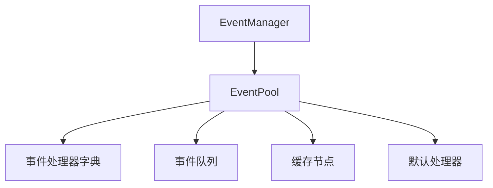
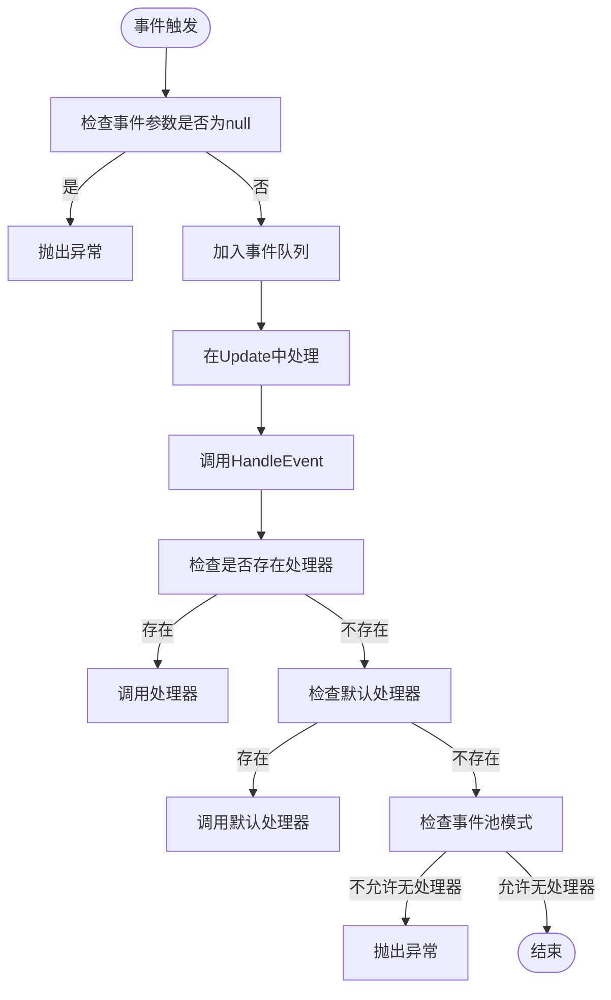
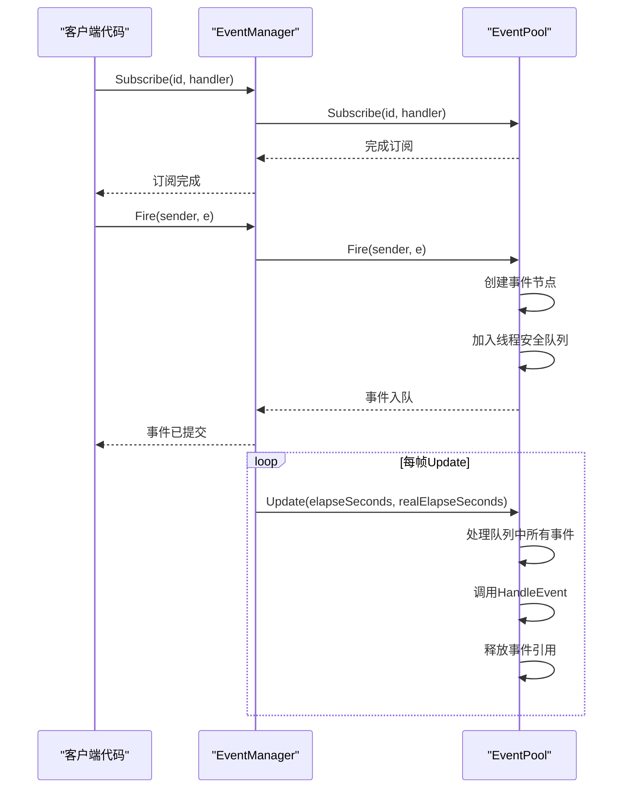
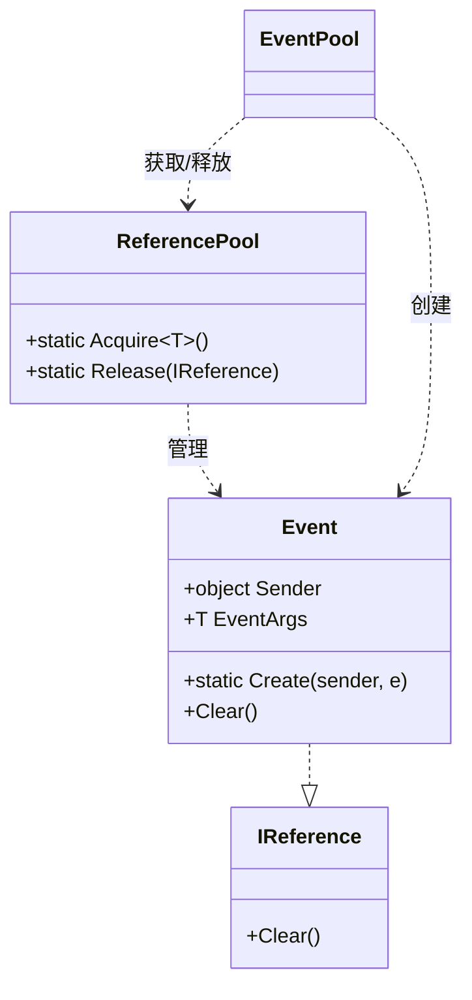
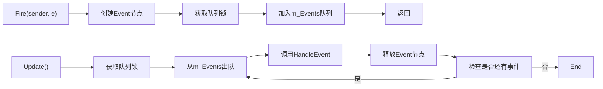
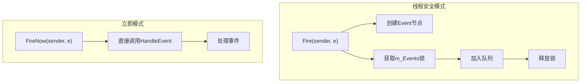
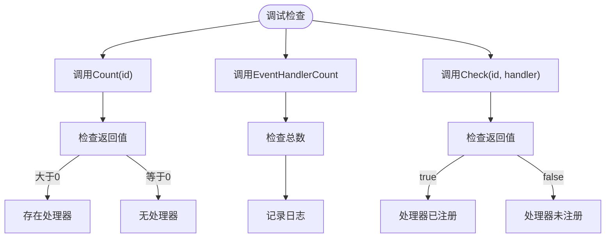
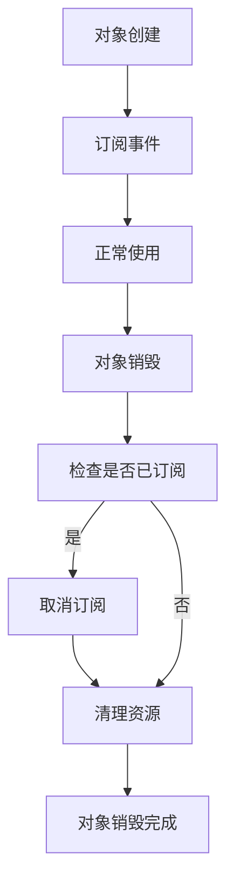

# 事件系统未响应问题

<cite>
**本文档引用文件**  
- [EventManager.cs](file://GameFramework/Event/EventManager.cs)
- [EventPool.cs](file://GameFramework/Base/EventPool/EventPool.cs)
- [EventPoolMode.cs](file://GameFramework/Base/EventPool/EventPoolMode.cs)
- [BaseEventArgs.cs](file://GameFramework/Base/EventPool/BaseEventArgs.cs)
- [GameEventArgs.cs](file://GameFramework/Event/GameEventArgs.cs)
- [ReferencePool.cs](file://GameFramework/Base/ReferencePool/ReferencePool.cs)
</cite>

## 目录
1. [简介](#简介)
2. [事件系统架构概述](#事件系统架构概述)
3. [常见故障排查](#常见故障排查)
4. [事件管理器与事件池交互机制](#事件管理器与事件池交互机制)
5. [事件引用计数与资源回收](#事件引用计数与资源回收)
6. [优先级队列与事件分发](#优先级队列与事件分发)
7. [线程安全处理机制](#线程安全处理机制)
8. [调试工具与监听器状态检查](#调试工具与监听器状态检查)
9. [对象销毁与事件解绑最佳实践](#对象销毁与事件解绑最佳实践)
10. [总结](#总结)

## 简介
本文档旨在深入分析Unity游戏框架中事件系统的常见问题，特别是事件订阅后未触发、参数传递错误和事件重复触发等典型故障。通过解析EventManager与EventPool的底层交互机制，帮助开发者理解事件引用计数、优先级队列和线程安全处理对事件分发的影响，并提供有效的调试方法和最佳实践。

## 事件系统架构概述
事件系统由EventManager和EventPool两个核心组件构成。EventManager作为高层接口，负责提供事件订阅、取消订阅和触发的API；EventPool作为底层实现，管理事件处理函数的存储、事件队列的调度以及线程安全的事件分发。

**图示来源**  
- [EventManager.cs](file://GameFramework/Event/EventManager.cs#L14-L147)
- [EventPool.cs](file://GameFramework/Base/EventPool/EventPool.cs#L29-L37)

## 常见故障排查

### 事件订阅后未触发
事件未触发的常见原因包括：
- 事件ID不匹配
- 事件处理器未正确订阅
- 事件池模式限制
- 事件参数为null

**图示来源**  
- [EventPool.cs](file://GameFramework/Base/EventPool/EventPool.cs#L217-L229)
- [EventPool.cs](file://GameFramework/Base/EventPool/EventPool.cs#L251-L282)

### 事件参数传递错误
事件参数传递错误通常源于：
- 事件参数类未正确继承BaseEventArgs
- 事件ID未正确实现
- 参数对象在分发前被修改或释放

### 事件重复触发
事件重复触发可能由以下原因导致：
- 多次订阅同一事件处理器
- 事件池模式允许重复处理器
- 对象销毁时未正确解绑事件

**Section sources**
- [EventPoolMode.cs](file://GameFramework/Base/EventPool/EventPoolMode.cs#L14-L36)
- [EventPool.cs](file://GameFramework/Base/EventPool/EventPool.cs#L139-L162)

## 事件管理器与事件池交互机制
EventManager通过封装EventPool实例来实现事件管理功能。EventManager的构造函数初始化EventPool时设置了AllowNoHandler和AllowMultiHandler模式，允许事件在没有处理器时正常运行，并支持多个处理器同时监听同一事件。

**图示来源**  
- [EventManager.cs](file://GameFramework/Event/EventManager.cs#L21-L24)
- [EventPool.cs](file://GameFramework/Base/EventPool/EventPool.cs#L29-L37)
- [EventPool.cs](file://GameFramework/Base/EventPool/EventPool.cs#L66-L77)

## 事件引用计数与资源回收
事件系统使用引用池(ReferencePool)来管理事件对象的生命周期，避免频繁的GC分配。事件对象在创建时从引用池获取，在处理完成后释放回池中。

**图示来源**  
- [EventPool.Event.cs](file://GameFramework/Base/EventPool/EventPool.Event.cs#L9-L55)
- [ReferencePool.cs](file://GameFramework/Base/ReferencePool/ReferencePool.cs#L108-L118)

## 优先级队列与事件分发
事件池使用先进先出(FIFO)队列来保证事件的有序分发。所有通过Fire方法触发的事件都会被加入队列，在下一帧的Update中按顺序处理，确保事件处理的确定性和可预测性。

**图示来源**  
- [EventPool.cs](file://GameFramework/Base/EventPool/EventPool.cs#L217-L229)
- [EventPool.cs](file://GameFramework/Base/EventPool/EventPool.cs#L66-L77)

## 线程安全处理机制
事件系统提供了两种事件触发模式：线程安全的Fire和非线程安全的FireNow。Fire方法通过锁机制保护事件队列，允许在任意线程中安全调用；FireNow方法直接在当前线程调用处理器，性能更高但不保证线程安全。

**图示来源**  
- [EventPool.cs](file://GameFramework/Base/EventPool/EventPool.cs#L217-L244)

## 调试工具与监听器状态检查
开发者可以通过以下方法检查事件监听器的注册状态：

1. 使用Count方法检查特定事件ID的处理器数量
2. 使用Check方法验证特定处理器是否已订阅
3. 通过EventHandlerCount属性获取总处理器数量

**Section sources**
- [EventManager.cs](file://GameFramework/Event/EventManager.cs#L45-L55)
- [EventPool.cs](file://GameFramework/Base/EventPool/EventPool.cs#L119-L137)

## 对象销毁与事件解绑最佳实践
为避免因对象销毁未解绑导致的空引用异常，应遵循以下最佳实践：

1. 在对象的OnDestroy或Dispose方法中取消所有事件订阅
2. 使用using语句或try-finally确保事件解绑
3. 避免使用匿名方法订阅事件，以便能够正确解绑

**Section sources**
- [EventManager.cs](file://GameFramework/Event/EventManager.cs#L114-L117)
- [EventPool.cs](file://GameFramework/Base/EventPool/EventPool.cs#L169-L201)

## 总结
本文档详细分析了事件系统的内部工作机制，包括EventManager与EventPool的交互、事件引用计数、优先级队列和线程安全处理等关键概念。通过理解这些底层机制，开发者可以更有效地排查事件系统常见问题，并遵循最佳实践避免潜在的bug。建议在开发过程中充分利用提供的调试方法，确保事件系统的稳定性和可靠性。