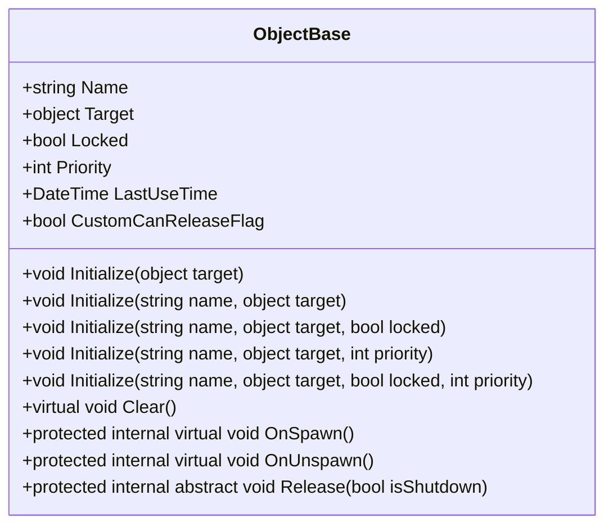
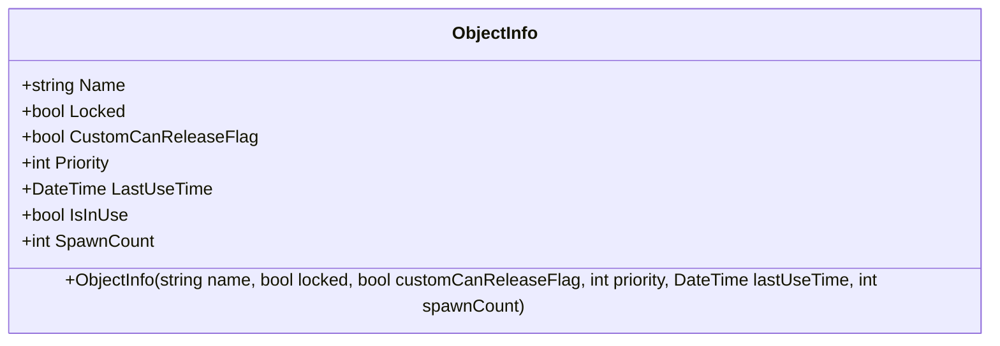
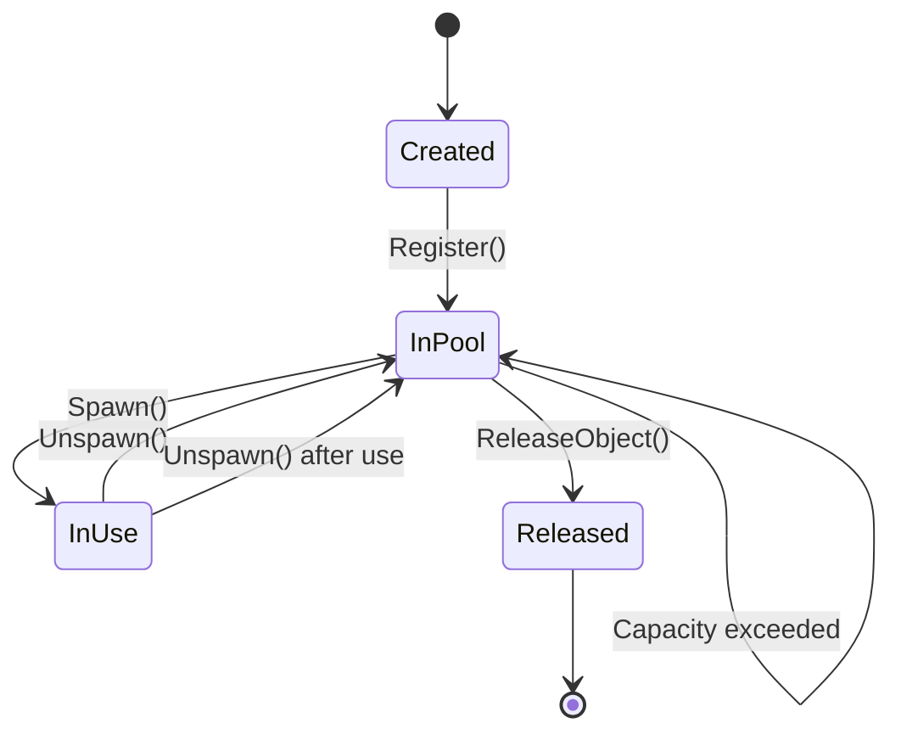
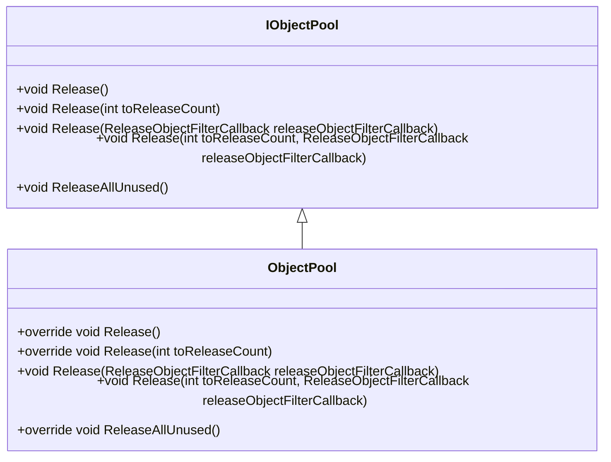
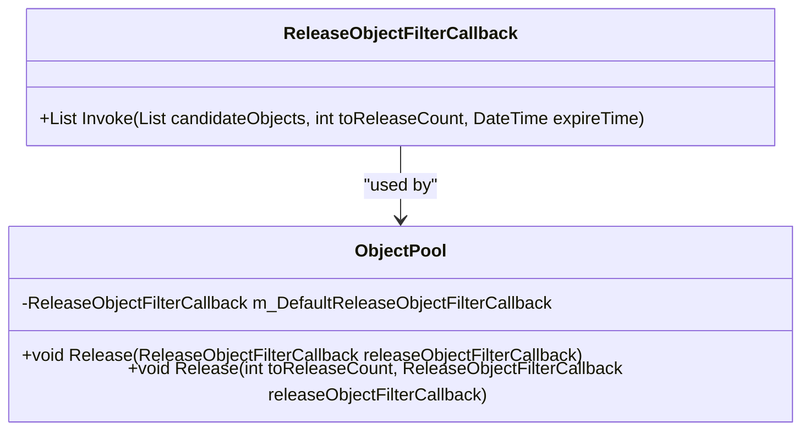

# 对象池泄漏与性能问题

<cite>
**Referenced Files in This Document**   
- [ObjectBase.cs](file://GameFramework/ObjectPool/ObjectBase.cs)
- [ObjectInfo.cs](file://GameFramework/ObjectPool/ObjectInfo.cs)
- [ObjectPoolManager.cs](file://GameFramework/ObjectPool/ObjectPoolManager.cs)
- [ObjectPoolManager.ObjectPool.cs](file://GameFramework/ObjectPool/ObjectPoolManager.ObjectPool.cs)
- [ReleaseObjectFilterCallback.cs](file://GameFramework/ObjectPool/ReleaseObjectFilterCallback.cs)
</cite>

## 目录
1. [简介](#简介)
2. [核心组件分析](#核心组件分析)
3. [对象池生命周期与状态管理](#对象池生命周期与状态管理)
4. [对象回收与释放机制](#对象回收与释放机制)
5. [条件性释放策略](#条件性释放策略)
6. [性能监控与调优](#性能监控与调优)
7. [常见问题排查](#常见问题排查)
8. [最佳实践](#最佳实践)

## 简介

对象池是一种重要的性能优化技术，通过复用对象来减少频繁创建和销毁带来的GC压力。然而，在实际使用中，开发者常面临对象未正确回收导致的内存泄漏、频繁创建销毁引发的GC压力、对象状态残留等问题。本文档基于`ObjectBase`生命周期和`ObjectInfo`监控数据，指导开发者如何利用`IObjectPoolManager`获取池统计信息，通过`ReleaseObjectFilterCallback`机制说明条件性释放策略的正确使用方式，并提供性能监控和调优建议。

## 核心组件分析

### ObjectBase 生命周期管理

`ObjectBase`是所有可池化对象的基类，负责管理对象的核心状态和生命周期。



**Diagram sources**
- [ObjectBase.cs](file://GameFramework/ObjectPool/ObjectBase.cs#L14-L205)

**Section sources**
- [ObjectBase.cs](file://GameFramework/ObjectPool/ObjectBase.cs#L14-L205)

### ObjectInfo 监控数据结构

`ObjectInfo`结构体用于提供对象池中对象的监控信息，是性能分析和问题排查的重要数据源。



**Diagram sources**
- [ObjectInfo.cs](file://GameFramework/ObjectPool/ObjectInfo.cs#L15-L120)

**Section sources**
- [ObjectInfo.cs](file://GameFramework/ObjectPool/ObjectInfo.cs#L15-L120)

## 对象池生命周期与状态管理

### 对象状态流转

对象在池中的生命周期涉及多个状态的流转，正确理解这些状态是避免问题的关键。



**Diagram sources**
- [ObjectPoolManager.ObjectPool.cs](file://GameFramework/ObjectPool/ObjectPoolManager.ObjectPool.cs#L18-L634)
- [ObjectBase.cs](file://GameFramework/ObjectPool/ObjectBase.cs#L14-L205)

**Section sources**
- [ObjectPoolManager.ObjectPool.cs](file://GameFramework/ObjectPool/ObjectPoolManager.ObjectPool.cs#L18-L634)
- [ObjectBase.cs](file://GameFramework/ObjectPool/ObjectBase.cs#L14-L205)

### 状态属性详解

| 属性 | 类型 | 说明 | 影响 |
|------|------|------|------|
| Name | string | 对象名称，用于标识和查找 | 对象池内唯一标识 |
| Target | object | 实际的对象实例 | 对象池管理的核心数据 |
| Locked | bool | 对象是否被锁定，锁定的对象不会被自动释放 | 防止重要对象被意外回收 |
| Priority | int | 对象优先级，影响释放顺序 | 高优先级对象更晚被释放 |
| LastUseTime | DateTime | 最后使用时间，用于过期判断 | 过期对象优先被释放 |
| CustomCanReleaseFlag | bool | 自定义释放检查标记 | 扩展释放条件判断 |
| IsInUse | bool | 对象是否正在被使用 | 正在使用的对象不能被释放 |
| SpawnCount | int | 获取计数，记录对象被获取的次数 | 多次获取对象的使用统计 |

**Section sources**
- [ObjectBase.cs](file://GameFramework/ObjectPool/ObjectBase.cs#L14-L205)
- [ObjectInfo.cs](file://GameFramework/ObjectPool/ObjectInfo.cs#L15-L120)

## 对象回收与释放机制

### 对象回收流程

对象回收是对象池管理的关键环节，正确的回收流程能有效避免内存泄漏。

```mermaid
flowchart TD
A[调用 Unspawn()] --> B{对象存在?}
B --> |是| C[调用 OnUnspawn()]
B --> |否| D[抛出异常]
C --> E[更新 LastUseTime]
C --> F[减少 SpawnCount]
F --> G{SpawnCount < 0?}
G --> |是| H[抛出异常]
G --> |否| I[检查是否超容量]
I --> J{Count > Capacity?}
J --> |是| K[触发 Release()]
J --> |否| L[回收完成]
```

**Diagram sources**
- [ObjectPoolManager.ObjectPool.cs](file://GameFramework/ObjectPool/ObjectPoolManager.ObjectPool.cs#L390-L408)
- [ObjectBase.cs](file://GameFramework/ObjectPool/ObjectBase.cs#L170-L183)

**Section sources**
- [ObjectPoolManager.ObjectPool.cs](file://GameFramework/ObjectPool/ObjectPoolManager.ObjectPool.cs#L390-L408)
- [ObjectBase.cs](file://GameFramework/ObjectPool/ObjectBase.cs#L170-L183)

### 释放机制详解

对象释放机制包含多个层次，从单个对象释放到批量释放，再到全部释放。



**Diagram sources**
- [ObjectPoolManager.ObjectPool.cs](file://GameFramework/ObjectPool/ObjectPoolManager.ObjectPool.cs#L444-L515)
- [IObjectPool.cs](file://GameFramework/ObjectPool/IObjectPool.cs#L15-L216)

**Section sources**
- [ObjectPoolManager.ObjectPool.cs](file://GameFramework/ObjectPool/ObjectPoolManager.ObjectPool.cs#L444-L515)

## 条件性释放策略

### ReleaseObjectFilterCallback 机制

`ReleaseObjectFilterCallback`是实现条件性释放的核心机制，允许开发者自定义对象释放的筛选逻辑。



**Diagram sources**
- [ReleaseObjectFilterCallback.cs](file://GameFramework/ObjectPool/ReleaseObjectFilterCallback.cs#L15-L22)
- [ObjectPoolManager.ObjectPool.cs](file://GameFramework/ObjectPool/ObjectPoolManager.ObjectPool.cs#L18-L634)

**Section sources**
- [ReleaseObjectFilterCallback.cs](file://GameFramework/ObjectPool/ReleaseObjectFilterCallback.cs#L15-L22)

### 自定义释放策略实现

```mermaid
flowchart TD
A[调用 Release()] --> B[获取可释放对象]
B --> C[调用 ReleaseObjectFilterCallback]
C --> D[筛选需要释放的对象]
D --> E{筛选结果为空?}
E --> |是| F[结束]
E --> |否| G[逐个释放对象]
G --> H[调用 ReleaseObject()]
H --> I[从池中移除]
I --> J[调用对象 Release()]
J --> K[回收内部对象]
```

**Diagram sources**
- [ObjectPoolManager.ObjectPool.cs](file://GameFramework/ObjectPool/ObjectPoolManager.ObjectPool.cs#L472-L502)
- [ObjectPoolManager.Object