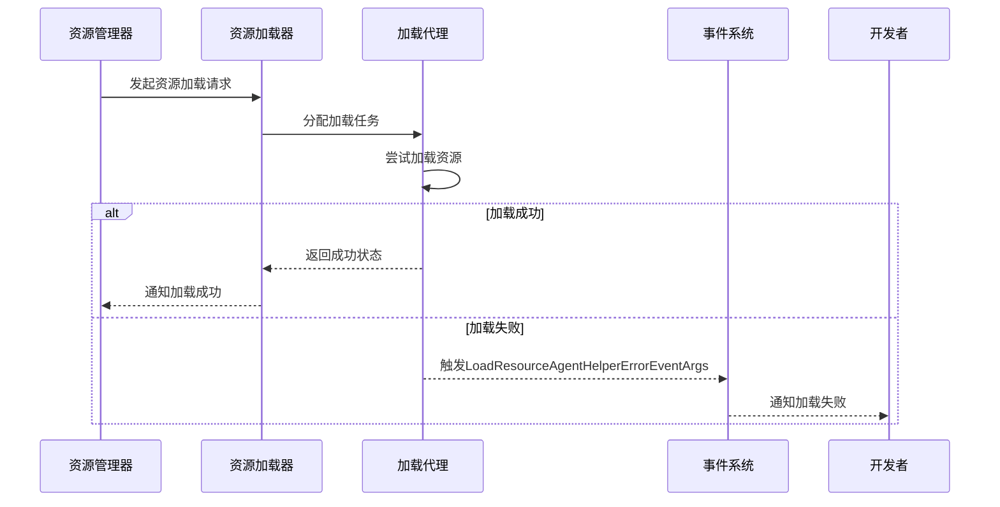
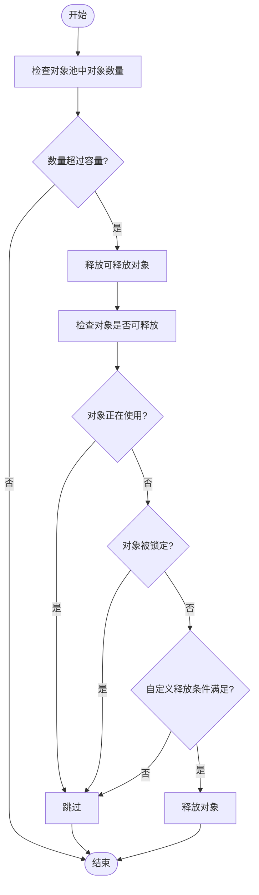

# 故障排除

<cite>
**本文档中引用的文件**
- [ResourceManager.cs](file://GameFramework/Resource/ResourceManager.cs)
- [GameFrameworkException.cs](file://GameFramework/Base/GameFrameworkException.cs)
- [ObjectPoolManager.ObjectPool.cs](file://GameFramework/ObjectPool/ObjectPoolManager.ObjectPool.cs)
- [EventPool.cs](file://GameFramework/Base/EventPool/EventPool.cs)
- [NetworkManager.cs](file://GameFramework/Network/NetworkManager.cs)
- [LoadResourceAgentHelperErrorEventArgs.cs](file://GameFramework/Resource/LoadResourceAgentHelperErrorEventArgs.cs)
- [ResourceUpdateFailureEventArgs.cs](file://GameFramework/Resource/ResourceUpdateFailureEventArgs.cs)
- [NetworkErrorEventArgs.cs](file://GameFramework/Network/NetworkErrorEventArgs.cs)
</cite>

## 目录
1. [简介](#简介)
2. [资源加载失败](#资源加载失败)
3. [对象池泄漏](#对象池泄漏)
4. [事件未响应](#事件未响应)
5. [网络连接异常](#网络连接异常)
6. [异常处理机制](#异常处理机制)
7. [调试步骤与修复建议](#调试步骤与修复建议)
8. [附录](#附录)

## 简介
本故障排除指南旨在系统性地列出使用GameFramework框架过程中可能遇到的常见问题、错误代码及其解决方案。涵盖资源加载失败、对象池泄漏、事件未响应、网络连接异常等典型场景。提供详细的错误日志分析方法、调试步骤及修复建议。特别关注ResourceManager和Exception处理机制，帮助开发者快速定位和解决问题。

## 资源加载失败
资源加载失败是使用GameFramework时常见的问题之一。通常由以下原因导致：

1. **资源路径错误**：检查资源路径是否正确，确保资源文件存在于指定路径。
2. **资源文件缺失**：确认资源文件是否已正确打包并部署到目标设备。
3. **资源版本不匹配**：检查资源版本是否与当前游戏版本兼容。

当资源加载失败时，系统会触发`LoadResourceAgentHelperErrorEventArgs`事件，该事件包含加载资源状态和错误信息。开发者可以通过订阅此事件来捕获加载失败的情况，并根据错误信息进行相应的处理。

**图表来源**
- [ResourceManager.cs](file://GameFramework/Resource/ResourceManager.cs#L81-L129)
- [LoadResourceAgentHelperErrorEventArgs.cs](file://GameFramework/Resource/LoadResourceAgentHelperErrorEventArgs.cs#L12-L63)

**本节来源**
- [ResourceManager.cs](file://GameFramework/Resource/ResourceManager.cs#L81-L129)
- [LoadResourceAgentHelperErrorEventArgs.cs](file://GameFramework/Resource/LoadResourceAgentHelperErrorEventArgs.cs#L12-L63)

## 对象池泄漏
对象池泄漏是指对象池中的对象未能正确释放，导致内存占用持续增加。在GameFramework中，对象池由`ObjectPoolManager`管理，每个对象池都有其特定的容量和过期时间。

对象池泄漏的常见原因包括：

1. **对象未正确回收**：确保在使用完对象后调用`Unspawn`方法将其归还给对象池。
2. **对象被锁定**：检查是否有对象被意外锁定，导致无法释放。
3. **自定义释放条件不满足**：如果设置了自定义的释放筛选函数，确保条件能够正确满足。

当对象池中的对象数量超过容量时，系统会自动尝试释放可释放的对象。开发者可以通过设置对象池的`AutoReleaseInterval`、`Capacity`、`ExpireTime`等属性来优化对象池的行为。

**图表来源**
- [ObjectPoolManager.ObjectPool.cs](file://GameFramework/ObjectPool/ObjectPoolManager.ObjectPool.cs#L41-L55)
- [ObjectPoolManager.ObjectPool.cs](file://GameFramework/ObjectPool/ObjectPoolManager.ObjectPool.cs#L400-L439)

**本节来源**
- [ObjectPoolManager.ObjectPool.cs](file://GameFramework/ObjectPool/ObjectPoolManager.ObjectPool.cs#L41-L55)
- [ObjectPoolManager.ObjectPool.cs](file://GameFramework/ObjectPool/ObjectPoolManager.ObjectPool.cs#L400-L439)

## 事件未响应
事件未响应是指事件被触发后，相应的事件处理函数未能执行。在GameFramework中，事件系统由`EventManager`管理，基于