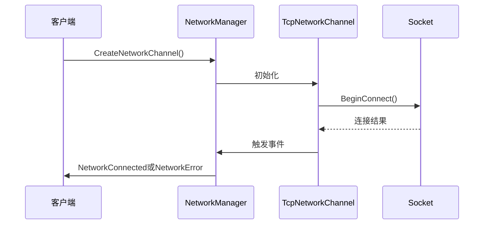
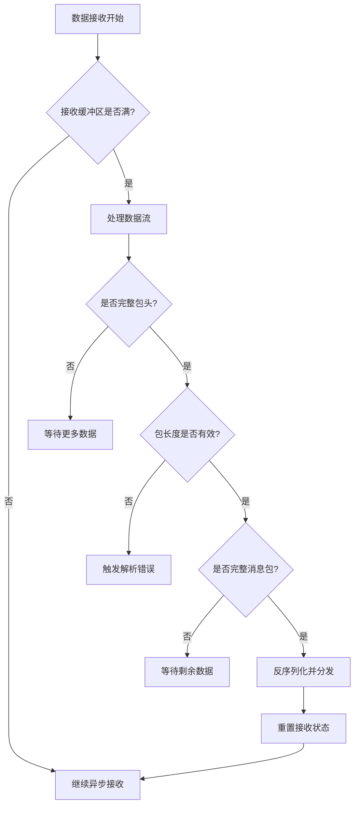
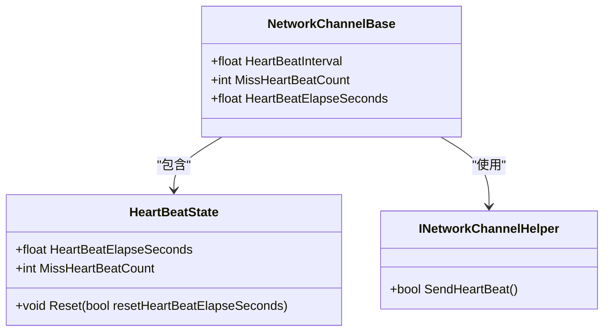
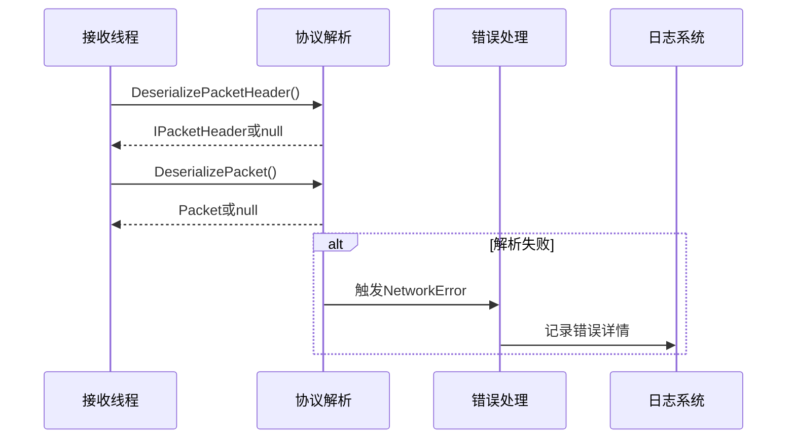
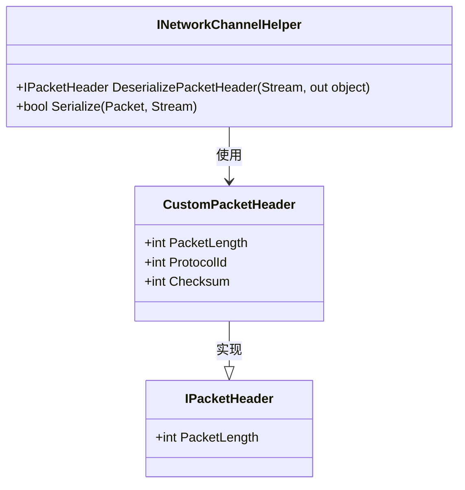
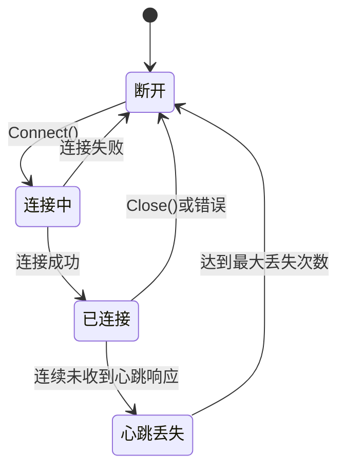

# 网络通信问题排查

<cite>
**本文档引用的文件**  
- [INetworkManager.cs](file://GameFramework/Network/INetworkManager.cs)
- [NetworkManager.cs](file://GameFramework/Network/NetworkManager.cs)
- [NetworkManager.ConnectState.cs](file://GameFramework/Network/NetworkManager.ConnectState.cs)
- [NetworkManager.HeartBeatState.cs](file://GameFramework/Network/NetworkManager.HeartBeatState.cs)
- [NetworkErrorEventArgs.cs](file://GameFramework/Network/NetworkErrorEventArgs.cs)
- [NetworkMissHeartBeatEventArgs.cs](file://GameFramework/Network/NetworkMissHeartBeatEventArgs.cs)
- [NetworkErrorCode.cs](file://GameFramework/Network/NetworkErrorCode.cs)
- [INetworkChannelHelper.cs](file://GameFramework/Network/INetworkChannelHelper.cs)
- [Packet.cs](file://GameFramework/Network/Packet.cs)
- [IPacketHeader.cs](file://GameFramework/Network/IPacketHeader.cs)
- [NetworkManager.TcpNetworkChannel.cs](file://GameFramework/Network/NetworkManager.TcpNetworkChannel.cs)
- [NetworkManager.NetworkChannelBase.cs](file://GameFramework/Network/NetworkManager.NetworkChannelBase.cs)
- [NetworkManager.SendState.cs](file://GameFramework/Network/NetworkManager.SendState.cs)
- [NetworkManager.ReceiveState.cs](file://GameFramework/Network/NetworkManager.ReceiveState.cs)
</cite>

## 目录
1. [简介](#简介)
2. [核心组件分析](#核心组件分析)
3. [连接失败排查](#连接失败排查)
4. [数据包丢失与粘包处理](#数据包丢失与粘包处理)
5. [心跳超时机制](#心跳超时机制)
6. [协议解析错误分析](#协议解析错误分析)
7. [断线重连策略](#断线重连策略)
8. [自定义PacketHeader兼容性](#自定义packetheader兼容性)
9. [状态机行为分析](#状态机行为分析)
10. [事件参数与日志诊断](#事件参数与日志诊断)

## 简介
本文档系统性分析基于INetworkManager和NetworkManager实现的网络通信故障排查方法。重点涵盖连接失败、数据包丢失、心跳超时、协议解析错误等常见问题，结合状态机和事件参数指导开发者进行精准诊断。

## 核心组件分析

**网络通信核心组件包括INetworkManager接口、NetworkManager实现类、网络频道基类NetworkChannelBase以及TCP网络频道TcpNetworkChannel。这些组件共同构成了完整的网络通信框架，支持事件驱动的异常处理机制。**

**Section sources**
- [INetworkManager.cs](file://GameFramework/Network/INetworkManager.cs#L15-L91)
- [NetworkManager.cs](file://GameFramework/Network/NetworkManager.cs#L29-L37)
- [NetworkManager.NetworkChannelBase.cs](file://GameFramework/Network/NetworkManager.NetworkChannelBase.cs#L12-L636)
- [NetworkManager.TcpNetworkChannel.cs](file://GameFramework/Network/NetworkManager.TcpNetworkChannel.cs#L12-L290)

## 连接失败排查



**Diagram sources**
- [NetworkManager.cs](file://GameFramework/Network/NetworkManager.cs#L29-L37)
- [NetworkManager.TcpNetworkChannel.cs](file://GameFramework/Network/NetworkManager.TcpNetworkChannel.cs#L12-L290)
- [NetworkManager.ConnectState.cs](file://GameFramework/Network/NetworkManager.ConnectState.cs#L11-L40)

**Section sources**
- [NetworkManager.cs](file://GameFramework/Network/NetworkManager.cs#L29-L37)
- [NetworkManager.TcpNetworkChannel.cs](file://GameFramework/Network/NetworkManager.TcpNetworkChannel.cs#L12-L290)

## 数据包丢失与粘包处理



**Diagram sources**
- [NetworkManager.NetworkChannelBase.cs](file://GameFramework/Network/NetworkManager.NetworkChannelBase.cs#L12-L636)
- [NetworkManager.ReceiveState.cs](file://GameFramework/Network/NetworkManager.ReceiveState.cs#L12-L98)

**Section sources**
- [NetworkManager.NetworkChannelBase.cs](file://GameFramework/Network/NetworkManager.NetworkChannelBase.cs#L12-L636)
- [NetworkManager.ReceiveState.cs](file://GameFramework/Network/NetworkManager.ReceiveState.cs#L12-L98)
- [INetworkChannelHelper.cs](file://GameFramework/Network/INetworkChannelHelper.cs#L14-L71)

## 心跳超时机制



**Diagram sources**
- [NetworkManager.HeartBeatState.cs](file://GameFramework/Network/NetworkManager.HeartBeatState.cs#L11-L55)
- [NetworkManager.NetworkChannelBase.cs](file://GameFramework/Network/NetworkManager.NetworkChannelBase.cs#L12-L636)
- [INetworkChannelHelper.cs](file://GameFramework/Network/INetworkChannelHelper.cs#L14-L71)

**Section sources**
- [NetworkManager.HeartBeatState.cs](file://GameFramework/Network/NetworkManager.HeartBeatState.cs#L11-L55)
- [NetworkManager.NetworkChannelBase.cs](file://GameFramework/Network/NetworkManager.NetworkChannelBase.cs#L12-L636)

## 协议解析错误分析



**Diagram sources**
- [INetworkChannelHelper.cs](file://GameFramework/Network/INetworkChannelHelper.cs#L14-L71)
- [NetworkErrorEventArgs.cs](file://GameFramework/Network/NetworkErrorEventArgs.cs#L14-L91)
- [Packet.cs](file://GameFramework/Network/Packet.cs#L12-L14)

**Section sources**
- [INetworkChannelHelper.cs](file://GameFramework/Network/INetworkChannelHelper.cs#L14-L71)
- [NetworkErrorEventArgs.cs](file://GameFramework/Network/NetworkErrorEventArgs.cs#L14-L91)

## 断线重连策略

**断线重连应结合NetworkClosed事件和自定义重试逻辑实现。建议采用指数退避算法控制重试间隔，避免频繁连接对服务器造成压力。重连时需重新初始化网络频道并注册事件处理器。**

**Section sources**
- [NetworkManager.cs](file://GameFramework/Network/NetworkManager.cs#L29-L37)
- [NetworkManager.NetworkChannelBase.cs](file://GameFramework/Network/NetworkManager.NetworkChannelBase.cs#L12-L636)

## 自定义PacketHeader兼容性



**Diagram sources**
- [IPacketHeader.cs](file://GameFramework/Network/IPacketHeader.cs#L12-L21)
- [INetworkChannelHelper.cs](file://GameFramework/Network/INetworkChannelHelper.cs#L14-L71)

**Section sources**
- [IPacketHeader.cs](file://GameFramework/Network/IPacketHeader.cs#L12-L21)
- [INetworkChannelHelper.cs](file://GameFramework/Network/INetworkChannelHelper.cs#L14-L71)

## 状态机行为分析



**Diagram sources**
- [NetworkManager.ConnectState.cs](file://GameFramework/Network/NetworkManager.ConnectState.cs#L11-L40)
- [NetworkManager.HeartBeatState.cs](file://GameFramework/Network/NetworkManager.HeartBeatState.cs#L11-L55)
- [NetworkManager.NetworkChannelBase.cs](file://GameFramework/Network/NetworkManager.NetworkChannelBase.cs#L12-L636)

**Section sources**
- [NetworkManager.ConnectState.cs](file://GameFramework/Network/NetworkManager.ConnectState.cs#L11-L40)
- [NetworkManager.HeartBeatState.cs](file://GameFramework/Network/NetworkManager.HeartBeatState.cs#L11-L55)

## 事件参数与日志诊断

```mermaid
erDiagram
NETWORK_ERROR ||--o{ NETWORK_ERROR_EVENT : 包含
NETWORK_MISS_HEARTBEAT ||--o{ NETWORK_MISS_HEARTBEAT_EVENT : 包含
NETWORK_ERROR_EVENT {
INetworkChannel NetworkChannel
NetworkErrorCode ErrorCode
SocketError SocketErrorCode
string ErrorMessage
}
NETWORK_MISS_HEARTBEAT_EVENT {
INetworkChannel NetworkChannel
int MissCount
}
NETWORK_ERROR {
Unknown
AddressFamilyError
SocketError
ConnectError
SendError
ReceiveError
SerializeError
DeserializePacketHeaderError
DeserializePacketError
}
```

**Diagram sources**
- [NetworkErrorEventArgs.cs](file://GameFramework/Network/NetworkErrorEventArgs.cs#L14-L91)
- [NetworkMissHeartBeatEventArgs.cs](file://GameFramework/Network/NetworkMissHeartBeatEventArgs.cs#L12-L63)
- [NetworkErrorCode.cs](file://GameFramework/Network/NetworkErrorCode.cs#L12-L58)

**Section sources**
- [NetworkErrorEventArgs.cs](file://GameFramework/Network/NetworkErrorEventArgs.cs#L14-L91)
- [NetworkMissHeartBeatEventArgs.cs](file://GameFramework/Network/NetworkMissHeartBeatEventArgs.cs#L12-L63)
- [NetworkErrorCode.cs](file://GameFramework/Network/NetworkErrorCode.cs#L12-L58)