# 资源管理问题排查

<cite>
**本文档引用的文件**  
- [IResourceManager.cs](file://GameFramework/Resource/IResourceManager.cs)
- [ResourceManager.cs](file://GameFramework/Resource/ResourceManager.cs)
- [LoadAssetFailureCallback.cs](file://GameFramework/Resource/LoadAssetFailureCallback.cs)
- [LoadSceneFailureCallback.cs](file://GameFramework/Resource/LoadSceneFailureCallback.cs)
- [LoadAssetCallbacks.cs](file://GameFramework/Resource/LoadAssetCallbacks.cs)
- [LoadSceneCallbacks.cs](file://GameFramework/Resource/LoadSceneCallbacks.cs)
- [ResourceManager.ResourceLoader.cs](file://GameFramework/Resource/ResourceManager.ResourceLoader.cs)
- [ResourceManager.ResourceLoader.LoadResourceAgent.cs](file://GameFramework/Resource/ResourceManager.ResourceLoader.LoadResourceAgent.cs)
- [Constant.cs](file://GameFramework/Resource/Constant.cs)
- [LoadResourceStatus.cs](file://GameFramework/Resource/LoadResourceStatus.cs)
- [DecryptResourceCallback.cs](file://GameFramework/Resource/DecryptResourceCallback.cs)
</cite>

## 目录
1. [简介](#简介)
2. [资源加载失败排查](#资源加载失败排查)
3. [版本更新异常处理](#版本更新异常处理)
4. [资源校验错误分析](#资源校验错误分析)
5. [回调机制详解](#回调机制详解)
6. [路径与依赖问题调试](#路径与依赖问题调试)
7. [加密解密失败场景](#加密解密失败场景)
8. [性能瓶颈优化](#性能瓶颈优化)
9. [完整问题排查流程](#完整问题排查流程)

## 简介
资源管理模块是游戏框架的核心组件，负责资源的加载、更新、校验和释放。本指南重点分析资源加载失败、版本更新异常、资源校验错误等常见问题，详细说明`LoadAssetFailureCallback`、`LoadSceneFailureCallback`等回调机制的触发条件和处理方式。结合`IResourceManager`接口行为，解释资源路径错误、依赖缺失、加密解密失败等场景的调试方法，提供从日志定位到问题修复的完整流程，并给出性能瓶颈（如加载卡顿）的优化建议。

## 资源加载失败排查

资源加载失败是资源管理中最常见的问题，可能由多种原因引起。通过分析`IResourceManager`接口和`ResourceManager`实现，可以系统性地排查这些问题。

### 资源不存在
当请求加载的资源在资源列表中不存在时，会触发加载失败。可以通过`HasAsset`方法检查资源是否存在。

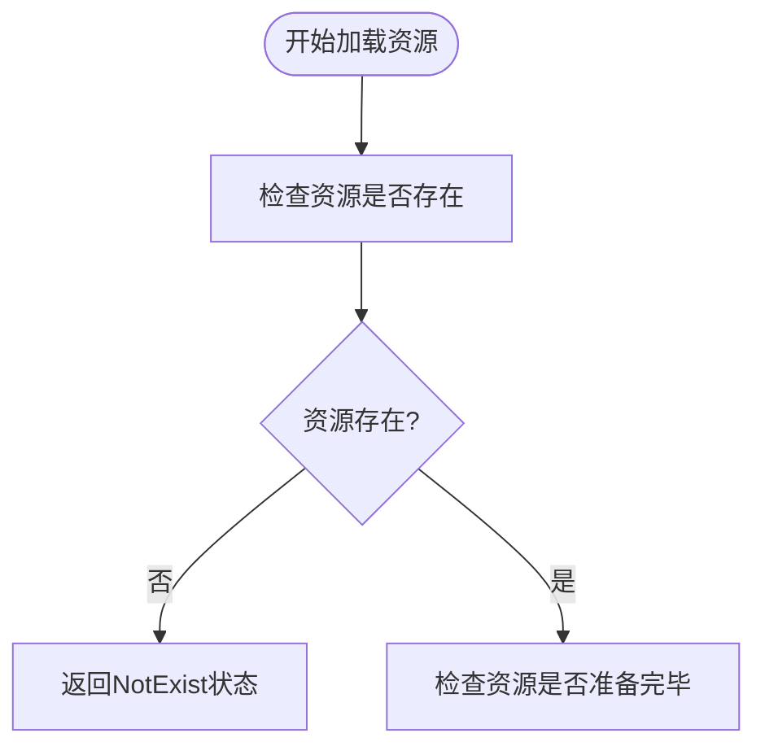

**图示来源**
- [IResourceManager.cs](file://GameFramework/Resource/IResourceManager.cs#L18-L830)
- [ResourceManager.ResourceLoader.cs](file://GameFramework/Resource/ResourceManager.ResourceLoader.cs#L0-L799)

### 资源未准备完毕
即使资源存在，如果尚未准备完毕（如正在更新或校验），也会导致加载失败。资源的准备状态由`ResourceInfo.Ready`属性控制。

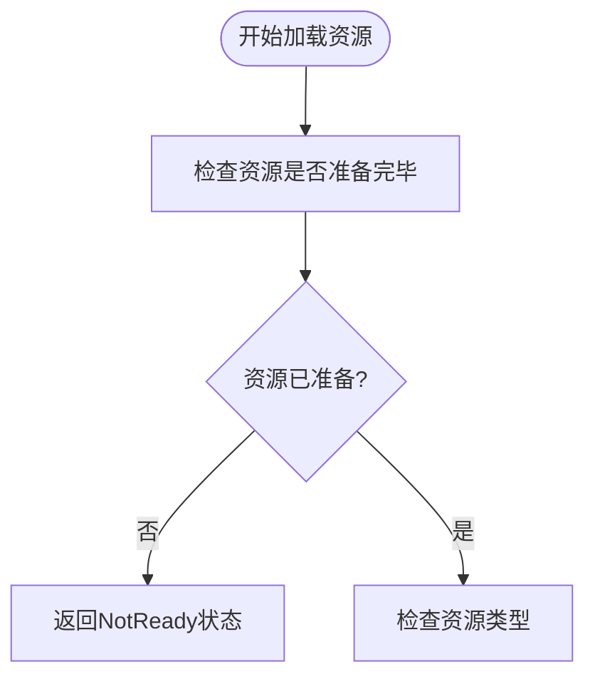

**图示来源**
- [ResourceManager.ResourceLoader.cs](file://GameFramework/Resource/ResourceManager.ResourceLoader.cs#L0-L799)
- [ResourceManager.ResourceLoader.LoadResourceTaskBase.cs](file://GameFramework/Resource/ResourceManager.ResourceLoader.LoadResourceTaskBase.cs#L0-L176)

### 资源类型错误
尝试以错误的类型加载资源会导致类型错误。例如，将二进制资源作为普通资源加载。

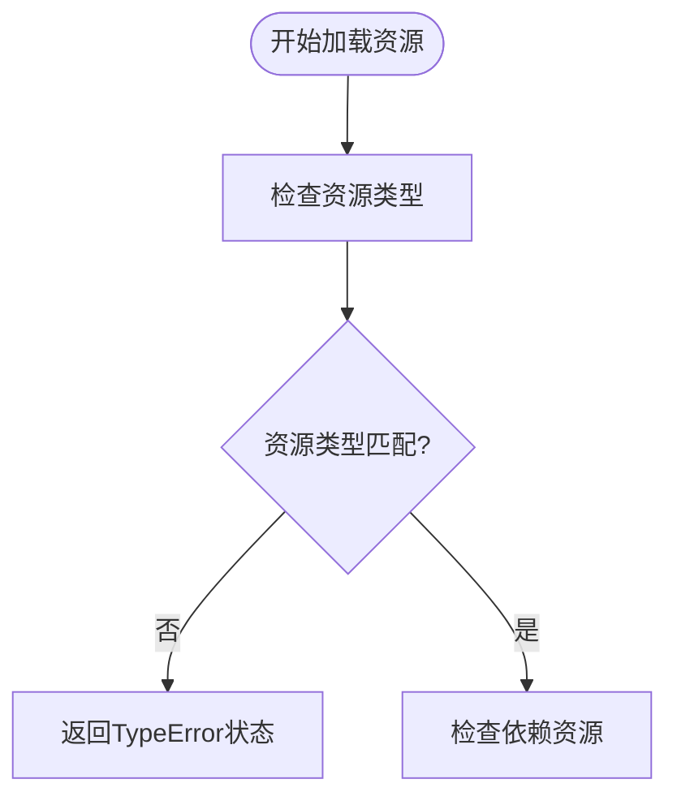

**图示来源**
- [ResourceManager.ResourceLoader.cs](file://GameFramework/Resource/ResourceManager.ResourceLoader.cs#L0-L799)
- [LoadResourceStatus.cs](file://GameFramework/Resource/LoadResourceStatus.cs#L0-L45)

### 依赖资源错误
资源可能依赖其他资源，如果依赖资源加载失败，主资源也会加载失败。

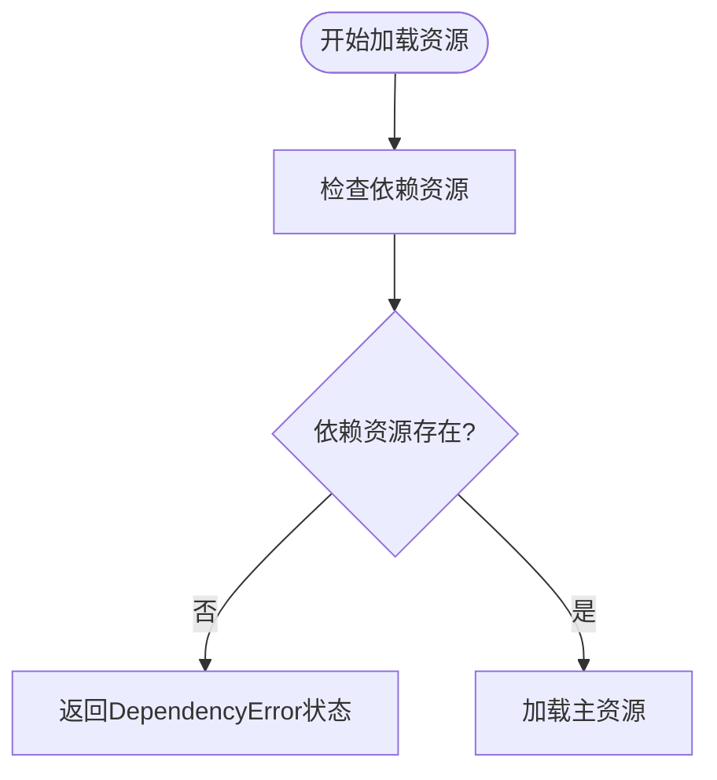

**图示来源**
- [ResourceManager.ResourceLoader.cs](file://GameFramework/Resource/ResourceManager.ResourceLoader.cs#L0-L799)
- [ResourceManager.ResourceLoader.LoadAssetTask.cs](file://GameFramework/Resource/ResourceManager.ResourceLoader.LoadAssetTask.cs#L0-L88)

**本节来源**
- [IResourceManager.cs](file://GameFramework/Resource/IResourceManager.cs#L18-L830)
- [ResourceManager.cs](file://GameFramework/Resource/ResourceManager.cs#L0-L799)
- [LoadResourceStatus.cs](file://GameFramework/Resource/LoadResourceStatus.cs#L0-L45)

## 版本更新异常处理

版本更新是资源管理的重要功能，但在更新过程中可能出现各种异常情况。

### 更新前检查
在开始更新前，需要检查当前版本与服务器版本的差异，确定需要更新的资源。

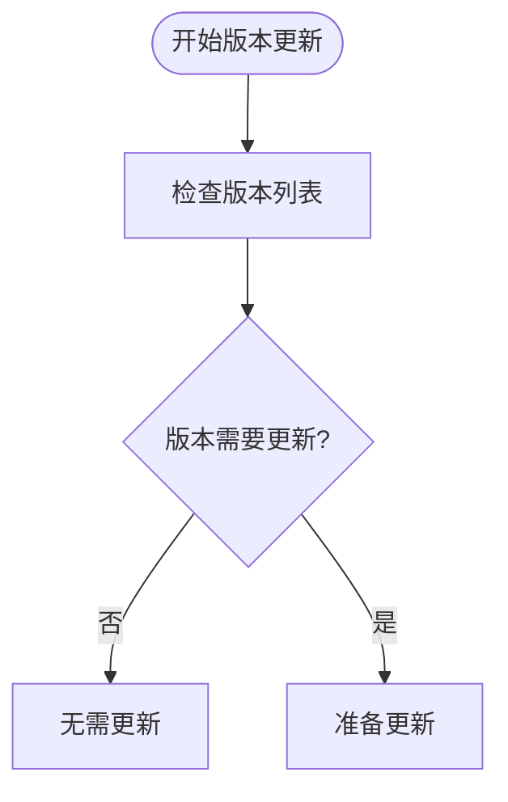

**图示来源**
- [IResourceManager.cs](file://GameFramework/Resource/IResourceManager.cs#L18-L830)
- [ResourceManager.cs](file://GameFramework/Resource/ResourceManager.cs#L0-L799)

### 更新过程中的错误
更新过程中可能遇到网络问题、文件损坏等错误。

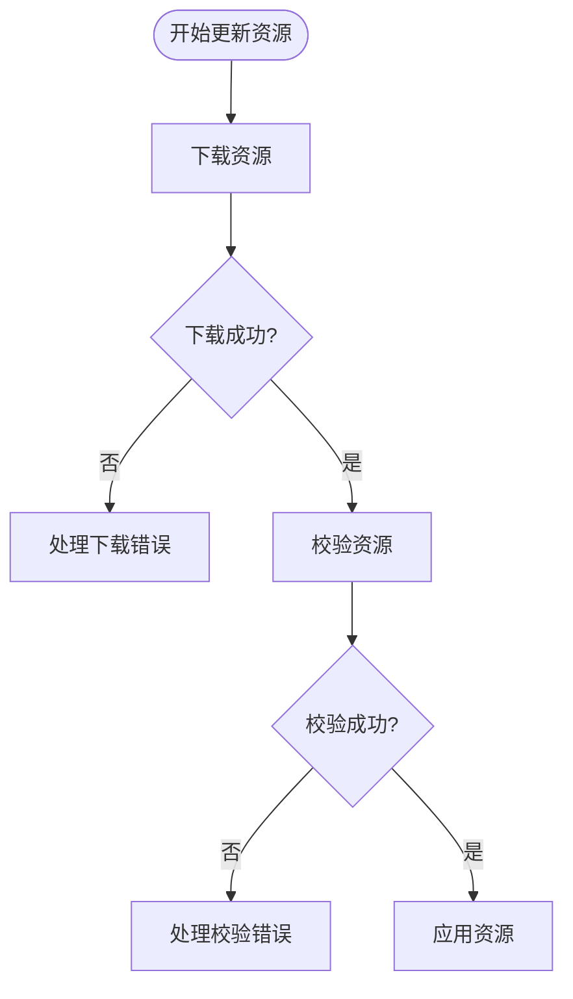

**图示来源**
- [ResourceManager.cs](file://GameFramework/Resource/ResourceManager.cs#L0-L799)
- [ResourceManager.ResourceUpdater.cs](file://GameFramework/Resource/ResourceManager.ResourceUpdater.cs#L0-L799)

### 更新重试机制
系统提供了更新重试机制，可以在更新失败后自动重试。

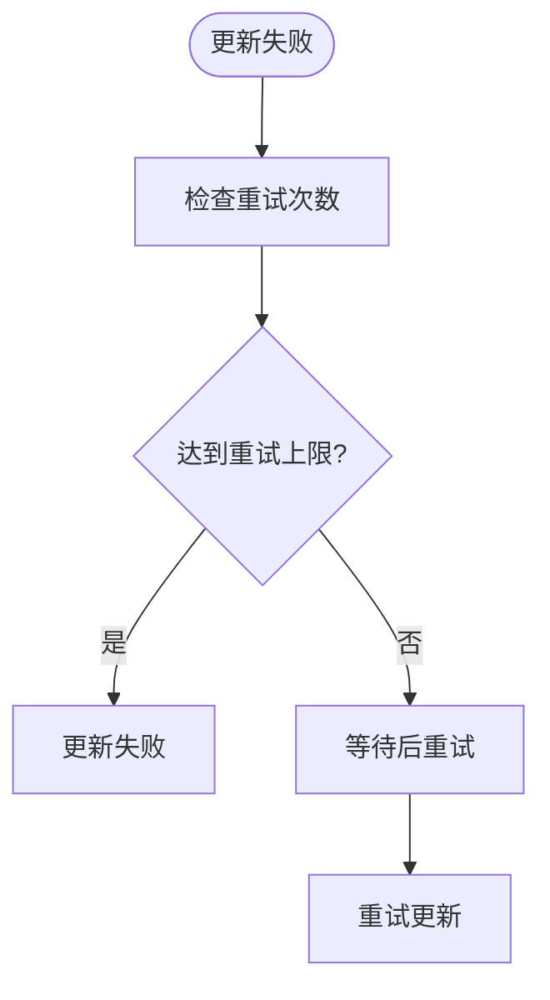

**图示来源**
- [IResourceManager.cs](file://GameFramework/Resource/IResourceManager.cs#L18-L830)
- [ResourceManager.cs](file://GameFramework/Resource/ResourceManager.cs#L0-L799)

**本节来源**
- [IResourceManager.cs](file://GameFramework/Resource/IResourceManager.cs#L18-L830)
- [ResourceManager.cs](file://GameFramework/Resource/ResourceManager.cs#L0-L799)

## 资源校验错误分析

资源校验是确保资源完整性和正确性的重要步骤。

### 校验流程
资源校验按照特定流程进行，确保每个资源都经过验证。

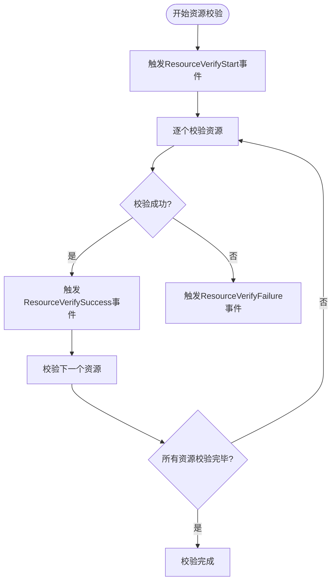

**图示来源**
- [IResourceManager.cs](file://GameFramework/Resource/IResourceManager.cs#L18-L830)
- [ResourceManager.ResourceVerifier.cs](file://GameFramework/Resource/ResourceManager.ResourceVerifier.cs#L0-L799)

### 校验失败原因
资源校验失败可能由多种原因引起：

1. **文件损坏**：资源文件在传输或存储过程中损坏
2. **哈希值不匹配**：计算的哈希值与预期值不一致
3. **文件缺失**：资源文件不存在
4. **权限问题**：无法访问资源文件

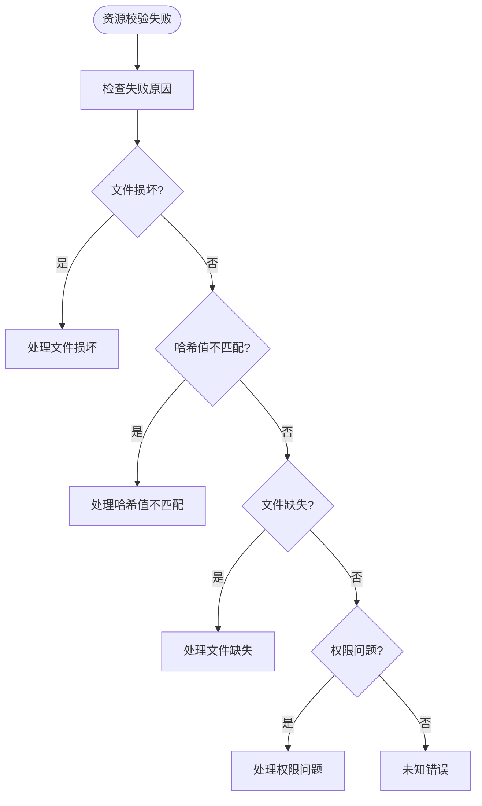

**图示来源**
- [ResourceManager.ResourceVerifier.cs](file://GameFramework/Resource/ResourceManager.ResourceVerifier.cs#L0-L799)
- [Utility.Verifier.cs](file://GameFramework/Utility/Utility.Verifier.cs#L0-L799)

**本节来源**
- [IResourceManager.cs](file://GameFramework/Resource/IResourceManager.cs#L18-L830)
- [ResourceManager.ResourceVerifier.cs](file://GameFramework/Resource/ResourceManager.ResourceVerifier.cs#L0-L799)

## 回调机制详解

回调机制是资源管理模块与上层逻辑通信的重要方式。

### LoadAssetFailureCallback
`LoadAssetFailureCallback`是加载资源失败时的回调函数，定义在`LoadAssetFailureCallback.cs`中。

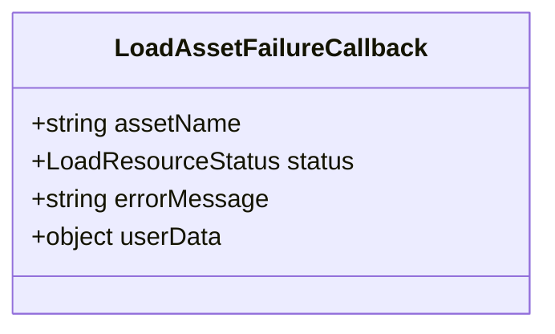

该回调在以下情况下被触发：
- 资源不存在
- 资源未准备完毕
- 资源类型错误
- 依赖资源错误
- 加载资源错误

**图示来源**
- [LoadAssetFailureCallback.cs](file://GameFramework/Resource/LoadAssetFailureCallback.cs#L0-L18)
- [IResourceManager.cs](file://GameFramework/Resource/IResourceManager.cs#L18-L830)

### LoadSceneFailureCallback
`LoadSceneFailureCallback`是加载场景失败时的回调函数，定义在`LoadSceneFailureCallback.cs`中。

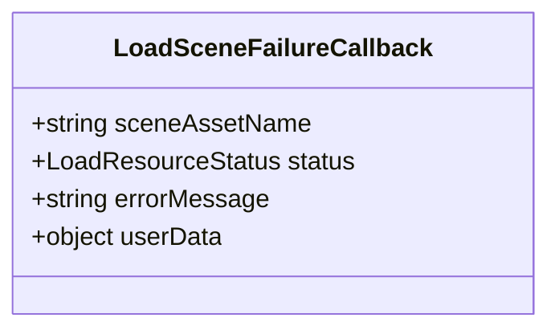

该回调在以下情况下被触发：
- 场景资源不存在
- 场景资源未准备完毕
- 场景资源类型错误
- 场景依赖资源错误
- 加载场景错误

**图示来源**
- [LoadSceneFailureCallback.cs](file://GameFramework/Resource/LoadSceneFailureCallback.cs#L0-L18)
- [IResourceManager.cs](file://GameFramework/Resource/IResourceManager.cs#L18-L830)

### 回调触发流程
回调的触发遵循特定的流程，确保错误信息能够正确传递。

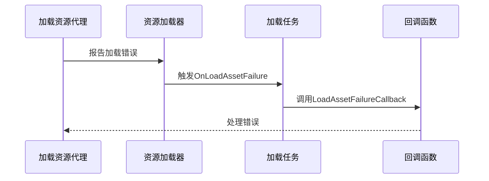

**图示来源**
- [ResourceManager.ResourceLoader.LoadResourceAgent.cs](file://GameFramework/Resource/ResourceManager.ResourceLoader.LoadResourceAgent.cs#L0-L361)
- [ResourceManager.ResourceLoader.LoadAssetTask.cs](file://GameFramework/Resource/ResourceManager.ResourceLoader.LoadAssetTask.cs#L0-L88)

**本节来源**
- [LoadAssetFailureCallback.cs](file://GameFramework/Resource/LoadAssetFailureCallback.cs#L0-L18)
- [LoadSceneFailureCallback.cs](file://GameFramework/Resource/LoadSceneFailureCallback.cs#L0-L18)
- [IResourceManager.cs](file://GameFramework/Resource/IResourceManager.cs#L18-L830)

## 路径与依赖问题调试

路径和依赖问题是资源加载失败的常见原因。

### 资源路径解析
资源路径的解析遵循特定规则，确保能够正确找到资源文件。

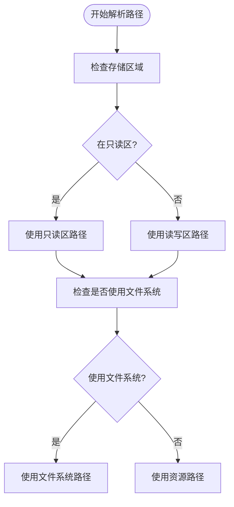

**图示来源**
- [IResourceManager.cs](file://GameFramework/Resource/IResourceManager.cs#L18-L830)
- [ResourceManager.ResourceLoader.cs](file://GameFramework/Resource/ResourceManager.ResourceLoader.cs#L0-L799)

### 依赖关系管理
资源之间的依赖关系需要正确管理，避免循环依赖和缺失依赖。

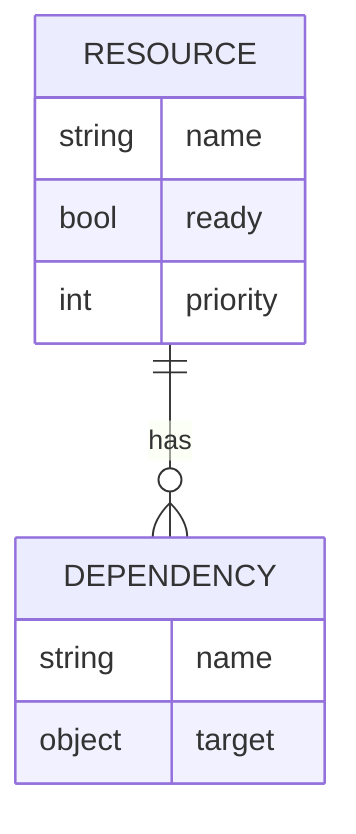

**图示来源**
- [ResourceManager.ResourceLoader.cs](file://GameFramework/Resource/ResourceManager.ResourceLoader.cs#L0-L799)
- [ResourceManager.ResourceLoader.LoadResourceTaskBase.cs](file://GameFramework/Resource/ResourceManager.ResourceLoader.LoadResourceTaskBase.cs#L0-L176)

### 调试方法
调试路径和依赖问题的方法包括：

1. **日志输出**：启用详细日志，查看资源加载的详细过程
2. **路径验证**：使用`GetBinaryPath`等方法验证路径是否正确
3. **依赖检查**：使用`GetAllLoadAssetInfos`获取所有加载任务信息，检查依赖关系

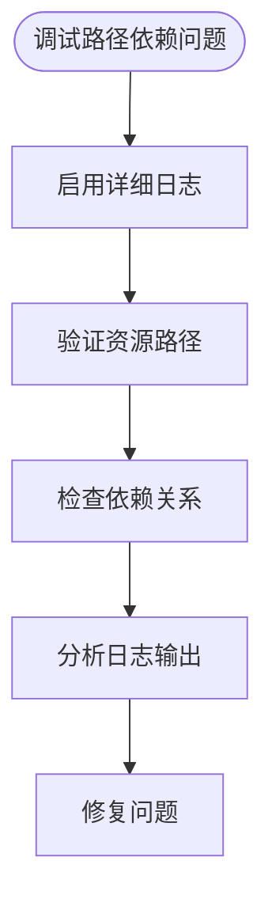

**图示来源**
- [IResourceManager.cs](file://GameFramework/Resource/IResourceManager.cs#L18-L830)
- [ResourceManager.ResourceLoader.cs](file://GameFramework/Resource/ResourceManager.ResourceLoader.cs#L0-L799)

**本节来源**
- [IResourceManager.cs](file://GameFramework/Resource/IResourceManager.cs#L18-L830)
- [ResourceManager.ResourceLoader.cs](file://GameFramework/Resource/ResourceManager.ResourceLoader.cs#L0-L799)

## 加密解密失败场景

加密解密是保护资源安全的重要手段，但也可能引入新的问题。

### 解密回调机制
解密回调函数`DecryptResourceCallback`定义了资源解密的方式。

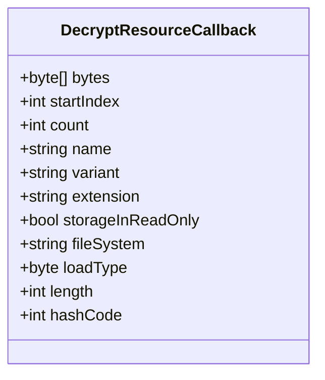

**图示来源**
- [DecryptResourceCallback.cs](file://GameFramework/Resource/DecryptResourceCallback.cs#L0-L25)
- [IResourceManager.cs](file://GameFramework/Resource/IResourceManager.cs#L18-L830)

### 解密失败原因
解密失败可能由以下原因引起：

1. **密钥错误**：使用的解密密钥不正确
2. **数据损坏**：加密数据在传输或存储过程中损坏
3. **算法不匹配**：加密和解密使用的算法不一致
4. **参数错误**：解密参数（如起始位置、长度）不正确

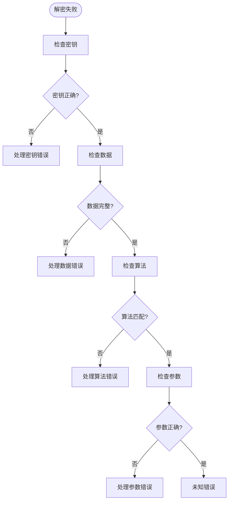

**图示来源**
- [DecryptResourceCallback.cs](file://GameFramework/Resource/DecryptResourceCallback.cs#L0-L25)
- [ResourceManager.ResourceLoader.LoadResourceAgent.cs](file://GameFramework/Resource/ResourceManager.ResourceLoader.LoadResourceAgent.cs#L0-L361)

### 调试方法
调试加密解密问题的方法包括：

1. **验证密钥**：确保加密和解密使用相同的密钥
2. **检查数据完整性**：验证加密数据是否完整
3. **确认算法一致性**：确保加密和解密使用相同的算法
4. **验证参数**：检查解密参数是否正确

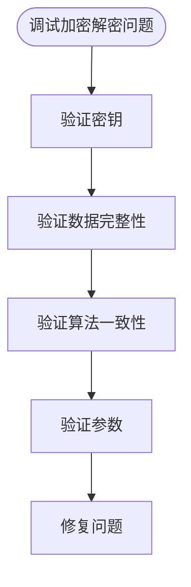

**图示来源**
- [DecryptResourceCallback.cs](file://GameFramework/Resource/DecryptResourceCallback.cs#L0-L25)
- [ResourceManager.ResourceLoader.LoadResourceAgent.cs](file://GameFramework/Resource/ResourceManager.ResourceLoader.LoadResourceAgent.cs#L0-L361)

**本节来源**
- [DecryptResourceCallback.cs](file://GameFramework/Resource/DecryptResourceCallback.cs#L0-L25)
- [IResourceManager.cs](file://GameFramework/Resource/IResourceManager.cs#L18-L830)

## 性能瓶颈优化

性能瓶颈是资源管理中需要重点关注的问题，特别是加载卡顿等现象。

### 加载代理管理
加载代理的数量和配置直接影响加载性能。

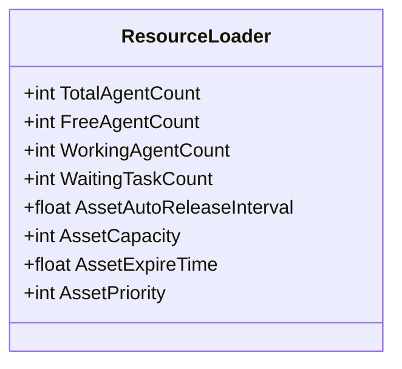

**图示来源**
- [IResourceManager.cs](file://GameFramework/Resource/IResourceManager.cs#L18-L830)
- [ResourceManager.ResourceLoader.cs](file://GameFramework/Resource/ResourceManager.ResourceLoader.cs#L0-L799)

### 对象池优化
合理配置对象池可以显著提升性能。

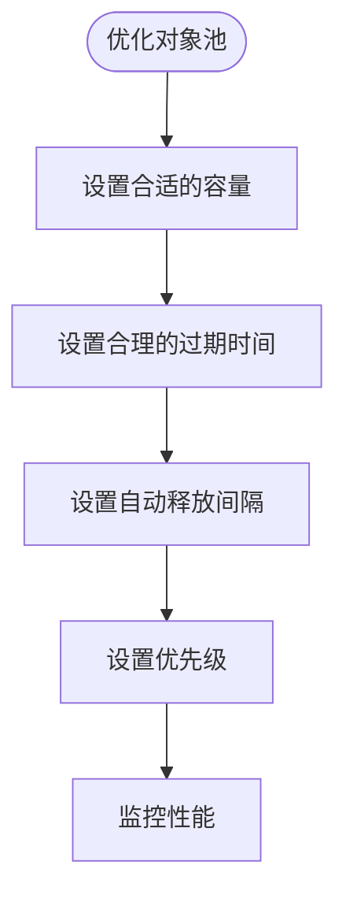

**图示来源**
- [IResourceManager.cs](file://GameFramework/Resource/IResourceManager.cs#L18-L830)
- [ResourceManager.ResourceLoader.cs](file://GameFramework/Resource/ResourceManager.ResourceLoader.cs#L0-L799)

### 加载优先级
合理设置加载优先级可以避免关键资源加载延迟。

```mermaid
flowchart TD
Start([设置加载优先级]) --> IdentifyCritical["识别关键资源"]
IdentifyCritical --> SetHighPriority["为关键资源设置高优先级"]
SetHighPriority --> MonitorLoading["监控加载过程"]
MonitorLoading --> AdjustPriority["根据需要调整优先级"]
```

**图示来源**
- [Constant.cs](file://GameFramework/Resource/Constant.cs#L0-L20)
- [IResourceManager.cs](file://GameFramework/Resource/IResourceManager.cs#L18-L830)

### 性能监控
建立性能监控机制，及时发现和解决性能问题。

```mermaid
flowchart TD
Start([性能监控]) --> CollectData["收集性能数据"]
CollectData --> AnalyzeData["分析性能数据"]
AnalyzeData --> IdentifyBottleneck["识别性能瓶颈"]
IdentifyBottleneck --> Optimize["优化"]
Optimize --> Verify["验证优化效果"]
```

**图示来源**
- [IResourceManager.cs](file://GameFramework/Resource