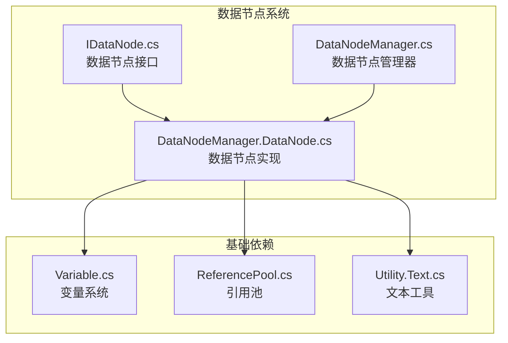
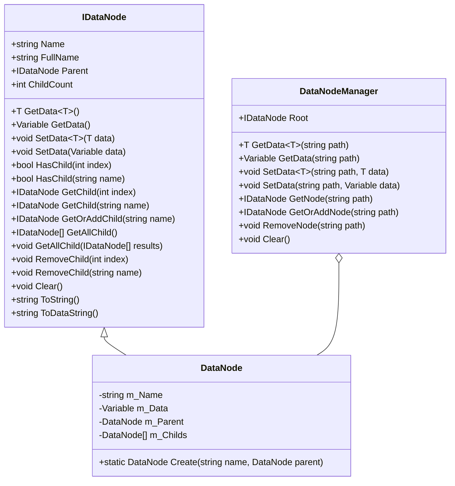
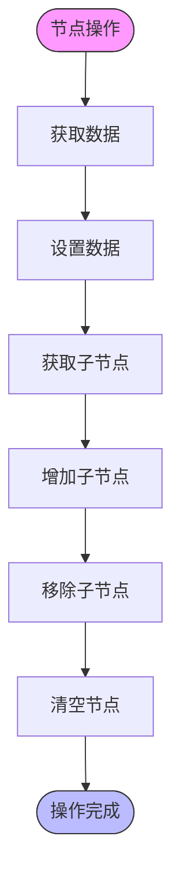
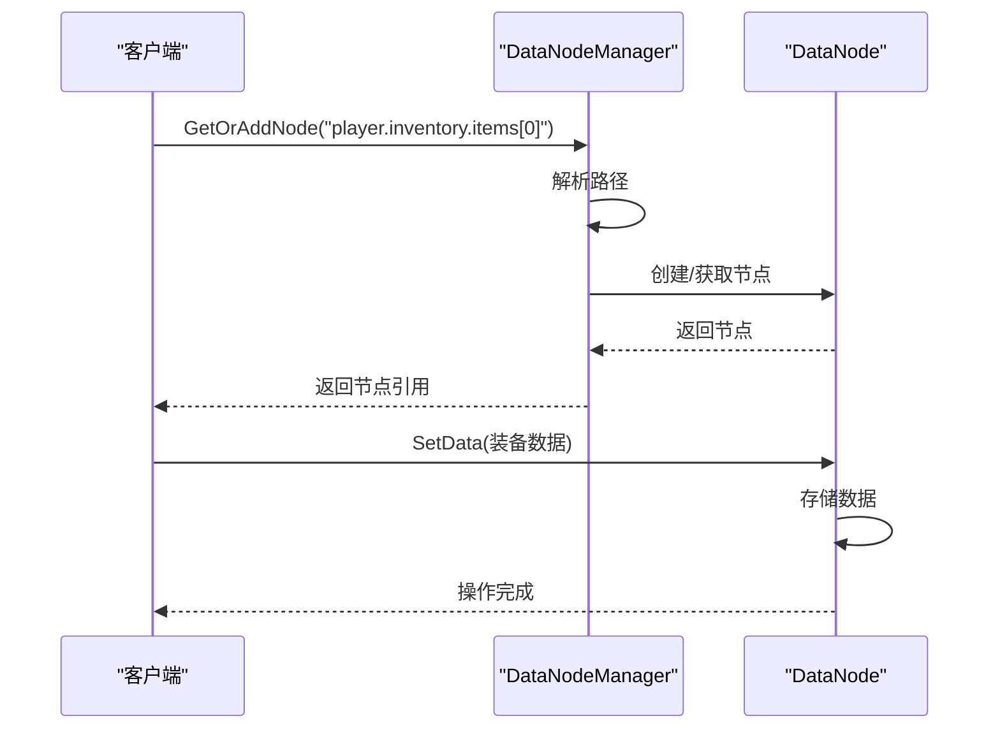
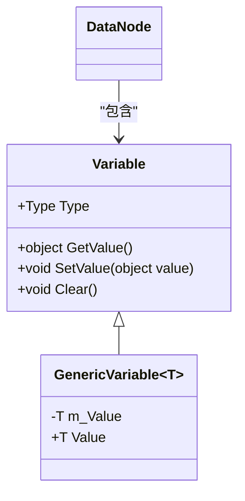
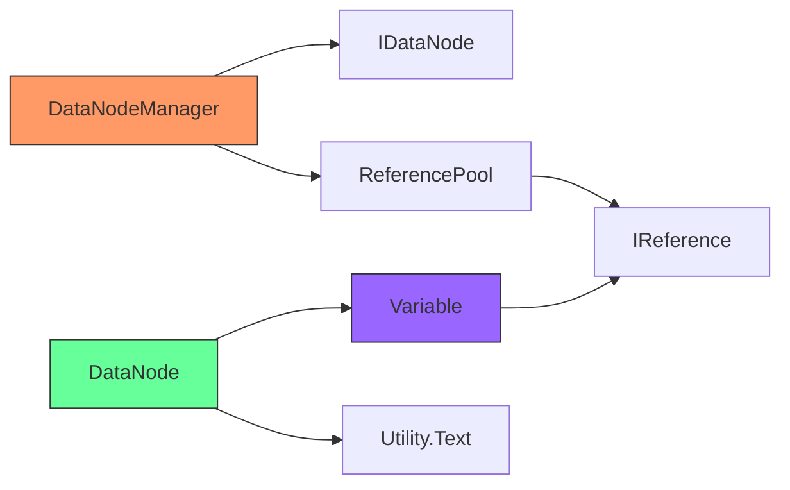

# 数据节点

<cite>
**本文档中引用的文件**   
- [IDataNode.cs](file://GameFramework/DataNode/IDataNode.cs)
- [DataNodeManager.cs](file://GameFramework/DataNode/DataNodeManager.cs)
- [DataNodeManager.DataNode.cs](file://GameFramework/DataNode/DataNodeManager.DataNode.cs)
- [Variable.cs](file://GameFramework/Base/Variable/Variable.cs)
- [ReferencePool.cs](file://GameFramework/Base/ReferencePool/ReferencePool.cs)
- [Utility.Text.cs](file://GameFramework/Utility/Utility.Text.cs)
</cite>

## 目录
1. [简介](#简介)
2. [项目结构](#项目结构)
3. [核心组件](#核心组件)
4. [架构概述](#架构概述)
5. [详细组件分析](#详细组件分析)
6. [依赖分析](#依赖分析)
7. [性能考虑](#性能考虑)
8. [故障排除指南](#故障排除指南)
9. [结论](#结论)

## 简介
数据节点系统是游戏框架中的核心数据管理模块，提供了一种树状结构来组织和管理复杂的游戏数据。该系统支持数据的增删改查、监听和事件通知，适用于背包、技能树等需要层次化数据结构的场景。通过 `IDataNode` 和 `DataNodeManager` 的设计，实现了高效的数据访问和变更通知机制。

## 项目结构
数据节点系统位于 `GameFramework/DataNode` 目录下，包含接口定义和具体实现。系统依赖于基础模块中的变量系统和引用池，形成了一个完整的数据管理解决方案。

**图示来源**
- [IDataNode.cs](file://GameFramework/DataNode/IDataNode.cs#L14-L149)
- [DataNodeManager.cs](file://GameFramework/DataNode/DataNodeManager.cs#L25-L280)
- [DataNodeManager.DataNode.cs](file://GameFramework/DataNode/DataNodeManager.DataNode.cs#L11-L381)

**章节来源**
- [IDataNode.cs](file://GameFramework/DataNode/IDataNode.cs#L14-L149)
- [DataNodeManager.cs](file://GameFramework/DataNode/DataNodeManager.cs#L25-L280)

## 核心组件
数据节点系统的核心由 `IDataNode` 接口和 `DataNodeManager` 类组成。`IDataNode` 定义了数据节点的基本操作，包括数据获取、设置、子节点管理等。`DataNodeManager` 作为单例管理器，提供了全局的数据节点访问入口。

**章节来源**
- [IDataNode.cs](file://GameFramework/DataNode/IDataNode.cs#L14-L149)
- [DataNodeManager.cs](file://GameFramework/DataNode/DataNodeManager.cs#L25-L280)

## 架构概述
数据节点系统采用树状结构组织数据，每个节点可以包含数据和子节点。系统通过路径查找机制支持快速定位节点，使用引用池优化内存分配，确保高性能的数据操作。

**图示来源**
- [IDataNode.cs](file://GameFramework/DataNode/IDataNode.cs#L14-L149)
- [DataNodeManager.cs](file://GameFramework/DataNode/DataNodeManager.cs#L25-L280)
- [DataNodeManager.DataNode.cs](file://GameFramework/DataNode/DataNodeManager.DataNode.cs#L11-L381)

## 详细组件分析

### IDataNode 接口分析
`IDataNode` 接口定义了数据节点的标准操作集，包括节点信息获取、数据操作和子节点管理。接口设计遵循单一职责原则，每个方法都有明确的用途。

**图示来源**
- [IDataNode.cs](file://GameFramework/DataNode/IDataNode.cs#L14-L149)

**章节来源**
- [IDataNode.cs](file://GameFramework/DataNode/IDataNode.cs#L14-L149)

### DataNodeManager 分析
`DataNodeManager` 是数据节点系统的管理中枢，负责维护整个节点树的根节点，并提供全局的节点访问接口。管理器通过路径解析支持层级查找，简化了复杂数据结构的访问。

**图示来源**
- [DataNodeManager.cs](file://GameFramework/DataNode/DataNodeManager.cs#L25-L280)
- [DataNodeManager.DataNode.cs](file://GameFramework/DataNode/DataNodeManager.DataNode.cs#L11-L381)

**章节来源**
- [DataNodeManager.cs](file://GameFramework/DataNode/DataNodeManager.cs#L25-L280)

### 数据绑定与变更回调
系统通过变量系统实现数据绑定，当节点数据发生变化时，可以触发相应的回调函数。这种机制支持实时更新UI和其他依赖组件。

**图示来源**
- [Variable.cs](file://GameFramework/Base/Variable/Variable.cs#L15-L87)
- [DataNodeManager.DataNode.cs](file://GameFramework/DataNode/DataNodeManager.DataNode.cs#L110-L113)

**章节来源**
- [Variable.cs](file://GameFramework/Base/Variable/Variable.cs#L15-L87)

## 依赖分析
数据节点系统依赖于框架的基础模块，形成了一个完整的依赖链。系统通过引用池管理节点对象的生命周期，避免频繁的内存分配和垃圾回收。

**图示来源**
- [DataNodeManager.cs](file://GameFramework/DataNode/DataNodeManager.cs#L25-L280)
- [ReferencePool.cs](file://GameFramework/Base/ReferencePool/ReferencePool.cs#L12-L200)
- [Utility.Text.cs](file://GameFramework/Utility/Utility.Text.cs#L1-L621)

**章节来源**
- [ReferencePool.cs](file://GameFramework/Base/ReferencePool/ReferencePool.cs#L12-L200)

## 性能考虑
数据节点系统在设计时充分考虑了性能优化。通过引用池减少对象创建开销，使用高效的路径解析算法，确保在大型数据结构下的操作性能。

- **内存优化**：使用引用池复用节点对象
- **查找效率**：O(n) 时间复杂度的路径查找
- **数据访问**：直接引用避免重复查找
- **内存管理**：自动清理机制防止内存泄漏

## 故障排除指南
当遇到数据节点系统相关问题时，可以参考以下常见问题的解决方案：

1. **节点查找失败**：检查路径格式是否正确，支持 "."、"/"、"\\" 作为分隔符
2. **数据类型错误**：确保使用正确的泛型类型进行数据操作
3. **内存泄漏**：确认节点树在不再需要时被正确清理
4. **性能问题**：避免在每帧中创建大量临时节点

**章节来源**
- [DataNodeManager.cs](file://GameFramework/DataNode/DataNodeManager.cs#L41-L78)
- [DataNodeManager.DataNode.cs](file://GameFramework/DataNode/DataNodeManager.DataNode.cs#L77-L83)

## 结论
数据节点系统提供了一套完整的树状数据管理解决方案，适用于各种需要层次化数据结构的游戏场景。通过合理的接口设计和性能优化，系统既保证了易用性又确保了运行效率。开发者可以基于此系统构建复杂的背包、技能树等游戏功能。