# 数据表

<cite>
**本文档引用的文件**
- [IDataTable.cs](file://GameFramework/DataTable/IDataTable.cs)
- [DataTableBase.cs](file://GameFramework/DataTable/DataTableBase.cs)
- [DataTableManager.cs](file://GameFramework/DataTable/DataTableManager.cs)
- [IDataRow.cs](file://GameFramework/DataTable/IDataRow.cs)
- [DataProvider.cs](file://GameFramework/Base/DataProvider/DataProvider.cs)
- [TypeNamePair.cs](file://GameFramework/Base/DataStruct/TypeNamePair.cs)
- [IResourceManager.cs](file://GameFramework/Resource/IResourceManager.cs)
- [LoadAssetCallbacks.cs](file://GameFramework/Resource/LoadAssetCallbacks.cs)
- [LoadBinaryCallbacks.cs](file://GameFramework/Resource/LoadBinaryCallbacks.cs)
</cite>

## 目录
1. [简介](#简介)
2. [核心组件设计](#核心组件设计)
3. [数据表定义与加载流程](#数据表定义与加载流程)
4. [数据表解析机制](#数据表解析机制)
5. [内存存储结构与高效查询](#内存存储结构与高效查询)
6. [数据表管理器设计](#数据表管理器设计)
7. [自定义数据表实现](#自定义数据表实现)
8. [热重载支持](#热重载支持)
9. [配置系统集成](#配置系统集成)
10. [典型应用场景](#典型应用场景)

## 简介
数据表模块是游戏框架中的核心配置管理系统，负责游戏配置数据的定义、加载、解析、查询和缓存。该模块通过IDataTable、DataTableBase和DataTableManager三个核心组件构建了一个完整的数据表管理体系，支持从字符串或二进制流中解析数据，提供高效的内存存储和查询功能，并与资源管理系统深度集成，实现配置数据的热重载和动态更新。

## 核心组件设计

### IDataTable接口设计
IDataTable接口定义了数据表的核心功能，包括数据表的基本信息获取、数据行访问、条件查询和数据操作。该接口通过泛型约束确保类型安全，同时继承IEnumerable<T>接口支持LINQ查询。

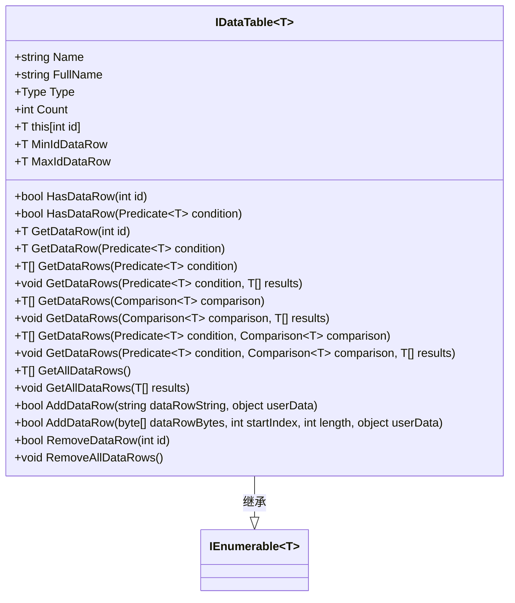

**图源**
- [IDataTable.cs](file://GameFramework/DataTable/IDataTable.cs#L16-L190)

### DataTableBase基类设计
DataTableBase作为数据表的抽象基类，实现了IDataProvider<DataTableBase>接口，封装了数据加载和解析的通用逻辑。它通过组合模式使用DataProvider<DataTableBase>来处理底层资源加载，实现了数据加载与业务逻辑的分离。

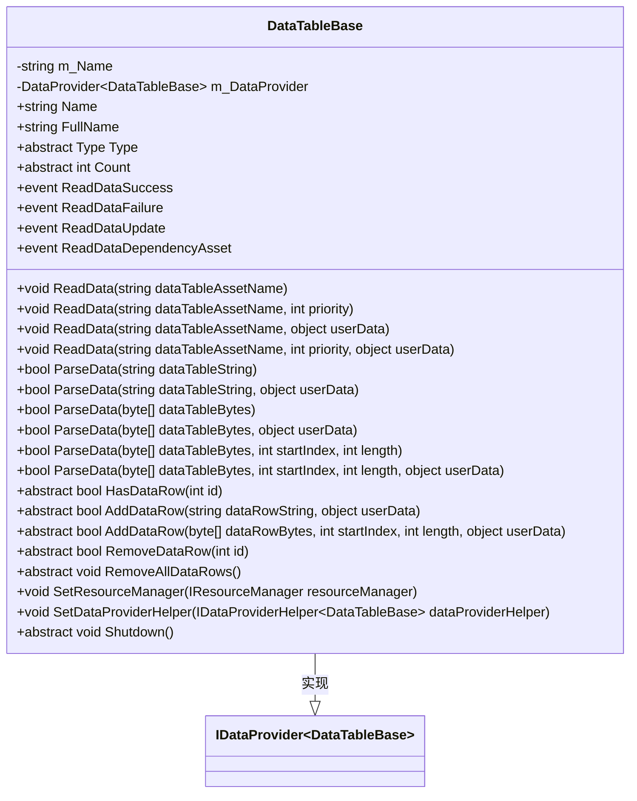

**图源**
- [DataTableBase.cs](file://GameFramework/DataTable/DataTableBase.cs#L15-L302)

### IDataRow接口设计
IDataRow接口定义了数据表行的基本结构和解析方法，要求实现类必须提供ID属性和两种解析方法（字符串和二进制流），确保数据表行能够从不同格式的数据源中正确解析。

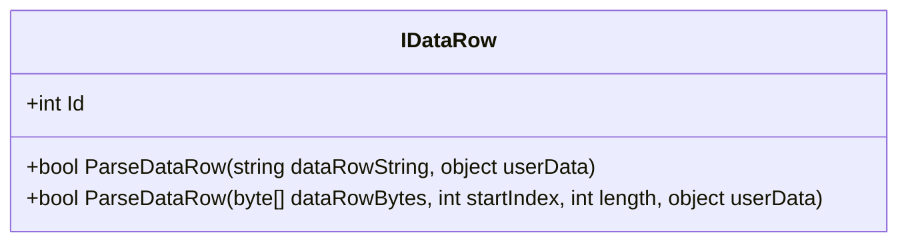

**图源**
- [IDataRow.cs](file://GameFramework/DataTable/IDataRow.cs#L12-L39)

## 数据表定义与加载流程

### 数据表加载流程
数据表的加载流程通过DataTableBase的ReadData方法启动，该方法委托给内部的DataProvider<DataTableBase>实例处理。DataProvider根据资源位置（磁盘或文件系统）选择不同的加载策略，最终通过事件通知机制返回加载结果。

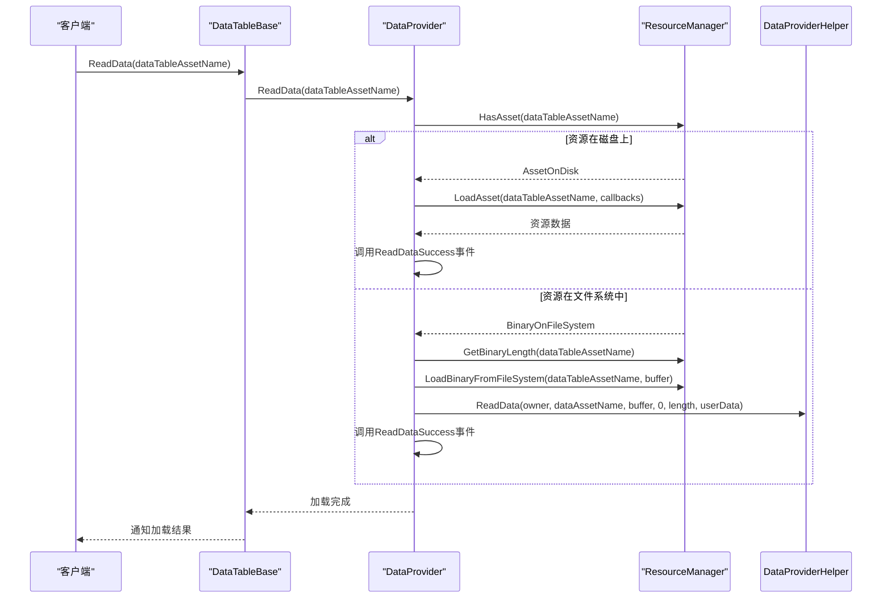

**图源**
- [DataTableBase.cs](file://GameFramework/DataTable/DataTableBase.cs#L108-L148)
- [DataProvider.cs](file://GameFramework/Base/DataProvider/DataProvider.cs#L16-L498)
- [IResourceManager.cs](file://GameFramework/Resource/IResourceManager.cs#L18-L830)

### 数据表创建流程
数据表的创建由DataTableManager统一管理，通过泛型工厂方法创建特定类型的数据表实例。创建过程中会进行类型验证，确保数据表行类型实现IDataRow接口，并使用TypeNamePair作为唯一标识符。

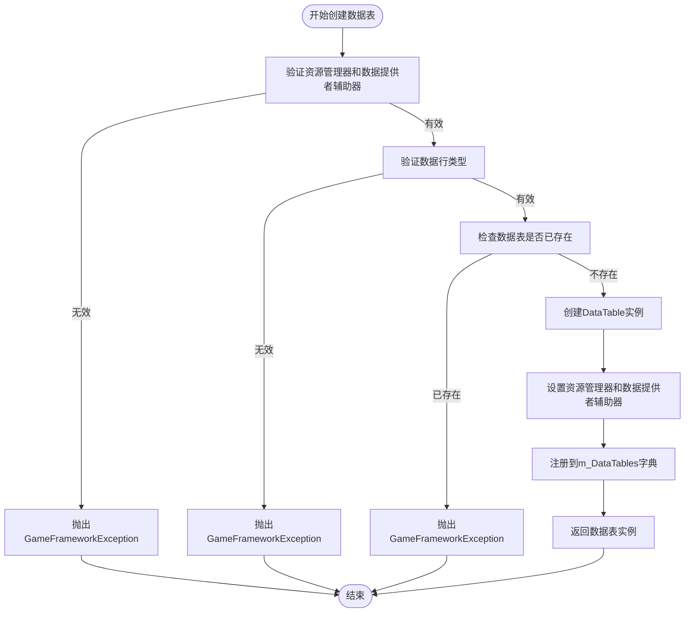

**图源**
- [DataTableManager.cs](file://GameFramework/DataTable/DataTableManager.cs#L352-L386)

## 数据表解析机制

### 数据解析流程
数据表的解析通过ParseData方法实现，该方法将解析任务委托给DataProvider<DataTableBase>，最终由IDataProviderHelper<T>的实现类完成具体的解析工作。解析过程支持字符串和二进制流两种格式。

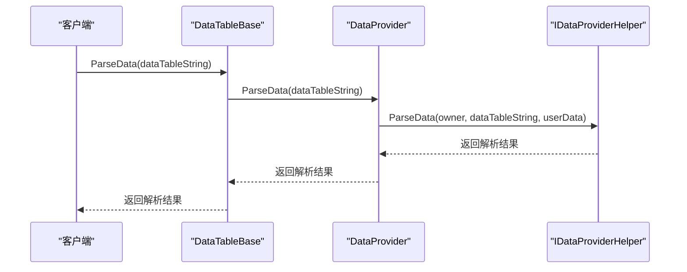

**图源**
- [DataTableBase.cs](file://GameFramework/DataTable/DataTableBase.cs#L176-L256)
- [DataProvider.cs](file://GameFramework/Base/DataProvider/DataProvider.cs#L345-L438)

### 数据行解析机制
数据行的解析由IDataRow接口的ParseDataRow方法定义，具体实现由数据表行类完成。解析过程通常包括字符串分割、类型转换和字段赋值等步骤，确保数据能够正确映射到对象属性。

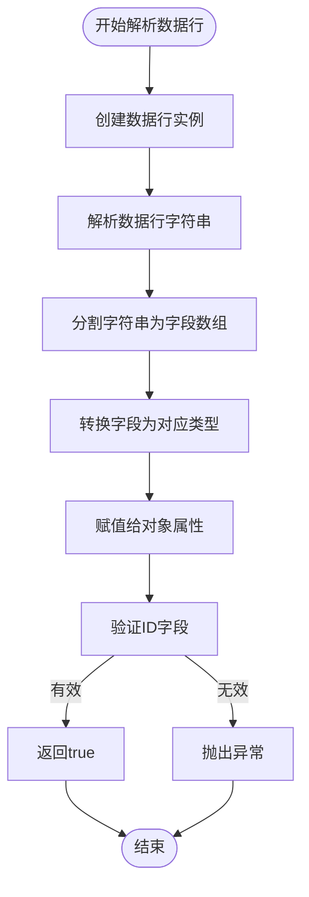

## 内存存储结构与高效查询

### 内存存储结构
数据表使用Dictionary<int, T>作为内部存储结构，以数据行ID为键，数据行实例为值，实现O(1)时间复杂度的随机访问。同时维护最小ID和最大ID的数据行引用，优化范围查询性能。

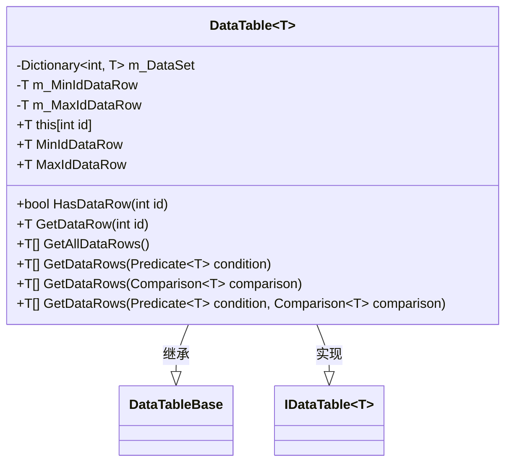

**图源**
- [DataTableManager.cs](file://GameFramework/DataTable/DataTableManager.cs#L13-L522)

### 高效查询方法
数据表提供了多种查询方法，包括基于ID的直接访问、基于条件的筛选查询和基于比较器的排序查询。查询结果可以返回数组或通过List<T>参数直接填充，避免不必要的内存分配。

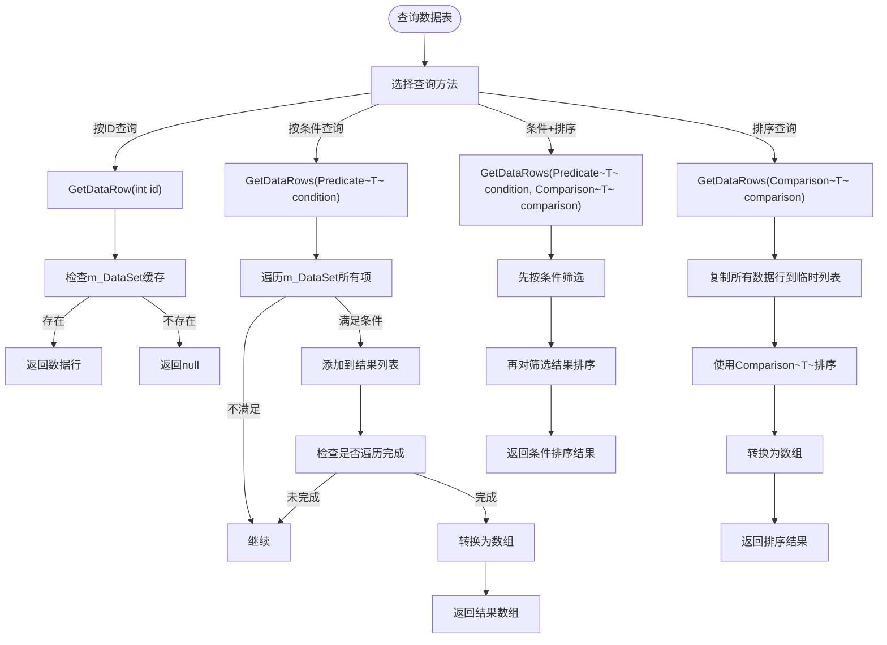

## 数据表管理器设计

### DataTableManager架构
DataTableManager作为数据表的中央管理器，负责所有数据表的生命周期管理。它使用Dictionary<TypeNamePair, DataTableBase>存储所有已创建的数据表，并提供创建、获取、销毁等管理功能。

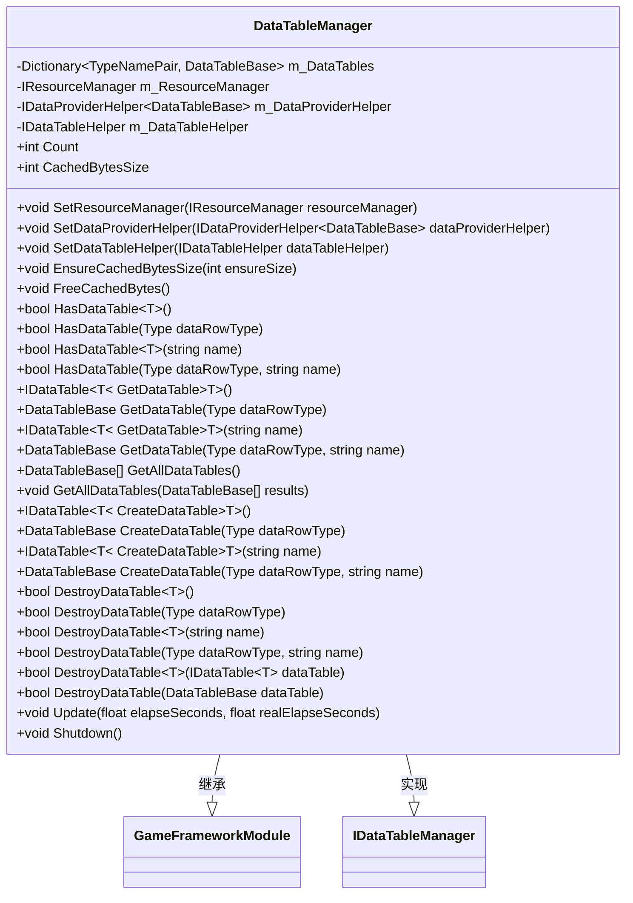

**图源**
- [DataTableManager.cs](file://GameFramework/DataTable/DataTableManager.cs#L26-L508)

### 数据表生命周期管理
数据表的生命周期由DataTableManager统一管理，包括创建、使用和销毁三个阶段。创建时进行类型验证和重复检查，销毁时调用Shutdown方法清理资源。

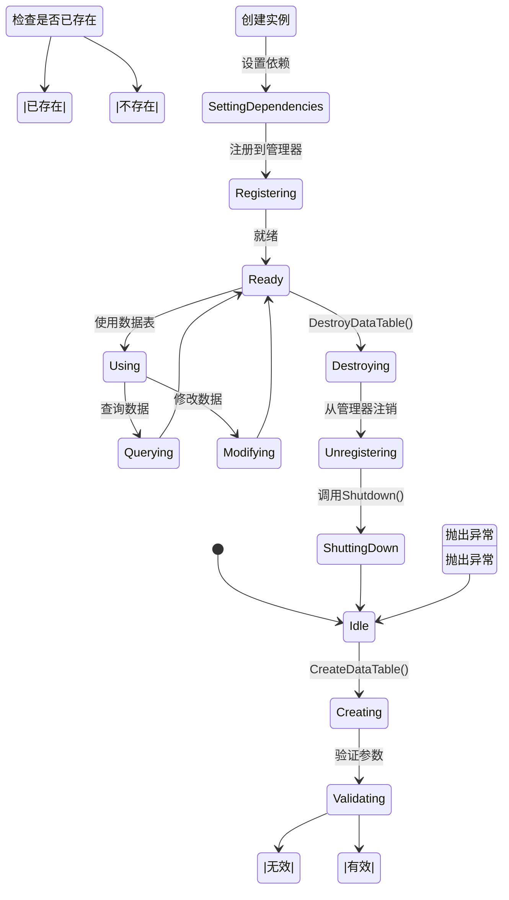

## 自定义数据表实现

### 自定义数据表行
要创建自定义数据表，首先需要定义数据表行类，该类必须实现IDataRow接口并提供无参数构造函数。数据行类通常包含与配置文件字段对应的属性。

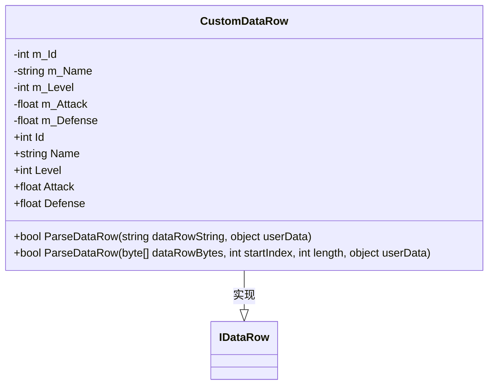

### 自定义数据表创建
通过DataTableManager的泛型CreateDataTable方法创建自定义数据表实例，系统会自动创建DataTable<T>的泛型实例并完成初始化。

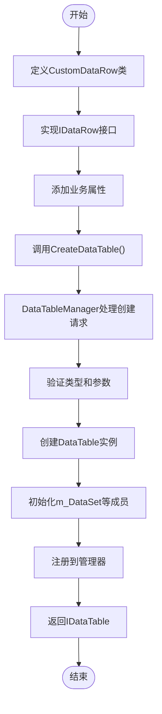

## 热重载支持

### 热重载机制
数据表模块通过与资源管理系统的集成支持热重载功能。当配置文件发生变化时，资源系统会重新加载资源，触发数据表的重新解析，实现配置的实时更新。

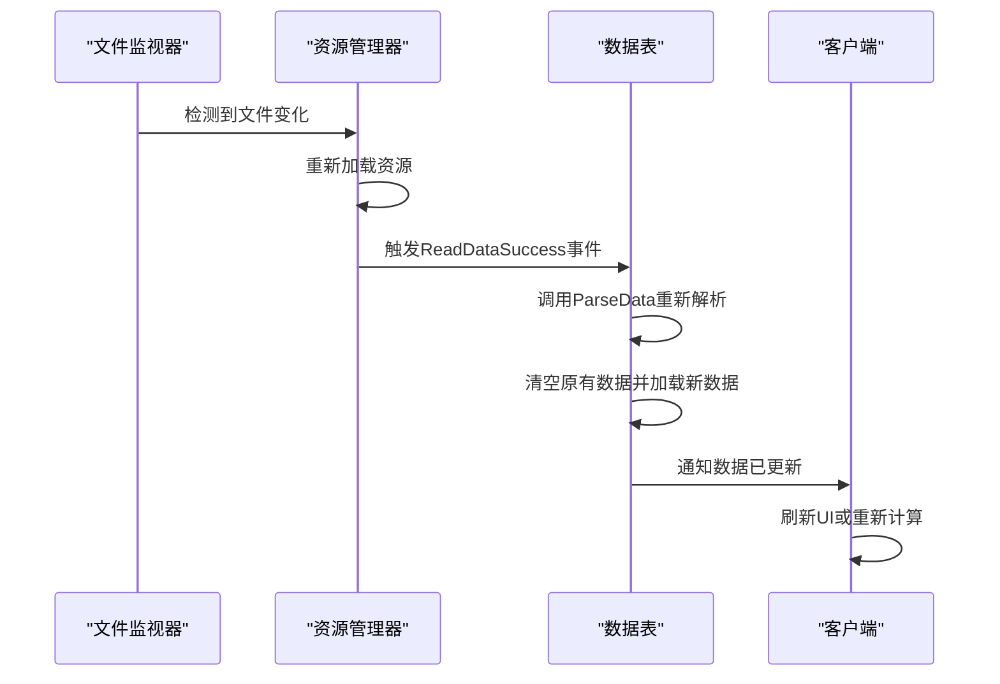

## 配置系统集成

### 与资源