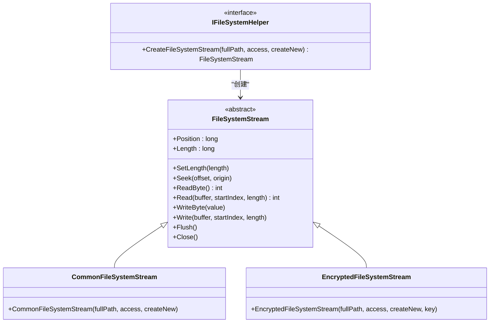
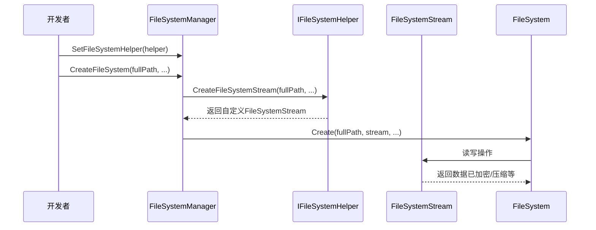

# 扩展与辅助功能

<cite>
**本文档引用的文件**
- [IFileSystemHelper.cs](file://GameFramework/FileSystem/IFileSystemHelper.cs)
- [FileSystemManager.cs](file://GameFramework/FileSystem/FileSystemManager.cs)
- [FileSystem.cs](file://GameFramework/FileSystem/FileSystem.cs)
- [CommonFileSystemStream.cs](file://GameFramework/FileSystem/CommonFileSystemStream.cs)
- [IFileSystemManager.cs](file://GameFramework/FileSystem/IFileSystemManager.cs)
- [FileSystemStream.cs](file://GameFramework/FileSystem/FileSystemStream.cs)
</cite>

## 目录
1. [接口设计目的](#接口设计目的)
2. [扩展机制与自定义实现](#扩展机制与自定义实现)
3. [注入与使用流程](#注入与使用流程)
4. [高级应用场景](#高级应用场景)
5. [线程安全与异常处理](#线程安全与异常处理)

## 接口设计目的

`IFileSystemHelper` 接口的设计目的是为文件系统底层行为提供可扩展的抽象层，使开发者能够自定义文件系统的创建方式和底层流操作。该接口通过定义 `CreateFileSystemStream` 方法，允许开发者控制文件系统流的创建过程，从而在文件读写过程中插入自定义逻辑，如加密解密、压缩解压、日志记录、网络传输等。

此设计遵循依赖倒置原则，将文件系统流的创建职责从核心逻辑中解耦，使得文件系统管理器（`FileSystemManager`）无需关心具体流的实现方式，只需依赖 `IFileSystemHelper` 接口即可完成文件系统的加载与创建。这种设计提高了系统的灵活性和可维护性，支持在不修改核心代码的前提下扩展文件系统功能。

**Section sources**
- [IFileSystemHelper.cs](file://GameFramework/FileSystem/IFileSystemHelper.cs#L12-L22)
- [FileSystemManager.cs](file://GameFramework/FileSystem/FileSystemManager.cs#L112-L126)

## 扩展机制与自定义实现

`IFileSystemHelper` 接口的核心方法 `CreateFileSystemStream` 接收文件路径、访问模式和是否创建新流的参数，返回一个 `FileSystemStream` 抽象类的实例。开发者可通过实现此接口，返回自定义的 `FileSystemStream` 派生类，从而控制文件的底层读写行为。

例如，可实现一个加密文件系统助手，在 `CreateFileSystemStream` 中返回一个包装了加密/解密逻辑的流实现。当文件被读取时，数据自动解密；当文件被写入时，数据自动加密。类似地，可实现压缩流、缓存流、网络流等，以满足不同场景需求。

`FileSystemStream` 本身是一个抽象类，定义了位置、长度、读写、定位、刷新和关闭等基本操作，为各种自定义流实现提供了统一的接口契约。

**Diagram sources**
- [IFileSystemHelper.cs](file://GameFramework/FileSystem/IFileSystemHelper.cs#L12-L22)
- [FileSystemStream.cs](file://GameFramework/FileSystem/FileSystemStream.cs#L15-L133)
- [CommonFileSystemStream.cs](file://GameFramework/FileSystem/CommonFileSystemStream.cs#L15-L160)

**Section sources**
- [FileSystemStream.cs](file://GameFramework/FileSystem/FileSystemStream.cs#L15-L133)
- [CommonFileSystemStream.cs](file://GameFramework/FileSystem/CommonFileSystemStream.cs#L15-L160)

## 注入与使用流程

自定义的 `IFileSystemHelper` 实现需通过 `FileSystemManager` 的 `SetFileSystemHelper` 方法注入到系统中。一旦设置，所有后续的文件系统创建或加载操作都将使用该助手来创建底层流。

流程如下：
1. 开发者创建 `IFileSystemHelper` 的实现类（如 `EncryptedFileSystemHelper`）。
2. 在游戏初始化阶段，调用 `FileSystemManager.SetFileSystemHelper()` 注入该实例。
3. 当调用 `CreateFileSystem` 或 `LoadFileSystem` 时，`FileSystemManager` 会通过已设置的 `IFileSystemHelper` 创建 `FileSystemStream`。
4. 核心文件系统逻辑（`FileSystem` 类）使用该流进行读写操作，透明地应用自定义行为。

此机制确保了扩展功能的全局生效，同时保持了调用代码的简洁性。

**Diagram sources**
- [FileSystemManager.cs](file://GameFramework/FileSystem/FileSystemManager.cs#L82-L90)
- [FileSystemManager.cs](file://GameFramework/FileSystem/FileSystemManager.cs#L136-L178)
- [FileSystem.cs](file://GameFramework/FileSystem/FileSystem.cs#L138-L171)

**Section sources**
- [FileSystemManager.cs](file://GameFramework/FileSystem/FileSystemManager.cs#L82-L224)

## 高级应用场景

### 热更新
通过自定义 `IFileSystemHelper`，可实现从远程服务器加载文件系统流，支持动态更新资源包。例如，实现一个 `WebFileSystemHelper`，其 `CreateFileSystemStream` 返回一个基于 HTTP 下载的流，使得游戏资源可从 CDN 加载，实现无缝热更新。

### 安全加固
实现加密文件系统，所有资源文件在打包时加密，运行时通过 `EncryptedFileSystemHelper` 自动解密。密钥可动态生成或从服务器获取，有效防止资源被轻易提取。

### 性能监控
实现一个 `LoggingFileSystemHelper`，在流操作前后记录时间戳和文件信息，用于分析文件读写性能瓶颈。也可实现缓存机制，减少重复读取的开销。

### 跨平台兼容
针对不同平台（如移动设备、PC）实现不同的流处理逻辑，例如在移动设备上启用压缩以节省带宽，在PC上使用本地高速缓存。

## 线程安全与异常处理

### 线程安全
`IFileSystemHelper` 的 `CreateFileSystemStream` 方法可能在多线程环境中被调用（如资源异步加载）。因此，其实现必须保证线程安全，避免共享状态的竞态条件。建议将助手实现为无状态或使用锁保护共享资源。

`FileSystemStream` 的读写操作通常由单一线程执行，但若在多线程环境下使用，需确保其内部状态（如 `Position`）的线程安全。`CommonFileSystemStream` 基于 `FileStream`，其线程安全取决于底层 .NET 实现，通常不保证多线程并发访问。

### 异常传播
`IFileSystemHelper` 的实现应在创建流失败时返回 `null`，而非抛出异常，因为 `FileSystemManager` 会检查返回值并抛出带有上下文信息的 `GameFrameworkException`。这有助于统一错误处理和日志记录。

在 `FileSystemStream` 的读写方法中，若发生底层 I/O 错误，应让异常自然抛出，由上层调用者（如 `ResourceManager`）捕获并处理。核心文件系统逻辑（`FileSystem` 类）会将这些异常包装为 `GameFrameworkException`，确保错误信息的一致性。

**Section sources**
- [FileSystemManager.cs](file://GameFramework/FileSystem/FileSystemManager.cs#L136-L178)
- [FileSystemManager.cs](file://GameFramework/FileSystem/FileSystemManager.cs#L186-L224)
- [IFileSystemHelper.cs](file://GameFramework/FileSystem/IFileSystemHelper.cs#L21-L21)