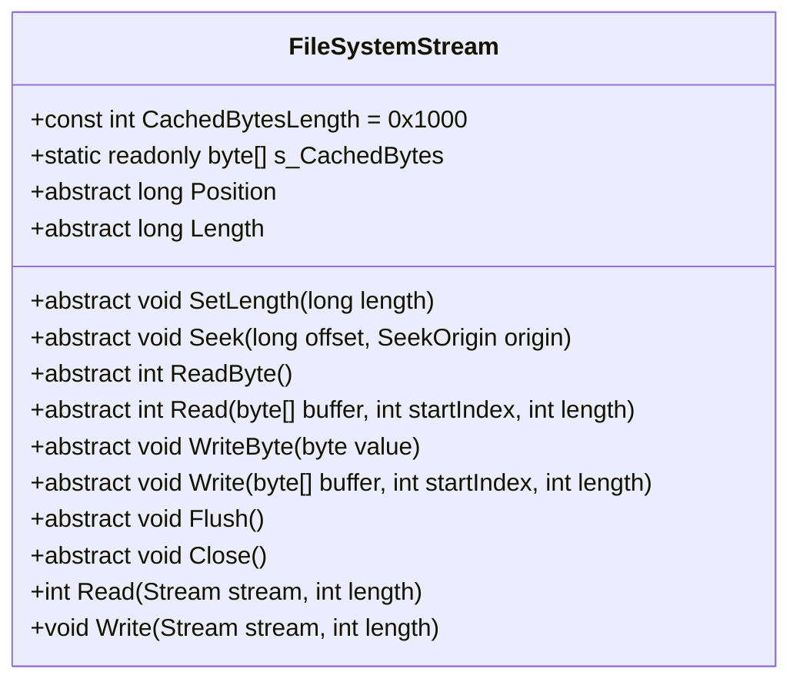
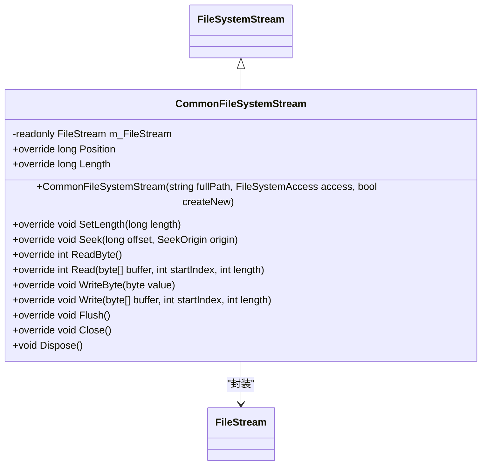
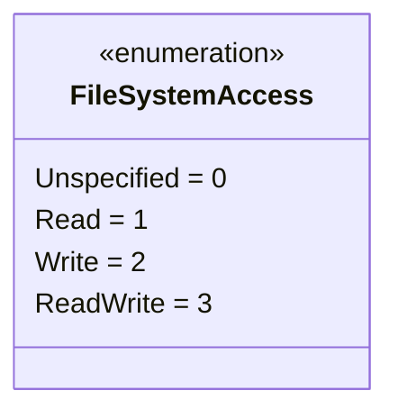
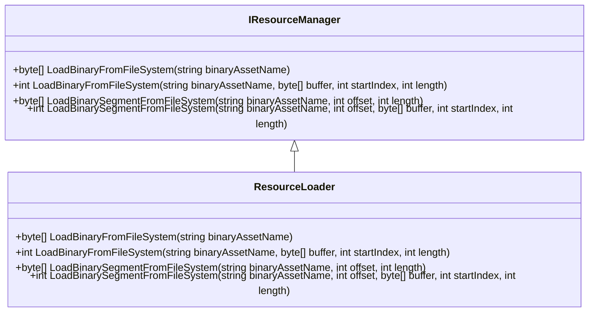
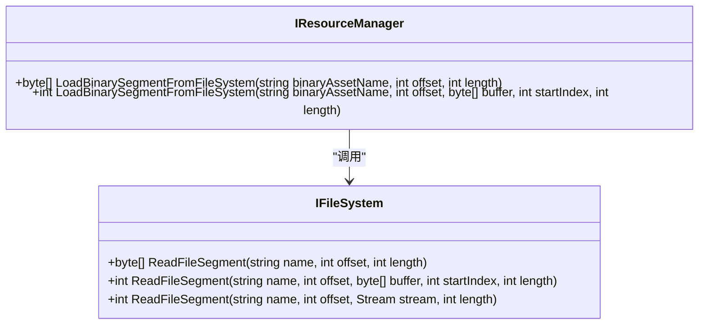

# 文件流与读写操作

<cite>
**Referenced Files in This Document**   
- [FileSystemStream.cs](file://GameFramework/FileSystem/FileSystemStream.cs)
- [CommonFileSystemStream.cs](file://GameFramework/FileSystem/CommonFileSystemStream.cs)
- [FileSystemAccess.cs](file://GameFramework/FileSystem/FileSystemAccess.cs)
- [IFileSystem.cs](file://GameFramework/FileSystem/IFileSystem.cs)
- [IResourceManager.cs](file://GameFramework/Resource/IResourceManager.cs)
- [ResourceManager.ResourceLoader.cs](file://GameFramework/Resource/ResourceManager.ResourceLoader.cs)
</cite>

## 目录
1. [引言](#引言)
2. [核心抽象流设计](#核心抽象流设计)
3. [通用文件流实现](#通用文件流实现)
4. [文件系统访问权限控制](#文件系统访问权限控制)
5. [资源加载场景集成](#资源加载场景集成)
6. [大文件分片读取与优化](#大文件分片读取与优化)
7. [异常处理与最佳实践](#异常处理与最佳实践)

## 引言

本文档全面介绍Unity游戏框架中文件流系统的核心实现机制，重点阐述`FileSystemStream`抽象流及其派生类`CommonFileSystemStream`的设计与应用。通过分析流接口的同步/异步读取操作、Seek、Read、Length等标准功能的实现，揭示其在资源加载场景中的透明数据读取能力。同时，深入解析`FileSystemAccess`枚举在权限控制中的作用，以及如何支持从打包文件或原生文件系统中高效读取数据。最后，提供大文件分片读取、内存映射优化及异常处理的最佳实践指导。

## 核心抽象流设计

`FileSystemStream`是整个文件流系统的核心抽象基类，定义了所有文件流操作的标准接口。它通过`protected internal abstract`关键字定义了一系列必须由派生类实现的成员，确保了接口的一致性和强制性。

**Diagram sources**
- [FileSystemStream.cs](file://GameFramework/FileSystem/FileSystemStream.cs#L15-L133)

**Section sources**
- [FileSystemStream.cs](file://GameFramework/FileSystem/FileSystemStream.cs#L15-L133)

该类提供了两个重要的便利方法：`Read(Stream, int)`和`Write(Stream, int)`。这两个方法利用内部的静态缓存数组`s_CachedBytes`（长度为4096字节）作为缓冲区，实现了流与流之间的高效数据传输。例如，`Read`方法通过循环调用抽象的`Read(byte[], int, int)`方法，将数据从文件流读取到缓存，再写入目标流，直到完成指定长度的数据传输。

## 通用文件流实现

`CommonFileSystemStream`是`FileSystemStream`的具体实现，它封装了.NET原生的`FileStream`，提供了与物理文件系统的直接交互能力。

**Diagram sources**
- [CommonFileSystemStream.cs](file://GameFramework/FileSystem/CommonFileSystemStream.cs#L15-L160)
- [FileSystemStream.cs](file://GameFramework/FileSystem/FileSystemStream.cs#L15-L133)

**Section sources**
- [CommonFileSystemStream.cs](file://GameFramework/FileSystem/CommonFileSystemStream.cs#L15-L160)

其构造函数根据传入的`FileSystemAccess`枚举值，配置不同的`FileStream`打开模式和访问权限。例如，当访问模式为`Read`时，文件以只读方式打开；当为`Write`或`ReadWrite`时，根据`createNew`参数决定是创建新文件还是打开现有文件。所有抽象方法的实现都直接委托给内部的`m_FileStream`实例，确保了标准流操作的正确执行。

## 文件系统访问权限控制

`FileSystemAccess`枚举是权限控制的核心，它使用`[Flags]`特性定义了三种访问模式：`Read`（只读）、`Write`（只写）和`ReadWrite`（可读写）。

**Diagram sources**
- [FileSystemAccess.cs](file://GameFramework/FileSystem/FileSystemAccess.cs#L14-L36)

**Section sources**
- [FileSystemAccess.cs](file://GameFramework/FileSystem/FileSystemAccess.cs#L14-L36)

该枚举被广泛应用于文件系统和流的创建过程中，作为参数传递以指定所需的访问权限。例如，在`CommonFileSystemStream`的构造函数中，`switch`语句根据`access`参数的值来决定`FileStream`的`FileAccess`和`FileMode`。这种设计确保了在运行时就能进行严格的权限检查，防止了越权操作的发生。

## 资源加载场景集成

文件流系统与资源管理器紧密集成，实现了从打包文件或原生文件系统中透明读取数据的能力。`IResourceManager`接口提供了`LoadBinaryFromFileSystem`系列方法，专门用于从文件系统中加载二进制资源。

**Diagram sources**
- [IResourceManager.cs](file://GameFramework/Resource/IResourceManager.cs#L682-L783)
- [ResourceManager.ResourceLoader.cs](file://GameFramework/Resource/ResourceManager.ResourceLoader.cs#L653-L675)

**Section sources**
- [IResourceManager.cs](file://GameFramework/Resource/IResourceManager.cs#L682-L783)
- [ResourceManager.ResourceLoader.cs](file://GameFramework/Resource/ResourceManager.ResourceLoader.cs#L653-L675)

`ResourceLoader`类的`LoadBinaryFromFileSystem`方法是这一集成的关键。它首先通过`GetResourceInfo`获取资源信息，验证资源存在且已准备就绪，然后通过`GetFileSystem`获取对应的`IFileSystem`实例，最终调用`IFileSystem.ReadFile`方法完成数据读取。如果资源需要解密，还会调用用户提供的`DecryptResourceCallback`进行处理。

## 大文件分片读取与优化

为了高效处理大文件，系统提供了分片读取（Segment）的机制。`IFileSystem`接口定义了`ReadFileSegment`系列方法，允许按指定偏移和长度读取文件的特定片段。

**Diagram sources**
- [IFileSystem.cs](file://GameFramework/FileSystem/IFileSystem.cs#L132-L189)
- [IResourceManager.cs](file://GameFramework/Resource/IResourceManager.cs#L726-L783)

**Section sources**
- [IFileSystem.cs](file://GameFramework/FileSystem/IFileSystem.cs#L132-L189)
- [IResourceManager.cs](file://GameFramework/Resource/IResourceManager.cs#L726-L783)

这种设计避免了将整个大文件一次性加载到内存中，极大地优化了内存使用。例如，`LoadBinarySegmentFromFileSystem`方法可以用于实现视频或音频资源的流式加载，或者在游戏存档系统中只读取特定的存档数据块。结合`Stream`参数的重载方法，还可以实现数据的直接管道传输，进一步减少内存拷贝。

## 异常处理与最佳实践

### 异常处理

系统在多个层面实现了健壮的异常处理机制：
1.  **参数验证**：在`CommonFileSystemStream`的构造函数中，检查`fullPath`是否为空或无效。
2.  **状态检查**：在`ResourceLoader`中，`LoadBinaryFromFileSystem`会检查资源是否存在、是否已准备就绪、是否为二进制资源等。
3.  **权限检查**：`FileSystemAccess`的`switch`语句包含`default`分支，对无效的访问模式抛出异常。
4.  **资源存在性检查**：`IFileSystem`的读取方法在文件不存在时会返回`null`或抛出异常。

### 最佳实践

1.  **使用`using`语句**：`CommonFileSystemStream`实现了`IDisposable`接口，应始终在`using`语句块中使用，确保流被正确关闭和释放。
2.  **选择合适的读取方法**：对于小文件，使用`LoadBinaryFromFileSystem(string)`直接获取字节数组；对于大文件或需要流式处理的场景，使用`LoadBinaryFromFileSystem(string, byte[], int, int)`或`ReadFileSegment`系列方法。
3.  **利用分片读取**：对于超大资源，优先考虑分片读取，避免内存溢出。
4.  **处理解密回调**：如果资源是加密的，务必通过`SetDecryptResourceCallback`提供正确的解密逻辑。
5.  **权限最小化**：创建文件流时，根据实际需求选择最严格的访问权限（`Read`、`Write`或`ReadWrite`），遵循最小权限原则。

通过遵循这些最佳实践，开发者可以安全、高效地利用该文件流系统进行各种文件读写和资源加载操作。