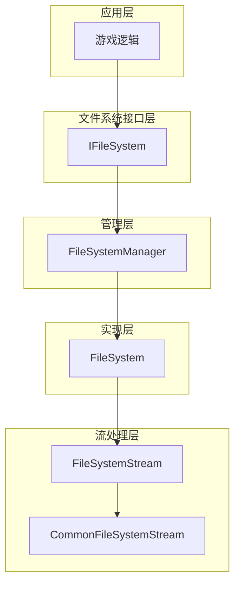
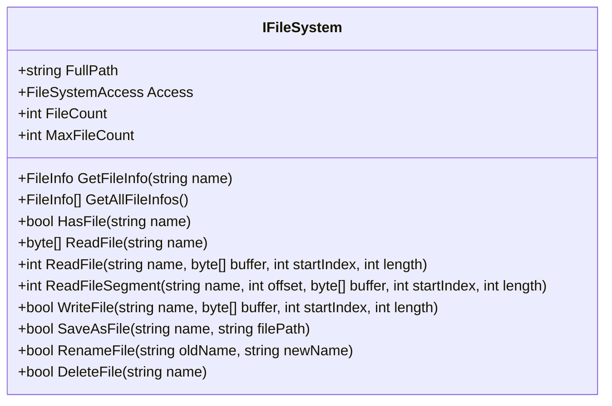
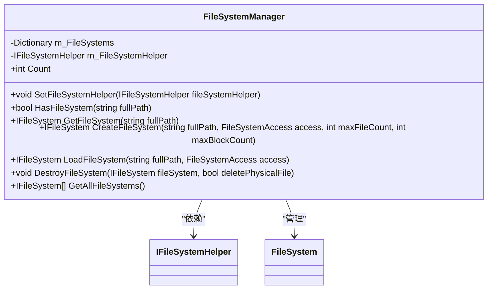
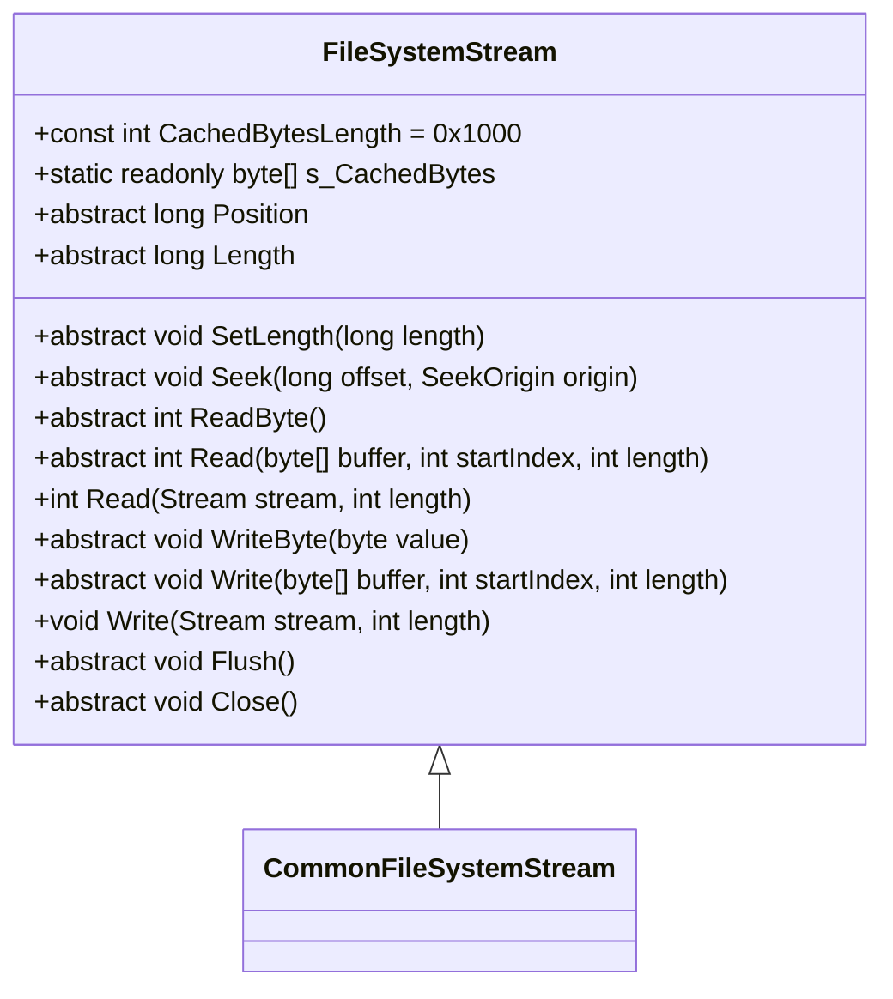
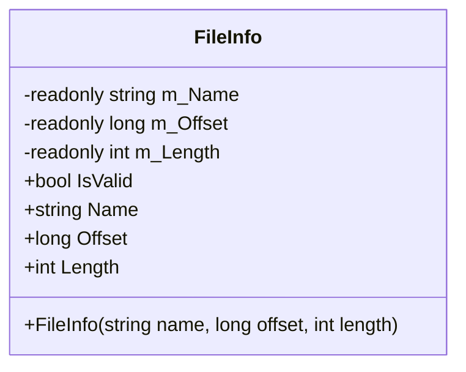

# 文件系统

<cite>
**Referenced Files in This Document**  
- [IFileSystem.cs](file://GameFramework/FileSystem/IFileSystem.cs)
- [FileSystemManager.cs](file://GameFramework/FileSystem/FileSystemManager.cs)
- [FileSystemStream.cs](file://GameFramework/FileSystem/FileSystemStream.cs)
- [FileSystem.cs](file://GameFramework/FileSystem/FileSystem.cs)
- [CommonFileSystemStream.cs](file://GameFramework/FileSystem/CommonFileSystemStream.cs)
- [FileInfo.cs](file://GameFramework/FileSystem/FileInfo.cs)
- [ResourceManager.cs](file://GameFramework/Resource/ResourceManager.cs)
</cite>

## 目录
1. [简介](#简介)
2. [核心组件](#核心组件)
3. [架构概述](#架构概述)
4. [详细组件分析](#详细组件分析)
5. [依赖分析](#依赖分析)
6. [性能考虑](#性能考虑)
7. [故障排除指南](#故障排除指南)
8. [结论](#结论)

## 简介
本文件系统模块为Unity游戏框架提供了一套完整的虚拟文件系统解决方案，支持资源包与持久化存储的统一访问。该系统通过抽象化文件操作，实现了跨平台兼容性，并提供了高效的文件读写、路径管理、缓存策略和分片加载机制。设计上采用模块化架构，通过IFileSystem接口定义文件系统行为，FileSystemManager进行统一管理，FileSystemStream处理底层流操作，实现了高内聚低耦合的设计原则。

## 核心组件

文件系统模块由多个核心组件构成，包括IFileSystem接口、FileSystemManager管理器、FileSystem实现类、FileSystemStream流处理类以及FileInfo文件信息结构体。这些组件协同工作，提供了完整的文件系统功能。

**Section sources**
- [IFileSystem.cs](file://GameFramework/FileSystem/IFileSystem.cs#L15-L275)
- [FileSystemManager.cs](file://GameFramework/FileSystem/FileSystemManager.cs#L16-L281)
- [FileSystemStream.cs](file://GameFramework/FileSystem/FileSystemStream.cs#L15-L133)

## 架构概述

文件系统采用分层架构设计，上层通过IFileSystem接口提供统一的文件操作API，中层由FileSystemManager负责文件系统的生命周期管理和调度，底层通过FileSystemStream实现具体的流操作。这种设计实现了关注点分离，提高了系统的可维护性和可扩展性。

**Diagram sources**
- [IFileSystem.cs](file://GameFramework/FileSystem/IFileSystem.cs#L15-L275)
- [FileSystemManager.cs](file://GameFramework/FileSystem/FileSystemManager.cs#L16-L281)
- [FileSystem.cs](file://GameFramework/FileSystem/FileSystem.cs#L25-L799)
- [FileSystemStream.cs](file://GameFramework/FileSystem/FileSystemStream.cs#L15-L133)
- [CommonFileSystemStream.cs](file://GameFramework/FileSystem/CommonFileSystemStream.cs#L15-L160)

## 详细组件分析

### IFileSystem接口分析

IFileSystem接口定义了文件系统的核心功能，包括文件的读写、查询、重命名和删除等操作。接口提供了多种重载方法，支持不同的读写模式，如完整文件读取、分片读取、流式读写等，满足不同场景的需求。

**Diagram sources**
- [IFileSystem.cs](file://GameFramework/FileSystem/IFileSystem.cs#L15-L275)

**Section sources**
- [IFileSystem.cs](file://GameFramework/FileSystem/IFileSystem.cs#L15-L275)

### FileSystemManager分析

FileSystemManager作为文件系统的管理中枢，负责所有文件系统的创建、加载、获取和销毁。它通过字典结构维护所有活动的文件系统实例，并提供线程安全的操作接口。管理器还负责与IFileSystemHelper协作，实现跨平台的文件流创建。

**Diagram sources**
- [FileSystemManager.cs](file://GameFramework/FileSystem/FileSystemManager.cs#L16-L281)
- [IFileSystemHelper.cs](file://GameFramework/FileSystem/IFileSystemHelper.cs#L21-L21)

**Section sources**
- [FileSystemManager.cs](file://GameFramework/FileSystem/FileSystemManager.cs#L16-L281)

### FileSystemStream分析

FileSystemStream是文件系统流的抽象基类，定义了所有流操作的基本方法，包括读写、定位、长度设置等。它采用protected internal访问修饰符，确保只有文件系统内部组件可以访问这些底层操作，保证了系统的安全性和封装性。

**Diagram sources**
- [FileSystemStream.cs](file://GameFramework/FileSystem/FileSystemStream.cs#L15-L133)

**Section sources**
- [FileSystemStream.cs](file://GameFramework/FileSystem/FileSystemStream.cs#L15-L133)

### FileInfo结构体分析

FileInfo结构体封装了文件的基本信息，包括文件名、偏移量和长度。它采用不可变设计，通过构造函数初始化所有字段，确保数据的一致性和安全性。结构体还提供了IsValid属性，用于快速验证文件信息的有效性。

**Diagram sources**
- [FileInfo.cs](file://GameFramework/FileSystem/FileInfo.cs#L14-L92)

**Section sources**
- [FileInfo.cs](file://GameFramework/FileSystem/FileInfo.cs#L14-L92)

## 依赖分析

文件系统模块与其他框架组件存在紧密的依赖关系，特别是在资源管理方面。ResourceManager通过FileSystemManager访问文件系统，实现了资源的统一管理和加载。

**Diagram sources**
- [ResourceManager.cs](file://GameFramework/Resource/ResourceManager.cs#L2291-L2341)
- [FileSystemManager.cs](file://GameFramework/FileSystem/FileSystemManager.cs#L16-L281)
- [IFileSystemHelper.cs](file://GameFramework/FileSystem/IFileSystemHelper.cs#L21-L21)
- [CommonFileSystemStream.cs](file://GameFramework/FileSystem/CommonFileSystemStream.cs#L15-L160)

**Section sources**
- [ResourceManager.cs](file://GameFramework/Resource/ResourceManager.cs#L2291-L2341)

## 性能考虑

文件系统在设计时充分考虑了性能优化，主要体现在以下几个方面：

1. **缓存机制**：通过静态缓存字节数组（s_CachedBytes）减少内存分配，提高I/O操作效率。
2. **批量操作**：提供多种重载方法，支持批量读写，减少系统调用次数。
3. **预分配**：在创建文件系统时预分配数据结构容量，避免运行时动态扩容的性能开销。
4. **流式处理**：支持流式读写，避免大文件加载时的内存峰值。

对于大文件处理，建议使用分片读取或流式读取方式，避免一次性加载整个文件到内存。异步读取可以通过在后台线程中调用读取方法实现，但需要注意线程安全问题。

## 故障排除指南

在使用文件系统时可能遇到的常见问题及解决方案：

1. **文件系统创建失败**：检查文件路径是否有效，确保有相应的读写权限。
2. **文件读取异常**：验证文件是否存在，检查文件系统访问模式是否正确。
3. **性能瓶颈**：对于频繁访问的小文件，考虑使用内存缓存；对于大文件，使用分片读取。
4. **资源泄漏**：确保在不再需要文件系统时调用DestroyFileSystem方法进行清理。

错误恢复策略建议采用重试机制，对于临时性错误（如网络中断）可以进行有限次数的重试，对于永久性错误应记录日志并通知上层应用。

## 结论

文件系统模块通过精心设计的接口和分层架构，提供了一套高效、可靠、易用的虚拟文件系统解决方案。它不仅满足了游戏开发中对文件操作的基本需求，还通过抽象化设计实现了跨平台兼容性。建议在实际使用中遵循最佳实践，合理利用缓存和流式处理机制，以获得最佳性能表现。