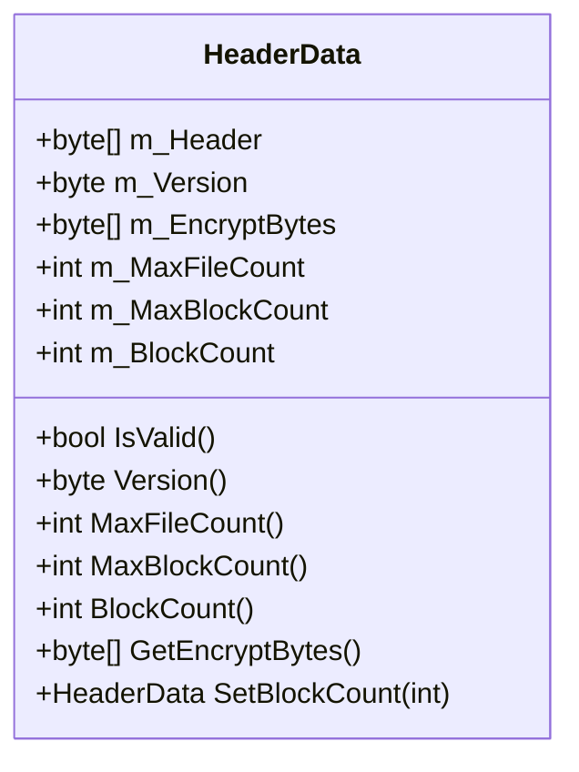
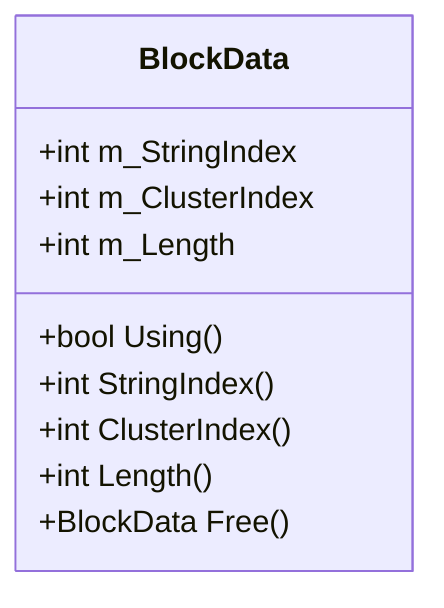
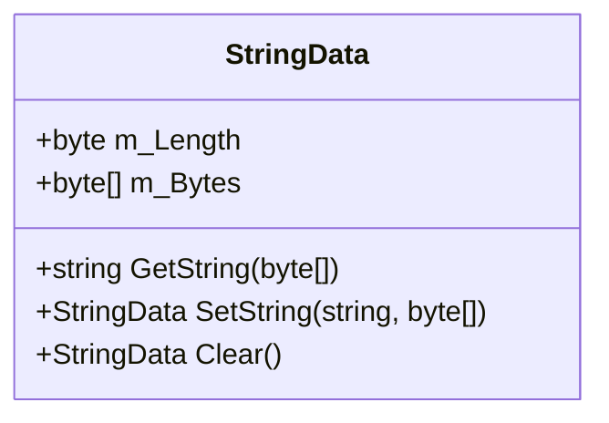
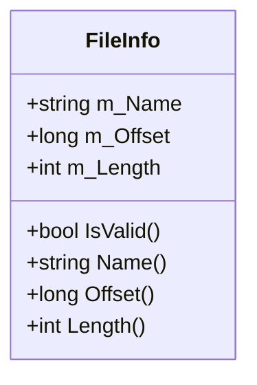
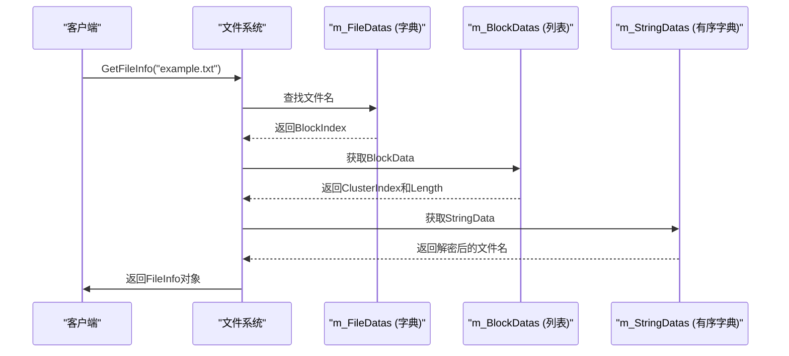
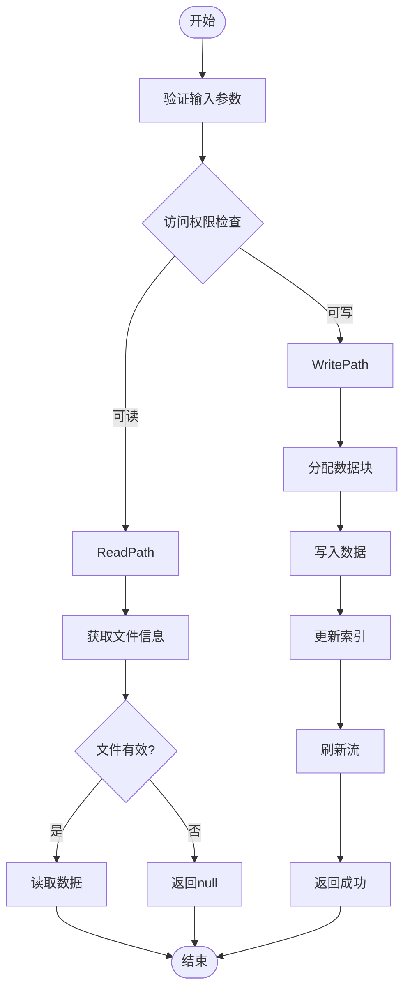
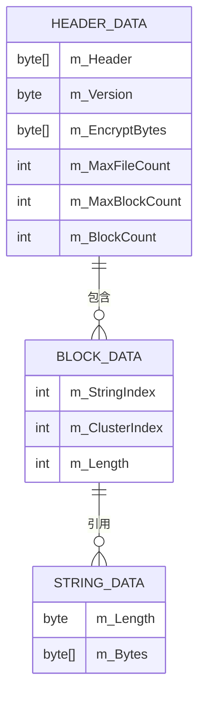
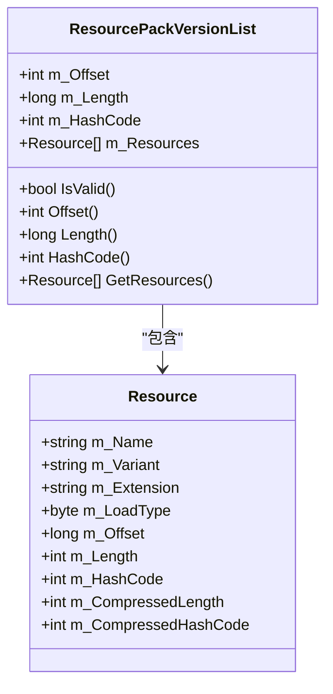
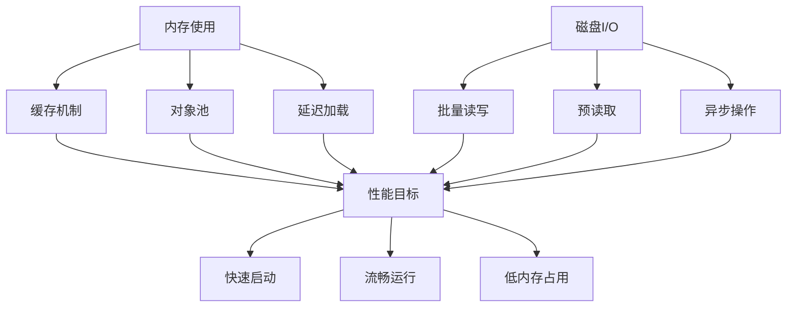

# 文件结构与数据模型

<cite>
**Referenced Files in This Document**   
- [FileSystem.HeaderData.cs](file://GameFramework/FileSystem/FileSystem.HeaderData.cs)
- [FileSystem.BlockData.cs](file://GameFramework/FileSystem/FileSystem.BlockData.cs)
- [FileSystem.StringData.cs](file://GameFramework/FileSystem/FileSystem.StringData.cs)
- [FileInfo.cs](file://GameFramework/FileSystem/FileInfo.cs)
- [FileSystem.cs](file://GameFramework/FileSystem/FileSystem.cs)
- [ResourcePackVersionList.cs](file://GameFramework/Resource/ResourcePackVersionList.cs)
- [ResourcePackVersionList.Resource.cs](file://GameFramework/Resource/ResourcePackVersionList.Resource.cs)
</cite>

## 目录
1. [引言](#引言)
2. [核心数据结构](#核心数据结构)
3. [文件索引与查找机制](#文件索引与查找机制)
4. [序列化格式与资源包应用](#序列化格式与资源包应用)
5. [设计权衡分析](#设计权衡分析)
6. [结论](#结论)

## 引言

本文档详细说明虚拟文件系统的内部结构设计，重点分析HeaderData（文件头）、BlockData（数据块）、StringData（字符串表）的组织方式，以及FileInfo如何描述单个文件的元数据。该设计旨在实现高效的文件索引与快速查找，同时在读取性能与存储开销之间取得平衡。此虚拟文件系统广泛应用于资源包（Resource Pack）中，为游戏资源管理提供底层支持。

## 核心数据结构

### HeaderData（文件头）

HeaderData结构位于文件系统的最前端，作为整个文件系统的元数据容器，包含版本信息、加密字节、最大文件数量、最大数据块数量等关键信息。

**Diagram sources**
- [FileSystem.HeaderData.cs](file://GameFramework/FileSystem/FileSystem.HeaderData.cs#L10-L105)

**Section sources**
- [FileSystem.HeaderData.cs](file://GameFramework/FileSystem/FileSystem.HeaderData.cs#L10-L105)

### BlockData（数据块）

BlockData结构用于管理文件系统中的数据块，每个数据块对应一个文件或空闲空间。它包含字符串索引、簇索引和数据长度等信息，是连接文件名与实际数据偏移的关键桥梁。

**Diagram sources**
- [FileSystem.BlockData.cs](file://GameFramework/FileSystem/FileSystem.BlockData.cs#L10-L76)

**Section sources**
- [FileSystem.BlockData.cs](file://GameFramework/FileSystem/FileSystem.BlockData.cs#L10-L76)

### StringData（字符串表）

StringData结构用于存储文件名字符串，采用加密存储以提高安全性。它包含字符串长度和加密后的字节数组，通过GetString方法可以解密获取原始文件名。

**Diagram sources**
- [FileSystem.StringData.cs](file://GameFramework/FileSystem/FileSystem.StringData.cs#L10-L70)

**Section sources**
- [FileSystem.StringData.cs](file://GameFramework/FileSystem/FileSystem.StringData.cs#L10-L70)

### FileInfo（文件信息）

FileInfo结构用于描述单个文件的元数据，包括文件名称、偏移量和长度。它是外部API与内部数据结构之间的桥梁，为上层应用提供统一的文件访问接口。

**Diagram sources**
- [FileInfo.cs](file://GameFramework/FileSystem/FileInfo.cs#L14-L92)

**Section sources**
- [FileInfo.cs](file://GameFramework/FileSystem/FileInfo.cs#L14-L92)

## 文件索引与查找机制

### 数据结构协同工作流程

虚拟文件系统通过HeaderData、BlockData、StringData和FileInfo四个核心结构的协同工作，实现了高效的文件索引与快速查找。

**Diagram sources**
- [FileSystem.cs](file://GameFramework/FileSystem/FileSystem.cs#L258-L273)
- [FileSystem.cs](file://GameFramework/FileSystem/FileSystem.cs#L1344-L1349)

**Section sources**
- [FileSystem.cs](file://GameFramework/FileSystem/FileSystem.cs#L258-L273)
- [FileSystem.cs](file://GameFramework/FileSystem/FileSystem.cs#L1344-L1349)

### 文件读写操作流程

文件的读写操作通过统一的API接口实现，内部通过数据块分配和管理机制确保数据的正确存储和读取。

**Diagram sources**
- [FileSystem.cs](file://GameFramework/FileSystem/FileSystem.cs#L331-L358)
- [FileSystem.cs](file://GameFramework/FileSystem/FileSystem.cs#L806-L860)

**Section sources**
- [FileSystem.cs](file://GameFramework/FileSystem/FileSystem.cs#L331-L358)
- [FileSystem.cs](file://GameFramework/FileSystem/FileSystem.cs#L806-L860)

## 序列化格式与资源包应用

### 序列化格式示例

虚拟文件系统的序列化格式遵循严格的布局规范，确保跨平台兼容性和数据完整性。

**Diagram sources**
- [FileSystem.HeaderData.cs](file://GameFramework/FileSystem/FileSystem.HeaderData.cs#L10-L105)
- [FileSystem.BlockData.cs](file://GameFramework/FileSystem/FileSystem.BlockData.cs#L10-L76)
- [FileSystem.StringData.cs](file://GameFramework/FileSystem/FileSystem.StringData.cs#L10-L70)

### 资源包中的应用

在资源包（Resource Pack）中，虚拟文件系统的设计被进一步扩展，用于管理游戏资源的版本和依赖关系。

**Diagram sources**
- [ResourcePackVersionList.cs](file://GameFramework/Resource/ResourcePackVersionList.cs#L32-L39)
- [ResourcePackVersionList.Resource.cs](file://GameFramework/Resource/ResourcePackVersionList.Resource.cs#L11-L158)

**Section sources**
- [ResourcePackVersionList.cs](file://GameFramework/Resource/ResourcePackVersionList.cs#L32-L39)
- [ResourcePackVersionList.Resource.cs](file://GameFramework/Resource/ResourcePackVersionList.Resource.cs#L11-L158)

## 设计权衡分析

### 读取性能与存储开销的平衡

虚拟文件系统在设计时充分考虑了读取性能与存储开销之间的平衡，通过多种机制实现优化。

| 设计特性 | 优点 | 缺点 | 适用场景 |
|---------|------|------|---------|
| 固定簇大小(4KB) | 减少碎片，提高读取效率 | 可能造成内部碎片 | 大量小文件场景 |
| 字符串表加密 | 提高安全性，防止直接查看文件名 | 增加CPU开销 | 需要保护资源的场景 |
| 数据块预分配 | 减少动态分配开销 | 初始文件较大 | 资源包预构建场景 |
| 懒加载机制 | 减少内存占用 | 首次访问有延迟 | 内存受限环境 |

**Section sources**
- [FileSystem.HeaderData.cs](file://GameFramework/FileSystem/FileSystem.HeaderData.cs#L10-L105)
- [FileSystem.BlockData.cs](file://GameFramework/FileSystem/FileSystem.BlockData.cs#L10-L76)
- [FileSystem.StringData.cs](file://GameFramework/FileSystem/FileSystem.StringData.cs#L10-L70)

### 内存与磁盘的权衡

系统在内存使用和磁盘I/O之间进行了精心的权衡，以适应不同的应用场景。

**Diagram sources**
- [FileSystem.cs](file://GameFramework/FileSystem/FileSystem.cs#L1344-L1349)
- [FileSystem.cs](file://GameFramework/FileSystem/FileSystem.cs#L806-L860)

## 结论

虚拟文件系统通过精心设计的HeaderData、BlockData、StringData和FileInfo结构，实现了高效的文件索引与快速查找。其序列化格式在资源包中的应用证明了设计的实用性和扩展性。尽管在读取性能与存储开销之间存在固有的权衡，但通过合理的机制设计，系统能够在不同应用场景下取得良好的平衡。未来可以考虑引入更先进的压缩算法和更智能的缓存策略，进一步优化系统性能。