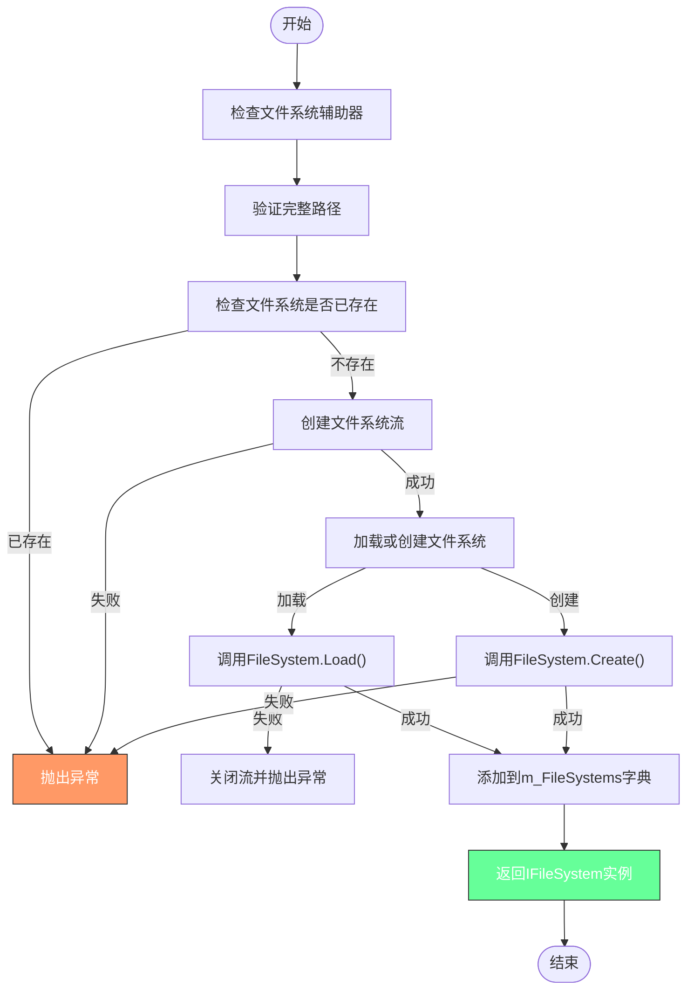
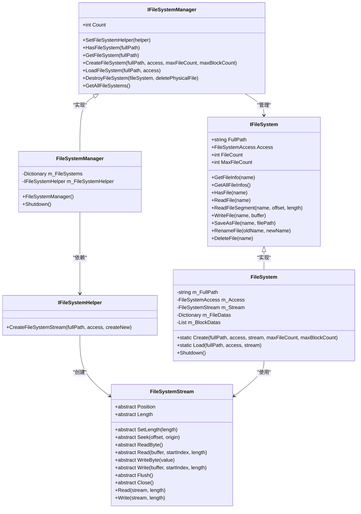
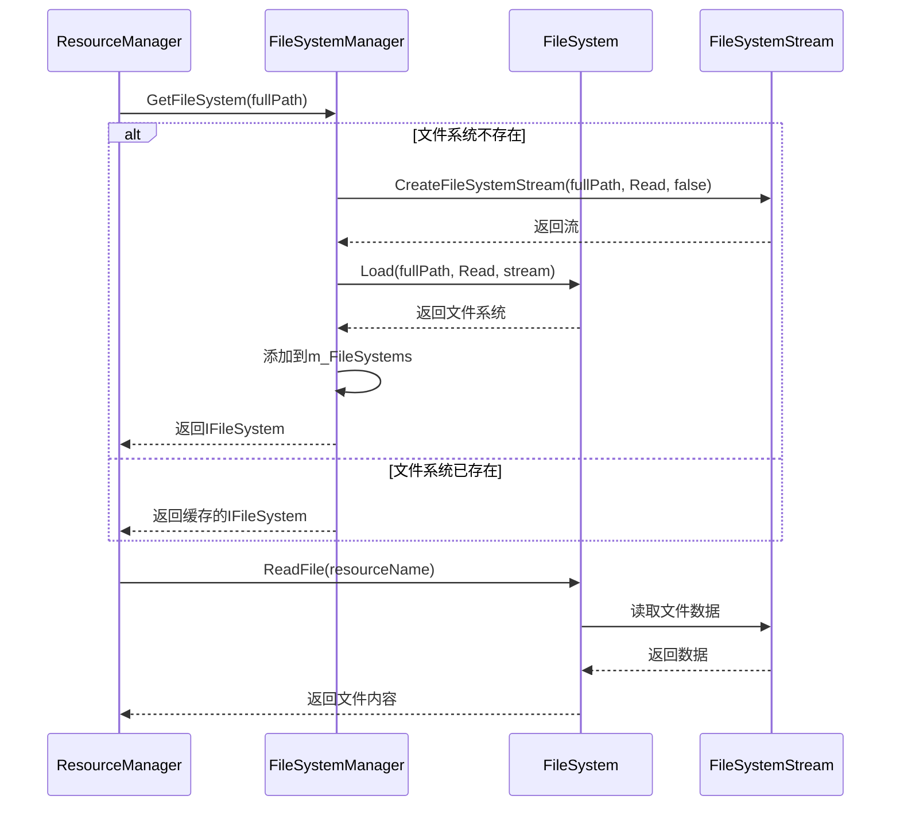
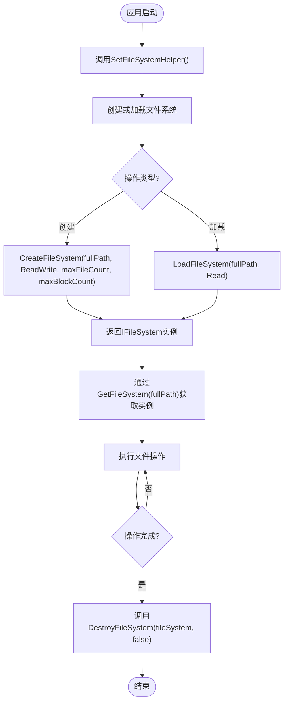

# 核心接口与管理器

<cite>
**Referenced Files in This Document**   
- [IFileSystem.cs](file://GameFramework/FileSystem/IFileSystem.cs)
- [IFileSystemManager.cs](file://GameFramework/FileSystem/IFileSystemManager.cs)
- [FileSystemManager.cs](file://GameFramework/FileSystem/FileSystemManager.cs)
- [FileSystem.cs](file://GameFramework/FileSystem/FileSystem.cs)
- [IFileSystemHelper.cs](file://GameFramework/FileSystem/IFileSystemHelper.cs)
- [FileSystemStream.cs](file://GameFramework/FileSystem/FileSystemStream.cs)
- [ResourceManager.cs](file://GameFramework/Resource/ResourceManager.cs)
</cite>

## 目录
1. [引言](#引言)
2. [核心接口定义](#核心接口定义)
3. [文件系统管理器实现](#文件系统管理器实现)
4. [文件系统注册与生命周期管理](#文件系统注册与生命周期管理)
5. [多存储介质统一访问机制](#多存储介质统一访问机制)
6. [资源加载链中的角色](#资源加载链中的角色)
7. [命名空间隔离与访问控制](#命名空间隔离与访问控制)
8. [标准操作流程示例](#标准操作流程示例)
9. [架构关系图](#架构关系图)

## 引言

本文档深入解析Unity游戏框架中文件系统的核心接口`IFileSystem`和`IFileSystemManager`，以及其实现类`FileSystemManager`。该系统为游戏资源管理提供了基础支撑，通过统一的接口抽象，实现了对不同存储介质（如资源包、持久化目录）的透明访问。文档将详细阐述文件系统的注册、初始化、挂载和卸载流程，说明如何通过管理器统一访问不同存储介质中的文件，并结合代码示例展示创建、获取和释放文件系统的标准流程。

## 核心接口定义

### IFileSystem 接口

`IFileSystem`接口定义了文件系统的基本操作契约，为上层应用提供了统一的文件访问方式。

**Section sources**
- [IFileSystem.cs](file://GameFramework/FileSystem/IFileSystem.cs#L15-L275)

### IFileSystemManager 接口

`IFileSystemManager`接口定义了文件系统管理器的功能，负责文件系统的生命周期管理和统一访问入口。

**Section sources**
- [IFileSystemManager.cs](file://GameFramework/FileSystem/IFileSystemManager.cs#L14-L80)

## 文件系统管理器实现

`FileSystemManager`是`IFileSystemManager`接口的具体实现，作为游戏框架的模块之一，负责管理所有文件系统的实例。

**Section sources**
- [FileSystemManager.cs](file://GameFramework/FileSystem/FileSystemManager.cs#L16-L281)

## 文件系统注册与生命周期管理

文件系统的生命周期由`FileSystemManager`统一管理，包括创建、加载、获取和销毁等操作。



**Diagram sources**
- [FileSystemManager.cs](file://GameFramework/FileSystem/FileSystemManager.cs#L136-L178)
- [FileSystemManager.cs](file://GameFramework/FileSystem/FileSystemManager.cs#L186-L224)

## 多存储介质统一访问机制

通过`IFileSystemHelper`和`FileSystemStream`的抽象，系统实现了对不同存储介质的统一访问。



**Diagram sources**
- [IFileSystemManager.cs](file://GameFramework/FileSystem/IFileSystemManager.cs#L14-L80)
- [FileSystemManager.cs](file://GameFramework/FileSystem/FileSystemManager.cs#L16-L281)
- [IFileSystem.cs](file://GameFramework/FileSystem/IFileSystem.cs#L15-L275)
- [FileSystem.cs](file://GameFramework/FileSystem/FileSystem.cs#L16-L281)
- [IFileSystemHelper.cs](file://GameFramework/FileSystem/IFileSystemHelper.cs#L12-L22)
- [FileSystemStream.cs](file://GameFramework/FileSystem/FileSystemStream.cs#L15-L133)

## 资源加载链中的角色

文件系统在资源加载链中扮演着关键角色，`ResourceManager`通过`FileSystemManager`来访问不同存储位置的资源。



**Diagram sources**
- [ResourceManager.cs](file://GameFramework/Resource/ResourceManager.cs#L2291-L2341)
- [FileSystemManager.cs](file://GameFramework/FileSystem/FileSystemManager.cs#L186-L224)
- [FileSystem.cs](file://GameFramework/FileSystem/FileSystem.cs#L180-L232)

## 命名空间隔离与访问控制

系统通过文件系统名称和访问模式实现了命名空间隔离和访问控制。

**Section sources**
- [FileSystemManager.cs](file://GameFramework/FileSystem/FileSystemManager.cs#L136-L178)
- [FileSystemManager.cs](file://GameFramework/FileSystem/FileSystemManager.cs#L186-L224)

## 标准操作流程示例

以下是创建、获取和释放文件系统的标准流程：



**Diagram sources**
- [FileSystemManager.cs](file://GameFramework/FileSystem/FileSystemManager.cs#L112-L126)
- [FileSystemManager.cs](file://GameFramework/FileSystem/FileSystemManager.cs#L136-L178)
- [FileSystemManager.cs](file://GameFramework/FileSystem/FileSystemManager.cs#L186-L224)
- [FileSystemManager.cs](file://GameFramework/FileSystem/FileSystemManager.cs#L250-L265)

## 架构关系图

```mermaid
graph TD
subgraph "资源管理层"
RM[ResourceManager]
end
subgraph "文件系统管理层"
FSM[FileSystemManager]
FSMH[IFileSystemHelper]
end
subgraph "文件系统实现层"
FS[FileSystem]
FSS[FileSystemStream]
end
RM --> FSM : "依赖"
FSM --> FSMH : "设置辅助器"
FSM --> FS : "创建/加载"
FS --> FSS : "使用流"
FSMH --> FSS : "创建流"
style RM fill:#4CAF50,stroke:#333,color:#fff
style FSM fill:#2196F3,stroke:#333,color:#fff
style FSMH fill:#FF9800,stroke:#333,color:#fff
style FS fill:#9C27B0,stroke:#333,color:#fff
style FSS fill:#F44336,stroke:#333,color:#fff
```

**Diagram sources**
- [ResourceManager.cs](file://GameFramework/Resource/ResourceManager.cs#L81-L129)
- [FileSystemManager.cs](file://GameFramework/FileSystem/FileSystemManager.cs#L25-L29)