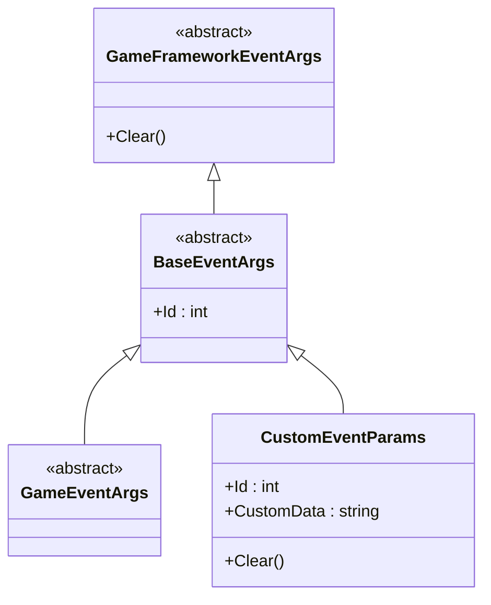
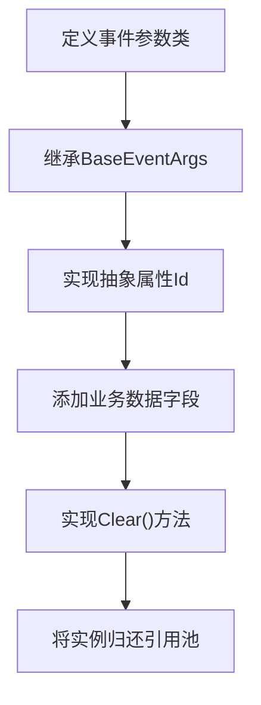
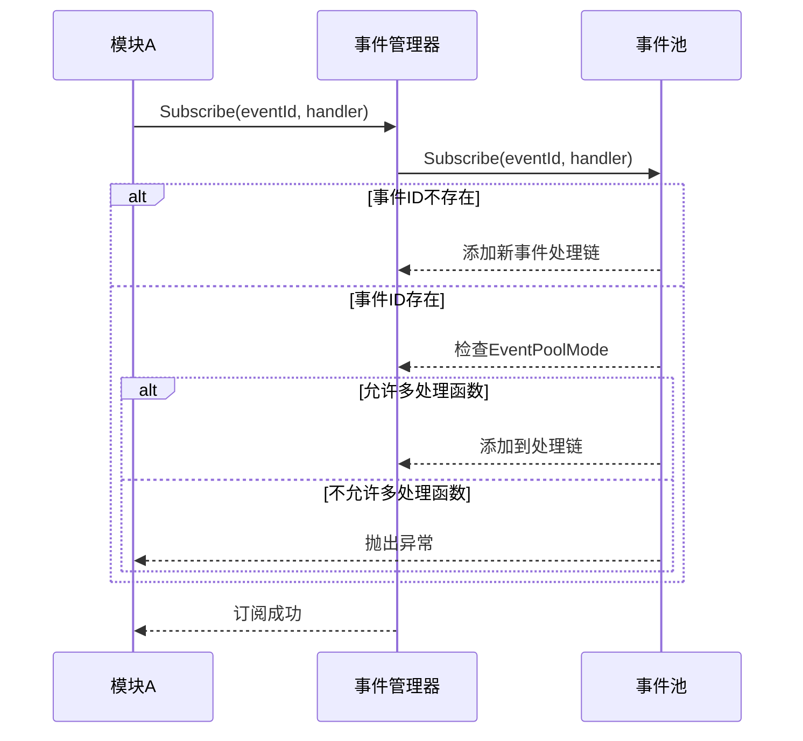
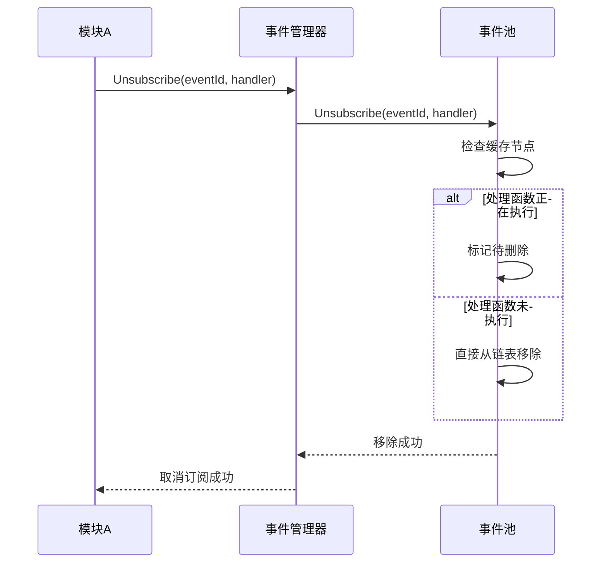
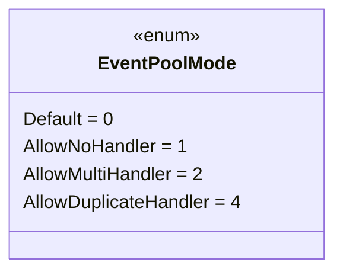
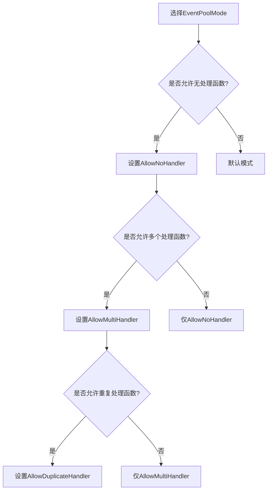
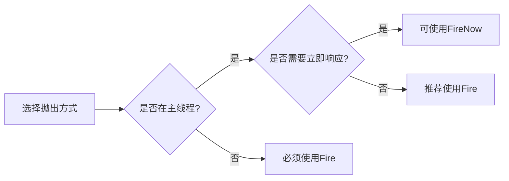

# 事件系统使用规范

<cite>
**Referenced Files in This Document**   
- [GameFrameworkEventArgs.cs](file://GameFramework/Base/GameFrameworkEventArgs.cs)
- [BaseEventArgs.cs](file://GameFramework/Base/EventPool/BaseEventArgs.cs)
- [EventPool.cs](file://GameFramework/Base/EventPool/EventPool.cs)
- [EventPoolMode.cs](file://GameFramework/Base/EventPool/EventPoolMode.cs)
- [EventManager.cs](file://GameFramework/Event/EventManager.cs)
- [GameEventArgs.cs](file://GameFramework/Event/GameEventArgs.cs)
- [IReference.cs](file://GameFramework/Base/ReferencePool/IReference.cs)
</cite>

## 目录
1. [引言](#引言)
2. [事件参数类定义规范](#事件参数类定义规范)
3. [事件订阅与取消订阅原则](#事件订阅与取消订阅原则)
4. [事件优先级与处理模式](#事件优先级与处理模式)
5. [事件命名与使用场景](#事件命名与使用场景)
6. [事件系统架构与数据流](#事件系统架构与数据流)
7. [最佳实践与常见问题](#最佳实践与常见问题)

## 引言

事件系统是实现模块间松耦合通信的核心机制。通过事件驱动架构，各模块可以独立开发、测试和维护，仅通过定义良好的事件接口进行交互。本规范旨在指导开发者正确使用事件系统，确保代码的可维护性、可扩展性和稳定性。事件系统基于观察者模式实现，通过`EventManager`统一管理事件的订阅、分发和处理，支持线程安全的事件抛出和灵活的事件处理模式。

## 事件参数类定义规范

事件参数类是事件数据的载体，必须遵循严格的类型安全和可扩展性原则。所有事件参数类都应继承自`BaseEventArgs`，以确保统一的接口和行为。



**Diagram sources**
- [GameFrameworkEventArgs.cs](file://GameFramework/Base/GameFrameworkEventArgs.cs#L14-L27)
- [BaseEventArgs.cs](file://GameFramework/Base/EventPool/BaseEventArgs.cs#L12-L21)
- [GameEventArgs.cs](file://GameFramework/Event/GameEventArgs.cs#L12-L14)

### 继承体系与接口要求

事件参数类的继承体系确保了类型安全和资源管理。`GameFrameworkEventArgs`作为最顶层的抽象基类，实现了`IReference`接口，要求所有派生类必须实现`Clear()`方法用于清理引用，防止内存泄漏。



**Diagram sources**
- [IReference.cs](file://GameFramework/Base/ReferencePool/IReference.cs#L12-L18)
- [BaseEventArgs.cs](file://GameFramework/Base/EventPool/BaseEventArgs.cs#L12-L21)

**Section sources**
- [BaseEventArgs.cs](file://GameFramework/Base/EventPool/BaseEventArgs.cs#L12-L21)
- [GameFrameworkEventArgs.cs](file://GameFramework/Base/GameFrameworkEventArgs.cs#L14-L27)

### 类型安全与可扩展性

通过泛型约束和抽象属性`Id`，事件系统实现了类型安全的事件分发。每个事件类型必须有唯一的`Id`标识，用于在事件池中进行快速查找和路由。这种设计既保证了编译时的类型检查，又提供了运行时的灵活性，便于系统扩展新的事件类型。

## 事件订阅与取消订阅原则

正确的订阅与取消订阅是防止内存泄漏和异常调用的关键。必须严格遵守配对原则，确保每个订阅都有对应的取消订阅操作。

### 订阅机制分析

事件订阅通过`Subscribe`方法实现，该方法在内部进行严格的参数验证和模式检查。根据`EventPoolMode`的配置，系统会验证是否允许同一事件存在多个处理函数或重复的处理函数。



**Diagram sources**
- [EventPool.cs](file://GameFramework/Base/EventPool/EventPool.cs#L139-L162)
- [EventManager.cs](file://GameFramework/Event/EventManager.cs#L104-L107)

### 取消订阅机制分析

取消订阅操作同样重要，必须在模块销毁或不再需要监听事件时及时调用。系统通过`Unsubscribe`方法移除事件处理函数，并在内部维护缓存节点以支持安全的迭代删除。



**Diagram sources**
- [EventPool.cs](file://GameFramework/Base/EventPool/EventPool.cs#L169-L201)
- [EventManager.cs](file://GameFramework/Event/EventManager.cs#L114-L117)

**Section sources**
- [EventPool.cs](file://GameFramework/Base/EventPool/EventPool.cs#L139-L201)
- [EventManager.cs](file://GameFramework/Event/EventManager.cs#L104-L117)

## 事件优先级与处理模式

事件处理模式由`EventPoolMode`枚举定义，控制着事件处理函数的存在性和数量约束，对于确保系统稳定性和预期行为至关重要。

### EventPoolMode 枚举定义

`EventPoolMode`是一个标志枚举（Flags Enum），允许通过位运算组合多种模式。这种设计提供了极大的灵活性，可以根据不同事件的业务需求配置合适的处理模式。



**Diagram sources**
- [EventPoolMode.cs](file://GameFramework/Base/EventPool/EventPoolMode.cs#L14-L36)

### 模式组合与应用场景

不同的`EventPoolMode`组合适用于不同的业务场景。例如，`AllowNoHandler | AllowMultiHandler`组合允许事件没有处理函数或有多个处理函数，这在全局UI刷新等场景中非常有用，因为可能在某些状态下没有模块需要响应该事件。



**Diagram sources**
- [EventPoolMode.cs](file://GameFramework/Base/EventPool/EventPoolMode.cs#L14-L36)
- [EventPool.cs](file://GameFramework/Base/EventPool/EventPool.cs#L29-L37)

**Section sources**
- [EventPoolMode.cs](file://GameFramework/Base/EventPool/EventPoolMode.cs#L14-L36)
- [EventPool.cs](file://GameFramework/Base/EventPool/EventPool.cs#L29-L37)

## 事件命名与使用场景

合理的事件命名和使用场景选择是确保代码可读性和维护性的关键因素。

### 命名规范

推荐采用"模块名+操作名"的命名格式，例如`PlayerHealthChanged`、`InventoryItemAdded`等。这种命名方式清晰地表达了事件的来源和含义，便于开发者理解和维护。

### 典型使用场景

事件系统特别适用于以下场景：
- 跨模块状态通知（如玩家生命值变化通知UI模块）
- 全局UI刷新（如资源数量变化触发所有相关UI更新）
- 系统级事件广播（如游戏暂停、继续等）

## 事件系统架构与数据流

事件系统采用分层架构设计，`EventManager`作为高层接口，`EventPool`作为核心实现，共同协作完成事件的生命周期管理。

```mermaid
graph TB
subgraph "高层接口"
EventManager[EventManager]
end
subgraph "核心实现"
EventPool[EventPool<GameEventArgs>]
EventPoolMode[EventPoolMode]
end
subgraph "事件参数"
GameEventArgs[GameEventArgs]
CustomEvent[自定义事件参数]
end
EventManager --> EventPool : 委托调用
EventPool --> EventPoolMode : 模式检查
EventPool --> GameEventArgs : 泛型约束
GameEventArgs --> CustomEvent : 继承
```

**Diagram sources**
- [EventManager.cs](file://GameFramework/Event/EventManager.cs#L14-L147)
- [EventPool.cs](file://GameFramework/Base/EventPool/EventPool.cs#L29-L37)
- [GameEventArgs.cs](file://GameFramework/Event/GameEventArgs.cs#L12-L14)

**Section sources**
- [EventManager.cs](file://GameFramework/Event/EventManager.cs#L14-L147)
- [EventPool.cs](file://GameFramework/Base/EventPool/EventPool.cs#L29-L37)

## 最佳实践与常见问题

### 事件抛出方式选择

系统提供两种事件抛出方式：`Fire`和`FireNow`。`Fire`是线程安全的，事件会在下一帧分发，适用于大多数场景；`FireNow`则立即分发，不保证线程安全，仅在确定在主线程调用且需要立即响应时使用。



**Diagram sources**
- [EventPool.cs](file://GameFramework/Base/EventPool/EventPool.cs#L217-L244)
- [EventManager.cs](file://GameFramework/Event/EventManager.cs#L133-L146)

### 内存泄漏预防

通过`IReference`接口和引用池机制，事件参数对象在使用后会被自动清理并归还池中，避免了频繁的GC压力。开发者在自定义事件参数类时，必须正确实现`Clear()`方法，清理所有引用类型的字段。

**Section sources**
- [EventPool.cs](file://GameFramework/Base/EventPool/EventPool.cs#L217-L244)
- [EventManager.cs](file://GameFramework/Event/EventManager.cs#L133-L146)
- [IReference.cs](file://GameFramework/Base/ReferencePool/IReference.cs#L12-L18)