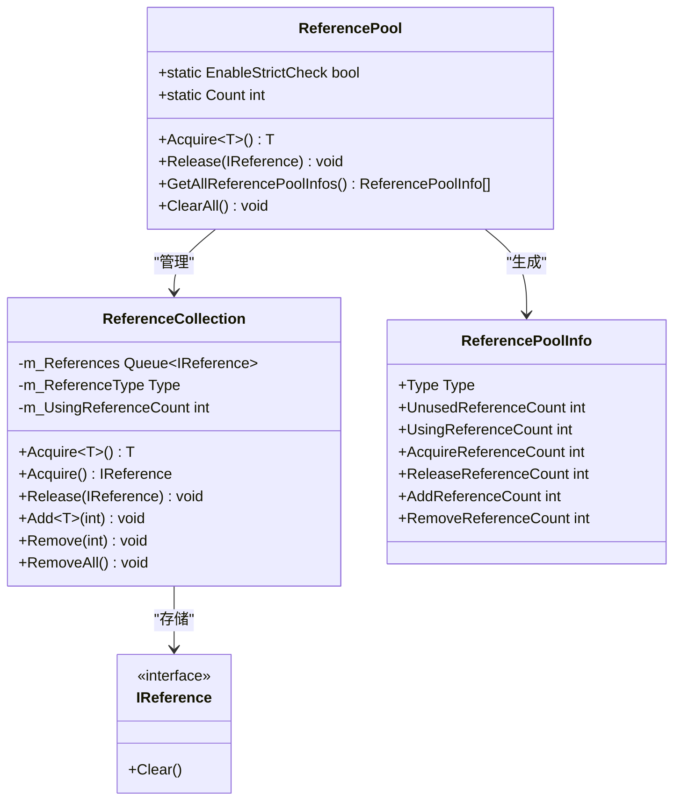
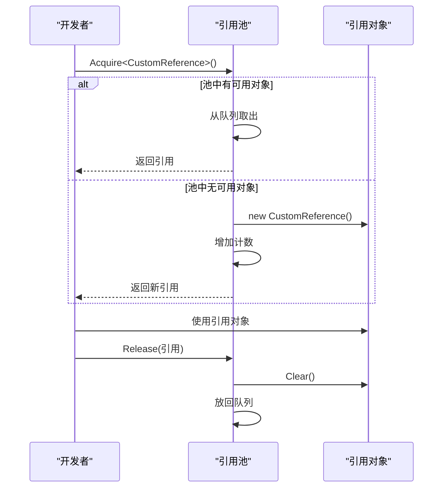
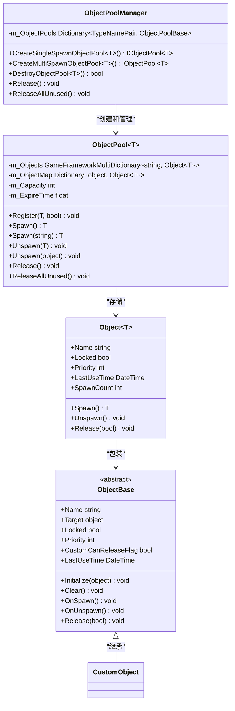
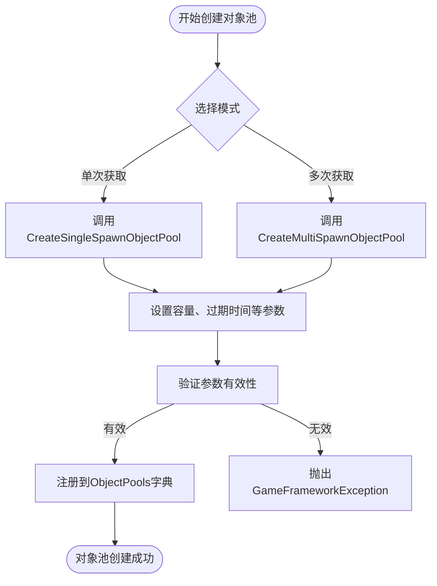
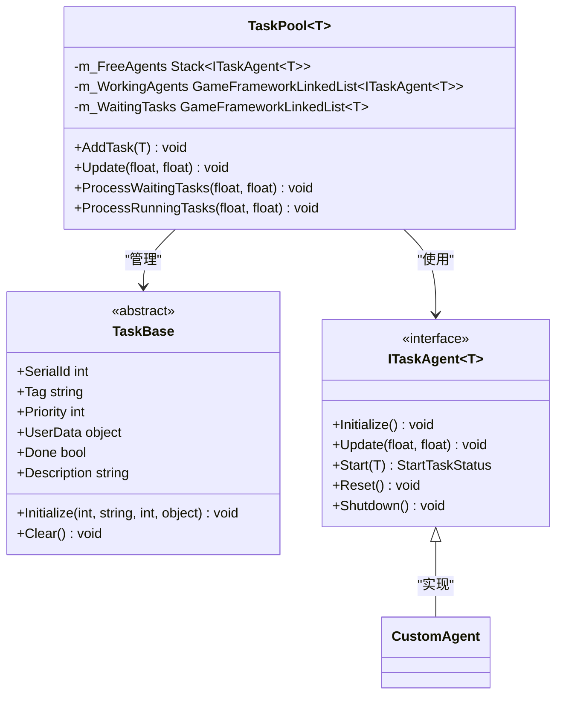
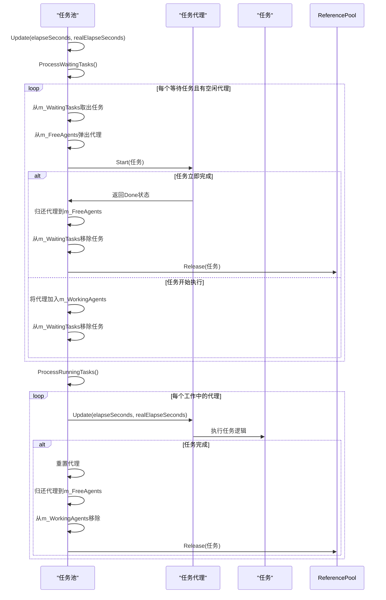
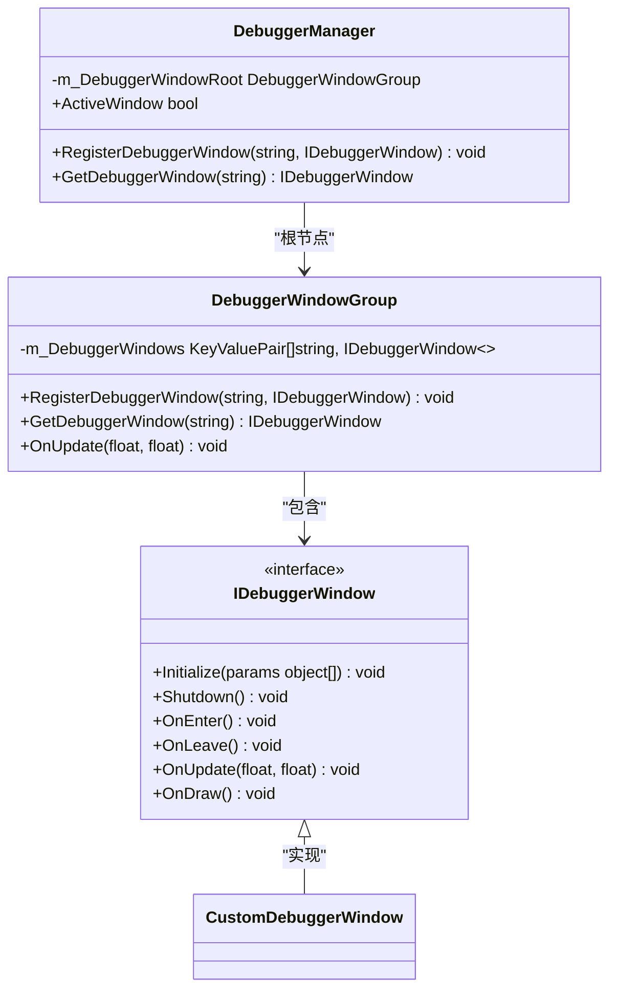

<cite>
**Referenced Files in This Document**   
- [ReferencePool.cs](file://GameFramework/Base/ReferencePool/ReferencePool.cs)
- [IReference.cs](file://GameFramework/Base/ReferencePool/IReference.cs)
- [ReferencePoolInfo.cs](file://GameFramework/Base/ReferencePool/ReferencePoolInfo.cs)
- [ObjectPoolManager.cs](file://GameFramework/ObjectPool/ObjectPoolManager.cs)
- [ObjectPoolManager.ObjectPool.cs](file://GameFramework/ObjectPool/ObjectPoolManager.ObjectPool.cs)
- [ObjectBase.cs](file://GameFramework/ObjectPool/ObjectBase.cs)
- [TaskPool.cs](file://GameFramework/Base/TaskPool/TaskPool.cs)
- [TaskBase.cs](file://GameFramework/Base/TaskPool/TaskBase.cs)
- [DebuggerManager.cs](file://GameFramework/Debugger/DebuggerManager.cs)
- [IDebuggerWindow.cs](file://GameFramework/Debugger/IDebuggerWindow.cs)
</cite>

# 性能优化策略

## Table of Contents
1. [引言](#引言)
2. [引用池（ReferencePool）优化](#引用池referencepool优化)
3. [对象池（ObjectPool）优化](#对象池objectpool优化)
4. [任务池（TaskPool）优化](#任务池taskpool优化)
5. [性能剖析与监控](#性能剖析与监控)
6. [综合案例分析](#综合案例分析)
7. [结论](#结论)

## 引言

在Unity游戏开发中，性能优化是确保游戏流畅运行的关键。频繁的内存分配和垃圾回收（GC）会导致帧率波动，影响用户体验。GameFramework提供了一套完整的性能优化解决方案，包括引用池、对象池和任务池等核心组件。本文将系统性地总结这些优化技术的最佳实践，帮助开发者有效减少GC压力，提升帧率稳定性。

## 引用池（ReferencePool）优化

引用池是减少GC压力的基础工具，通过复用实现了`IReference`接口的对象，避免了频繁的内存分配和释放。

### 引用池工作原理

引用池的核心是`ReferencePool`类，它维护了一个字典，以引用类型为键，存储对应的`ReferenceCollection`实例。每个`ReferenceCollection`包含一个队列，用于存储未使用的引用对象。当需要获取引用时，优先从队列中取出，否则创建新实例；当归还引用时，将其放回队列以备复用。

**Diagram sources**
- [ReferencePool.cs](file://GameFramework/Base/ReferencePool/ReferencePool.cs#L15-L225)
- [IReference.cs](file://GameFramework/Base/ReferencePool/IReference.cs#L10-L20)
- [ReferencePoolInfo.cs](file://GameFramework/Base/ReferencePool/ReferencePoolInfo.cs#L15-L125)

### 正确使用引用池

#### 获取与归还引用

开发者应遵循"获取-使用-归还"的模式。获取引用使用`ReferencePool.Acquire<T>()`，使用完毕后必须调用`ReferencePool.Release()`归还。归还前，引用对象的`Clear()`方法会被自动调用，以重置其内部状态。

**Diagram sources**
- [ReferencePool.cs](file://GameFramework/Base/ReferencePool/ReferencePool.cs#L108-L118)
- [ReferencePool.cs](file://GameFramework/Base/ReferencePool/ReferencePool.cs#L140-L150)

**Section sources**
- [ReferencePool.cs](file://GameFramework/Base/ReferencePool/ReferencePool.cs#L108-L150)
- [IReference.cs](file://GameFramework/Base/ReferencePool/IReference.cs#L10-L20)

#### 避免内存泄漏

内存泄漏通常由未归还引用导致。开发者必须确保在所有代码路径下（包括异常情况）都能正确归还引用。建议使用`try...finally`或`using`语句（如果实现了`IDisposable`）来保证归还操作的执行。

## 对象池（ObjectPool）优化

对象池用于管理实体、UI、声音等复杂对象的生命周期，在高频创建销毁场景下效果显著。

### 对象池架构

对象池由`ObjectPoolManager`统一管理，支持创建单次获取和允许多次获取两种模式。每个对象池（`ObjectPool<T>`）内部维护两个字典：`m_Objects`按名称索引对象，`m_ObjectMap`按目标对象索引，确保高效查找。

**Diagram sources**
- [ObjectPoolManager.cs](file://GameFramework/ObjectPool/ObjectPoolManager.cs#L20-L1304)
- [ObjectPoolManager.ObjectPool.cs](file://GameFramework/ObjectPool/ObjectPoolManager.ObjectPool.cs#L18-L634)
- [ObjectBase.cs](file://GameFramework/ObjectPool/ObjectBase.cs#L15-L207)

### 使用规范

#### 创建与配置对象池

使用`ObjectPoolManager`的`CreateSingleSpawnObjectPool`或`CreateMultiSpawnObjectPool`方法创建对象池。关键参数包括：
- **容量（Capacity）**：池的最大容量，防止内存无限增长。
- **过期时间（ExpireTime）**：对象在未使用状态下存活的最长时间。
- **自动释放间隔（AutoReleaseInterval）**：检查并释放过期对象的频率。

**Diagram sources**
- [ObjectPoolManager.cs](file://GameFramework/ObjectPool/ObjectPoolManager.cs#L384-L1123)
- [ObjectPoolManager.ObjectPool.cs](file://GameFramework/ObjectPool/ObjectPoolManager.ObjectPool.cs#L41-L55)

#### 预加载与容量控制

对于启动时需要大量对象的场景，应进行预加载。通过`Register`方法将预先创建的对象注册到池中，避免运行时的性能开销。同时，严格控制容量，防止内存占用过高。

**Section sources**
- [ObjectPoolManager.ObjectPool.cs](file://GameFramework/ObjectPool/ObjectPoolManager.ObjectPool.cs#L190-L205)
- [ObjectPoolManager.cs](file://GameFramework/ObjectPool/ObjectPoolManager.cs#L384-L1123)

## 任务池（TaskPool）优化

任务池用于高效调度异步任务，通过任务代理复用和优先级队列，平衡性能与资源消耗。

### 任务池工作机制

任务池（`TaskPool<T>`）维护三个核心集合：`m_FreeAgents`（空闲代理栈）、`m_WorkingAgents`（工作代理链表）和`m_WaitingTasks`（等待任务链表）。任务按优先级排序，高优先级任务优先执行。

**Diagram sources**
- [TaskPool.cs](file://GameFramework/Base/TaskPool/TaskPool.cs#L15-L442)
- [TaskBase.cs](file://GameFramework/Base/TaskPool/TaskBase.cs#L15-L137)

### 异步任务调度

#### 添加与执行任务

通过`AddTask`方法将任务加入`m_WaitingTasks`链表，按优先级排序。`Update`方法在每帧调用，`ProcessWaitingTasks`将等待任务分配给空闲代理，`ProcessRunningTasks`更新正在执行的任务。

**Diagram sources**
- [TaskPool.cs](file://GameFramework/Base/TaskPool/TaskPool.cs#L97-L106)
- [TaskPool.cs](file://GameFramework/Base/TaskPool/TaskPool.cs#L412-L441)
- [TaskPool.cs](file://GameFramework/Base/TaskPool/TaskPool.cs#L390-L410)

#### 并发控制

通过控制`m_FreeAgents`的初始数量来限制并发任务数。过多的并发任务会消耗大量CPU资源，过少则无法充分利用多核优势。开发者应根据任务类型和目标平台进行合理配置。

**Section sources**
- [TaskPool.cs](file://GameFramework/Base/TaskPool/TaskPool.cs#L97-L442)
- [TaskBase.cs](file://GameFramework/Base/TaskPool/TaskBase.cs#L15-L137)

## 性能剖析与监控

### Debugger模块监控

`DebuggerManager`提供了强大的运行时监控功能。开发者可以注册自定义的调试窗口，实时查看对象池状态、内存分配热点等信息。

**Diagram sources**
- [DebuggerManager.cs](file://GameFramework/Debugger/DebuggerManager.cs#L15-L141)
- [IDebuggerWindow.cs](file://GameFramework/Debugger/IDebuggerWindow.cs#L10-L48)
- [DebuggerManager.DebuggerWindowGroup.cs](file://GameFramework/Debugger/DebuggerManager.DebuggerWindowGroup.cs#L11-L305)

### 监控对象池状态

通过`ObjectPoolManager.GetAllObjectPools()`获取所有对象池，遍历其`GetAllObjectInfos()`方法，可以监控每个对象的使用情况，及时发现潜在的内存泄漏或配置不当问题。

**Section sources**
- [ObjectPoolManager.cs](file://GameFramework/ObjectPool/ObjectPoolManager.cs#L700-L740)
- [ObjectPoolManager.ObjectPool.cs](file://GameFramework/ObjectPool/ObjectPoolManager.ObjectPool.cs#L600-L630)

## 综合案例分析

假设开发一个射击游戏，玩家发射的子弹需要频繁创建和销毁。通过以下步骤优化：
1. 创建`Bullet`类继承`ObjectBase`。
2. 使用`ObjectPoolManager.CreateMultiSpawnObjectPool<Bullet>()`创建子弹对象池。
3. 发射时调用`Spawn()`获取子弹，击中或超出范围时调用`Unspawn()`回收。
4. 通过`DebuggerManager`注册监控窗口，实时查看子弹对象池的`UsingReferenceCount`和`UnusedReferenceCount`。

此方案可将GC频率降低90%以上，显著提升帧率稳定性。

## 结论

GameFramework的引用池、对象池和任务池是性能优化的三大支柱。正确使用这些技术，可以有效减少GC压力，提升游戏性能。关键在于遵循最佳实践：及时归还引用、合理配置对象池参数、控制任务并发数，并利用Debugger模块进行持续监控。通过系统性的优化，开发者能够构建出流畅、稳定的游戏体验。