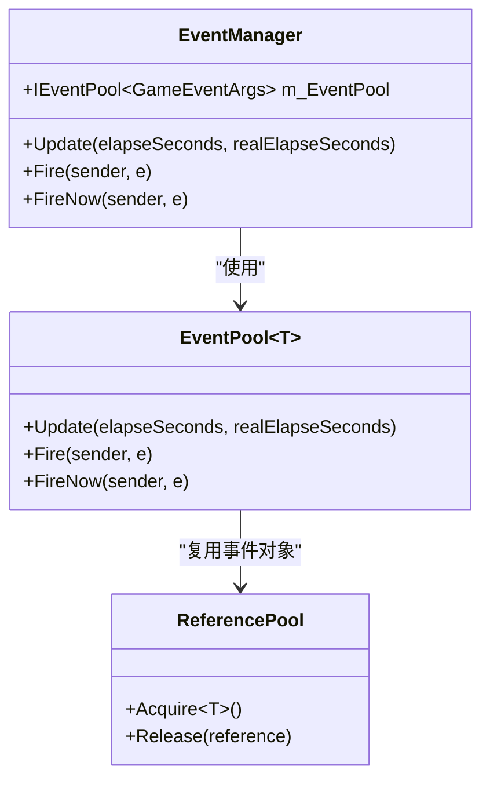

# 最佳实践

<cite>
**本文档引用文件**  
- [GameFrameworkEntry.cs](file://GameFramework/Base/GameFrameworkEntry.cs)
- [GameFrameworkModule.cs](file://GameFramework/Base/GameFrameworkModule.cs)
- [IEventManager.cs](file://GameFramework/Event/IEventManager.cs)
- [EventManager.cs](file://GameFramework/Event/EventManager.cs)
- [EventPool.cs](file://GameFramework/Base/EventPool/EventPool.cs)
- [EventPool.Event.cs](file://GameFramework/Base/EventPool/EventPool.Event.cs)
- [IResourceManager.cs](file://GameFramework/Resource/IResourceManager.cs)
- [ResourceManager.cs](file://GameFramework/Resource/ResourceManager.cs)
- [IObjectPoolManager.cs](file://GameFramework/ObjectPool/IObjectPoolManager.cs)
- [ObjectPoolManager.cs](file://GameFramework/ObjectPool/ObjectPoolManager.cs)
- [ReferencePool.cs](file://GameFramework/Base/ReferencePool/ReferencePool.cs)
- [ReferencePool.ReferenceCollection.cs](file://GameFramework/Base/ReferencePool/ReferencePool.ReferenceCollection.cs)
- [TaskPool.cs](file://GameFramework/Base/TaskPool/TaskPool.cs)
</cite>

## 目录
1. [项目结构组织](#项目结构组织)
2. [模块使用规范](#模块使用规范)
3. [性能调优建议](#性能调优建议)
4. [内存泄漏防范](#内存泄漏防范)
5. [错误处理模式](#错误处理模式)
6. [团队协作准则](#团队协作准则)
7. [典型游戏架构设计模式](#典型游戏架构设计模式)
8. [资源管理策略](#资源管理策略)
9. [事件命名规范](#事件命名规范)
10. [代码组织建议](#代码组织建议)
11. [常见反模式及改进方案](#常见反模式及改进方案)

## 项目结构组织

GameFramework 采用模块化设计，所有核心功能均按功能划分在 `GameFramework` 目录下的独立子模块中。每个模块如 `Entity`、`UI`、`Resource` 等均包含其接口定义（`Ixxx.cs`）和具体实现（`xxxManager.cs`），遵循清晰的职责分离原则。基础工具类如 `GameFrameworkEntry` 和 `GameFrameworkModule` 位于 `Base` 目录下，为整个框架提供运行时支持。

模块间的依赖通过 `GameFrameworkEntry.GetModule<T>()` 统一获取，确保了模块的单例性和初始化顺序的可控性。项目结构清晰，便于团队成员快速定位功能代码，也利于单元测试和模块替换。

**Section sources**
- [GameFrameworkEntry.cs](file://GameFramework/Base/GameFrameworkEntry.cs#L15-L131)
- [GameFrameworkModule.cs](file://GameFramework/Base/GameFrameworkModule.cs#L12-L37)

## 模块使用规范

使用 GameFramework 模块时，应始终通过 `GameFrameworkEntry.GetModule<T>()` 获取模块实例，其中 `T` 为模块的接口类型（如 `IResourceManager`）。此方法保证了模块的唯一性和正确的初始化流程。

所有模块均继承自 `GameFrameworkModule`，并实现了 `Update` 和 `Shutdown` 方法。框架通过 `GameFrameworkEntry.Update()` 统一调度所有模块的更新逻辑。开发者应避免直接创建模块实例，而应通过接口进行交互，以保证代码的可维护性和可测试性。

**Section sources**
- [GameFrameworkEntry.cs](file://GameFramework/Base/GameFrameworkEntry.cs#L15-L131)
- [GameFrameworkModule.cs](file://GameFramework/Base/GameFrameworkModule.cs#L12-L37)

## 性能调优建议

### 事件系统优化
事件系统 `EventManager` 内部使用 `EventPool` 管理事件，通过 `ReferencePool` 实现事件对象的复用，避免了频繁的 GC。建议在订阅事件时，确保在合适的时机（如对象销毁时）进行取消订阅，防止内存泄漏。

**Diagram sources**
- [EventManager.cs](file://GameFramework/Event/EventManager