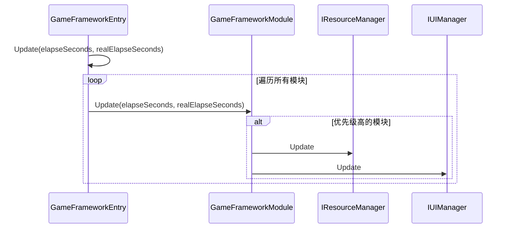
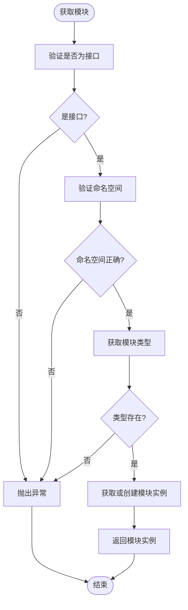
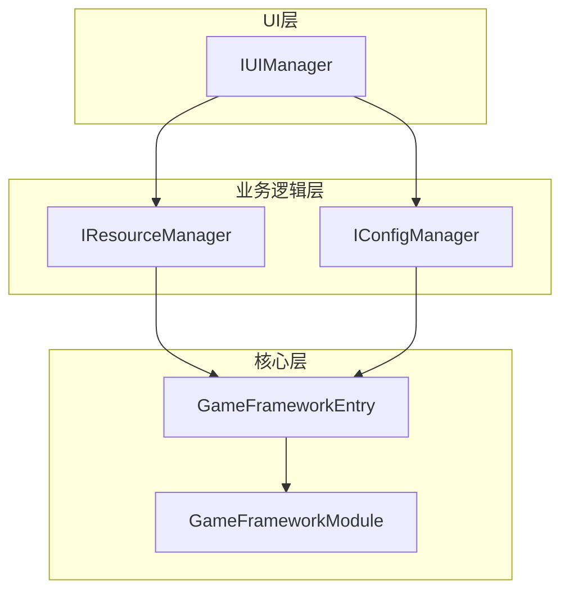
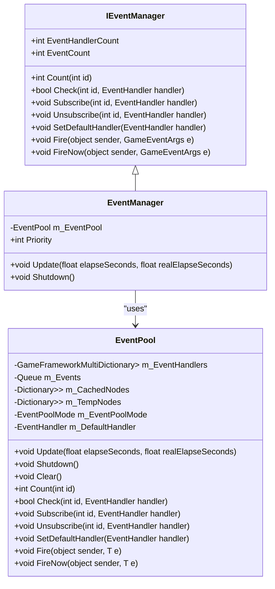

# 架构设计规范

<cite>
**Referenced Files in This Document**   
- [GameFrameworkEntry.cs](file://GameFramework/Base/GameFrameworkEntry.cs)
- [GameFrameworkModule.cs](file://GameFramework/Base/GameFrameworkModule.cs)
- [IConfigManager.cs](file://GameFramework/Config/IConfigManager.cs)
- [IResourceManager.cs](file://GameFramework/Resource/IResourceManager.cs)
- [IUIManager.cs](file://GameFramework/UI/IUIManager.cs)
- [EventManager.cs](file://GameFramework/Event/EventManager.cs)
- [IEventManager.cs](file://GameFramework/Event/IEventManager.cs)
- [EventPool.cs](file://GameFramework/Base/EventPool/EventPool.cs)
</cite>

## 目录
1. [模块化架构设计原则](#模块化架构设计原则)
2. [模块优先级机制](#模块优先级机制)
3. [依赖获取模式](#依赖获取模式)
4. [典型游戏架构分层](#典型游戏架构分层)
5. [模块间通信实践](#模块间通信实践)

## 模块化架构设计原则

GameFramework项目采用基于`GameFrameworkEntry`的模块化架构设计，通过`GameFrameworkModule`实现高内聚、低耦合的模块划分。这种设计模式将不同的功能职责封装在独立的模块中，每个模块都继承自抽象类`GameFrameworkModule`，并实现其定义的接口。

模块化设计的核心在于将系统分解为可管理的、独立的组件，每个组件负责特定的功能领域。例如，`IConfigManager`负责全局配置管理，`IResourceManager`处理资源加载与管理，`IUIManager`控制界面的显示与交互。这种划分方式确保了每个模块的职责单一，降低了模块间的耦合度。

```mermaid
classDiagram
class GameFrameworkModule {
+virtual int Priority
+abstract void Update(float elapseSeconds, float realElapseSeconds)
+abstract void Shutdown()
}
class GameFrameworkEntry {
+static void Update(float elapseSeconds, float realElapseSeconds)
+static void Shutdown()
+static T GetModule<T>()
-static GameFrameworkModule GetModule(Type moduleType)
-static GameFrameworkModule CreateModule(Type moduleType)
}
class IConfigManager {
+int Count
+int CachedBytesSize
+void SetResourceManager(IResourceManager resourceManager)
+void SetDataProviderHelper(IDataProviderHelper<IConfigManager> dataProviderHelper)
+void SetConfigHelper(IConfigHelper configHelper)
+void EnsureCachedBytesSize(int ensureSize)
+void FreeCachedBytes()
+bool HasConfig(string configName)
+bool GetBool(string configName)
+bool GetBool(string configName, bool defaultValue)
+int GetInt(string configName)
+int GetInt(string configName, int defaultValue)
+float GetFloat(string configName)
+float GetFloat(string configName, float defaultValue)
+string GetString(string configName)
+string GetString(string configName, string defaultValue)
+bool AddConfig(string configName, string configValue)
+bool AddConfig(string configName, bool boolValue, int intValue, float floatValue, string stringValue)
+bool RemoveConfig(string configName)
+void RemoveAllConfigs()
}
class IResourceManager {
+string ReadOnlyPath
+string ReadWritePath
+ResourceMode ResourceMode
+string CurrentVariant
+PackageVersionListSerializer PackageVersionListSerializer
+UpdatableVersionListSerializer UpdatableVersionListSerializer
+ReadOnlyVersionListSerializer ReadOnlyVersionListSerializer
+ReadWriteVersionListSerializer ReadWriteVersionListSerializer
+ResourcePackVersionListSerializer ResourcePackVersionListSerializer
+string ApplicableGameVersion
+int InternalResourceVersion
+int AssetCount
+int ResourceCount
+int ResourceGroupCount
+string UpdatePrefixUri
+int GenerateReadWriteVersionListLength
+string ApplyingResourcePackPath
+int ApplyWaitingCount
+int UpdateRetryCount
+IResourceGroup UpdatingResourceGroup
+int UpdateWaitingCount
+int UpdateWaitingWhilePlayingCount
+int UpdateCandidateCount
+int LoadTotalAgentCount
+int LoadFreeAgentCount
+int LoadWorkingAgentCount
+int LoadWaitingTaskCount
+float AssetAutoReleaseInterval
+int AssetCapacity
+float AssetExpireTime
+int AssetPriority
+float ResourceAutoReleaseInterval
+int ResourceCapacity
+float ResourceExpireTime
+int ResourcePriority
+event EventHandler<ResourceVerifyStartEventArgs> ResourceVerifyStart
+event EventHandler<ResourceVerifySuccessEventArgs> ResourceVerifySuccess
+event EventHandler<ResourceVerifyFailureEventArgs> ResourceVerifyFailure
+event EventHandler<ResourceApplyStartEventArgs> ResourceApplyStart
+event EventHandler<ResourceApplySuccessEventArgs> ResourceApplySuccess
+event EventHandler<ResourceApplyFailureEventArgs> ResourceApplyFailure
+event EventHandler<ResourceUpdateStartEventArgs> ResourceUpdateStart
+event EventHandler<ResourceUpdateChangedEventArgs> ResourceUpdateChanged
+event EventHandler<ResourceUpdateSuccessEventArgs> ResourceUpdateSuccess
+event EventHandler<ResourceUpdateFailureEventArgs> ResourceUpdateFailure
+event EventHandler<ResourceUpdateAllCompleteEventArgs> ResourceUpdateAllComplete
+void SetReadOnlyPath(string readOnlyPath)
+void SetReadWritePath(string readWritePath)
+void SetResourceMode(ResourceMode resourceMode)
+void SetCurrentVariant(string currentVariant)
+void SetObjectPoolManager(IObjectPoolManager objectPoolManager)
+void SetFileSystemManager(IFileSystemManager fileSystemManager)
+void SetDownloadManager(IDownloadManager downloadManager)
+void SetDecryptResourceCallback(DecryptResourceCallback decryptResourceCallback)
+void SetResourceHelper(IResourceHelper resourceHelper)
+void AddLoadResourceAgentHelper(ILoadResourceAgentHelper loadResourceAgentHelper)
+void InitResources(InitResourcesCompleteCallback initResourcesCompleteCallback)
+CheckVersionListResult CheckVersionList(int latestInternalResourceVersion)
+void UpdateVersionList(int versionListLength, int versionListHashCode, int versionListCompressedLength, int versionListCompressedHashCode, UpdateVersionListCallbacks updateVersionListCallbacks)
+void VerifyResources(int verifyResourceLengthPerFrame, VerifyResourcesCompleteCallback verifyResourcesCompleteCallback)
+void CheckResources(bool ignoreOtherVariant, CheckResourcesCompleteCallback checkResourcesCompleteCallback)
+void ApplyResources(string resourcePackPath, ApplyResourcesCompleteCallback applyResourcesCompleteCallback)
+void UpdateResources(UpdateResourcesCompleteCallback updateResourcesCompleteCallback)
+void UpdateResources(string resourceGroupName, UpdateResourcesCompleteCallback updateResourcesCompleteCallback)
+void StopUpdateResources()
+bool VerifyResourcePack(string resourcePackPath)
+TaskInfo[] GetAllLoadAssetInfos()
+void GetAllLoadAssetInfos(List<TaskInfo> results)
+HasAssetResult HasAsset(string assetName)
+void LoadAsset(string assetName, LoadAssetCallbacks loadAssetCallbacks)
+void LoadAsset(string assetName, Type assetType, LoadAssetCallbacks loadAssetCallbacks)
+void LoadAsset(string assetName, int priority, LoadAssetCallbacks loadAssetCallbacks)
+void LoadAsset(string assetName, LoadAssetCallbacks loadAssetCallbacks, object userData)
+void LoadAsset(string assetName, Type assetType, int priority, LoadAssetCallbacks loadAssetCallbacks)
+void LoadAsset(string assetName, Type assetType, LoadAssetCallbacks loadAssetCallbacks, object userData)
+void LoadAsset(string assetName, int priority, LoadAssetCallbacks loadAssetCallbacks, object userData)
+void LoadAsset(string assetName, Type assetType, int priority, LoadAssetCallbacks loadAssetCallbacks, object userData)
+void UnloadAsset(object asset)
+void LoadScene(string sceneAssetName, LoadSceneCallbacks loadSceneCallbacks)
+void LoadScene(string sceneAssetName, int priority, LoadSceneCallbacks loadSceneCallbacks)
+void LoadScene(string sceneAssetName, LoadSceneCallbacks loadSceneCallbacks, object userData)
+void LoadScene(string sceneAssetName, int priority, LoadSceneCallbacks loadSceneCallbacks, object userData)
+void UnloadScene(string sceneAssetName, UnloadSceneCallbacks unloadSceneCallbacks)
+void UnloadScene(string sceneAssetName, UnloadSceneCallbacks unloadSceneCallbacks, object userData)
+string GetBinaryPath(string binaryAssetName)
+bool GetBinaryPath(string binaryAssetName, out bool storageInReadOnly, out bool storageInFileSystem, out string relativePath, out string fileName)
+int GetBinaryLength(string binaryAssetName)
+void LoadBinary(string binaryAssetName, LoadBinaryCallbacks loadBinaryCallbacks)
+void LoadBinary(string binaryAssetName, LoadBinaryCallbacks loadBinaryCallbacks, object userData)
+byte[] LoadBinaryFromFileSystem(string binaryAssetName)
+int LoadBinaryFromFileSystem(string binaryAssetName, byte[] buffer)
+int LoadBinaryFromFileSystem(string binaryAssetName, byte[] buffer, int startIndex)
+int LoadBinaryFromFileSystem(string binaryAssetName, byte[] buffer, int startIndex, int length)
+byte[] LoadBinarySegmentFromFileSystem(string binaryAssetName, int length)
+byte[] LoadBinarySegmentFromFileSystem(string binaryAssetName, int offset, int length)
+int LoadBinarySegmentFromFileSystem(string binaryAssetName, byte[] buffer)
+int LoadBinarySegmentFromFileSystem(string binaryAssetName, byte[] buffer, int length)
+int LoadBinarySegmentFromFileSystem(string binaryAssetName, byte[] buffer, int startIndex, int length)
+int LoadBinarySegmentFromFileSystem(string binaryAssetName, int offset, byte[] buffer)
+int LoadBinarySegmentFromFileSystem(string binaryAssetName, int offset, byte[] buffer, int length)
+int LoadBinarySegmentFromFileSystem(string binaryAssetName, int offset, byte[] buffer, int startIndex, int length)
+bool HasResourceGroup(string resourceGroupName)
+IResourceGroup GetResourceGroup()
+IResourceGroup GetResourceGroup(string resourceGroupName)
+IResourceGroup[] GetAllResourceGroups()
+void GetAllResourceGroups(List<IResourceGroup> results)
+IResourceGroupCollection GetResourceGroupCollection(params string[] resourceGroupNames)
+IResourceGroupCollection GetResourceGroupCollection(List<string> resourceGroupNames)
}
class IUIManager {
+int UIGroupCount
+float InstanceAutoReleaseInterval
+int InstanceCapacity
+float InstanceExpireTime
+int InstancePriority
+event EventHandler<OpenUIFormSuccessEventArgs> OpenUIFormSuccess
+event EventHandler<OpenUIFormFailureEventArgs> OpenUIFormFailure
+event EventHandler<OpenUIFormUpdateEventArgs> OpenUIFormUpdate
+event EventHandler<OpenUIFormDependencyAssetEventArgs> OpenUIFormDependencyAsset
+event EventHandler<CloseUIFormCompleteEventArgs> CloseUIFormComplete
+void SetObjectPoolManager(IObjectPoolManager objectPoolManager)
+void SetResourceManager(IResourceManager resourceManager)
+void SetUIFormHelper(IUIFormHelper uiFormHelper)
+bool HasUIGroup(string uiGroupName)
+IUIGroup GetUIGroup(string uiGroupName)
+IUIGroup[] GetAllUIGroups()
+void GetAllUIGroups(List<IUIGroup> results)
+bool AddUIGroup(string uiGroupName, IUIGroupHelper uiGroupHelper)
+bool AddUIGroup(string uiGroupName, int uiGroupDepth, IUIGroupHelper uiGroupHelper)
+bool HasUIForm(int serialId)
+bool HasUIForm(string uiFormAssetName)
+IUIForm GetUIForm(int serialId)
+IUIForm GetUIForm(string uiFormAssetName)
+IUIForm[] GetUIForms(string uiFormAssetName)
+void GetUIForms(string uiFormAssetName, List<IUIForm> results)
+IUIForm[] GetAllLoadedUIForms()
+void GetAllLoadedUIForms(List<IUIForm> results)
+int[] GetAllLoadingUIFormSerialIds()
+void GetAllLoadingUIFormSerialIds(List<int> results)
+bool IsLoadingUIForm(int serialId)
+bool IsLoadingUIForm(string uiFormAssetName)
+bool IsValidUIForm(IUIForm uiForm)
+int OpenUIForm(string uiFormAssetName, string uiGroupName)
+int OpenUIForm(string uiFormAssetName, string uiGroupName, int priority)
+int OpenUIForm(string uiFormAssetName, string uiGroupName, bool pauseCoveredUIForm)
+int OpenUIForm(string uiFormAssetName, string uiGroupName, object userData)
+int OpenUIForm(string uiFormAssetName, string uiGroupName, int priority, bool pauseCoveredUIForm)
+int OpenUIForm(string uiFormAssetName, string uiGroupName, int priority, object userData)
+int OpenUIForm(string uiFormAssetName, string uiGroupName, bool pauseCoveredUIForm, object userData)
+int OpenUIForm(string uiFormAssetName, string uiGroupName, int priority, bool pauseCoveredUIForm, object userData)
+void CloseUIForm(int serialId)
+void CloseUIForm(int serialId, object userData)
+void CloseUIForm(IUIForm uiForm)
+void CloseUIForm(IUIForm uiForm, object userData)
+void CloseAllLoadedUIForms()
+void CloseAllLoadedUIForms(object userData)
+void CloseAllLoadingUIForms()
+void RefocusUIForm(IUIForm uiForm)
+void RefocusUIForm(IUIForm uiForm, object userData)
+void SetUIFormInstanceLocked(object uiFormInstance, bool locked)
+void SetUIFormInstancePriority(object uiFormInstance, int priority)
}
GameFrameworkEntry --> GameFrameworkModule : "manages"
IConfigManager --> IResourceManager : "depends on"
IUIManager --> IResourceManager : "depends on"
```

**Diagram sources**
- [GameFrameworkEntry.cs](file://GameFramework/Base/GameFrameworkEntry.cs#L15-L131)
- [GameFrameworkModule.cs](file://GameFramework/Base/GameFrameworkModule.cs#L12-L37)
- [IConfigManager.cs](file://GameFramework/Config/IConfigManager.cs#L14-L158)
- [IResourceManager.cs](file://GameFramework/Resource/IResourceManager.cs#L18-L830)
- [IUIManager.cs](file://GameFramework/UI/IUIManager.cs#L17-L380)

**Section sources**
- [GameFrameworkEntry.cs](file://GameFramework/Base/GameFrameworkEntry.cs#L15-L131)
- [GameFrameworkModule.cs](file://GameFramework/Base/GameFrameworkModule.cs#L12-L37)

## 模块优先级机制

模块优先级（Priority）机制在GameFramework中起着至关重要的作用，它控制着模块的初始化和更新顺序。每个模块通过重写`Priority`属性来定义其优先级，优先级较高的模块会优先进行轮询，并且在关闭时后进行。

在`GameFrameworkEntry`中，模块的创建和排序逻辑通过`CreateModule`方法实现。当创建新模块时，系统会遍历已存在的模块链表，根据优先级将新模块插入到适当的位置。这种基于优先级的排序确保了关键模块（如资源管理、事件系统）能够优先初始化和更新。

**Diagram sources**
- [GameFrameworkEntry.cs](file://GameFramework/Base/GameFrameworkEntry.cs#L15-L131)
- [GameFrameworkModule.cs](file://GameFramework/Base/GameFrameworkModule.cs#L12-L37)

**Section sources**
- [GameFrameworkEntry.cs](file://GameFramework/Base/GameFrameworkEntry.cs#L15-L131)
- [GameFrameworkModule.cs](file://GameFramework/Base/GameFrameworkModule.cs#L12-L37)

## 依赖获取模式

`GameFrameworkEntry.GetModule<T>()`是获取模块依赖的核心方法，它采用泛型接口的方式获取指定类型的模块实例。这种设计模式遵循了依赖倒置原则，使得模块间的依赖关系更加清晰和可控。

在使用`GetModule<T>()`时，必须通过接口类型来获取模块，这确保了模块间的松耦合。例如，要获取资源管理器，应使用`IResourceManager`接口而不是具体的实现类。这种方法不仅提高了代码的可测试性，还便于在不同环境下替换模块的实现。

**Diagram sources**
- [GameFrameworkEntry.cs](file://GameFramework/Base/GameFrameworkEntry.cs#L15-L131)

**Section sources**
- [GameFrameworkEntry.cs](file://GameFramework/Base/GameFrameworkEntry.cs#L15-L131)

## 典型游戏架构分层

典型的GameFramework架构分层包括核心层、业务逻辑层和UI层。核心层包含`GameFrameworkEntry`和基础模块，负责整个框架的启动和管理。业务逻辑层包含`IConfigManager`、`IResourceManager`等模块，处理游戏的核心逻辑。UI层由`IUIManager`管理，负责界面的显示和用户交互。

这种分层架构确保了各层之间的职责分离，核心层不直接依赖于UI层，而是通过事件系统进行通信。业务逻辑层作为中间层，既依赖于核心层提供的基础服务，又为UI层提供数据支持。

**Diagram sources**
- [GameFrameworkEntry.cs](file://GameFramework/Base/GameFrameworkEntry.cs#L15-L131)
- [GameFrameworkModule.cs](file://GameFramework/Base/GameFrameworkModule.cs#L12-L37)
- [IConfigManager.cs](file://GameFramework/Config/IConfigManager.cs#L14-L158)
- [IResourceManager.cs](file://GameFramework/Resource/IResourceManager.cs#L18-L830)
- [IUIManager.cs](file://GameFramework/UI/IUIManager.cs#L17-L380)

**Section sources**
- [GameFrameworkEntry.cs](file://GameFramework/Base/GameFrameworkEntry.cs#L15-L131)
- [GameFrameworkModule.cs](file://GameFramework/Base/GameFrameworkModule.cs#L12-L37)
- [IConfigManager.cs](file://GameFramework/Config/IConfigManager.cs#L14-L158)
- [IResourceManager.cs](file://GameFramework/Resource/IResourceManager.cs#L18-L830)
- [IUIManager.cs](file://GameFramework/UI/IUIManager.cs#L17-L380)

## 模块间通信实践

模块间通信应优先使用事件系统而非直接引用，这是GameFramework设计的重要原则。事件系统通过`IEventManager`接口提供，允许模块间进行松耦合的通信。模块可以订阅特定类型的事件，在事件发生时执行相应的处理逻辑。

事件系统的优势在于它解耦了事件的发布者和订阅者，使得模块可以独立开发和测试。例如，当资源加载完成时，`IResourceManager`可以抛出一个资源加载完成事件，而不需要知道哪些模块对此事件感兴趣。任何需要响应此事件的模块都可以订阅该事件，从而实现灵活的通信机制。

**Diagram sources**
- [IEventManager.cs](file://GameFramework/Event/IEventManager.cs#L0-L82)
- [EventManager.cs](file://GameFramework/Event/EventManager.cs#L0-L149)
- [EventPool.cs](file://GameFramework/Base/EventPool/EventPool.cs#L0-L285)

**Section sources**
- [IEventManager.cs](file://GameFramework/Event/IEventManager.cs#L0-L82)
- [EventManager.cs](file://GameFramework/Event/EventManager.cs#L0-L149)
- [EventPool.cs](file://GameFramework/Base/EventPool/EventPool.cs#L0-L285)