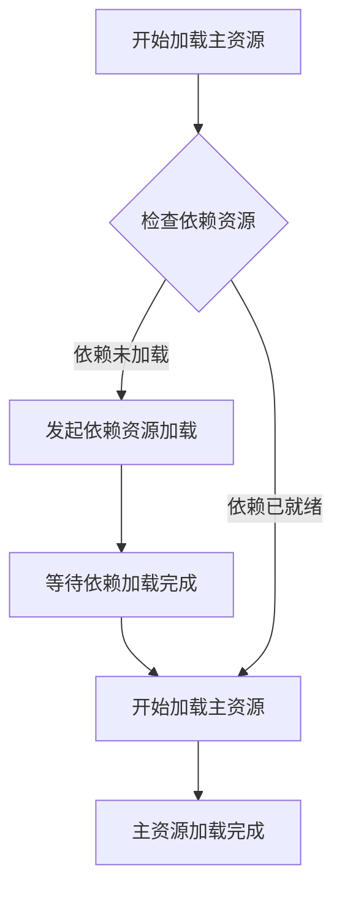
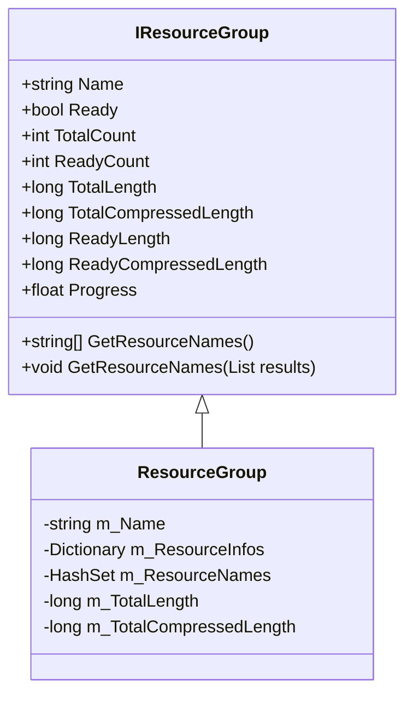
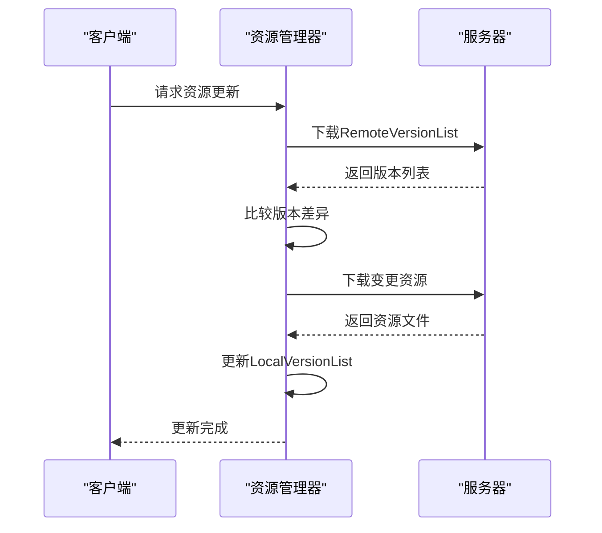
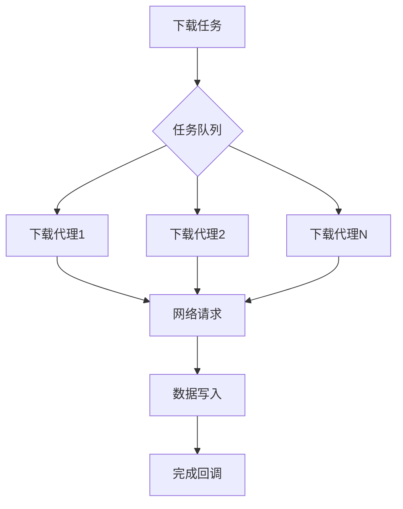
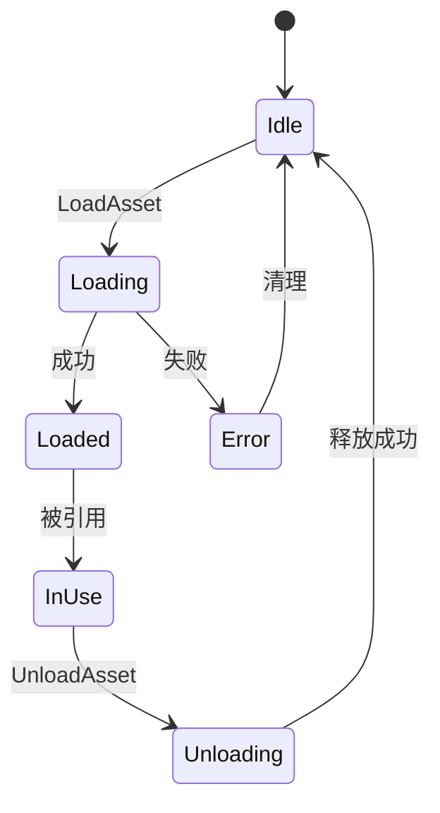

# 资源管理规范

<cite>
**本文档中引用的文件**  
- [IResourceGroup.cs](file://GameFramework/Resource/IResourceGroup.cs)
- [ResourceManager.cs](file://GameFramework/Resource/ResourceManager.cs)
- [ResourceManager.ResourceLoader.cs](file://GameFramework/Resource/ResourceManager.ResourceLoader.cs)
- [PackageVersionList.cs](file://GameFramework/Resource/PackageVersionList.cs)
- [LocalVersionList.cs](file://GameFramework/Resource/LocalVersionList.cs)
- [DownloadManager.cs](file://GameFramework/Download/DownloadManager.cs)
- [ResourceManager.ResourceUpdater.cs](file://GameFramework/Resource/ResourceManager.ResourceUpdater.cs)
- [ResourceManager.ResourceGroup.cs](file://GameFramework/Resource/ResourceManager.ResourceGroup.cs)
- [ResourceManager.ResourceChecker.cs](file://GameFramework/Resource/ResourceManager.ResourceChecker.cs)
- [ResourceManager.ResourceGroupCollection.cs](file://GameFramework/Resource/ResourceManager.ResourceGroupCollection.cs)
- [ResourceManager.ResourceInfo.cs](file://GameFramework/Resource/ResourceManager.ResourceInfo.cs)
- [ResourceManager.ResourceLoader.LoadResourceAgent.cs](file://GameFramework/Resource/ResourceManager.ResourceLoader.LoadResourceAgent.cs)
- [ResourceManager.ResourceLoader.ResourceObject.cs](file://GameFramework/Resource/ResourceManager.ResourceLoader.ResourceObject.cs)
- [ResourceManager.ResourceLoader.LoadAssetTask.cs](file://GameFramework/Resource/ResourceManager.ResourceLoader.LoadAssetTask.cs)
</cite>

## 目录
1. [异步资源加载](#异步资源加载)
2. [资源依赖管理](#资源依赖管理)
3. [资源组划分策略](#资源组划分策略)
4. [版本控制与增量更新](#版本控制与增量更新)
5. [下载并发控制](#下载并发控制)
6. [资源生命周期管理](#资源生命周期管理)

## 异步资源加载

在基于GameFramework的项目中，必须使用异步加载接口（如`LoadAssetAsync`）来加载资源，以避免阻塞主线程。同步加载方式会导致UI卡顿和性能下降，尤其是在移动设备上。通过异步加载，可以确保游戏运行流畅，同时提供加载进度反馈。

资源管理器通过任务池（TaskPool）管理所有加载任务，确保资源加载在后台线程中进行。开发者应使用`LoadAssetCallbacks`回调函数集来处理加载成功、失败和进度更新事件，从而实现非阻塞式的资源加载流程。

**Section sources**
- [ResourceManager.ResourceLoader.cs](file://GameFramework/Resource/ResourceManager.ResourceLoader.cs#L136-L142)
- [ResourceManager.ResourceLoader.LoadAssetTask.cs](file://GameFramework/Resource/ResourceManager.ResourceLoader.LoadAssetTask.cs#L13-L88)

## 资源依赖管理

正确的资源依赖管理是确保资源正确加载的关键。GameFramework通过`LoadAssetDependencyAssetCallback`机制，在加载主资源前自动检查并加载其依赖项。每个资源的依赖关系在版本列表中定义，并在加载时由资源管理器自动解析。

当加载一个资源时，系统会首先检查其所有依赖资源是否已准备就绪。如果依赖资源尚未加载，则会自动发起依赖资源的加载任务。只有当所有依赖资源都成功加载后，主资源才会开始加载过程。这种机制保证了资源加载的完整性和一致性。

**Diagram sources**
- [ResourceManager.ResourceLoader.cs](file://GameFramework/Resource/ResourceManager.ResourceLoader.cs#L136-L142)
- [ResourceManager.ResourceLoader.LoadAssetTask.cs](file://GameFramework/Resource/ResourceManager.ResourceLoader.LoadAssetTask.cs#L13-L88)

**Section sources**
- [ResourceManager.ResourceLoader.cs](file://GameFramework/Resource/ResourceManager.ResourceLoader.cs#L136-L142)
- [ResourceManager.ResourceLoader.LoadAssetTask.cs](file://GameFramework/Resource/ResourceManager.ResourceLoader.LoadAssetTask.cs#L13-L88)

## 资源组划分策略

合理的资源组划分对于优化热更新效率至关重要。GameFramework支持按场景、功能模块或更新频率对资源进行分组。每个资源组（ResourceGroup）可以独立管理其加载和更新状态。

资源组的划分应遵循以下原则：
- 按场景划分：将每个游戏场景所需的资源单独分组，便于场景切换时的资源管理
- 按功能模块划分：将UI、音效、角色等不同功能的资源分别归组
- 按更新频率划分：将经常更新的内容与稳定内容分离，减少更新包大小

通过`IResourceGroup`接口，可以获取资源组的准备状态、包含资源数量和加载进度等信息，便于实现精细化的资源管理。

**Diagram sources**
- [IResourceGroup.cs](file://GameFramework/Resource/IResourceGroup.cs#L14-L99)
- [ResourceManager.ResourceGroup.cs](file://GameFramework/Resource/ResourceManager.ResourceGroup.cs#L12-L268)

**Section sources**
- [IResourceGroup.cs](file://GameFramework/Resource/IResourceGroup.cs#L14-L99)
- [ResourceManager.ResourceGroup.cs](file://GameFramework/Resource/ResourceManager.ResourceGroup.cs#L12-L268)

## 版本控制与增量更新

GameFramework通过版本控制机制实现资源的增量更新。系统使用`LocalVersionList`和`PackageVersionList`来管理本地和远程的资源版本信息。`LocalVersionList`存储当前设备上的资源状态，而`PackageVersionList`描述服务器端的最新资源版本。

资源更新流程如下：
1. 下载远程版本列表（RemoteVersionList）
2. 比较本地与远程版本差异
3. 仅下载发生变化的资源文件
4. 更新本地版本列表

通过`ResourceUpdater`组件，可以监控更新进度并处理更新事件。增量更新大大减少了需要下载的数据量，提高了更新效率并节省了用户流量。

**Diagram sources**
- [PackageVersionList.cs](file://GameFramework/Resource/PackageVersionList.cs#L39-L48)
- [LocalVersionList.cs](file://GameFramework/Resource/LocalVersionList.cs#L29-L34)
- [ResourceManager.ResourceUpdater.cs](file://GameFramework/Resource/ResourceManager.ResourceUpdater.cs#L151-L157)

**Section sources**
- [PackageVersionList.cs](file://GameFramework/Resource/PackageVersionList.cs#L39-L48)
- [LocalVersionList.cs](file://GameFramework/Resource/LocalVersionList.cs#L29-L34)
- [ResourceManager.ResourceUpdater.cs](file://GameFramework/Resource/ResourceManager.ResourceUpdater.cs#L151-L157)

## 下载并发控制

下载管理器（DownloadManager）负责控制资源下载的并发数量，以平衡下载速度与系统负载。通过合理配置下载并发数，可以在保证下载效率的同时避免过度消耗系统资源。

下载管理器的主要配置参数包括：
- `TotalAgentCount`：下载代理总数
- `FreeAgentCount`：可用下载代理数量
- `WorkingAgentCount`：工作中下载代理数量
- `FlushSize`：写入磁盘的缓冲区大小
- `Timeout`：下载超时时间

开发者应根据目标平台的性能特征调整这些参数。例如，在移动设备上应适当降低并发数以节省电量和带宽，而在PC平台上可以提高并发数以加快下载速度。

**Diagram sources**
- [DownloadManager.cs](file://GameFramework/Download/DownloadManager.cs#L31-L41)
- [DownloadManager.DownloadAgent.cs](file://GameFramework/Download/DownloadManager.DownloadAgent.cs#L12-L373)

**Section sources**
- [DownloadManager.cs](file://GameFramework/Download/DownloadManager.cs#L31-L41)
- [DownloadManager.DownloadAgent.cs](file://GameFramework/Download/DownloadManager.DownloadAgent.cs#L12-L373)

## 资源生命周期管理

有效的资源生命周期管理对于防止内存泄漏和优化性能至关重要。GameFramework通过对象池（ObjectPool）和引用计数机制来管理资源的生命周期。

关键管理建议包括：
- 及时卸载不再使用的资源，调用`UnloadAsset`方法
- 避免资源引用残留，确保所有引用在使用完毕后被清除
- 合理配置对象池参数，如自动释放间隔、对象过期时间和池容量
- 监控资源使用情况，及时发现和修复资源泄漏问题

资源管理器会跟踪每个资源的引用关系，并在资源不再被引用时自动释放。开发者应遵循"谁加载，谁释放"的原则，确保资源的加载和卸载操作成对出现。

**Diagram sources**
- [ResourceManager.ResourceLoader.ResourceObject.cs](file://GameFramework/Resource/ResourceManager.ResourceLoader.ResourceObject.cs#L0-L125)
- [ResourceManager.ResourceLoader.cs](file://GameFramework/Resource/ResourceManager.ResourceLoader.cs#L136-L142)

**Section sources**
- [ResourceManager.ResourceLoader.ResourceObject.cs](file://GameFramework/Resource/ResourceManager.ResourceLoader.ResourceObject.cs#L0-L125)
- [ResourceManager.ResourceLoader.cs](file://GameFramework/Resource/ResourceManager.ResourceLoader.cs#L136-L142)