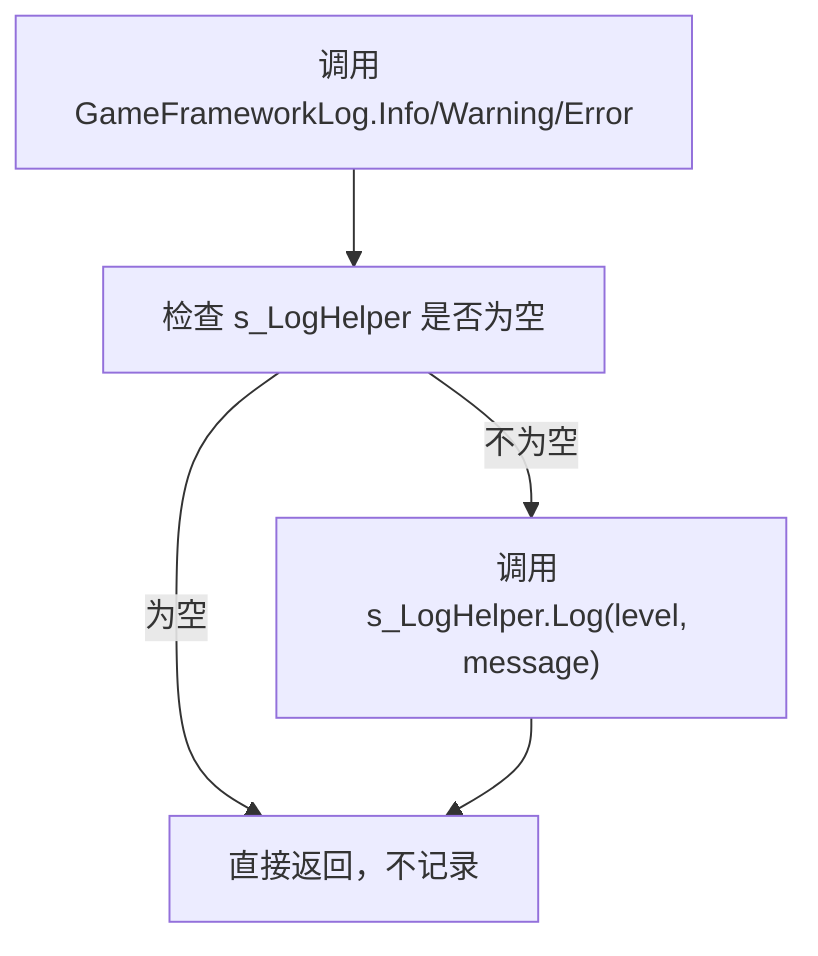
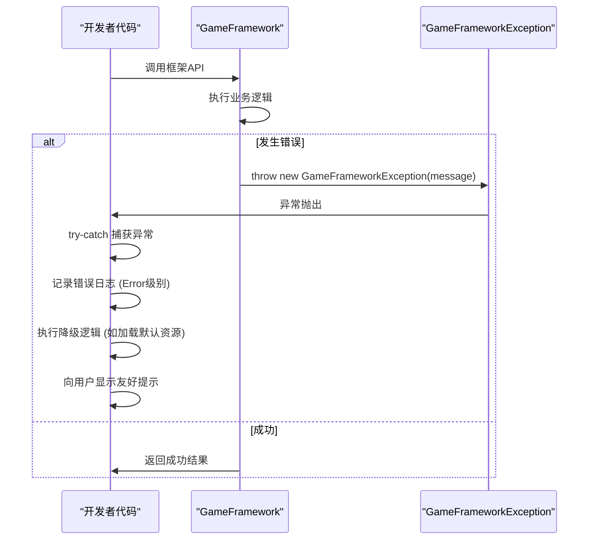
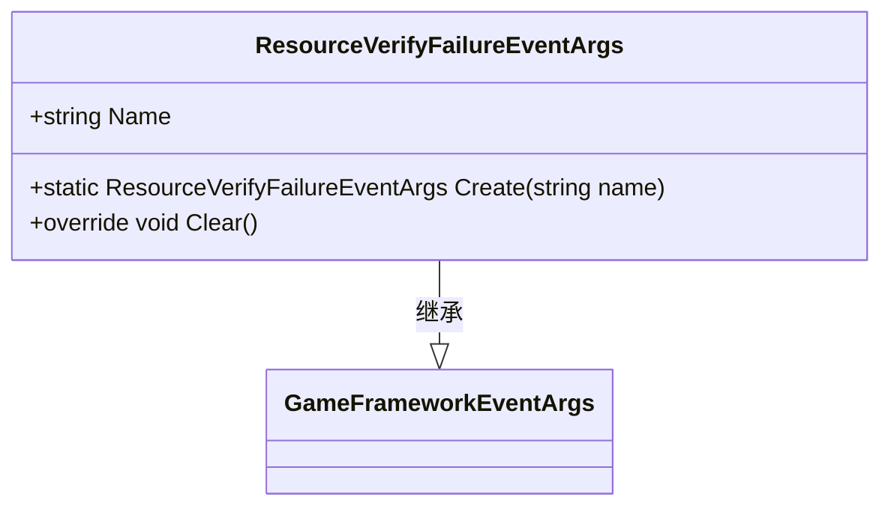
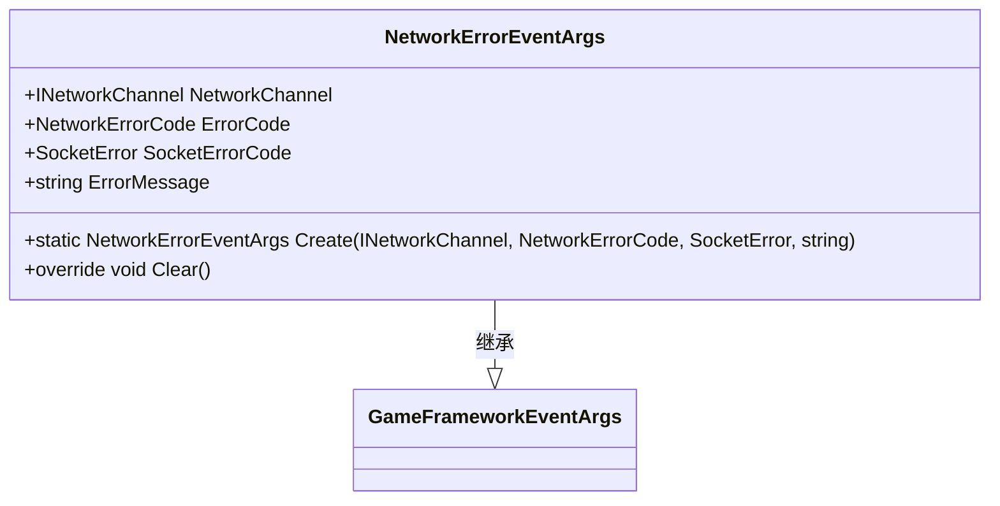
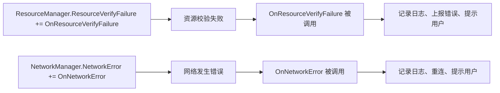
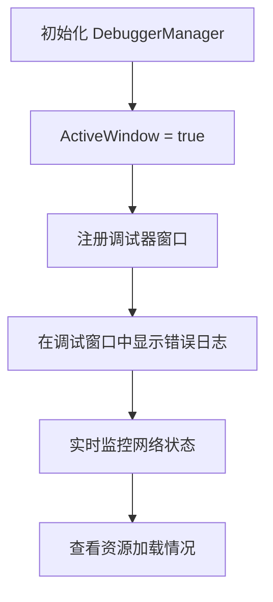

# 错误处理与日志记录

<cite>
**本文档中引用的文件**  
- [GameFrameworkLog.cs](file://GameFramework/Base/Log/GameFrameworkLog.cs)
- [GameFrameworkLogLevel.cs](file://GameFramework/Base/Log/GameFrameworkLogLevel.cs)
- [GameFrameworkException.cs](file://GameFramework/Base/GameFrameworkException.cs)
- [ResourceVerifyFailureEventArgs.cs](file://GameFramework/Resource/ResourceVerifyFailureEventArgs.cs)
- [NetworkErrorEventArgs.cs](file://GameFramework/Network/NetworkErrorEventArgs.cs)
- [DebuggerManager.cs](file://GameFramework/Debugger/DebuggerManager.cs)
- [ResourceManager.ResourceVerifier.cs](file://GameFramework/Resource/ResourceManager.ResourceVerifier.cs)
- [NetworkManager.cs](file://GameFramework/Network/NetworkManager.cs)
</cite>

## 目录
1. [简介](#简介)
2. [日志记录规范](#日志记录规范)
3. [异常处理机制](#异常处理机制)
4. [错误事件监控](#错误事件监控)
5. [错误码与可读性消息](#错误码与可读性消息)
6. [运行时错误可视化](#运行时错误可视化)
7. [最佳实践总结](#最佳实践总结)

## 简介
本指南旨在为GameFramework框架制定统一的错误处理和日志记录最佳实践。通过规范日志使用、强化异常处理、利用框架提供的错误事件机制，确保游戏在各种异常情况下能够优雅降级，避免崩溃，并提供有效的错误追踪和用户反馈机制。

**Section sources**
- [GameFrameworkLog.cs](file://GameFramework/Base/Log/GameFrameworkLog.cs#L1-L50)
- [GameFrameworkException.cs](file://GameFramework/Base/GameFrameworkException.cs#L1-L20)

## 日志记录规范

### GameFrameworkLog 使用规范
`GameFrameworkLog` 提供了静态方法用于记录不同级别的日志。开发者应通过 `SetLogHelper` 方法设置自定义的日志辅助器来控制日志输出行为。

**Diagram sources**
- [GameFrameworkLog.cs](file://GameFramework/Base/Log/GameFrameworkLog.cs#L20-L23)
- [GameFrameworkLog.cs](file://GameFramework/Base/Log/GameFrameworkLog.cs#L553-L561)

### 日志级别应用场景
- **Info**: 记录程序正常运行的关键流程和状态信息，如模块初始化完成、资源加载成功等。
- **Warning**: 记录潜在问题或非致命错误，如配置项缺失但有默认值、网络延迟较高、资源加载耗时过长等。
- **Error**: 记录导致功能无法正常工作的错误，如文件读取失败、网络连接中断、数据解析错误等。
- **Fatal**: 记录可能导致程序崩溃的严重错误。

### 生产环境Debug日志禁用
根据规范，**禁止在生产环境中输出Debug日志**。`GameFrameworkLog.Debug` 方法虽然存在，但应在发布版本中通过编译器指令或配置将其禁用，以避免性能损耗和日志污染。

**Section sources**
- [GameFrameworkLog.cs](file://GameFramework/Base/Log/GameFrameworkLog.cs#L29-L51)
- [GameFrameworkLog.cs](file://GameFramework/Base/Log/GameFrameworkLog.cs#L553-L759)
- [GameFrameworkLogLevel.cs](file://GameFramework/Base/Log/GameFrameworkLogLevel.cs#L1-L41)

## 异常处理机制

### GameFrameworkException 捕获与处理
`GameFrameworkException` 是框架定义的核心异常类型，所有框架抛出的异常都应继承此类。开发者应捕获此类异常并进行优雅降级处理。

**Diagram sources**
- [GameFrameworkException.cs](file://GameFramework/Base/GameFrameworkException.cs#L15-L54)
- [GameFrameworkLog.cs](file://GameFramework/Base/Log/GameFrameworkLog.cs#L1601-L1623)

### 优雅降级策略
当捕获到 `GameFrameworkException` 时，应避免游戏直接崩溃。推荐的降级策略包括：
1.  **记录错误**: 使用 `GameFrameworkLog.Error` 记录详细的错误信息。
2.  **恢复状态**: 将相关模块或系统恢复到一个安全的初始状态。
3.  **提供替代方案**: 例如，当资源加载失败时，加载一个默认的占位资源。
4.  **用户通知**: 通过UI向用户显示一个清晰、友好的错误提示，告知其发生了什么以及可能的解决方案。

**Section sources**
- [GameFrameworkException.cs](file://GameFramework/Base/GameFrameworkException.cs#L15-L54)
- [GameFrameworkLog.cs](file://GameFramework/Base/Log/GameFrameworkLog.cs#L1601-L1623)

## 错误事件监控

### ResourceVerifyFailureEventArgs
当资源校验失败时，框架会触发 `ResourceVerifyFailureEventArgs` 事件。该事件包含失败的资源名称，可用于监控资源完整性。

**Diagram sources**
- [ResourceVerifyFailureEventArgs.cs](file://GameFramework/Resource/ResourceVerifyFailureEventArgs.cs#L12-L50)

### NetworkErrorEventArgs
当网络通信发生错误时，框架会触发 `NetworkErrorEventArgs` 事件。该事件提供了详细的错误信息，包括网络频道、错误码、Socket错误码和错误消息。

**Diagram sources**
- [NetworkErrorEventArgs.cs](file://GameFramework/Network/NetworkErrorEventArgs.cs#L14-L91)

### 事件订阅与处理
开发者应订阅这些事件，以便进行集中监控和处理。

**Section sources**
- [ResourceVerifyFailureEventArgs.cs](file://GameFramework/Resource/ResourceVerifyFailureEventArgs.cs#L12-L50)
- [NetworkErrorEventArgs.cs](file://GameFramework/Network/NetworkErrorEventArgs.cs#L14-L91)
- [ResourceManager.ResourceVerifier.cs](file://GameFramework/Resource/ResourceManager.ResourceVerifier.cs#L1-L389)
- [NetworkManager.cs](file://GameFramework/Network/NetworkManager.cs#L1-L353)

## 错误码与可读性消息

### 建立错误码体系
建议为应用定义一套清晰的错误码体系。例如：
- `1000-1999`: 资源相关错误
- `2000-2999`: 网络相关错误
- `3000-3999`: 用户数据相关错误

### 可读性错误消息编写规范
错误消息应遵循以下规范：
1.  **清晰明确**: 直接说明发生了什么问题。
2.  **用户友好**: 避免使用技术术语，用用户能理解的语言描述。
3.  **提供解决方案**: 如果可能，给出用户可以采取的解决步骤。
4.  **包含错误码**: 在日志中记录完整的错误码，便于开发人员定位。

例如，一个可读性错误消息可以是：“网络连接失败 (错误码: 2001)。请检查您的网络连接后重试。”

**Section sources**
- [NetworkErrorEventArgs.cs](file://GameFramework/Network/NetworkErrorEventArgs.cs#L14-L91)
- [ResourceVerifyFailureEventArgs.cs](file://GameFramework/Resource/ResourceVerifyFailureEventArgs.cs#L12-L50)

## 运行时错误可视化

### Debugger 模块集成
`DebuggerManager` 提供了运行时调试窗口，可用于可视化追踪错误。

开发者可以利用 `RegisterDebuggerWindow` 方法注册自定义的调试窗口，将错误信息、日志和系统状态以可视化的方式呈现，极大地方便了运行时的问题排查。

**Diagram sources**
- [DebuggerManager.cs](file://GameFramework/Debugger/DebuggerManager.cs#L1-L141)

**Section sources**
- [DebuggerManager.cs](file://GameFramework/Debugger/DebuggerManager.cs#L1-L141)

## 最佳实践总结
1.  **日志规范**: 严格区分 `Info`、`Warning`、`Error` 级别，生产环境禁用 `Debug` 日志。
2.  **异常健壮性**: 全面捕获 `GameFrameworkException`，实现优雅降级，避免游戏崩溃。
3.  **事件驱动监控**: 订阅 `ResourceVerifyFailureEventArgs`、`NetworkErrorEventArgs` 等框架事件，实现集中式错误监控。
4.  **用户友好提示**: 建立错误码体系，编写清晰、可读的错误消息，并通过UI向用户反馈。
5.  **可视化追踪**: 结合 `Debugger` 模块，实现运行时错误的可视化追踪和调试。