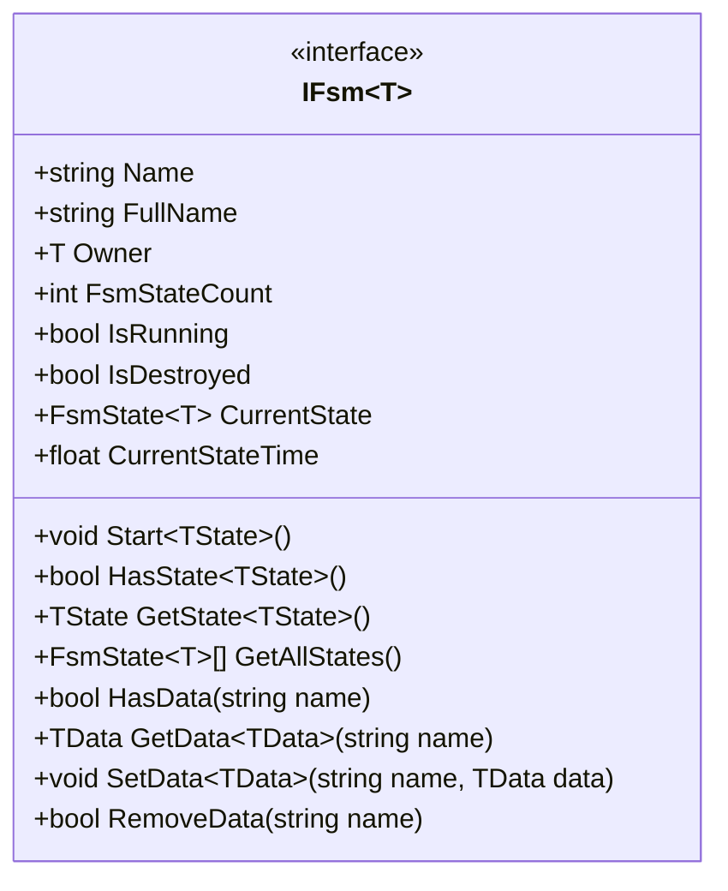
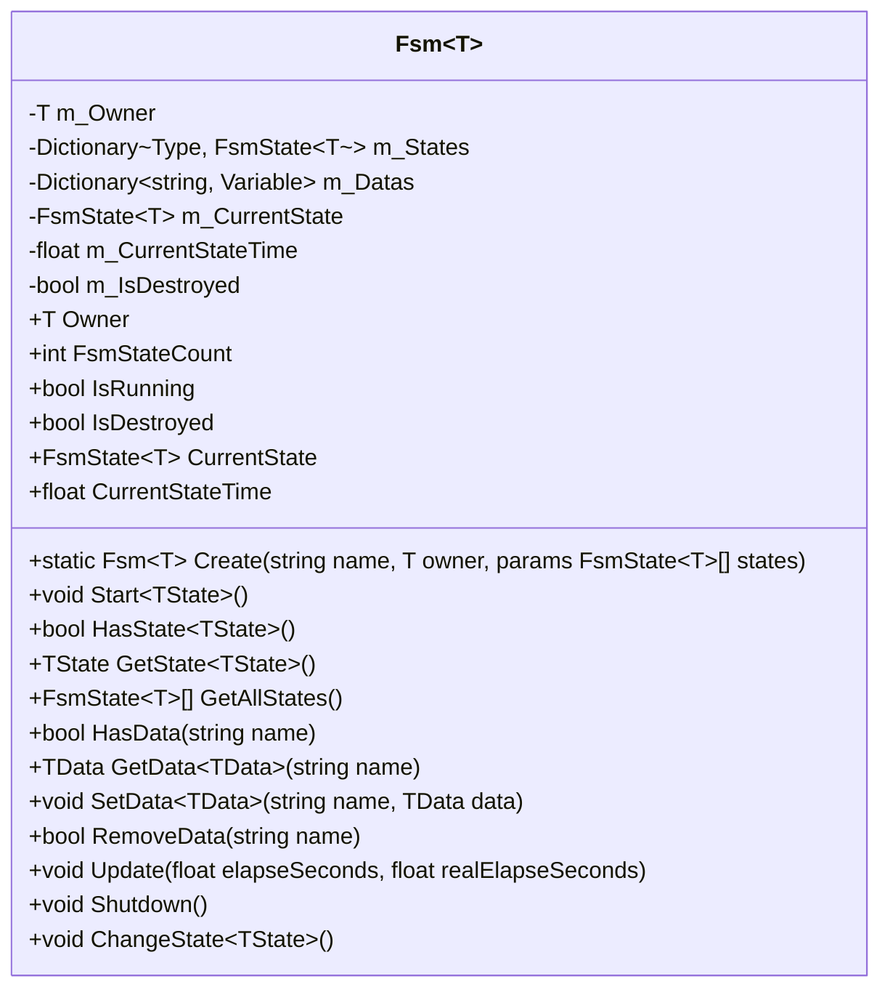
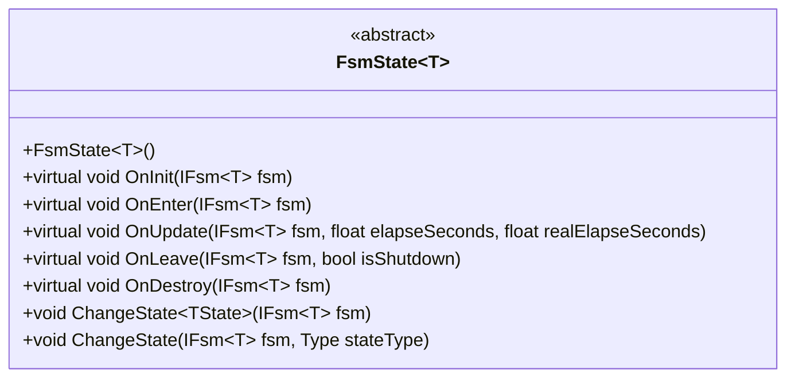
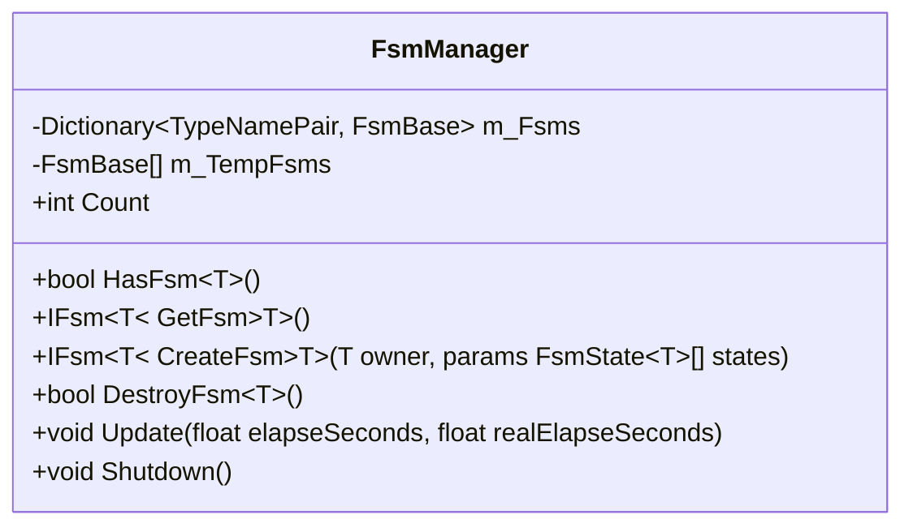
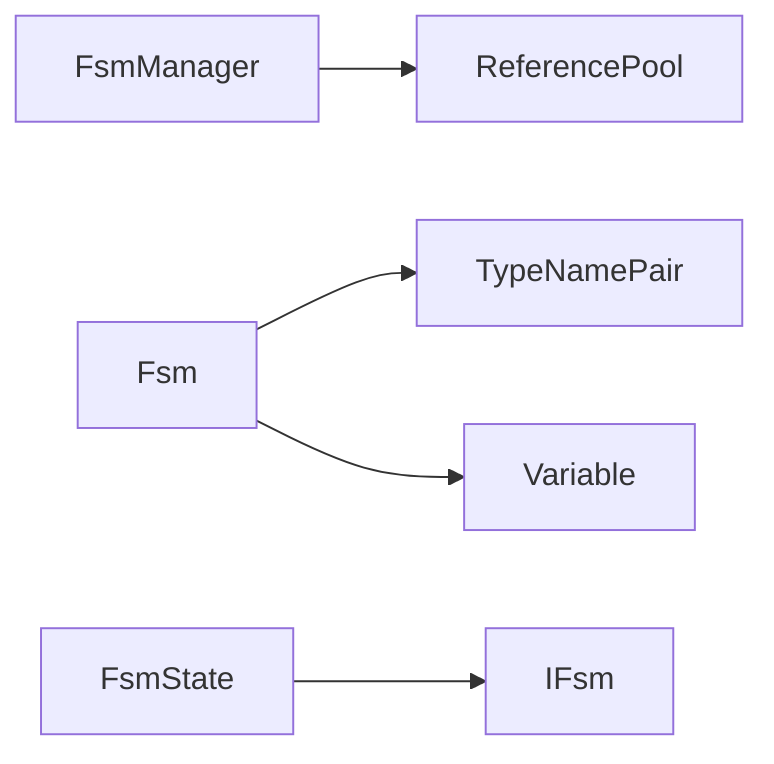

# 有限状态机

<cite>
**本文档中引用的文件**  
- [IFsm.cs](file://GameFramework/Fsm/IFsm.cs)
- [Fsm.cs](file://GameFramework/Fsm/Fsm.cs)
- [FsmState.cs](file://GameFramework/Fsm/FsmState.cs)
- [FsmManager.cs](file://GameFramework/Fsm/FsmManager.cs)
</cite>

## 目录
1. [简介](#简介)
2. [核心组件](#核心组件)
3. [架构概述](#架构概述)
4. [详细组件分析](#详细组件分析)
5. [依赖分析](#依赖分析)
6. [性能考虑](#性能考虑)
7. [故障排除指南](#故障排除指南)
8. [结论](#结论)

## 简介
有限状态机（FSM）模块为游戏开发提供了一种结构化的方式来管理对象的状态和状态转换。该模块支持状态定义、状态机创建、状态转换、事件驱动、嵌套状态机等核心功能，广泛应用于角色控制、AI行为、UI流程等场景。通过清晰的接口和实现，FSM模块确保了状态管理的高效性和可维护性。

## 核心组件
FSM模块的核心组件包括`IFsm`、`Fsm`、`FsmState`和`FsmManager`。这些组件共同构成了一个完整的状态机系统，支持状态的定义、转换和管理。

**Section sources**
- [IFsm.cs](file://GameFramework/Fsm/IFsm.cs)
- [Fsm.cs](file://GameFramework/Fsm/Fsm.cs)
- [FsmState.cs](file://GameFramework/Fsm/FsmState.cs)
- [FsmManager.cs](file://GameFramework/Fsm/FsmManager.cs)

## 架构概述
FSM模块的架构由状态机管理器、状态机实例和状态类组成。`FsmManager`负责管理所有状态机实例，`Fsm`表示具体的状态机，而`FsmState`定义了状态的行为。

```mermaid
graph TB
subgraph "FSM模块"
FsmManager["FsmManager<br/>状态机管理器"]
Fsm["Fsm<T><br/>具体状态机"]
FsmState["FsmState<T><br/>状态基类"]
end
FsmManager --> Fsm : "创建、管理"
Fsm --> FsmState : "包含多个状态"
```

**Diagram sources**
- [FsmManager.cs](file://GameFramework/Fsm/FsmManager.cs)
- [Fsm.cs](file://GameFramework/Fsm/Fsm.cs)
- [FsmState.cs](file://GameFramework/Fsm/FsmState.cs)

## 详细组件分析
### IFsm 接口分析
`IFsm<T>`接口定义了有限状态机的基本操作，包括获取状态机名称、持有者、当前状态，以及启动、检查和获取状态等方法。



**Diagram sources**
- [IFsm.cs](file://GameFramework/Fsm/IFsm.cs)

**Section sources**
- [IFsm.cs](file://GameFramework/Fsm/IFsm.cs)

### Fsm 类分析
`Fsm<T>`类实现了`IFsm<T>`接口，提供了状态机的具体实现。它管理状态集合、当前状态、状态数据，并处理状态的初始化、进入、更新和离开。



**Diagram sources**
- [Fsm.cs](file://GameFramework/Fsm/Fsm.cs)

**Section sources**
- [Fsm.cs](file://GameFramework/Fsm/Fsm.cs)

### FsmState 类分析
`FsmState<T>`类是所有状态的基类，定义了状态的生命周期方法，包括初始化、进入、更新、离开和销毁。子类可以通过重写这些方法来实现具体的状态行为。



**Diagram sources**
- [FsmState.cs](file://GameFramework/Fsm/FsmState.cs)

**Section sources**
- [FsmState.cs](file://GameFramework/Fsm/FsmState.cs)

### FsmManager 类分析
`FsmManager`类负责管理所有状态机实例，提供创建、获取、销毁状态机的功能，并在每帧更新所有运行中的状态机。



**Diagram sources**
- [FsmManager.cs](file://GameFramework/Fsm/FsmManager.cs)

**Section sources**
- [FsmManager.cs](file://GameFramework/Fsm/FsmManager.cs)

## 依赖分析
FSM模块依赖于`ReferencePool`进行对象池管理，`TypeNamePair`用于唯一标识状态机，以及`Variable`用于存储状态机数据。这些依赖确保了状态机的高效创建和销毁，以及数据的安全管理。



**Diagram sources**
- [FsmManager.cs](file://GameFramework/Fsm/FsmManager.cs)
- [Fsm.cs](file://GameFramework/Fsm/Fsm.cs)
- [FsmState.cs](file://GameFramework/Fsm/FsmState.cs)

**Section sources**
- [FsmManager.cs](file://GameFramework/Fsm/FsmManager.cs)
- [Fsm.cs](file://GameFramework/Fsm/Fsm.cs)
- [FsmState.cs](file://GameFramework/Fsm/FsmState.cs)

## 性能考虑
FSM模块通过对象池（`ReferencePool`）减少了频繁的内存分配和垃圾回收，提高了性能。状态机的更新操作在`FsmManager`中批量处理，减少了每帧的调用开销。此外，状态机的状态转换和数据访问都经过优化，确保了高效的运行。

## 故障排除指南
在使用FSM模块时，常见的问题包括状态机无法启动、状态转换失败和数据访问异常。这些问题通常由状态定义错误、状态机持有者为空或数据名称无效引起。建议在创建状态机时检查持有者和状态集合的有效性，并在访问数据时验证数据名称。

**Section sources**
- [Fsm.cs](file://GameFramework/Fsm/Fsm.cs)
- [FsmState.cs](file://GameFramework/Fsm/FsmState.cs)
- [IFsm.cs](file://GameFramework/Fsm/IFsm.cs)

## 结论
FSM模块提供了一个强大且灵活的状态管理解决方案，适用于各种游戏开发场景。通过清晰的接口设计和高效的实现，该模块确保了状态管理的可靠性和性能。开发者可以利用该模块轻松实现复杂的角色控制、AI行为和UI流程。