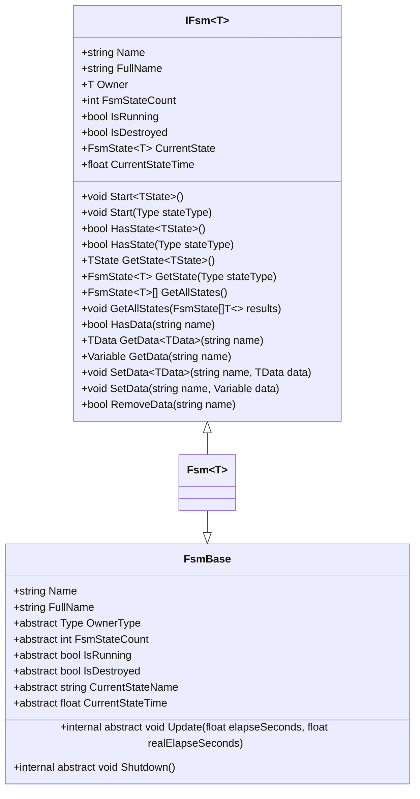
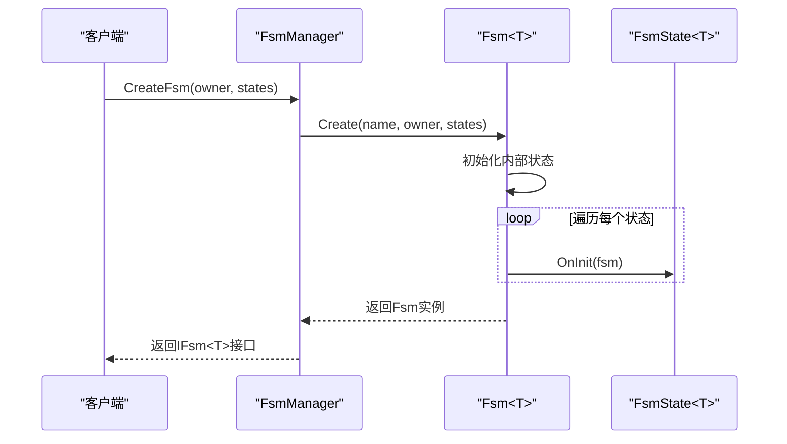
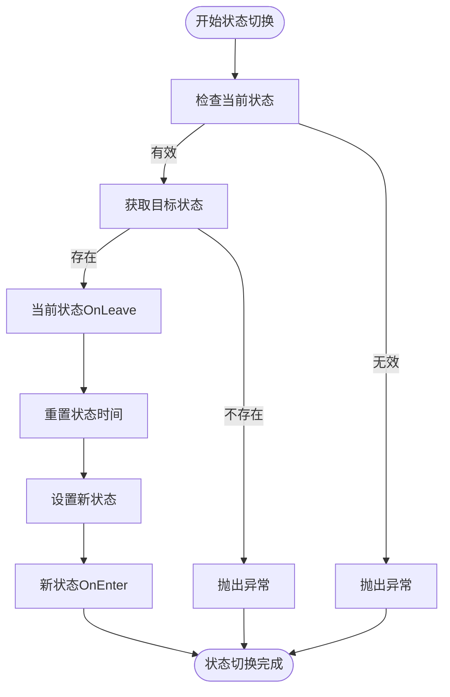
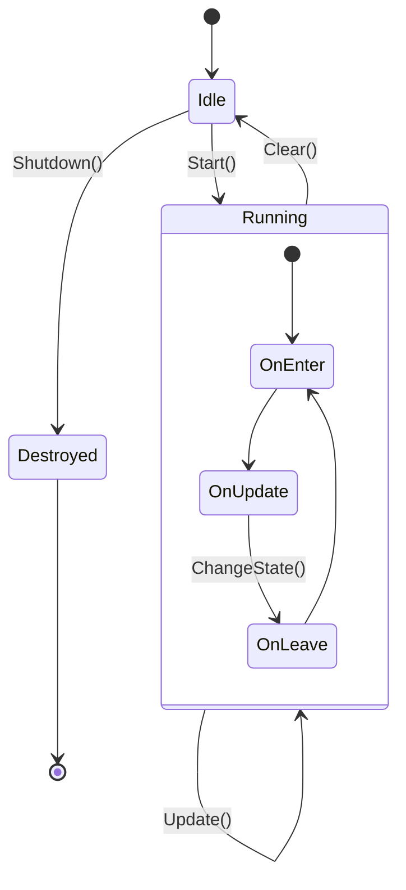

# 有限状态机概述

<cite>
**Referenced Files in This Document**   
- [Fsm.cs](file://GameFramework/Fsm/Fsm.cs)
- [FsmBase.cs](file://GameFramework/Fsm/FsmBase.cs)
- [IFsm.cs](file://GameFramework/Fsm/IFsm.cs)
- [FsmManager.cs](file://GameFramework/Fsm/FsmManager.cs)
- [FsmState.cs](file://GameFramework/Fsm/FsmState.cs)
</cite>

## 目录
1. [简介](#简介)
2. [核心架构](#核心架构)
3. [状态机实现](#状态机实现)
4. [状态管理](#状态管理)
5. [生命周期管理](#生命周期管理)
6. [数据管理](#数据管理)
7. [集成与应用](#集成与应用)
8. [性能与线程安全](#性能与线程安全)
9. [使用模式](#使用模式)

## 简介

有限状态机（Finite State Machine, FSM）模块是游戏开发中用于管理复杂行为逻辑的核心组件。该模块通过定义清晰的状态和状态转换规则，为游戏实体、流程控制等提供了一种结构化的编程范式。在游戏开发中，有限状态机广泛应用于角色行为控制、游戏流程管理、UI状态切换等场景，能够有效降低代码复杂度，提高可维护性和可扩展性。

FSM模块的设计目标是提供一个高效、灵活且易于使用的状态机框架，支持在运行时动态创建和管理多个状态机实例。通过将状态逻辑与持有者分离，实现了关注点分离的设计原则，使得状态机可以被复用在不同的游戏对象上。该模块与其他系统（如实体管理、流程管理）紧密集成，为构建复杂的游戏逻辑提供了坚实的基础。

## 核心架构

FSM模块的核心架构由`IFsm`接口和`FsmBase`抽象基类共同定义，形成了一个清晰的契约与实现分离的设计模式。`IFsm<T>`接口定义了有限状态机的公共契约，包括状态管理、数据访问和生命周期控制等核心功能，而`FsmBase`则提供了状态机的基本属性和抽象方法，为具体实现奠定了基础。

**Diagram sources**
- [IFsm.cs](file://GameFramework/Fsm/IFsm.cs#L16-L177)
- [FsmBase.cs](file://GameFramework/Fsm/FsmBase.cs#L14-L111)

**Section sources**
- [IFsm.cs](file://GameFramework/Fsm/IFsm.cs#L16-L177)
- [FsmBase.cs](file://GameFramework/Fsm/FsmBase.cs#L14-L111)

## 状态机实现

`Fsm<T>`类是有限状态机的具体实现，它继承自`FsmBase`并实现了`IFsm<T>`接口。该类通过泛型参数`T`指定状态机的持有者类型，实现了类型安全的状态机管理。`Fsm<T>`使用字典结构`m_States`来存储和管理所有状态，确保了状态查找的高效性。

状态机的创建通过静态`Create`方法完成，该方法接受持有者对象和状态集合作为参数。在创建过程中，状态机会对每个状态调用`OnInit`方法进行初始化，并将状态注册到内部的状态字典中。这种设计使得状态机可以在运行时动态构建，适应不同的游戏场景需求。

**Diagram sources**
- [Fsm.cs](file://GameFramework/Fsm/Fsm.cs#L16-L586)
- [FsmManager.cs](file://GameFramework/Fsm/FsmManager.cs#L15-L409)

**Section sources**
- [Fsm.cs](file://GameFramework/Fsm/Fsm.cs#L16-L586)
- [FsmManager.cs](file://GameFramework/Fsm/FsmManager.cs#L15-L409)

## 状态管理

状态管理是有限状态机的核心功能之一，`Fsm<T>`类提供了完整的方法集来支持状态的注册、查询和切换。通过`HasState`和`GetState`方法，可以检查特定状态是否存在并获取其引用。状态切换通过`Start`方法启动状态机，通过`ChangeState`方法在运行时切换到新状态。

状态切换过程遵循严格的生命周期管理：当前状态会先执行`OnLeave`回调，然后新状态执行`OnEnter`回调。这种设计确保了状态转换的原子性和一致性，避免了状态混乱。状态机还提供了`GetAllStates`方法，允许外部代码获取所有注册的状态，便于调试和监控。

**Diagram sources**
- [Fsm.cs](file://GameFramework/Fsm/Fsm.cs#L564-L587)
- [FsmState.cs](file://GameFramework/Fsm/FsmState.cs#L15-L108)

**Section sources**
- [Fsm.cs](file://GameFramework/Fsm/Fsm.cs#L16-L586)
- [FsmState.cs](file://GameFramework/Fsm/FsmState.cs#L15-L108)

## 生命周期管理

有限状态机的生命周期管理贯穿于其整个运行过程，从创建到销毁都有明确的控制机制。`Fsm<T>`类通过`IsRunning`属性跟踪状态机的运行状态，确保不会重复启动。状态机的更新通过`Update`方法实现，该方法在每帧调用时递增当前状态的持续时间，并触发`OnUpdate`回调。

当状态机被销毁时，`Clear`方法会依次调用所有状态的`OnDestroy`方法，确保资源的正确释放。`Shutdown`方法则负责将状态机实例归还到引用池中，实现了对象的复用，减少了垃圾回收的压力。这种生命周期管理机制保证了状态机的稳定性和性能。

**Diagram sources**
- [Fsm.cs](file://GameFramework/Fsm/Fsm.cs#L528-L562)
- [FsmBase.cs](file://GameFramework/Fsm/FsmBase.cs#L60-L112)

**Section sources**
- [Fsm.cs](file://GameFramework/Fsm/Fsm.cs#L16-L586)
- [FsmBase.cs](file://GameFramework/Fsm/FsmBase.cs#L14-L111)

## 数据管理

有限状态机提供了灵活的数据管理机制，允许在状态机内部存储和共享数据。通过`SetData`、`GetData`和`HasData`等方法，可以在状态机中存储任意类型的`Variable`对象。这些数据可以在不同状态之间共享，为状态转换提供了上下文信息。

数据管理采用字典结构`m_Datas`实现，确保了数据访问的高效性。当设置新数据时，如果存在同名旧数据，会先将其释放回引用池，避免内存泄漏。这种设计既保证了数据的安全性，又实现了资源的有效管理，是状态机能够处理复杂逻辑的重要支撑。

**Section sources**
- [Fsm.cs](file://GameFramework/Fsm/Fsm.cs#L400-L482)
- [IFsm.cs](file://GameFramework/Fsm/IFsm.cs#L134-L178)

## 集成与应用

有限状态机模块通过`FsmManager`与其他系统集成，实现了全局状态机的统一管理。`FsmManager`作为游戏框架模块，负责所有状态机的创建、更新和销毁。它在每帧调用时遍历所有活动状态机，调用其`Update`方法，确保了状态机的及时响应。

在游戏开发中，该模块常用于流程管理、实体控制等场景。例如，在角色控制中，可以定义"空闲"、"行走"、"攻击"等状态，通过条件触发状态转换；在游戏流程中，可以管理"开始界面"、"游戏进行"、"游戏结束"等状态，实现流程的有序切换。这种应用模式使得复杂的游戏逻辑变得清晰可控。

**Section sources**
- [FsmManager.cs](file://GameFramework/Fsm/FsmManager.cs#L52-L93)
- [Fsm.cs](file://GameFramework/Fsm/Fsm.cs#L528-L562)

## 性能与线程安全

该有限状态机模块在设计时充分考虑了性能优化，通过引用池（ReferencePool）机制实现了状态机对象的复用，减少了内存分配和垃圾回收的开销。状态机的更新采用批量处理方式，在`FsmManager`的`Update`方法中先收集所有活动状态机，再逐一更新，避免了在遍历过程中修改集合的风险。

关于线程安全，从代码分析来看，该模块主要设计用于单线程环境（如Unity主线程）。虽然在其他模块中发现了锁机制的使用（如EventPool和ReferencePool），但在FSM相关代码中未发现显式的线程同步处理。因此，建议在单线程上下文中使用该状态机模块，以确保线程安全和性能最优。

**Section sources**
- [FsmManager.cs](file://GameFramework/Fsm/FsmManager.cs#L52-L93)
- [Fsm.cs](file://GameFramework/Fsm/Fsm.cs#L28-L36)
- [Base/EventPool/EventPool.cs](file://GameFramework/Base/EventPool/EventPool.cs#L68)

## 使用模式

有限状态机的基本使用模式包括创建、启动和状态切换三个主要步骤。首先通过`FsmManager.CreateFsm`方法创建状态机实例，传入持有者对象和状态集合；然后调用`Start`方法启动状态机，指定初始状态；最后在状态逻辑中通过`ChangeState`方法实现状态切换。

典型使用模式中，状态类通常继承自`FsmState<T>`，并重写`OnEnter`、`OnUpdate`和`OnLeave`等生命周期方法。在`OnUpdate`中检查转换条件，在满足条件时调用`ChangeState`切换到新状态。这种模式使得状态逻辑清晰分离，便于维护和扩展，是游戏开发中推荐的最佳实践。

**Section sources**
- [FsmManager.cs](file://GameFramework/Fsm/FsmManager.cs#L220-L260)
- [Fsm.cs](file://GameFramework/Fsm/Fsm.cs#L150-L190)
- [FsmState.cs](file://GameFramework/Fsm/FsmState.cs#L50-L70)