# 状态定义与管理

<cite>
**Referenced Files in This Document**   
- [FsmState.cs](file://GameFramework/Fsm/FsmState.cs)
- [Fsm.cs](file://GameFramework/Fsm/Fsm.cs)
- [IFsm.cs](file://GameFramework/Fsm/IFsm.cs)
- [ReferencePool.cs](file://GameFramework/Base/ReferencePool/ReferencePool.cs)
</cite>

## 目录
1. [简介](#简介)
2. [核心组件](#核心组件)
3. [状态生命周期管理](#状态生命周期管理)
4. [状态与宿主绑定机制](#状态与宿主绑定机制)
5. [状态间数据共享](#状态间数据共享)
6. [实际应用场景](#实际应用场景)
7. [最佳实践](#最佳实践)

## 简介
本文档深入探讨了游戏框架中状态管理子系统的设计与实现，重点分析`FsmState`类的架构与使用方法。文档详细解释了如何定义具体的状态类并实现其进入（OnEnter）、执行（OnUpdate）、退出（OnLeave）等生命周期方法。同时，文档阐述了状态与宿主对象的绑定机制以及状态间共享数据的方式，并提供了在角色AI、UI界面切换等实际场景中创建和管理状态的代码示例。

## 核心组件

状态管理系统由`FsmState`和`Fsm`两个核心类构成。`FsmState<T>`是所有具体状态类的抽象基类，通过泛型参数`T`指定状态机的持有者类型。`Fsm<T>`则是有限状态机的具体实现，负责管理状态的创建、切换和生命周期。

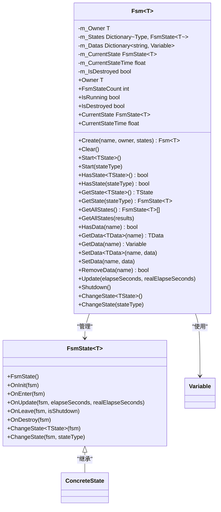

**Diagram sources**
- [FsmState.cs](file://GameFramework/Fsm/FsmState.cs#L15-L108)
- [Fsm.cs](file://GameFramework/Fsm/Fsm.cs#L16-L586)

**Section sources**
- [FsmState.cs](file://GameFramework/Fsm/FsmState.cs#L15-L108)
- [Fsm.cs](file://GameFramework/Fsm/Fsm.cs#L16-L586)

## 状态生命周期管理

### 状态生命周期方法
`FsmState<T>`类定义了五个关键的生命周期方法，这些方法在状态的不同阶段被自动调用：

- **OnInit**: 状态初始化时调用，用于执行一次性的初始化操作
- **OnEnter**: 状态进入时调用，用于准备状态所需的资源和数据
- **OnUpdate**: 状态轮询时调用，用于处理状态的持续逻辑
- **OnLeave**: 状态离开时调用，用于清理状态占用的资源
- **OnDestroy**: 状态销毁时调用，用于执行最终的清理工作

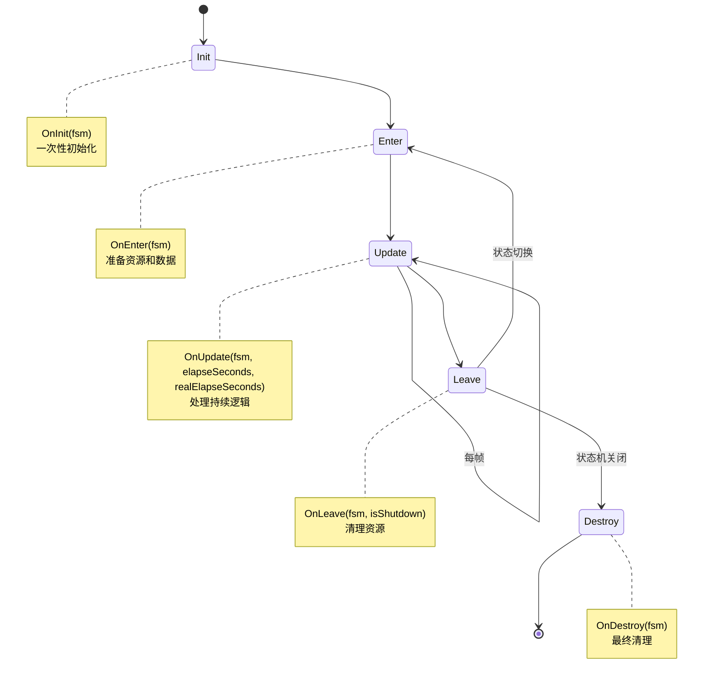

**Diagram sources**
- [FsmState.cs](file://GameFramework/Fsm/FsmState.cs#L30-L70)

**Section sources**
- [FsmState.cs](file://GameFramework/Fsm/FsmState.cs#L30-L70)

### 状态切换流程
状态切换是通过`Fsm<T>`类的`ChangeState`方法实现的。当调用此方法时，系统会按照严格的顺序执行状态切换流程：

1. 调用当前状态的`OnLeave`方法
2. 重置当前状态的计时器
3. 更新当前状态引用
4. 调用新状态的`OnEnter`方法

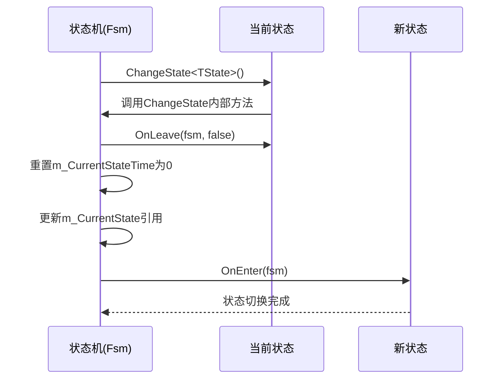

**Diagram sources**
- [Fsm.cs](file://GameFramework/Fsm/Fsm.cs#L568-L585)

**Section sources**
- [Fsm.cs](file://GameFramework/Fsm/Fsm.cs#L568-L585)

## 状态与宿主绑定机制

### 宿主对象绑定
每个`Fsm<T>`实例都与一个特定类型的宿主对象绑定，这个宿主对象通过泛型参数`T`指定。宿主对象在创建状态机时提供，并在整个状态机生命周期内保持不变。

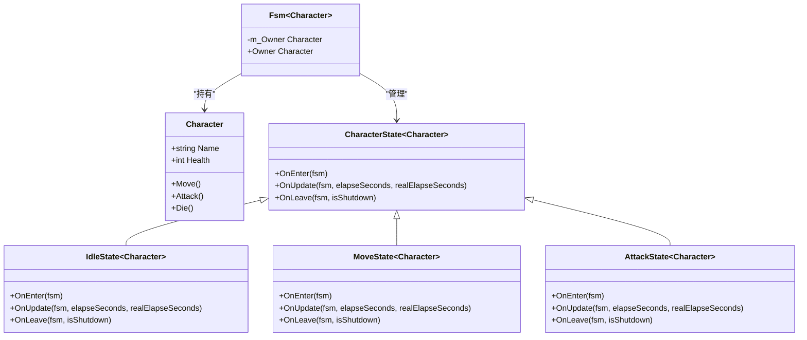

**Diagram sources**
- [Fsm.cs](file://GameFramework/Fsm/Fsm.cs#L28-L36)

**Section sources**
- [Fsm.cs](file://GameFramework/Fsm/Fsm.cs#L28-L36)

### 状态机创建流程
状态机的创建通过`Fsm<T>.Create`静态方法完成。该方法接收状态机名称、宿主对象和状态集合作为参数，返回一个已初始化的状态机实例。

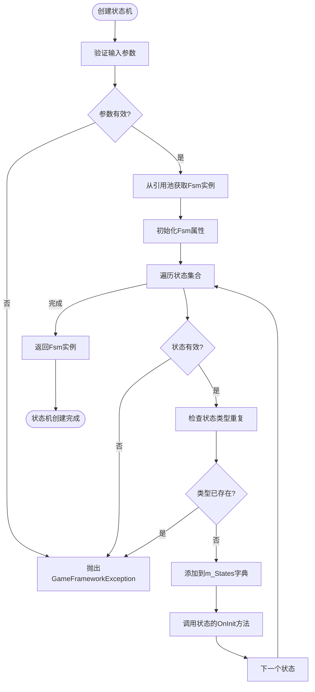

**Diagram sources**
- [Fsm.cs](file://GameFramework/Fsm/Fsm.cs#L133-L167)

**Section sources**
- [Fsm.cs](file://GameFramework/Fsm/Fsm.cs#L133-L167)

## 状态间数据共享

### 数据存储机制
状态机通过`m_Datas`字典实现状态间的数据共享。该字典以字符串为键，`Variable`对象为值，允许在不同状态之间传递和共享数据。

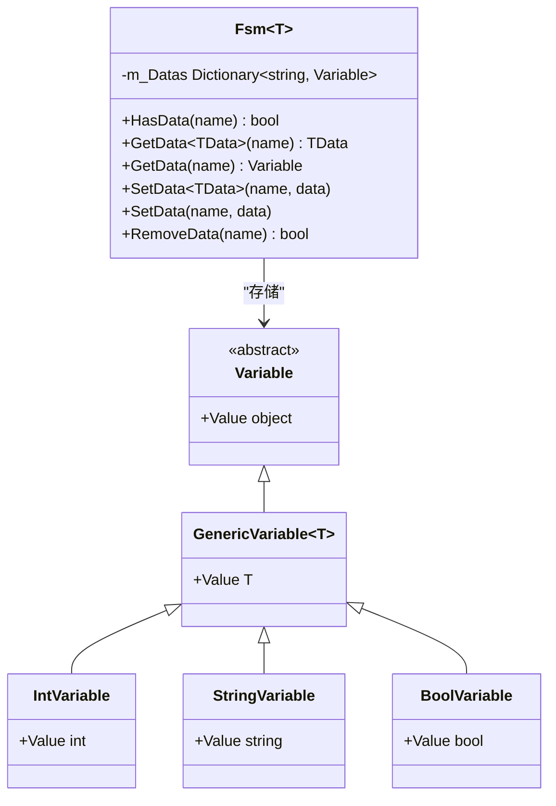

**Diagram sources**
- [Fsm.cs](file://GameFramework/Fsm/Fsm.cs#L28-L36)
- [Fsm.cs](file://GameFramework/Fsm/Fsm.cs#L400-L470)

**Section sources**
- [Fsm.cs](file://GameFramework/Fsm/Fsm.cs#L400-L470)

### 数据操作流程
状态机提供了完整的数据操作接口，包括数据的设置、获取、检查和移除。所有数据操作都会通过引用池进行管理，确保资源的有效利用。

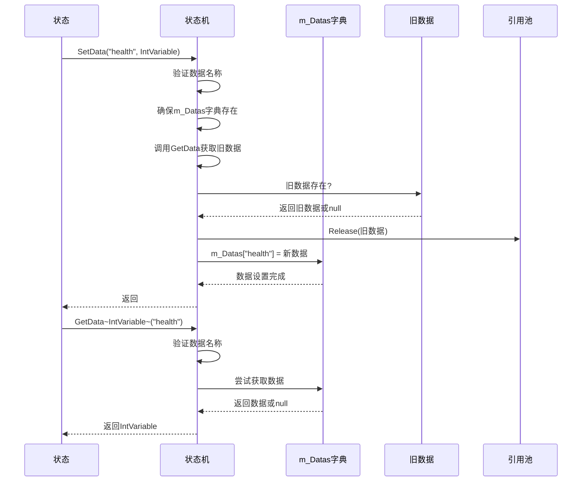

**Diagram sources**
- [Fsm.cs](file://GameFramework/Fsm/Fsm.cs#L400-L470)
- [ReferencePool.cs](file://GameFramework/Base/ReferencePool/ReferencePool.cs#L100-L120)

**Section sources**
- [Fsm.cs](file://GameFramework/Fsm/Fsm.cs#L400-L470)

## 实际应用场景

### 角色AI状态管理
在角色AI系统中，可以使用状态机管理角色的不同行为状态，如巡逻、追击、攻击和逃跑等。

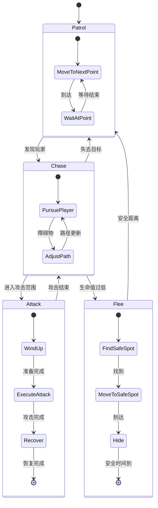

**Section sources**
- [FsmState.cs](file://GameFramework/Fsm/FsmState.cs#L15-L108)
- [Fsm.cs](file://GameFramework/Fsm/Fsm.cs#L16-L586)

### UI界面切换
在UI系统中，状态机可以用于管理不同界面的状态切换，如主菜单、设置界面、游戏界面等。

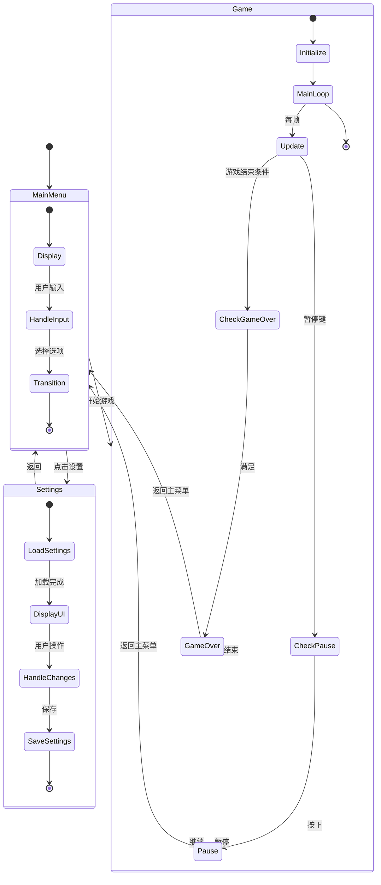

**Section sources**
- [FsmState.cs](file://GameFramework/Fsm/FsmState.cs#L15-L108)
- [Fsm.cs](file://GameFramework/Fsm/Fsm.cs#L16-L586)

## 最佳实践

### 状态定义规范
定义具体状态类时，应遵循以下最佳实践：

1. **明确职责**: 每个状态应有清晰的职责和行为边界
2. **最小化依赖**: 状态应尽量减少对其他系统或状态的直接依赖
3. **资源管理**: 在`OnEnter`中申请资源，在`OnLeave`中释放资源
4. **异常处理**: 在关键操作中添加适当的异常处理机制

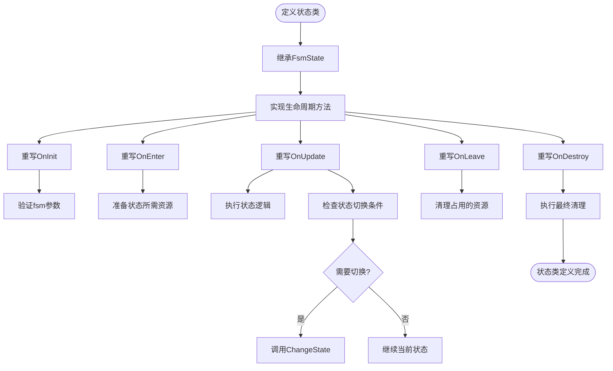

**Section sources**
- [FsmState.cs](file://GameFramework/Fsm/FsmState.cs#L15-L108)

### 参数传递与初始化
在创建和初始化状态机时，应注意以下要点：

1. **参数验证**: 确保所有输入参数的有效性
2. **状态去重**: 避免添加重复的状态类型
3. **引用池利用**: 利用引用池提高对象创建和销毁的效率
4. **错误处理**: 提供清晰的错误信息和异常处理机制

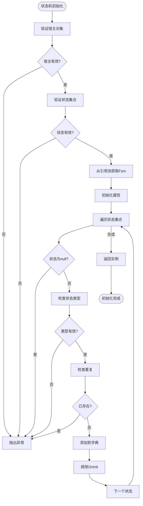

**Diagram sources**
- [Fsm.cs](file://GameFramework/Fsm/Fsm.cs#L133-L167)
- [ReferencePool.cs](file://GameFramework/Base/ReferencePool/ReferencePool.cs#L100-L120)

**Section sources**
- [Fsm.cs](file://GameFramework/Fsm/Fsm.cs#L133-L167)